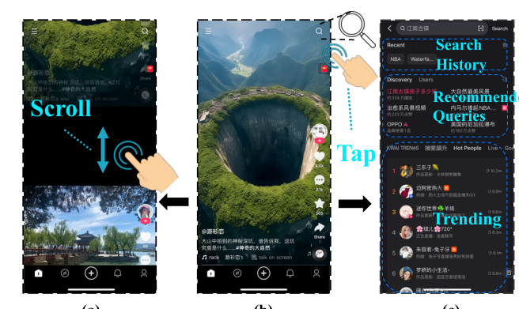
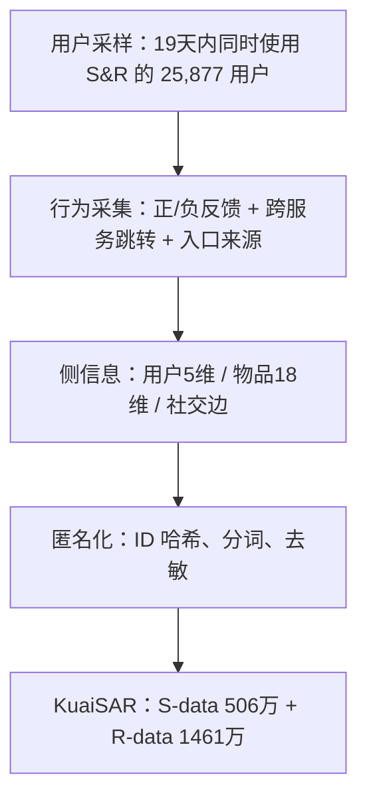
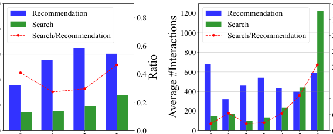

# KuaiSAR: A Unified Search And Recommendation Dataset (统一搜索与推荐数据集)

- **会议/期刊**: CIKM 2023 (Resource Track)
- **作者与机构**: Zhongxiang Sun, Zihua Si, Xiao Zhang, Jun Xu (中国人民大学高瓴人工智能学院)；Xiaoxue Zang, Dewei Leng, Yanan Niu, Yang Song (快手科技)
- **推荐链路定位**: 数据基座 / 端到端（召回—精排—重排全链路联合建模的评测底座）
- **研究方向**: 工业级架构与评测基准 / 跨域多场景推荐
- **论文原文**: [https://arxiv.org/abs/2306.07705v4](https://arxiv.org/abs/2306.07705v4)
- **开源代码**: 暂未开源（数据集主页 [https://ethan00si.github.io/KuaiSAR/](https://ethan00si.github.io/KuaiSAR/)，Zenodo: [https://zenodo.org/record/8181109](https://zenodo.org/record/8181109)）

## TL;DR (1分钟核心速览)

学术界做搜索-推荐（S&R）联合建模长期只能依赖私有工业日志或 Amazon 伪查询半合成数据。本文发布首个来自快手 App 的大规模真实统一 S&R 数据集 KuaiSAR：25,877 名双服务活跃用户、19 天、1,966 万条交互，首次记录“推荐流中发起搜索”的跨服务跳转与搜索入口来源，为意图推荐、S&R 互增强、多任务与多行为序列建模提供统一底座。

## Background & Motivation (背景与核心矛盾)

- **主流范式**: 工业界已把 S&R 视为一枚硬币的两面，采用统一模型、联合损失，或“以搜助推 / 以推助搜”的双向增强范式。
- **前人局限**: ① 学术界只能用私有日志或半合成数据（Amazon 用商品元数据**伪造 query**），搜索行为是“编”出来的，任何“以搜助推”结论都可能被构造偏差放大；② JDsearch 虽真实，却把推荐与闲逛混为“非搜索行为”，既不区分场景，也不记录搜索入口是主动输入还是点击推荐词。
- **核心洞察 (Key Insight)**: 短视频 App 中两服务已互为入口——推荐流中点击放大镜即发起搜索，搜索页又回推 query（图 1）。真正稀缺的不是“两个域的数据”，而是用户在两域之间的**意图跃迁轨迹**。
- **本文切入点**: 把跨服务跳转与入口来源当作一等公民埋点，开源真实日志，填补“学术界无统一 S&R 数据”的空白。

<figure class="paper-figure" markdown="span">
  <figcaption>图1：快手 App 中集成的 S&amp;R 场景。在观看视频过程中，用户有两种主要交互方式。他们可以利用推荐服务，通过垂直滚动发现多样视频（b）-&gt;（a）。或者，他们可以点击放大镜图标以使用搜索服务（b）-&gt;（c）。</figcaption>
</figure>

## Method (核心方法设计)

### 1. 整体框架 (Overall Architecture)

KuaiSAR 的“方法”是一条数据构建流水线：先圈定 2023-05-22 至 06-10 期间同时使用过搜索与推荐服务的约 2.5 万用户（**仅此一条过滤条件**，不做 k-core，刻意保留活跃度长尾），再采集正向与负向交互、跨服务跳转标签、用户/物品侧信息与社交关系（576 用户有好友边），最后按发布政策做 ID 哈希、分词与敏感词剔除后匿名化落库。产物为 S-data 与 R-data 两个可对齐子集，共享同一批用户与统一时间轴。

### 2. 关键设计拆解 (Key Designs)

1. **跨服务跳转标签（`search` / `search_photo_related`）**：前作只能看到“用户在搜”，看不到“用户是被哪条推荐视频诱发的搜”。本文对每条推荐交互记录是否点击放大镜跳转搜索、query 是否与当前视频相关。形式化地，用户轨迹为 $\mathcal{S}_u=[(a_1,s_1,\tau_1),\dots]$，$s_i\in\{\text{S},\text{R}\}$，联合建模目标可写为$\max\sum_u\sum_i\log P(a_{i+1}\mid a_{\le i},s_{\le i},\tau_{\le i})$——场景标签$s$ 与跳转标签共同回答“何时该跨域迁移兴趣”。
2. **搜索入口来源细分**：区分点击推荐 query、主动输入、点击热搜三类入口。这让 Intent Recommendation 从“预测一个 query 串”升级为“预测在何种入口下推何种 query”，也是唯一能评估“推荐激发搜索”这一闭环的数据。
3. **真实负反馈与多行为标签**：推荐侧保留“曝光但划走”的 skip，搜索侧保留“曝光未点击”，并附点赞/分享/关注/播放时长等 9 类反馈及时间戳。无需负采样即可还原真实曝光分布，直接支撑 CTR 校准、多任务学习与多行为序列建模。

### 3. 训练目标、负采样与推理效率

论文为资源论文，未给出模型、损失或负采样策略。笔记层面的推荐用法：以时间戳做**全局时间切分**防穿越；推荐任务用曝光未点击作真负样本 + 全库排序评估；跨域任务用 $s_i$ 做场景门控（类似多场景模型中的场景塔）。

## Experimental Setup & Evaluation Protocol (实验设置与评估协议)

- **数据集统计（原文 Table 1）**:

| 子集 | #Users | #Items | #Queries | #Actions |
| :--- | :---: | :---: | :---: | :---: |
| S-data | 25,877 | 3,026,189 | 453,667 | 5,059,169 |
| R-data | 25,877 | 4,046,367 | – | 14,605,716 |
| 合计 | 25,877 | 6,890,707 | 453,667 | 19,664,885 |

- **过滤方式**: 仅“窗口内同时使用过 S&R 服务”一条，无 5-core 截断，用户活跃度分布覆盖完整长尾。
- **数据划分与防穿越**: 论文**未提供官方 train/val/test 划分**，仅提供带时间戳原始日志；使用者须自行按 $\tau$ 做全局时间切分。
- **排名评测协议**: 未内置 Full-Ranking 或 Sampled Ranking 基准，也未附 baseline 数值；作者仅列出可支撑任务清单（意图推荐、S&R 互增强、多任务、多行为序列）。
- **对比基线与超参**: 无模型实验，故无 Embedding 维度、负采样比与显著性检验设置。

## Key Experimental Results (实验关键数据)

### 1. 数据集横向对比 (Main Results，替代主实验)

| 属性 | MS MARCO | KuaiRec | Amazon | JDsearch | **KuaiSAR** |
| :--- | :---: | :---: | :---: | :---: | :---: |
| 真实 R-action | ✗ | ✓ | ✓ | ✓ | **✓** |
| 真实 S-action | ✓ | ✗ | 伪查询 | ✓ | **✓** |
| #Users | – | 7,176 | 192,403 | 173,831 | **25,877** |
| #Items | 8.8M | 10,728 | 63,001 | 12.9M | **6.89M** |
| #Actions | 0.51M | 17.2M | 1.69M | 26.7M | **19.7M** |
| 场景可区分 | – | – | ✗ | ✗ | **✓** |
| 跨服务跳转 | ✗ | ✗ | ✗ | ✗ | **✓** |

### 2. 消融实验 (Ablation Study)

不适用：本文不训练模型、无组件消融。等价“消融”体现为表 2 的属性逐项对比——去掉跳转标签即退化为 JDsearch，去掉真实搜索行为即退化为 Amazon 伪查询，去掉推荐行为即退化为 MS MARCO。

### 3. 关键实验发现 (Key Findings)

**发现一：两域物品池几乎不重叠。** $3.03\text{M}+4.05\text{M}-6.89\text{M}\approx18.2$ 万，交集仅占全库 2.6%。这意味着“以搜助推”的增益主要来自搜索 query 对**长尾/冷启动物品**的语义补全，而非热门物品的共现信号放大。

**发现二：搜索行为稀疏但意图强度高。** 推荐交互 1461 万 vs 搜索 506 万（约 2.9:1），人均推荐 564 次、搜索 195 次，平均每条 query 仅 11.1 次交互。结合图 2，推荐活跃度最高与最低组、以及高搜索活跃组的搜索占比反而更高——说明联合训练必须按活跃度分桶，否则会被推荐重度用户主导。

<figure class="paper-figure" markdown="span">
  <figcaption>图2：S&amp;R 场景中用户交互的分布。活跃度越高表示用户参与度越高。红线表示搜索交互次数与推荐交互次数的比值。</figcaption>
</figure>

**发现三：标签即任务，一份日志可导出三套监督。** 9 类推荐反馈 + 双侧曝光未点击负样本 + 入口来源，使同一份数据可同时构造 CTR 预估、多任务多目标与意图推荐标签；相较 JDsearch 无法区分推荐/闲逛，这是最直接的可用性增量。

## Highlights & Limitations (亮点、对比与审稿批判)

- **与代表作对比 (vs. Prior Work)**: vs Amazon——其搜索行为由商品元数据合成，联合建模结论天然有构造偏差；vs JDsearch——真实但非搜索行为不分场景，无法研究跳转；vs KuaiRec——仅覆盖推荐域。KuaiSAR 是唯一同时具备真实双域行为 + 场景标签 + 入口来源 + 跨服务跳转的数据。
- **可迁移亮点**: ①“当前视频 → 是否触发搜索 → query 是否相关”的三元埋点范式，可直接迁移到电商详情页→比价/客服、内容页→外链等跨场景跳转建模；②保留曝光未点击的真负样本，避免负采样引入的流行度偏差，利于 CTR 校准研究。
- **审稿级局限批判**: ①**文本全量哈希为整数 ID**，query 与视频标题无法还原，直接封死语义匹配、LLM4Rec 与跨模态预训练类研究，是最大硬伤；②仅 19 天、2.6 万用户且无官方划分与 baseline，跨论文可比性依赖社区自建 benchmark；③未提供曝光位置、排序位次等去偏必需字段，位置偏差仍会干扰 CTR 类结论。

## Rating (四维评分)

- **方法创新性 (Novelty)**: ⭐⭐⭐ （非算法创新，但“跨服务跳转 + 入口来源”埋点在该数据集方向属首次，工程洞察强于理论贡献）
- **评估协议与实验扎实度 (Protocol & Experiments)**: ⭐⭐ （无官方划分、无 baseline、无显著性检验，资源论文属性明显，可比性需社区补建）
- **写作与数学规范度 (Clarity & Rigor)**: ⭐⭐⭐⭐ （统计口径、字段含义、与前作差异交代清晰，5 页短文信息密度高；缺形式化任务定义与复杂度讨论）
- **工业落地与复现价值 (Industrial & Practical Value)**: ⭐⭐⭐⭐ （真实工业日志 + 明确获取渠道，对 S&R 联合建模与意图推荐复现价值高；文本哈希化削弱可复用面）

