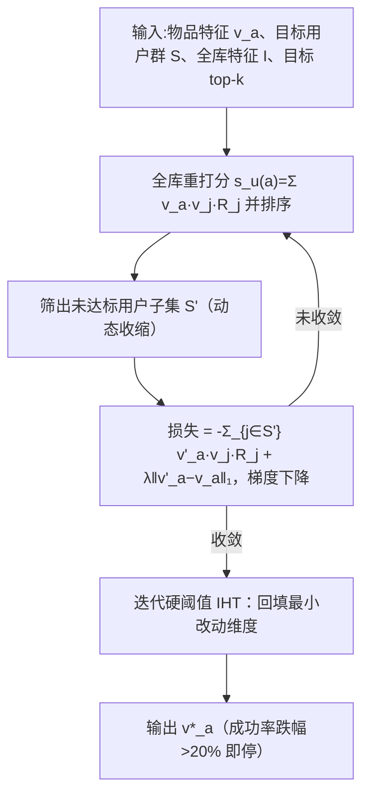
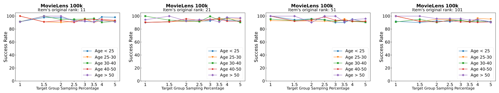

# RecRec: Algorithmic Recourse for Recommender Systems (面向推荐系统的算法补救)

- **会议/期刊**: CIKM 2023 (Short Paper)
- **作者与机构**: Sahil Verma、Varich Boonsanong、Chirag Shah (University of Washington)；Ashudeep Singh (Pinterest)；John P. Dickerson (University of Maryland)
- **推荐链路定位**: 排序/精排（物品侧特征编辑 → 排名干预，非模型训练环节）
- **研究方向**: 去偏公平、可信隐私与工业架构（多利益相关方可解释性 / 反事实解释）
- **论文原文**: [https://arxiv.org/abs/2308.14916v1](https://arxiv.org/abs/2308.14916v1)
- **开源代码**: 暂未开源

## TL;DR (1分钟核心速览)

现有可解释推荐几乎全部面向终端消费者，回答"为什么给我推这个"，对靠平台排名吃饭的内容提供方毫无可操作性。本文首次把**推荐补救 (algorithmic recourse)** 形式化为约束优化：给定物品原始特征 $\mathbf{v}_a$，求最小改动$\mathbf{v}'_a$ 使其进入目标用户群的 top-10。方法仅需特征空间梯度下降 + L1 稀疏松弛 + 迭代硬阈值，在 MovieLens-100K / AliEC Ads / Goodreads 三个系统的**全库排序**协议下，采样 1% 目标用户即达 80–100% 成功率，且用户推荐列表 RBO 相似度保持 99.43%–99.99%。

## Background & Motivation (背景与核心矛盾)

- **主流范式**: 可解释推荐以**特征归因**为主（"你看过 X 所以推 Y"、Facebook "Why am I seeing this ad?"），输出"哪些特征重要"，服务于消费者；反事实路线（PRINCE、CLEAR、Dean et al. 的 reachability）则通过删改**用户交互历史**来解释 top-1 为何被替换。
- **前人局限**: (1) 归因解释**不可执行**——商家知道"评分重要"却不知道该把描述改成什么样；(2) 反事实解释的干预对象是用户而非物品，且只解释 top-1 的"替换"而非"提升到第 k 位"，与内容提供方"我的商品怎么才能进首页"的诉求错位；reachability 还被限定在矩阵分解架构。
- **核心洞察 (Key Insight)**: 访谈研究（Airbnb 房东、Upwork 自由职业者、Etsy 卖家）显示商家在盲试改价、改描述、改标签，本质是在无梯度信息下盲目搜索特征空间——这正是"带稀疏约束的可行性优化"问题，可用梯度直接求解。
- **本文切入点**: 把"物品特征编辑 → 目标人群排名提升"写成 $\max$打分 s.t.$L_0$ 预算的约束优化，松弛后用梯度下降 + 硬阈值求解，与推荐模型内部结构解耦。

## Method (核心方法设计)

### 1. 整体框架 (Overall Architecture)

RecRec 不训练任何新模型，是一个**事后 (post-hoc)、模型无关的物品侧编辑器**。输入为已训练好的内容过滤式打分器（相似度点积 × 用户评分加权）、全库物品特征、目标用户群 $S$与目标排名$k$。优化循环中，先按当前$\mathbf{v}'_a$对全库重打分并重排序，剔除"已进 top-$k$"的用户得到活跃子集$S'$，只对$S'$计算损失并做一步梯度下降；收敛后再做迭代硬阈值裁剪，输出最终特征$\mathbf{v}^*_a$。整个流程对每个待补救物品独立执行一次。

### 2. 关键设计拆解 (Key Designs)

1. **动态成功子集 $S'$（既提成功率又抑制副作用）**：若对所有目标用户同时优化，已进 top-$k$的用户的梯度会继续把物品往上推，浪费改动预算并扰动他人列表。RecRec 每轮只对尚未达标的$S'$ 求损失：
$\mathcal{L}(\mathbf{v}'_a) = -\sum_{j\in S'}\left(\mathbf{v}'_a{}^\top\mathbf{v}_j \odot R_j\right) + \lambda\|\mathbf{v}'_a-\mathbf{v}_a\|_1$
即"救一个划掉一个"，梯度预算自动流向最难的用户，同时天然限制了推荐列表的漂移。

2. **L1 松弛 + 迭代硬阈值 IHT（稀疏性显式可控）**：$L_0$预算$\|\mathbf{v}'_a-\mathbf{v}_a\|_0\le\epsilon$不可微，论文先松弛为原始目标$\arg\min -\sum_{j\in S}(\cdot)+\lambda\|\cdot\|_1$，但实验发现 L1 只把改动**压小**而不**归零**，商家仍无从落地。收敛后按$|\Delta_i|$ 升序把最小改动维度逐一回填原值，直到成功率相对跌幅超过 20% 才停止——把"稀疏 vs. 有效"的帕累托前沿显式暴露给使用者，这是全文最实用的工程技巧。

3. **训练目标与推理开销**：无训练、无负采样，纯推理期优化。每轮需 $O(|I|\cdot f + |I|\log|I|)$的全库打分排序，成本与物品数线性；但损失只依赖$|S'|$ 个用户，故采样 0.1%–1% 的目标用户即可，无需遍历整个人群。

## Experimental Setup & Evaluation Protocol (实验设置与评估协议)

| 数据集 | #Users | #Items | #Interactions | 密度 | 特征维度/可改特征 |
| :--- | :---: | :---: | :---: | :---: | :--- |
| MovieLens-100K | 1,700 | ~1,000 | 100K | 5.88% | 9,500 维 TF-IDF；仅 movie summary 可改 |
| AliEC Ads | 13,200 | 5,600 | 1.4M | 1.89% | 2,300 维 one-hot+归一化 price；全部可改 |
| Goodreads | 11,200 | 4,300 | 1.3M | 2.70% | 17,400 维 TF-IDF+计数；全部可改 |

- **数据划分与防穿越**: 不涉及训练/测试划分（模型已给定）；物品按**原排名 11/21/51/101**（对目标群平均）取样，且排除"已进入 >1% 用户 top-10"的物品，避免补救退化为无操作。
- **排名评测协议**: 无偏 **Full-Ranking**（对 $|I|$ 全库打分排序，无负采样），成功判据为该物品进入某用户 top-10。
- **对比基线与超参**: **本文没有任何量化 Baseline**——PRINCE / CLEAR / Dean et al. 仅作定性对比，属该方向"首创"论文的典型短板。用户分为 5 个等规模组（年龄或评分数），采样率 0.1%–20%，显著性检验未报告。

## Key Experimental Results (实验关键数据)

### 1. 主实验对比 (Main Results)

| 数据集 | 覆盖原排名 | 最小采样率 | 该采样下成功率 | 峰值条件 | 峰值成功率 |
| :--- | :---: | :---: | :---: | :---: | :---: |
| MovieLens-100K | 11/21/51/101 | **1%** | **100%**（5 组全达标） | 1% 即饱和 | 100% |
| AliEC Ads | 11/21/51/101 | 1% | >80%（多数组/物品） | 20% 采样 | **100%** |
| Goodreads | 11/21/51/101 | **0.5%** | **>90%** | 2–5% 采样 | **100%** |

### 2. 消融/敏感性分析 (Ablation & Sensitivity)

原文未提供组件消融，以下为关键敏感性维度（采样率 ↑ 的联动效应）与副作用指标：

| 配置维度 | MovieLens-100K | AliEC Ads | Goodreads |
| :--- | :---: | :---: | :---: |
| 改动特征占比（最小采样时） | ~45% | ~0.25% | ~0.035% |
| 改动特征占比（最大采样时） | ~15% | ~0.05% | ~0.015% |
| 副作用 RBO (p=0.5) | 99.43% | **99.99%** | 99.92% |
| 成功率 vs 采样率 | 无增益（已饱和） | 80%→100% | 90%→100% |

<figure class="paper-figure" markdown="span">
  <figcaption>图1：在MovieLens-100K上训练的推荐系统中，RecRec对原始排名为11、21、51和101的项目的成功率。从用户组的1%起，在极小采样规模下，RecRec对所有用户组和所有原始排名下的项目均达到100%成功率。</figcaption>
</figure>

### 3. 关键实验发现 (Key Findings)

1. **极小采样即可高覆盖**：仅优化目标群 0.5%–1% 的用户，就能让全群 80%–100% 的用户看到该物品，说明"物品侧特征编辑"对人群的效果高度同质，无需对每个用户单独求梯度——这是方法可工业化的根本原因。
2. **稀疏度受特征表示支配而非算法**：MovieLens 需改动约 45% 维度（稠密语义向量中每维都轻微参与相似度），而 AliEC/Goodreads 仅改动 0.05%–0.25%（稀疏计数特征），两者的"可执行性"相差三个数量级，说明候选特征工程决定了补救能否被商家真正执行。
3. **副作用几乎为零**：RBO 均 >99.4%（AliEC 达 99.99%），证明动态 $S'$ 收缩确实把干预限制在"必要用户"上；同时采样率升高时所需改动单调下降并趋近于零，即"算得越全、改得越少"，揭示了精度–成本的可调折中。

## Highlights & Limitations (亮点、对比与审稿批判)

- **与代表作对比 (vs. Prior Work)**: 相比 PRINCE / CLEAR 等用户侧反事实（改交互历史、只解释 top-1），RecRec 改的是**物品特征**、目标是**任意排名的提升**而非 top-1 替换；相比 Dean et al. 的 reachability（矩阵分解限定、目标是审计过滤气泡），它面向商家、跨内容过滤与协同过滤架构通用，且输出可执行动作而非诊断结论。
- **可迁移亮点**: (1) "动态成功子集 $S'$"是一个通用的**最小副作用干预算子**，可直接移植到定向曝光、去偏重排、创作者扶持等场景；(2) "L1 松弛 + 20% 成功率容忍的 IHT"给出了稀疏可解释干预的标准调参范式。
- **审稿级局限批判**: (1) **缺少任何量化基线**，且打分器仅为点积内容过滤模型，未在神经协同过滤/深度排序模型上验证，方法普适性存疑；(2) 每物品需多次全库重排序，$|I|$ 百万级时开销不可忽略，且特征改动假设"商家可自由改写"，忽略了平台审核、内容一致性与多人博弈（多商家同时优化会互相挤压排名），也未做真实商家 A/B。

## Rating (四维评分)

- **方法创新性 (Novelty)**: ⭐⭐⭐⭐ （首次把 recourse 概念系统性迁移到推荐并提供物品侧形式化，但求解器本身仅为标准惩罚梯度下降 + 硬阈值，技术增量偏薄）
- **评估协议与实验扎实度 (Protocol & Experiments)**: ⭐⭐⭐ （采用无偏 Full-Ranking 与三个真实数据集、多原排名多用户组交叉验证，但完全缺失基线对比、消融与显著性检验，短论文体量所限）
- **写作与数学规范度 (Clarity & Rigor)**: ⭐⭐⭐⭐ （三性质定义清晰、优化式与算法伪码对应严谨、显式讨论 $L_0$→$L_1$→IHT 的松弛链条，代价是缺少收敛性与复杂度证明）
- **工业落地与复现价值 (Industrial & Practical Value)**: ⭐⭐⭐⭐ （仅需推理期梯度、采样 1% 即可生效，可直接做成商家后台"提升曝光建议"工具，但无开源代码且需自建可微打分管线）

