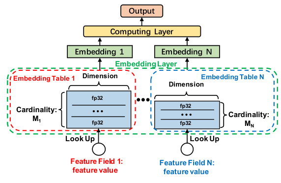
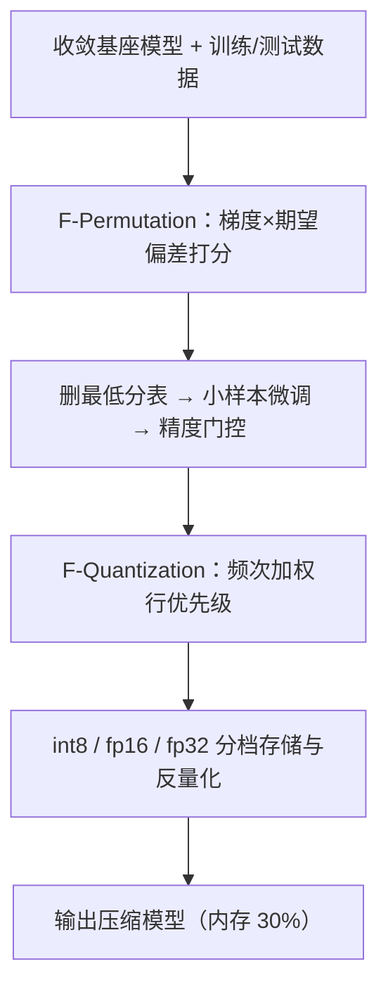
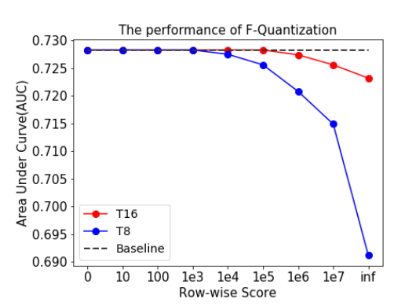

# SHARK: A Lightweight Model Compression Approach for Large-scale Recommender Systems (面向大规模推荐系统的轻量级模型压缩实践)

- **会议/期刊**: CIKM 2023
- **作者与机构**: Beichuan Zhang, Chenggen Sun, Jianchao Tan 等（快手科技）
- **推荐链路定位**: 精排（排序主模型嵌入层压缩，兼及训练/推理系统）
- **研究方向**: 去偏公平、可信隐私与工业架构 / CTR 预估与特征交叉
- **论文原文**: [https://arxiv.org/abs/2308.09395v1](https://arxiv.org/abs/2308.09395v1)
- **开源代码**: 暂未开源

## TL;DR (1分钟核心速览)

工业精排模型的嵌入层已膨胀到 TB 级，传统压缩要么引入新参数破坏基座结构（FSCD/AutoField/LASSO），要么代价高昂（Permutation 复杂度 $O(|\mathcal{D}|\cdot N\cdot T)$），要么对高频行量化误差失控。SHARK 给出两把"无侵入"手术刀：F-Permutation 用一阶泰勒展开近似打乱置换的损失增量，把特征域打分降到$O(|\mathcal{D}|)$；F-Quantization 按"正负样本加权频次"给每行打优先级，分档 int8/fp16/fp32。快手短视频主模型在 30% 内存占用下 Click/Like/Follow AUC 与 fp32 持平（最高 +0.04%），线上省 70% 存储、QPS +30%。

## Background & Motivation (背景与核心矛盾)

- **主流范式**: 精排用「嵌入层 + 计算层」结构（图 1），扩大嵌入表数量/基数/维度/精度是提升效果的主要手段，但代价是 TB 级内存与数千台机器。
- **前人局限（一）**: 训练型特征选择（FSCD、AutoField、Group LASSO、UMEC）需往基座里插入 mask / Gumbel 结构或额外正则，破坏线上系统兼容性；工业界常用的 Permutation 虽无侵入，但复杂度 $O(|\mathcal{D}|\cdot N\cdot T)$，只能在一个 mini-batch 内随机打乱一次，既慢又陷局部最优。
- **前人局限（二）**: 量化方法（ALPT、随机舍入、MPE 的浮点缓存）忽视了"高频访问行量化误差更大"这一现象；MPE 的 LFU/LRU 优先级不考虑正样本更重要的训练语义，且缓存架构难以同时承载 int8/fp16 多档策略。
- **核心洞察**: 特征域之间信息高度耦合，剪掉冗余域几乎无损；而行的"被访问频次 × 正样本权重"才是决定该行是否值得保留高精度的真正信号。
- **本文切入点**: 不改模型结构、不加可学习参数，用梯度与期望值直接"免费"读出重要度，把压缩做成后处理流水线。

<figure class="paper-figure" markdown="span">
  <figcaption>图1：推荐模型的常见结构范式，由计算层和嵌入层组成。嵌入层中的每个嵌入表对应一个特征字段，如年龄、性别等。嵌入表中嵌入的数量即为其基数。建议彩色查看。</figcaption>
</figure>

## Method (核心方法设计)

### 1. 整体框架 (Overall Architecture)

SHARK 是模型收敛后的两阶段后处理流水线：先跑 F-Permutation 迭代剪表——用一次前反向传播同时拿到梯度与各特征域的期望嵌入，算出表级重要度，每轮只删 $f$张最低分表（默认$f=1$），在小样本支撑集上微调回收敛，再测精度；当内存低于$rate_c$或精度跌破基座 99.25% 阈值即停。随后跑 F-Quantization：逐 batch 维护每行的频次优先级分数，按两个阈值$t_8,t_{16}$ 将行分别落到 int8 / fp16 / fp32 三档存储，训练时量化-反量化直通。两阶段结果可直接相乘叠加，无需联合重训。

### 2. 关键设计拆解 (Key Designs)

1. **F-Permutation：一阶泰勒近似置换损失**：Permutation 需遍历该域全部候选值求期望损失，复杂度爆炸。对其做一阶展开，损失增量近似为「梯度 × 期望偏差」：$w_i=\frac{1}{|\mathcal{D}|}\sum_{x}\frac{\partial \mathcal{L}}{\partial v_i^{*}}\left(\mathbb{E}[v_i]-v_i^{*}\right)$，复杂度降到$O(3|\mathcal{D}|)$，且期望可预先统计、梯度随一次反向免费获得。直觉：若把该域替换成"平均取值"会让损失显著变化，说明该域承载不可替代的信息。作者实测二阶展开与一阶效果相当，故取一阶。
2. **F-Quantization：正负样本加权的行级混合精度**：逐行量化 $s=e_{absmax}/(I_{max}-I_{min})$后，高频行误差反而最大。为此定义时序衰减的优先级$w_r^{(t+1)}=(1-\beta)w_r^{(t)}+\beta\left(c^{+}+\alpha c^{-}\right)$，其中$c^{+},c^{-}$为该行在一个 batch 内出现的正/负样本数，$\alpha=2$放大负样本计数、$\beta=0.99$平滑历史。随后分段映射：$w_r<t_8$用 int8，$t_8\le w_r<t_{16}$用 fp16，否则保 fp32（$t_8=10^3,t_{16}=10^5$）。物理直觉：越"热"的行梯度更新越频繁，量化噪声会被持续放大，必须给足精度；冷行几乎不被访问，int8 噪声影响可忽略。为兼容不同精度，每行附加 8bit/16bit/32bit 的 scale 元数据。
3. **训练目标与推理开销**：基座损失（多任务 MMOE 的点击/点赞/关注等）不变，量化以 STE 直通梯度，无额外正则、无新增可学习参数；推理侧只需按行读取对应精度并在 lookup 后反量化，内存 30% 的同时访存带宽大幅下降，这正是 QPS +30% 的来源。

<figure class="paper-figure" markdown="span">
  <figcaption>图3：F-Quantization在不同𝑡16和𝑡8下的性能。图中，“T8”和“T16”分别表示𝑡8和𝑡16。“基线”表示使用fp32的模型性能。建议彩色查看。</figcaption>
</figure>

## Experimental Setup & Evaluation Protocol (实验设置与评估协议)

- **数据集与预处理**:

| 数据集 | 样本量 | 特征域 | 内存/规模 | 特征/场景说明 |
| :--- | :---: | :---: | :---: | :--- |
| Criteo | ~4.4B（24 天） | 27（26 类 + 13 连续转嵌入） | 单机可复现 | 按 DLRM 设置每日随机取 12.5% 作负样本 |
| Industrial（快手） | 十亿级 | 180 | 参数量数十亿 | 短视频主排序模型，MMOE 多任务（点击/点赞/关注） |

- **数据划分与防穿越**: Criteo 采用时间切分——第 0–17 天做预训练与压缩，压缩后用第 0–22 天全量重训并评估；工业数据走在线学习（online learning）流式框架，与线上部署一致。
- **排名评测协议**: 非检索式排序任务，采用 **AUC 逐任务评估 + 内存占用比** 双指标；工业侧另有 7 天、10% 流量的在线 A/B，以平均观看时长与 QPS 为准绳（精度下降 >0.15% 视为显著不可接受）。
- **对比基线与超参**: 特征选择对比 FSCD、AutoField、Group LASSO、UMEC、Permutation；量化对比 MPE（LFU/LRU 浮点缓存）、ALPT、fp16+随机舍入、int8+随机舍入；维度压缩对比 PEP。batch size 512（Criteo）/8192（工业），lr=0.01，$\alpha=2,\beta=0.99$。

## Key Experimental Results (实验关键数据)

### 1. 主实验对比 (Main Results)

工业数据集，括号内为相对 fp32 基线的 AUC 变化（>0.15% 视为显著劣化）：

| 方法 | 内存占比 | Click | Like | Follow |
| :--- | :---: | :---: | :---: | :---: |
| FP32 Baseline | 100% | 0.7283 | 0.7496 | 0.7938 |
| ALPT | 55% | 0.7244 (-0.54%) | 0.7433 (-0.84%) | 0.7886 (-0.65%) |
| MPE (LFU/LRU 缓存) | 55% | 0.7255 (-0.38%) | 0.7457 (-0.52%) | 0.7910 (-0.35%) |
| PEP | 60% | 0.7255 (-0.39%) | 0.7468 (-0.38%) | 0.7912 (-0.33%) |
| **F-Quantization (本文)** | **50%** | **0.7293 (+0.13%)** | **0.7509 (+0.17%)** | **0.7928 (-0.12%)** |
| **F-Permutation (本文)** | **60%** | 0.7277 (-0.08%) | 0.7493 (-0.04%) | 0.7928 (-0.12%) |
| PEP @30% | 30% | 0.7236 (-0.64%) | 0.7433 (-0.84%) | 0.7886 (-0.65%) |
| **F-Q + F-P 组合** | **30%** | **0.7279 (-0.05%)** | **0.7493 (-0.04%)** | **0.7941 (+0.04%)** |

剪枝耗时（工业数据集）：F-Permutation 打分为 **1 小时**、全流程 1 天，对比 Permutation 6 小时/2 天、FSCD 与 LASSO 各 3 天/3 天。

### 2. 消融实验 (Ablation Study)

| 配置 | 内存 | Click Δ | Like Δ | Follow Δ | 结论 |
| :--- | :---: | :---: | :---: | :---: | :--- |
| 仅 F-Permutation | 60% | -0.08% | -0.04% | -0.12% | 表级冗余可安全剔除 |
| 仅 F-Quantization | 50% | +0.13% | +0.17% | -0.12% | 量化反而正则化 |
| F-Q + F-P（直接合并） | 30% | -0.05% | -0.04% | +0.04% | 二者正交可叠加 |
| 去掉正样本加权（等价 LFU） | 55% | -0.38% | -0.52% | -0.35% | 退化为 MPE 水平 |
| 全表统一 int8 | — | 掉 >2% | 掉 >2% | 掉 >2% | 单一精度不可行 |

### 3. 关键实验发现 (Key Findings)

1. **特征域耦合导致"免费午餐"区间**：Criteo 上剩余特征域 >19 个时精度几乎零损失，说明扩特征带来的边际信息大量重叠；F-Permutation 在绝大多数压缩比下最优，仅在 22–26 域区间略逊于 Permutation（因后者在 mini-batch 内打乱带来更强局部扰动）。
2. **量化误差与访问频次强相关已被实证**：全表 int8 + 随机舍入使三任务 AUC 均掉超 2%，而按频次分档后 50% 内存即可持平甚至微涨（Click +0.13%、Like +0.17%），证明"高频行必须高精度"是关键而非舍入偏差修正；$t_8<10^3$、$t_{16}<10^5$ 时性能与 fp32 齐平，阈值敏感性可接受。
3. **两阶段压缩正交且线上兑现**：30% 内存下组合方案三任务平均仅 -0.02%，而 PEP 同内存掉 0.6–0.8%；线上 A/B（7 天、10% 流量）平均观看时长无下降，存储省 70%、QPS +30%、节省数千台机器，已服务 3 亿+ DAU。

## Highlights & Limitations (亮点、对比与审稿批判)

- **与代表作对比**: 相对 FSCD/AutoField/LASSO 等"训练型"方法，SHARK 完全不侵入基座结构与损失，压缩即后处理，工程师可随时回滚；相对 Permutation，把打分从 6 小时压到 1 小时且用全量期望代替单 batch 打乱，摆脱局部最优；相对 MPE 的 LFU 缓存，用 $c^{+}+\alpha c^{-}$ 的频次加权替代纯访问计数，并天然支持多档精度而非单一缓存层。
- **可迁移亮点**: (1) 「梯度 × (期望值 − 当前值)」这一阶泰勒打分是可复用的通用特征域重要度探针，任何可微排序模型都能直接套；(2) 用 batch 内正负样本计数做在线行优先级，成本近乎为零，可迁移到任意大规模稀疏嵌入的存储分层（如 DDR/显存异构放置）。
- **审稿级局限批判**: (1) 公开数据集验证偏弱——Criteo 只给出剪枝曲线而未给完整数值表，量化部分几乎全靠单一工业数据集，缺乏学术可复现的定量对照；(2) 组合压缩比靠人工枚举（作者自认），且 F-Permutation 每轮只删一张表、需反复微调，特征域上千时迭代轮数与微调成本仍可能不可忽视；(3) 未报告训练阶段因量化-反量化带来的吞吐损失，也未讨论与 embedding 维度压缩/哈希冲突方法的叠加效应。

## Rating (四维评分)

- **方法创新性 (Novelty)**: ⭐⭐⭐⭐ （一阶泰勒近似置换 + 正负加权频次分档量化，两处均为轻量但切中工业痛点的"算子级"改良，理论深度有限但洞察准确）
- **评估协议与实验扎实度 (Protocol & Experiments)**: ⭐⭐⭐⭐ （工业数据集 + 7 天线上 A/B + 多维基线充分，扣分在 Criteo 仅给曲线、量化缺公开数据集的完整数值表）
- **写作与数学规范度 (Clarity & Rigor)**: ⭐⭐⭐⭐ （公式简洁且与复杂度分析一一对应，工程细节如额外 scale 字段都交代；部分符号 $w_r$与$w_i$ 混用、算法伪码排版粗糙）
- **工业落地与复现价值 (Industrial & Practical Value)**: ⭐⭐⭐⭐⭐ （无侵入后处理、1 小时打分、30% 内存持平、70% 存储与 QPS +30% 已在 3 亿 DAU 场景全量上线，落地价值极高）

