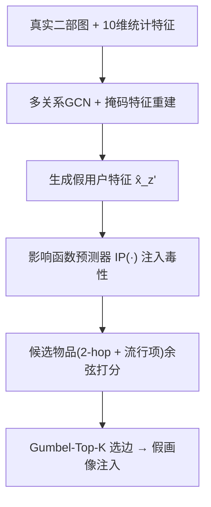

# Single-User Injection for Invisible Shilling Attack against Recommender Systems (推荐系统中面向不可见 Shilling 攻击的单用户注入)

- **会议/期刊**: CIKM 2023（10 pages, 5 figures）
- **作者与机构**: Chengzhi Huang, Hui Li（厦门大学 多媒体可信感知与高效计算教育部重点实验室）
- **推荐链路定位**: 数据注入（训练期投毒）→ 影响召回/精排结果
- **研究方向**: 去偏公平、可信隐私与工业架构 / 图神经网络与知识图谱推荐
- **论文原文**: [https://arxiv.org/abs/2308.10467v1](https://arxiv.org/abs/2308.10467v1)
- **开源代码**: [https://github.com/KDEGroup/SUI-Attack](https://github.com/KDEGroup/SUI-Attack)

## TL;DR (1分钟核心速览)

现有 shilling 攻击全部依赖“多用户注入”（典型注入 50 个虚假画像），作者反问：**只注入 1 个假用户能否成功投毒？** 本文提出 SUI-Attack，把投毒改写为**用户-物品二部图上的节点生成**任务：先用 10 维攻击特征 + 多关系 GCN + 掩码重建，并用**影响函数 (influence function)** 给生成特征注入“毒性”，再用 **Gumbel-Top-K** 采样连边构造画像。在 3 个数据集 × 7 个受害模型上，攻击指标 HR@50 单用户设定下最高超最好基线 **9.75 倍**（Last.fm/ItemCF），且仅达多用户最优基线一半画像数即可逼近其效果，同时更难被检测器识破。

## Background & Motivation (背景与核心矛盾)

- **主流范式**: 攻击者向受害 RS 注入 $b_{user}$ 个精心构造的假画像（Random/Bandwagon/Segment 启发式，或 TrialAttack、AUSH、LegUP 等 GAN/优化类深度方法），通过污染交互矩阵抬高目标物品排名。
- **前人局限**: ① 注入数量与攻击力、隐蔽性构成硬性 trade-off——画像越多越强，也越容易被无监督检测器（如 RDMA/LengthVar 类统计特征聚类）抓出；② 全部方法在“多用户”框架下设计，**在只有一个新增节点的极端约束下，随机/启发式画像的 HR@50 几乎塌到 0**（如 Last.fm 上 Random 为 0.000）。
- **核心洞察 (Key Insight)**: 单节点攻击在 CV（one-pixel attack）与图学习（single-node injection）中已被证明可行，而 RS 的推荐结果对**图拓扑上的高影响节点**天然敏感；只要该节点的特征与连边同时“有毒且自然”，一个画像就足以改变目标物品的全局排序。
- **本文切入点**: 用图生成 + 影响函数，把“画像填什么交互”转化为“生成一个高影响力节点的特征与邻居”。

## Method (核心方法设计)

### 1. 整体框架 (Overall Architecture)

输入为受害 RS 的二部图及其节点特征，模型分两阶段闭环：**特征生成**先在真实图上做 10% 节点掩码的特征重建预训练，得到能编码拓扑+特征的多关系 GCN 编码器；再用零向量初始化假用户 $z'$，预测其特征$\hat{\mathbf{x}}_{z'}$，并以“影响函数预测器”为监督信号放大其破坏性。**边生成**将该特征与候选物品特征投影到同一空间求余弦相似度，经 Gumbel-Top-K 采样选出至多$b_{item}$条连边；测试阶段用硬阈值$e=0.85$ 二值化得到最终画像，注入受害 RS 完成投毒。

### 2. 关键设计拆解 (Key Designs)

1. **毒性特征生成（掩码重建 + 影响函数）**：假用户没有真实交互，特征无从取值。作者先以重建目标训练编码器（$U_m,V_m$为掩码集）：$\mathcal{L}_{recon}=\frac{1}{|U_m|}\sum_{u\in U_m}\|\mathbf{x}_u-\hat{\mathbf{x}}_u\|^2+\frac{1}{|V_m|}\sum_{v\in V_m}\|\mathbf{x}_v-\hat{\mathbf{x}}_v\|^2$，但仅“像真用户”不足以扰动排序，于是引入影响函数衡量“把样本$z$上采样后对目标测试样本的损失影响”：$\mathcal{I}_{up,loss}(z,z_{test})=-\nabla_\theta\mathcal{L}(z_{test},\hat\theta)^{\top}H^{-1}_{\hat\theta}\nabla_\theta\mathcal{L}_{RS}(z,\hat\theta)$。对所有真实用户预计算该分数，训练三层 MLP 预测器$\mathrm{IP}(\cdot)$，最终$\mathcal{L}_{feat}=\mathcal{L}_{recon}-\mathrm{IP}(\mathbf{x}_{z'})$。直觉是：**最小化重建误差保证“像人”，最大化预测影响分数保证“有毒”**，二者对抗使假特征落在真实分布内却朝目标物品方向偏移。
2. **Gumbel-Top-K 连边生成（离散选择的梯度通路）**：连边是离散决策，无法直接反传。作者取目标物品的 2-hop 邻居（与目标有共访关系）并混入 $s$=5% 从 top-10% 热门中采样的物品以稀释异常，用$\cos(\mathbf{W}_{edge}\hat{\mathbf{x}}_{z'},\mathbf{W}_{edge}\mathbf{x}_j)$得分布$\mathbf{o}$，再以$\text{Gumbel-Softmax}(\mathbf{o}\odot mask_i,\alpha)$迭代$b_{item}$次无放回抽样，$\alpha$控制探索、温度$\tau$ 控制锐化。相比“全取 top-k”可避免画像里堆满同质物品，反而更像真实用户的兴趣组合。
3. **训练目标与开销**：总损失 $\mathcal{L}=\mathcal{L}_{adv}+\mathcal{L}_{recon}-\mathrm{IP}(\mathbf{x}_{z'})$，其中推广攻击损失$\mathcal{L}_{adv}=-\sum_{u\in U}\log\frac{\exp(r_{u,t})}{\sum_{j\in I}\exp(r_{u,j})}$直接把目标物品$t$ 的 softmax 排名往上推；**无负采样**，全库 softmax。推理只需一次前向 + 采样，单用户画像注入成本极低；主要开销来自影响函数的 Hessian 逆近似与 10 维特征预计算。

## Experimental Setup & Evaluation Protocol (实验设置与评估协议)

- **数据集与预处理**: 直接采用三份公开数据（未做 k-core 过滤，保持 shilling attack 社区惯例的原始分布）：

| 数据集 | #Users | #Items | #Interactions | 稀疏度 | 特征/场景说明 |
| :--- | :---: | :---: | :---: | :---: | :--- |
| Automotive | 2,928 | 1,835 | 20,473 | 99.62% | 亚马逊汽车配件评分 |
| T & HI | 1,208 | 8,491 | 28,396 | 99.72% | 工具与家居，用户极少、物品极多 |
| Last.fm | 1,892 | 12,523 | 186,479 | 99.21% | 音乐社交，最稠密 |

- **数据划分与防穿越 (Splitting Strategy)**: 原文**未显式给出划分比例**，沿用基线库（XMUDM/ShillingAttack、TrialAttack）默认设定在完整交互上训练受害模型；攻击本身是“注入后重训”的训练期投毒范式，每个数据集随机抽 **5 个目标物品**取平均。
- **排名评测协议 (Ranking Protocol)**: 攻击侧指标为 **HR@50**（注入后 top-50 列表命中目标物品的用户比例），属**全用户排序统计**而非采样排序；推荐精度指标不参与评价。对比基线含 Random / Segment / Bandwagon 三种启发式与 TrialAttack / AUSH / LegUP 三种深度方法，受害模型覆盖 ItemCF、WMF、NGCF、VAE、ItemAE、LightGCN、NCF 共 7 个。主要超参：图编码器隐层 250、dropout 0.5、学习率 5e-4 + cosine decay、64 epoch、batch 32、$b_{item}\le 50$、多用户设定$b_{user}=50$、$s$=5%、$e$=0.85。

## Key Experimental Results (实验关键数据)

### 1. 主实验对比 (Main Results)

下表 HR@50 中 “SUI-单” 为本文核心设定（$b_{user}=1$）；`Improv.` 为相对**单用户设定下最好基线**的相对提升。

| 数据集 | 受害模型 | Random | Segment | Bandwagon | TrialAttack | AUSH | LegUP | SUI-单 | SUI-多 | Improv. |
| :--- | :--- | :---: | :---: | :---: | :---: | :---: | :---: | :---: | :---: | :---: |
| T&HI | ItemCF | 0.010 | 0.000 | 0.000 | 0.042 | 0.012 | 0.040 | **0.194** | 0.262 | +362% |
| T&HI | VAE | 0.203 | 0.174 | 0.000 | 0.103 | 0.241 | 0.227 | **0.636** | 0.937 | +164% |
| T&HI | NCF | 0.301 | 0.193 | 0.163 | 0.265 | 0.317 | 0.187 | **0.481** | 0.862 | +51.7% |
| Last.fm | ItemCF | 0.000 | 0.002 | 0.000 | 0.003 | 0.003 | 0.012 | **0.117** | 0.208 | +875% |
| Last.fm | LightGCN | 0.075 | 0.010 | 0.020 | 0.076 | 0.091 | 0.083 | **0.266** | 0.376 | +192% |
| Last.fm | VAE | 0.132 | 0.117 | 0.163 | 0.128 | 0.192 | 0.118 | **0.494** | 0.683 | +157% |
| Automotive | ItemAE | 0.020 | 0.010 | 0.002 | 0.020 | 0.008 | 0.091 | **0.255** | 0.322 | +180% |
| Automotive | NCF | 0.082 | 0.070 | 0.002 | 0.112 | 0.104 | 0.142 | **0.376** | 0.811 | +165% |

### 2. 消融实验 (Ablation Study)

原文仅以柱状图（图 3，Automotive）给出消融，此处以相对趋势呈现：

| 变体 | 攻击效果 (HR@50) | 结论 |
| :--- | :---: | :--- |
| w/o 特征生成（随机特征） | 显著下降 | 毒性特征无法由随机噪声替代 |
| w/o 影响函数（仅重建） | 下降幅度最大 | “像人”不等于“有毒”，影响函数是攻击力主源 |
| w/o 边生成（随机连边） | 明显下降 | 连边需与假特征一致，否则画像自相矛盾 |

### 3. 关键实验发现 (Key Findings)

1. **1 个假用户 ≈ 半个多用户攻击**：`ratio 1`（单用户 SUI / 多用户最强基线）在多数模型上 $\ge 0.5$，Automotive 的 ItemAE 达 0.792、LightGCN 达 0.849、Last.fm 的 LightGCN 达 0.660；说明检测门槛高的系统里，一次注入就能造成可观排序偏移。
2. **针对性设计的必要性**：`ratio 2`（单用户 SUI / 单用户最强基线）在 21 个 (数据集, 受害模型) 组合中几乎全部大于 1，最高 9.75 倍，而大多数基线在该设定下 HR@50 低于 0.05——直接把多用户方法缩到 1 个画像会失效，**画像的“质量”而非“数量”才是关键**。
3. **灵活性可延伸至多用户设定**：`ratio 4`（多用户 SUI / 多用户最强基线）集中在 0.83–1.02，如 Automotive 的 WMF 为 1.005、LightGCN 为 1.016，说明同一模型无需改动即可在传统设定下持平甚至超越 SOTA；隐蔽性方面，无监督检测器在 Automotive 上对 SUI 画像的 precision/recall 仅约 0.01–0.02（图 1 最低），t-SNE 显示假用户散布在真实用户簇中（图 2），几乎不可分。

## Highlights & Limitations (亮点、对比与审稿批判)

- **与代表作对比 (vs. Prior Work)**: 相比 TrialAttack（GAN + 影响函数估计，仍需 50 画像）、AUSH（GAN 生成画像）、LegUP（知识蒸馏减少先验），SUI-Attack 的本质差异是**把“画像内容生成”换成“图上单节点拓扑生成”**，并用多关系 GCN 把物品侧结构信息纳入画像构造；相比 one-pixel / single-node injection 类工作，本文首次在**推荐排序目标**上验证单节点可行性。
- **可迁移亮点**: ① “掩码重建 + 影响函数最大化”这一组合可直接迁移到**数据增广/难样本合成**（把攻击目标换成正样本效用）；② Gumbel-Top-K + 热门混采的离散选边策略，可用于构造**去偏的负样本或鲁棒性测试集**。
- **审稿级局限批判**: ① **黑盒假设与实现存在 gap**：文中声称攻击者无法获取模型参数与梯度，但 $\mathcal{L}_{adv}$的优化实际对 7 个受害模型逐一反传，等价于白盒/可微代理，跨模型迁移性未验证；② 影响函数需 Hessian 逆近似，$N$ 较大时的近似误差与预计算开销未做复杂度分析，且评估仅有 HR@50 单一指标、缺少对系统整体推荐质量（如 NDCG 跌幅）与划分策略的说明，鲁棒性结论偏乐观。

## Rating (四维评分)

- **方法创新性 (Novelty)**: ⭐⭐⭐⭐ （首次定义单用户注入设定，并将投毒重构为图上节点生成 + 影响函数引导，问题视角新颖）
- **评估协议与实验扎实度 (Protocol & Experiments)**: ⭐⭐⭐ （3 数据集 × 7 受害模型覆盖面好、含检测与 t-SNE 隐蔽性分析，但划分策略未明示、消融仅柱状图且无显著性检验）
- **写作与数学规范度 (Clarity & Rigor)**: ⭐⭐⭐ （两阶段流程清晰、公式完整，但 10 维特征堆叠略冗长，Gumbel 部分符号与拼写有瑕疵）
- **工业落地与复现价值 (Industrial & Practical Value)**: ⭐⭐⭐⭐ （代码开源、单画像注入成本极低，对风控/反作弊侧的红队测试与检测器设计有直接警示价值）

