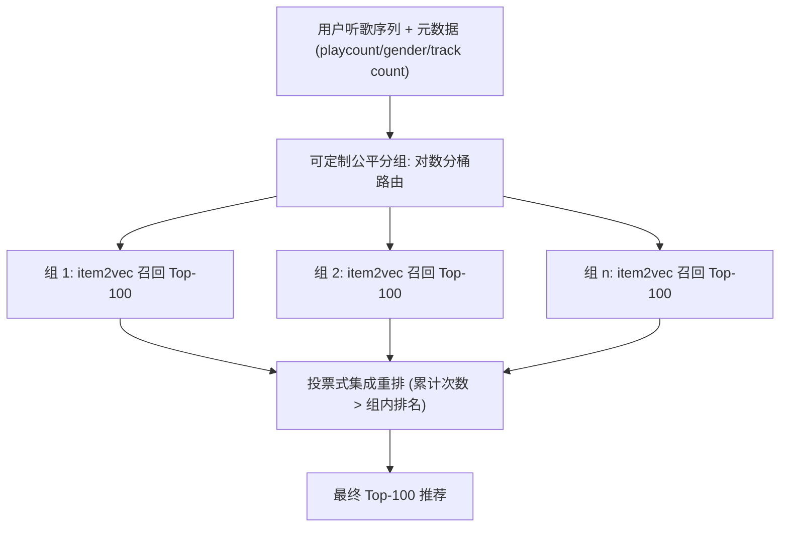
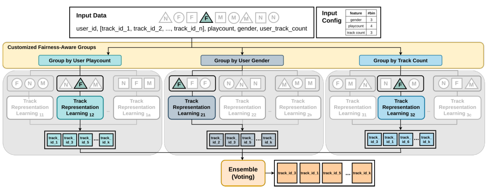

# Track2Vec: fairness music recommendation with a GPU-free customizable-driven framework (无 GPU 可定制驱动的公平音乐推荐框架)

- **会议/期刊**: CIKM 2022, EvalRS Workshop (CEUR Workshop Proceedings)
- **作者与机构**: Wei-Wei Du, Wei-Yao Wang, Wen-Chih Peng (阳明交通大学资工系)
- **推荐链路定位**: 召回 (Top-100 生成) + 列表级投票重排
- **研究方向**: 去偏公平、可信隐私与工业架构 / 协同过滤与双塔召回
- **论文原文**: [https://arxiv.org/abs/2210.16590v1](https://arxiv.org/abs/2210.16590v1)
- **开源代码**: [https://github.com/wwweiwei/Track2Vec](https://github.com/wwweiwei/Track2Vec)

## TL;DR (1分钟核心速览)

针对推荐系统只追准确率、忽视群体公平与算力受限的痛点，本文提出 Track2Vec：按用户播放量、性别、曲目数三个特征做对数分桶，为每个子群独立训练 item2vec 召回器，再用"累计推荐次数优先"的投票式重排做集成；同时提出 MR-ITF 指标以逆频率权重惩罚长尾漏检。在 EvalRS@CIKM 2022 的 LFM-1b 榜单上以无 GPU 方案取得第 4 名（17 队），总分较官方 CBOW 基线提升约 198%。

## Background & Motivation (背景与核心矛盾)

- **主流范式**: 音乐推荐普遍用 Word2Vec/item2vec 类的共听序列嵌入做召回，以 HR/MRR/nDCG 衡量效果；EvalRS 赛道额外要求按切片（性别、国家、流行度）与行为测试（less-wrong、latent diversity）评估公平性。
- **前人局限**: ① 单一全局嵌入让高频用户/热门曲目主导训练，少数群体切片指标被"平均掉"；② 现有多桶公平指标（如 MRED）需人工设定分桶数量，跨任务不可迁移，且无权重区分各桶重要性。
- **核心洞察 (Key Insight)**: 作者通过探索性数据分析发现 user playcount、user gender、track count 三个特征与模型行为指标强相关（图 3），且不同群体偏好的曲目分布差异极大——因此"分组训练 + 结果投票"天然带来多样性与覆盖。
- **本文切入点**: 把公平性做成"可配置的分组先验"：用特征分桶隔离多数群体对少数群体的梯度支配，并用 TF-IDF 思想设计免人工分桶的公平指标。

## Method (核心方法设计)

### 1. 整体框架 (Overall Architecture)

输入为用户的听歌序列（track_id 序列）及其元数据。框架先由**可定制公平分组**按配置把序列路由到对应子群（如男性用户只进入 gender=male 组），每个子群各自用 item2vec 在共听共现上训练曲目嵌入，得到该子群的 Top-K 候选（K=100）；随后**集成模块**对各组预测按"被推荐累计次数降序、再按组内原始排名"两级优先投票，输出最终列表。训练全程 CPU（AMD 3960X），无监督、无辅助任务，单折训练+推理仅约 22.5 分钟预算。

<figure class="paper-figure" markdown="span">
  <figcaption>图2：我们提出的框架流程。对于每个输入用户序列（如绿色三角形 F），模型根据输入配置（如 User Playcount、User Gender 和 Track Count）将其按三个特征拆分，并采用相应的曲目表示学习模块为待推荐曲目编码曲目嵌入。随后，这些模块的输出通过投票技术聚合，以生成最终推荐。</figcaption>
</figure>

### 2. 关键设计拆解 (Key Designs)

1. **可定制公平感知分组 (Customized Fairness-Aware Groups)**：痛点是不平衡群体被多数样本淹没。做法是对连续特征做 log10 分桶（playcount 以 10/100/1000 为切点分 4 组，track count 以 100/1000 分 3 组，gender 分男/女/中性），将全局语料切成若干子语料分别训练。直觉上等价于对损失做**群体级重要性重加权**，使每组嵌入只由本组共现统计决定，避免热门群体的高频共现主导向量空间。

2. **免人工分桶的公平指标 MR-ITF**：针对 MRED 类指标需手设 bin 数的问题，借鉴 TF-IDF 的逆频率思想，对每个类别（曲目）的 miss-rate 按其出现频率加权：

$$\text{MR-ITF}=\frac{\sum_{i=1}^{|C|} MR_i \cdot ITF_i}{\sum_{j=1}^{N} MR_j},\qquad ITF_i=\log\!\left(\frac{\#\text{total predictions}}{\#\text{track}_i}\right)$$

   长尾曲目的 $ITF_i$ 大、权重高，因此"全推爆款"的退化策略会被显著惩罚；分母仅做归一化，分子可替换为 MRR/nDCG 等任意指标，实现零配置迁移。

3. **训练目标、负采样与推理开销**：每个子群用 skip-gram/CBOW + 负采样（dim=100, window=60, min_count=0, 负样本数 5, epoch=10, seed=27），目标为

$$\mathcal{L}=-\log\sigma(\boldsymbol{v}_{c}^{\top}\boldsymbol{v}_{w})-\sum_{k=1}^{5}\log\sigma(-\boldsymbol{v}_{c}^{\top}\boldsymbol{v}_{n_k})$$

   推理为纯向量内积近邻检索，无需神经网络前向，故可无 GPU 部署；代价是嵌入无法利用用户侧特征做个性化打分，仅靠分组近似个性化。

## Experimental Setup & Evaluation Protocol (实验设置与评估协议)

- **数据集与预处理**: 基于 LFM-1b 听歌事件语料（官方 EvalRS 划分版本），仅使用 track_id 与三项用户/曲目元数据，未做 5-core 过滤，保留原始长尾分布。

| 数据集 | #Users | #Items | #Interactions | 稀疏度/密度 | 特征/场景说明 |
| :--- | :---: | :---: | :---: | :---: | :--- |
| LFM-1b (EvalRS 子集) | 未披露 | 未披露 | >100M (原始语料) | 极稀疏 | 用户背景 + 曲目元数据 + 听歌事件；5 折 bootstrap |

- **数据划分与防穿越 (Splitting Strategy)**: 官方 EvalRS 提供的分折划分；消融采用 **4 折 bootstrap 交叉验证**；测试期用户特征直接从训练数据按 user_id 回查，避免使用未来信息。
- **排名评测协议 (Ranking Protocol)**: 对每用户生成 K=100 的 **Full-Ranking** 列表（不裁剪候选池、不做负采样排序）；指标含标准 RS 指标（HR/MRR）、per-group 切片指标、行为测试，以及本文 MR-ITF。
- **对比基线与超参设置**: 官方基线 `CBOWRecSysBaseline`（同为 item2vec 类，未分组、无集成）；榜单共 17 支队伍。嵌入维度 $d=100$，窗口 60；论文未报告显著性检验。

## Key Experimental Results (实验关键数据)

### 1. 主实验对比 (Main Results)

官方榜单（分数经 Phase 1 最优值归一化，Rank 为 17 队中名次）：

| Rank | Model | Total Score | Standard RSs | Per-group | Behavioral |
| :---: | :--- | :---: | :---: | :---: | :---: |
| **4** | **Track2Vec (Ours)** | **1.1847** | 0.0088 | **2.9481** | 0.2050 |
| - | CBOWRecSysBaseline | -1.2122 | **0.0512** | -3.7194 | **0.4527** |
| - | Improv.% | **+198%** | -83% | **+179%** | -55% |

### 2. 消融实验 (Ablation Study)

| Variant | Standard RSs ↑ | Per-group ↑ | Behavioral ↑ | MR-ITF | Total ↑ |
| :--- | :---: | :---: | :---: | :---: | :---: |
| 仅 Gender (G) | 0.0103 | -0.0073 | -0.0138 | -4.3862 | -0.0048 |
| 仅 Playcount (P) | 0.0118 | -0.0039 | 0.0014 | -4.3863 | 0.0008 |
| 仅 TrackCount (U) | 0.0128 | -0.0061 | 0.0008 | -4.3861 | -0.0003 |
| G+P | 0.0127 | -0.0052 | 0.0188 | -4.3862 | 0.0041 |
| G+U | 0.0136 | -0.0055 | 0.0156 | -4.3861 | 0.0035 |
| P+U | 0.0143 | -0.0044 | 0.0223 | -4.3860 | 0.0057 |
| **Track2Vec (G+P+U)** | **0.0146** | -0.0055 | **0.0271** | -4.3861 | **0.0062** |

### 3. 关键实验发现 (Key Findings)

1. **增益几乎全部来自行为测试而非精度**：三组集成把 Behavioral 从 G 单组的 -0.0138 拉到 0.0271（翻正），而 Standard RSs 仅从 0.0103 升到 0.0146（+42%）；相对官方基线，per-group 指标 +179%，但标准精度反而 -83%，说明"公平换精度"的权衡十分显著。
2. **分组维度互补而非冗余**：任意两两组合（G+P/G+U/P+U）总分分别为 0.0041/0.0035/0.0057，均高于任一单组，且三组全用达 0.0062；案例研究显示三组 Top-100 推荐列表的**重叠率仅 12%**，从覆盖层面直接印证了集成带来的多样性。
3. **MR-ITF 在本数据上区分度不足**：所有变体的 MR-ITF 几乎恒为 -4.386（差异 <0.0003），作者归因于测试集真值本身高度分散、各模型 $ITF$ 项近似相同；这意味着该指标更适合作为"是否退化到爆款策略"的告警器，而非细粒度排序依据。

## Highlights & Limitations (亮点、对比与审稿批判)

- **与代表作对比 (vs. Prior Work)**: 与 YouTube 两阶段 DNN、PinSage 等监督式深度召回相比，本文完全放弃 GPU 与用户塔建模，用"分桶 + item2vec + 投票"换取可部署性与群体覆盖；与 RecList/MRED 等需人工设 bin 的公平评测相比，MR-ITF 用逆频率自动加权，且分子可替换为任意指标，通用性更强。
- **可迁移亮点**: ① "特征分桶 → 多路召回 → 投票重排"是低算力场景下提升长尾覆盖的通用配方，可直接用于冷启动或本地生活多业务线；② 逆频率加权聚合思路可套用到任何按类别统计的切片指标（如 per-country nDCG）。
- **审稿级局限批判**: ① 实验仅与一个官方基线对比、无显著性检验，且榜单分数经非线性归一化，"198%" 的绝对意义有限；② 分桶阈值（10/100/1000）仍为人工设定，与"免人工配置"的宣称自相矛盾，阈值敏感性未做分析；③ 用户侧个性化完全依赖分组近似，同组用户共享同一排序，长期可能造成组内同质化与"公平但千人一面"的新偏差。

## Rating (四维评分)

- **方法创新性 (Novelty)**: ⭐⭐ （分组 + item2vec + 投票均为成熟组件的工程组合，主要新意集中在 MR-ITF 指标的逆频率加权形式）
- **评估协议与实验扎实度 (Protocol & Experiments)**: ⭐⭐ （采用 Full-Ranking 与官方多切片协议较规范，但仅 1 个基线、无显著性检验、MR-ITF 实测无区分度）
- **写作与数学规范度 (Clarity & Rigor)**: ⭐⭐⭐ （三模块流程与公式表述清晰，MR-ITF 定义完整；但符号体系较简、复杂度与阈值敏感性分析缺失）
- **工业落地与复现价值 (Industrial & Practical Value)**: ⭐⭐⭐⭐ （纯 CPU、22.5 分钟/折、代码开源，极适合作为公平性基线或资源受限场景的快速上线方案）

