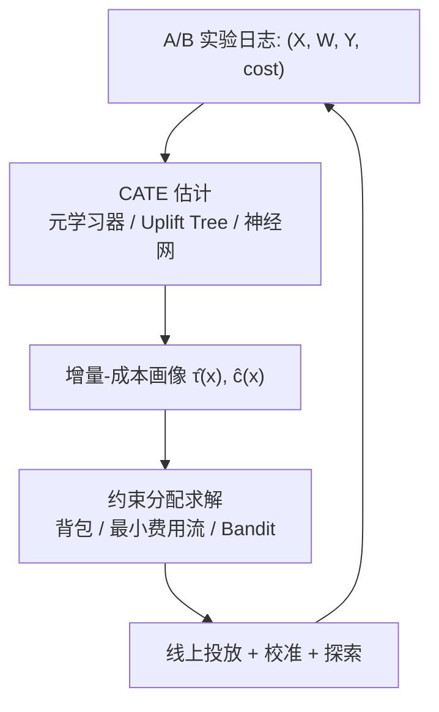

# Uplift Modeling: from Causal Inference to Personalization (从因果推断到个性化：Uplift 建模)

- **会议/期刊**: CIKM 2023 (Tutorial, 4 页)
- **作者与机构**: Felipe Moraes, Hugo Manuel Proença, Anastasiia Kornilova, Javier Albert, Dmitri Goldenberg（Booking.com，阿姆斯特丹/特拉维夫）
- **推荐链路定位**: 重排 / 营销干预决策层（Treatment Allocation，位于排序之后的"给谁发什么"环节）
- **研究方向**: 去偏公平与工业架构（主）/ 强化学习与动态探索（次）
- **论文原文**: [https://arxiv.org/abs/2308.09066v1](https://arxiv.org/abs/2308.09066v1)
- **开源代码**: 暂未开源（教程承诺提供 slides 与 uplift 开源库索引，无配套仓库）

## TL;DR (1分钟核心速览)

本文是一篇 CIKM 2023 教程型论文（无实验）。它直击推荐/营销系统中的核心痛点：A/B 实验只能给出**平均**处理效应，而个性化需要**个体**增量；且"会自然下单的用户"与"被促销说服的用户"必须区分，否则促销成本吞噬全部增量收益。教程以潜在结果框架下的 CATE 为统一语言，串联元学习器（双模型、X-learner、类别转换）与定制方法（Uplift Tree、神经网络），并延伸到"个体成本异质"下的**约束 Uplift**（背包/最小费用流/Bandit）以及校准、探索、可解释等生产化难题，落点是 Booking.com 的促销券分配实践。

## Background & Motivation (背景与核心矛盾)

- **主流范式**: 工业界用大规模 A/B 测试估计整体处理效应（ATE），据此判断"改版/发券是否有效"，再以相关性模型驱动个性化排序。
- **前人局限 (1)**: 因果推断的根本难题——每个用户只能观测到一种干预下的结果，反事实不可见，因此 CATE 估计**没有直接标签**，经典监督学习范式在此失效。
- **前人局限 (2)**: ATE 是全局标量，无法回答"该把优惠券发给谁"；而各用户获取干预的**成本不同**，只最大化增量而不约束成本，会让 ROI 为负。
- **核心洞察 (Key Insight)**: 用户可被划分为四象限——必然购买者（Sure Things）、说服敏感者（Persuadables）、无动于衷者（Lost Causes）、反效果者（Sleeping Dogs）；只有 Persuadables 带来真增量，而经典 CTR 模型恰恰高估必然购买者。
- **本文切入点**: 把个性化从"预测行为"重构为"预测增量 $\tau(x)$"，并在成本预算约束下求解分配问题。

## Method (核心方法设计)

### 1. 整体框架 (Overall Architecture)

教程给出的闭环是：A/B 实验同时产出干预分配 $W$、结果$Y$与个体成本$c$的观测数据$\to$用元学习器或定制模型估计 CATE$\hat{\tau}(x)$ $\to$将$\hat{\tau}(x)$与成本估计拼成"增量-成本"二维画像$\to$在预算/成本约束下求解 0-1 分配（背包、最小费用流或在线多选背包）$\to$ 线上投放并做动态校准与探索。整条链路强调离线模型与在线环境之间的分布漂移（旅游行业强季节性），因此模型需周期性重校准而非一次性训练。

### 2. 关键设计拆解 (Key Designs)

1. **CATE 作为统一目标与元学习器家族（把"无标签"问题转成可监督问题）**：核心量定义为 $\tau(x)=\mathbb{E}\left[Y_i(1)-Y_i(0)\mid X_i=x\right]$；双模型做法用两组样本分别拟合$\hat{\mu}_1,\hat{\mu}_0$后作差$\hat{\tau}(x)=\hat{\mu}_1(x)-\hat{\mu}_0(x)$，X-learner 在类别极不平衡时对两臂效应再做二次回归以纠偏；类别转换法则把两臂合成单标签$Z_i=Y_iW_i+(1-Y_i)(1-W_i)$，则$\hat{\tau}(x)=2\hat{\mathbb{E}}[Z\mid X=x]-1$，使任意二分类器可直接复用。直觉是：$Z$ 编码了"实际结果是否与所分配的臂一致"，一致即视为正响应。

2. **约束 Uplift：从"估计效应"到"带成本的分配"**：个性化促销的优化式为 $\max_{a_i\in\{0,1\}}\sum_i \hat{\tau}(x_i)\,a_i \ \ \text{s.t.}\ \ \sum_i \hat{c}(x_i)\,a_i\le B$，即成本异质的 0-1 背包；大规模场景下用最小费用流建模用户-干预匹配，在线场景则退化为多选背包并配合 contextual bandit 处理未知成本与延迟反馈。关键直觉是：把"净价值"$\hat\tau - \lambda\hat c$ 直接注入元学习器的损失（净价值优化），比先估效应再事后过滤更不易错配。

3. **训练目标、负采样与推理效率**: 本教程不给出统一损失函数；元学习器沿用各自分类/回归损失（如双模型的 logloss/MSE、类别转换的二分类交叉熵）。由于尚未产生干预的样本永远缺失反事实臂，**负采样在此语境不适用**，取而代之的关键是 A/B 实验中的随机化保证（无混杂、正性假设）。推理开销主要为用户级两次前向（双模型）或一次前向（类别转换/Uplift Tree），分配求解在大规模下需近似算法（最小费用流或贪心背包），复杂度随候选集线性增长。

## Experimental Setup & Evaluation Protocol (实验设置与评估协议)

**请注意：本文为 4 页 tutorial 提纲，不含数据集统计表、主实验对比表与消融实验**。以下如实记录其推荐的评估协议，不做任何数值杜撰。

- **数据集与预处理**: 未提供自建数据集；数据来源为 Booking.com 内部 A/B 实验日志与文献（Criteo/Uber/Facebook 等公开案例）。教程强调随机化实验数据是 Uplift 训练的前提。
- **数据划分与防穿越 (Splitting Strategy)**: 未给出具体划分方式，但强调随机化 A/B 采样的"干预-结果"配对，并指出离线训练集存在**历史分配偏差**，需按时间做动态校准（对应文献 [35]）。
- **排名评测协议 (Ranking Protocol)**: 未采用 Top-N 排名协议，而使用 Uplift 专有指标——Qini 曲线与 AUUC（连续形式）、以及 `uplift@k`（前 k 个被干预用户的累计增量）与 Qini 系数；对比对象是随机投放策略而非协同过滤基线。教程明确指出这类指标方差大、对分桶敏感。
- **对比基线与超参设置**: 覆盖元学习器（双模型 [9]、X-learner [18]、结果/类别转换 [2,8,23]）与定制方法（Uplift Tree [26]、神经网络类 [12,21,31]）；未给出嵌入维度、学习率或显著性检验（$p$ 值）设定。

## Key Experimental Results (实验关键数据)

### 1. 主实验对比 (Main Results)

原文无数值主表；此处以"方法族对照表"替代，忠实反映教程的结构化观点：

| 方法族 | 代表工作 | 核心机制 | 教程评述的优势 / 局限 |
| :--- | :--- | :--- | :--- |
| 双模型 (Two-Model) | [9] | 两臂各自建模后作差 | 实现最简；两模型误差累积、各自正则化目标与 CATE 不一致 |
| X-learner | [18] | 两阶段：先估效应再对效应回归 | 类别极不平衡（少量干预）时更稳；需两阶段调参 |
| 类别/结果转换 | [2,8,23] | 单标签 $Z$ 复用二分类器 | 单模型、方差低；对转换假设敏感 |
| Uplift Tree / Forest | [26] | 以增量增益为分裂准则 | 可解释、非线性；深树易过拟合 |
| 神经 Uplift | [12,21,31] | 表征共享 + 多任务头 | 高维稀疏特征表达强；需大量样本与调参 |
| 净价值优化 | [34] | 把成本直接写入学习目标 | 直接对齐 ROI；成本估计误差会传导 |
| 约束分配 | [22]（最小费用流）、[1,30]（在线多选背包）、[20]（bandit） | 预算约束下求解分配 | 贴近业务；在线求解开销大 |

### 2. 消融实验 (Ablation Study)

**原文未提供消融实验。** 教程仅以文献综述方式讨论组件取舍：随机化数据 vs 观测数据、Qini vs AUUC、有无成本约束、有无在线校准。

### 3. 关键实验发现 (Key Findings)

由于没有本文自产的实验数字，以下三条为教程明确陈述的定性结论，并标明出处性质（均为其引用的文献与工业经验，非本文实验）：

1. **"预测点击"≠"预测增量"**：经典模型会系统性把资源倾斜给 Sure Things（必然购买者），教程指出区分 Persuadables 与 Sure Things 是促销场景收益的主要来源，这也解释了为何 CTR 排序与 Uplift 排序在前 k 位常出现显著错配。
2. **成本异质性是约束 Uplift 成立的现实前提**：当个体成本差异存在时，先估效应后按分数截断的做法会低估 ROI；教程推荐将成本与效应联合求解（背包/最小费用流/在线多选背包）。
3. **生产化的瓶颈在"漂移"而非"精度"**：旅游与促销场景的季节性导致离线模型快速失配，需动态校准 [35] 与持续探索，同时以全局+局部可解释性 [17] 支撑业务方信任。

## Highlights & Limitations (亮点、对比与审稿批判)

- **与代表作对比 (vs. Prior Work)**: 相比 Kiciman & Sharma（WSDM'19）侧重"相关性陷阱与反事实推理"、Cui et al.（KDD'20）侧重因果+机器学习的通用方法，本教程把落点前移到**个性化干预分配**并补上"成本约束"与"生产化"两块；相比 Devriendt / Olaya / Zhang 的综述，其增量在于 Booking.com 的规模化实践经验与三小时课程化的方法地图。
- **可迁移亮点**: (1) 用类别转换 $Z$ 把任意现成二分类器改造为 Uplift 模型，工程改造成本极低；(2) "净价值注入损失"的思路可直接迁移到推荐中的多目标（时长/成本/退订风险）权衡与重排阶段的价值函数构造。
- **审稿级局限批判**: (1) **零实证**——4 页提纲不含数据、无基线、无显著性检验，指标敏感性（Qini/AUUC 方差、分桶粒度）只被口头提及而未被量化，结论的可复现性依赖听众与 slides；(2) **假设过强**——全程依赖随机化 A/B 与正性/无混杂假设，对观测日志中的位置偏差、长期效应与反馈回路未做处理，且约束分配在大规模在线求解下的延迟成本与近似最优性界未讨论。

## Rating (四维评分)

- **方法创新性 (Novelty)**: ⭐⭐⭐ （无新算法，价值在于把 CATE、约束分配与落地挑战整合成一条清晰的技术路线图）
- **评估协议与实验扎实度 (Protocol & Experiments)**: ⭐⭐ （仅罗列 Qini/AUUC/uplift@k 等指标，无数据集、无表、无消融、无显著性检验）
- **写作与数学规范度 (Clarity & Rigor)**: ⭐⭐⭐⭐ （CATE、四象限、成本约束优化式定义干净，方法族对照清晰，篇幅所限省略推导）
- **工业落地与复现价值 (Industrial & Practical Value)**: ⭐⭐⭐⭐ （Booking.com 真实促销场景经验丰富，含校准/探索/可解释落地清单；但无代码与数据，复现需自建 A/B 数据）

