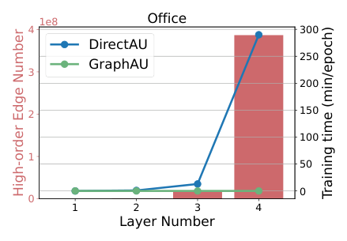
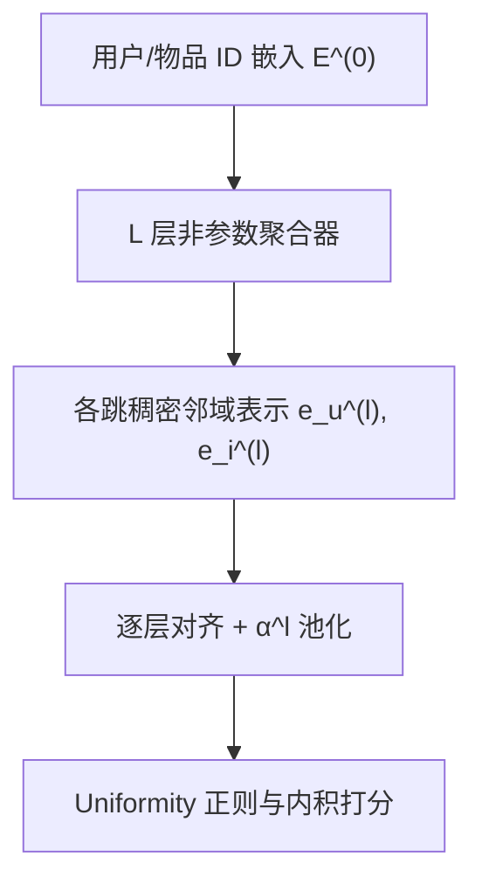
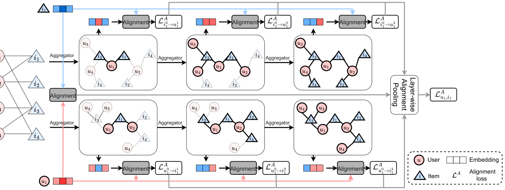

# Graph-based Alignment and Uniformity for Recommendation (基于图对齐与一致性的推荐)

- **会议/期刊**: CIKM 2023（short paper, 4 pages）
- **作者与机构**: Liangwei Yang, Zhiwei Liu, Chen Wang, Mingdai Yang, Xiaolong Liu, Jing Ma, Philip S. Yu；UIC / Salesforce AI Research / UESTC
- **推荐链路定位**: 召回 / 表征学习（点积全排序）
- **研究方向**: 图神经网络与知识图谱推荐 / 自监督对比学习与交互去噪
- **论文原文**: [论文原文链接](https://arxiv.org/abs/2308.09292v1)
- **开源代码**: [开源代码仓库链接](https://github.com/YangLiangwei/GraphAU)

## TL;DR (1分钟核心速览)

针对 DirectAU 只在稀疏正边上做对齐、高阶邻域逐边对齐开销爆炸的问题，GraphAU 用多层聚合器把高阶邻居压成稠密向量，并将中心嵌入逐层对齐到该向量，再用 $\alpha^l$ 池化平衡局部相关性与高阶影响范围。四个数据集上均达 SOTA，Office 的 R@20 较 DirectAU 提升 16.64%。

## Background & Motivation (背景与核心矛盾)

- **主流范式**: DirectAU 将用户-物品交互视为正对，在超球面上用 alignment 拉近正对、uniformity 均匀分布，理论清晰且优于若干图基线。
- **前人局限**: 正边极稀疏，直接对齐信号不足；若枚举 2/3 跳高阶边逐边对齐，边数随跳数指数增长，DirectAU 训练时间也指数增长。
- **核心洞察 (Key Insight)**: 高阶邻域不必逐边对齐；把邻居聚合为一个稠密向量，让中心嵌入对齐该向量即可注入高阶信息，且不同跳邻居的相关性与影响范围不同，应分层加权。
- **本文切入点**: GraphAU = 多跳邻域对齐 + 层间对齐池化，保持轻量聚合器与内积推理。

<figure class="paper-figure" markdown="span">
  <figcaption>图1：DirectAU 的可扩展性问题以及 GraphAU 的效率。GraphAU 的训练时间（折线图）随高阶边数（柱状图）增加几乎保持恒定。</figcaption>
</figure>

## Method (核心方法设计)

### 1. 整体框架 (Overall Architecture)

GraphAU 的输入是用户/物品 ID 嵌入 $\mathbf{E}^{(0)}$；每层用非参数 LightGCN 聚合器得到 1 至 L 跳的稠密邻域表示。训练时，中心节点$u^{(0)}$分别与物品各层表示$i^{(l)}$对齐，反向同理；层间对齐损失经$\alpha^l$ 加权池化，再与 uniformity 正则相加。推理仅用 0 层用户/物品嵌入内积排序，不引入额外图传播。

<figure class="paper-figure" markdown="span">
  <figcaption>图2：在考虑 3 跳内邻域时计算 𝑢1 与 𝑖1 之间对齐损失的示例。GraphAU 在用户-物品二部图上应用 3 个 Aggregator，获得 𝑢1/𝑖1 在 1 至 3 跳内的稠密邻域表示。每个 Aggregator 的输出在池化模块之前分别与 𝑢1 或 𝑖1 显式对齐。</figcaption>
</figure>

### 2. 关键设计拆解 (Key Designs)

1. **多跳邻域对齐（Multi-hop Neighborhood Alignment）**：痛点：逐边对齐高阶邻居会导致边数爆炸。核心算子：$\mathbf{e}_u^{(l+1)}=\mathrm{Agg}^{(l+1)}(\{\mathbf{e}_i^{(l)}\mid i\in\mathcal{N}_u\})$，并将中心嵌入对齐到第$l$跳稠密表示：$\mathcal{L}_{u^{(0)},i^{(l)}}^A=\|\mathbf{e}_u^{(0)}-\mathbf{e}_i^{(l)}\|_2^2$。直觉：聚合把指数级邻居压缩成单个向量，既保留高阶信息，又把对齐计算降为与层数线性相关。

2. **层间对齐池化（Layer-wise Alignment Pooling）**：痛点：不同跳邻居与中心节点的相关性、影响范围不同。核心算子：先做双向平均 $\mathcal{L}_{u,i}^{A,(l)}=\frac12(\mathcal{L}_{u^{(0)},i^{(l)}}^A+\mathcal{L}_{i^{(0)},u^{(l)}}^A)$，再加权求和$\mathcal{L}_{u,i}^A=\sum_{l=0}^{L}\alpha^l\mathcal{L}_{u,i}^{A,(l)}$。直觉：$\alpha<1$偏向局部相关邻居，$\alpha>1$ 偏向高阶影响范围，从而适配不同稀疏度数据。

3. **训练目标、负采样与推理效率**：总损失 $\mathcal{L}=\frac{1}{|\mathcal{E}|}\sum_{(u,i)\in\mathcal{E}}\mathcal{L}_{u,i}^A+\frac{\gamma}{2}(\mathcal{L}_U^U+\mathcal{L}_I^U)$；不显式构造负采样，uniformity 对全体用户/物品对施加排斥。推理为$R_{u,i}=\mathbf{e}_u^{(0)\top}\mathbf{e}_i^{(0)}$，仅$O(d)$ 点积；训练每 epoch 随高阶边增加近似恒定（图 1）。

## Experimental Setup & Evaluation Protocol (实验设置与评估协议)

- **数据集与预处理**: 原文未报告具体统计量，仅说明四个真实数据集规模不同，未提 `5-core` 过滤；下表保留场景信息。

| 数据集 | #Users | #Items | #Interactions | 稀疏度/密度 | 特征/场景说明 |
| :--- | :---: | :---: | :---: | :---: | :--- |
| Amazon Office | — | — | — | — | Amazon 评论，隐式反馈 |
| Amazon Toys | — | — | — | — | Amazon 评论，隐式反馈 |
| Amazon Beauty | — | — | — | — | Amazon 评论，隐式反馈 |
| Gowalla | — | — | — | — | LBS 签到，隐式反馈 |

- **数据划分与防穿越 (Splitting Strategy)**: 随机划分 60% 训练 / 20% 验证 / 20% 测试；非 Leave-One-Out、非全局时间戳切分。
- **排名评测协议 (Ranking Protocol)**: 原文未显式声明候选集与负例；结合 DirectAU 的评估惯例，本文按全库未交互物品 `Full-Ranking` 理解，指标为 R@20、HR@20、N@20。严格复现需核对作者代码。
- **对比基线与超参设置**: 对比 MF-BPR、NGCF、LightGCN、UltraGCN、DirectAU 五类基线；Embedding 维度 $d=32$；学习率搜 {0.1, 0.05, 0.01, 0.005}，weight decay 搜 {0, 1e-2, 1e-4, 1e-6, 1e-8}；层数 1–4，$\gamma$0–1 步长 0.1，$\alpha$0–2 步长 0.1；早停 10 epochs。原文未报告显著性检验（如$p<0.05$）。

## Key Experimental Results (实验关键数据)

### 1. 主实验对比 (Main Results)

R/H/N 分别表示 R@20 / HR@20 / N@20；`Improv.` 为 GraphAU 相对该数据集最强基线的提升。

| 方法 | Office R/H/N | Toys R/H/N | Beauty R/H/N | Gowalla R/H/N |
| :--- | :---: | :---: | :---: | :---: |
| MF-BPR | 0.0818/0.1762/0.0441 | 0.0755/0.1193/0.0393 | 0.0580/0.0936/0.0303 | 0.0824/0.3213/0.0627 |
| NGCF | 0.0753/0.1689/0.0403 | 0.0668/0.1048/0.0346 | 0.0843/0.1327/0.0453 | 0.0856/0.3288/0.0648 |
| LightGCN | 0.0711/0.1554/0.0380 | 0.0937/0.1483/0.0490 | 0.1035/0.1628/0.0546 | 0.0720/0.2901/0.0552 |
| UltraGCN | 0.0796/0.1639/0.0439 | 0.0928/0.1481/0.0493 | 0.1043/0.1619/0.0560 | 0.0887/0.3411/0.0668 |
| DirectAU | 0.0839/0.1682/0.0474 | 0.0985/0.1559/0.0531 | 0.1074/0.1677/0.0583 | 0.1134/0.4051/0.0847 |
| **GraphAU** | **0.0979/0.2003/0.0539** | **0.1041/0.1637/0.0551** | **0.1124/0.1752/0.0599** | **0.1174/0.4136/0.0855** |
| **Improv. R/H/N** | **+16.64/+13.68/+13.71%** | **+5.71/+5.04/+3.81%** | **+4.63/+4.47/+2.78%** | **+3.52/+2.11/+1.01%** |

### 2. 消融实验 (Ablation Study)

原文仅报告高阶 uniformity 消融；下表另加 DirectAU 作为“去掉多跳对齐”的代理对照。

| 变体 | Office R@20 | HR@20 | N@20 | 说明 |
| :--- | :---: | :---: | :---: | :--- |
| **GraphAU** | **0.0979** | **0.2003** | **0.0539** | 完整模型 |
| w/o 多跳对齐（DirectAU 代理） | 0.0839 | 0.1682 | 0.0474 | 仅直接正对对齐 |
| + 1 阶 uniformity | 0.0849 | 0.1704 | 0.0482 | 退化 |
| + 2 阶 uniformity | 0.0857 | 0.1732 | 0.0473 | 退化 |
| + 3 阶 uniformity | 0.0799 | 0.1600 | 0.0440 | 明显退化 |

### 3. 关键实验发现 (Key Findings)

1. **高阶对齐显著缓解稀疏性**：Office 上 GraphAU 的 R@20 从 DirectAU 的 0.0839 提升至 0.0979（+16.64%），说明把高阶邻居压成稠密向量再做对齐，比只对齐直接正边更有效；Gowalla 已较饱和，仍有 +3.52% R@20。
2. **层数与 $\alpha$需按数据稀疏度调节**：图 3 显示 Office 在 L=3 时 R@20 达 0.0988，L=1 仅 0.0840；Toys 在 L=3 达 0.1042，L=4 回落至 0.1011。$\alpha$的最优点在 Office 可$>1$、Toys 可$<1$，对应“高阶影响范围”与“局部相关性”的权衡。
3. **高阶 uniformity 反而有害**：在 Office 上加入 1/2/3 阶 uniformity 后，R@20 从 0.0979 降至 0.0849/0.0857/0.0799，说明二部图只显式编码用户-物品对齐信息，过度正则化高阶均匀性会扭曲表征。

## Highlights & Limitations (亮点、对比与审稿批判)

- **与代表作对比 (vs. Prior Work)**: DirectAU 只对齐直接正对，未利用高阶连通；LightGCN/NGCF 虽聚合高阶邻居，但没有显式 alignment/uniformity 目标；UltraGCN 用无限层近似简化图传播，但仍未把高阶邻域作为对齐对象。GraphAU 的关键差异是“先聚合、再对齐、再分层池化”。
- **可迁移亮点**: 将“高阶邻域压缩为稠密向量后再做对比/对齐”可迁移到图对比学习，避免逐边构造正对；$\alpha^l$ 层间加权可迁移到多跳对比损失，用单超参控制局部与高阶信号。
- **审稿级局限批判**: 短文仅四个数据集，未报告数据集统计、显著性检验与候选集协议，复现时需核对代码；$\alpha$与$\gamma$对结果影响较大，尤其$\gamma$ 需细调；可扩展性只展示训练时间，未报告显存与在线延迟。

## Rating (四维评分)

- **方法创新性 (Novelty)**: ⭐⭐⭐⭐ （把高阶邻域聚合与 DirectAU 对齐目标结合，机制简单但切中稀疏痛点，层间 $\alpha$ 池化有辨识度）
- **评估协议与实验扎实度 (Protocol & Experiments)**: ⭐⭐⭐ （四数据集与五基线较完整，但缺数据集统计、显著性检验和明确的全排序/采样协议）
- **写作与数学规范度 (Clarity & Rigor)**: ⭐⭐⭐⭐ （公式精简、变量定义清楚，聚合-对齐-池化链条完整；短文篇幅限制导致协议细节不足）
- **工业落地与复现价值 (Industrial & Practical Value)**: ⭐⭐⭐⭐ （代码开源，LightGCN 聚合与内积推理易部署，训练时间随高阶边近似恒定，适合召回表征学习）

