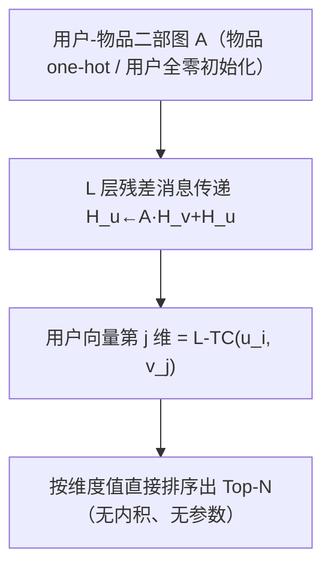
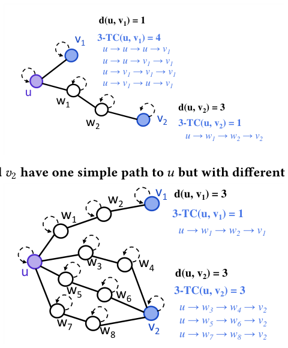

# How Expressive are Graph Neural Networks in Recommendation? (推荐系统中图神经网络的表达性究竟有多强？)

- **会议/期刊**: CIKM 2023（32nd ACM International Conference on Information and Knowledge Management）
- **作者与机构**: Xuheng Cai, Lianghao Xia, Xubin Ren, Chao Huang（香港大学 HKUDS）
- **推荐链路定位**: 召回（图协同过滤表征与打分）
- **研究方向**: 图神经网络与知识图谱推荐 / 协同过滤与双塔召回
- **论文原文**: [https://arxiv.org/abs/2308.11127v3](https://arxiv.org/abs/2308.11127v3)
- **开源代码**: [https://github.com/HKUDS/GTE](https://github.com/HKUDS/GTE)

## TL;DR (1分钟核心速览)

现有 GNN 推荐器的"表达性"分析一律借用图同构（WL 测试）这一图级指标，但推荐的本质是**区分节点与目标用户的结构远近**，而非区分整图结构，度量与任务目标错位。本文构建图级/节点级/链路级三层理论框架，提出与推荐目标直接对齐的**拓扑接近度 (Topological Closeness, TC)**，并证明"消息传递 + 随机初始化 + 内积预测"这一主流范式**无法**按 TC 正确排序。据此给出无参数算法 GTE，在 6 个真实数据集全库排序下，于 3 个稀疏数据集上 Recall@20 相对最佳 GCL 基线提升 8%–14%，且 CPU 训练比 GPU 版 LightGCL 快约两个数量级。

## Background & Motivation (背景与核心矛盾)

- **主流范式**: LightGCN/GCCF 类消息传递 GNN 做图卷积，SimGRACE/SAIL/HCCF/LightGCL 等图对比学习（GCL）加自监督增广，最终以用户-物品表征内积 $\hat{y}_{u,v}=\mathbf{e}_u\cdot\mathbf{e}_v$ 排序。
- **前人局限**: 其一，Xu 等的 WL 等价定理与随机初始化通用性定理都以**图同构**为表达性度量，只服务图分类任务，与"给某用户区分不同物品"这一目标无关；其二，Chamberlain 等指出消息传递无法区分自同构节点（automorphic nodes），但即便节点级度量也只要求"区分不同节点"，不刻画**谁离用户更近**。
- **核心洞察 (Key Insight)**: 作者在真实数据上采样 400 对正/负物品，发现正样本与用户的 3-TC 差值几乎恒大于 0（图 4），说明拓扑接近度天然与真实偏好序一致；而基线模型排序与 TC 理想排序的 Kendall τ 仅 0.05–0.25。
- **本文切入点**: 把"表达性"重定义为链路级 TC 保序能力，并用一个**可证明在 TC 上最优的免学习算法**作为探针，反向检验度量对推荐性能的解释力。

## Method (核心方法设计)

### 1. 整体框架 (Overall Architecture)

论文先做三层理论刻画：(i) 图级——聚合函数单射即可达 WL 等价；(ii) 节点级——证明"差异化初始嵌入 (DIE) + 残差连接 + 单射聚合"可在连通二部图上区分**全部**自同构节点；(iii) 链路级——将自同构节点分为三类，证明主流"随机初始嵌入 + 内积预测"范式无法保证 TC 保序。随后构造 GTE：物品 $v_i$用 one-hot$\mathbf{h}^{(0)}_{v_i}\in\mathbb{R}^{I}$、用户用全零向量初始化，在二部邻接矩阵$A$上做$L$层残差传播，最后**直接取用户向量的第$j$维作为对物品$v_j$的打分**（而非内积），该维度恰等于$L\text{-TC}(u_i,v_j)$。

<figure class="paper-figure" markdown="span">
  <figcaption>图3：k=3 时拓扑接近度的示意图。</figcaption>
</figure>

### 2. 关键设计拆解 (Key Designs)

1. **拓扑接近度 $k$-TC：把"最短距离 + 簇密度"合并为一条可传播的计数**。测地距离无法区分"同样距离但簇密度不同"的节点（图 3b 中$v_2$与$u$同簇却与$v_1$ 距离相同），因此定义
$k\text{-TC}(u,v)=\left|\mathcal{P}^k_{u,v}\right|,\quad 0\text{-TC}(u,u)=1$即长度为$k$、允许重复点/重复边/自环的路径条数。直觉：短简单路径 + 高密度邻域会放大长度为$k$ 的游走计数，故 TC 同时编码距离与聚类结构，且天然可由消息传递逐层累加。

2. **主流范式不可保序的否证（Lemma 6 + 反例构造）**。在 $\sigma,\phi$ 取恒等、仅用末层表征的简化设定下可证
$\mathbf{e}^{(k)}_u=\sum_{w\in\mathcal{N}^{(k)}(u)\cup\{u\}} k\text{-TC}(u,w)\cdot\mathbf{e}^{(0)}_w$即嵌入是初始随机向量的 TC 加权和。于是$\hat{y}_{u,v_1}-\hat{y}_{u,v_2}$中 TC 差值被"随机向量内积 + 其余邻居结构"构成的系数$k_1k_3-k_2k_4$等项污染，即使$L\text{-TC}(u,v_1)>L\text{-TC}(u,v_2)$ 也无法保证打分更高——这解释了为何 GCL 模型的 τ 只有 0.05–0.25。

3. **GTE 的 TC 最优性与训练/推理开销**。由归纳法可得第 $k$层第$j$维$h^{(k)}_w[j]=k\text{-TC}(w,v_j)$，故 Theorem 8：若$L\text{-TC}(u_i,v_j)>L\text{-TC}(u_i,v_k)$，则$\hat{y}_{i,j}>\hat{y}_{i,k}$严格成立。GTE 全程无损失函数、无负采样、无梯度更新，仅$L$次稀疏矩阵乘（复杂度$O(L|A|I)$ 量级），训练即"算完即用"，推理为取维度排序。

## Experimental Setup & Evaluation Protocol (实验设置与评估协议)

- **数据集与预处理**: 6 个真实数据集，按密度从稠密到稀疏排列，用户-物品交互二部图，未额外做 5-core 过滤说明（沿用公开版本划分）。

| 数据集 | #Users | #Items | #Interactions | 密度 | 场景 |
| :--- | :---: | :---: | :---: | :---: | :--- |
| Yelp | 29,601 | 24,734 | 1,517,326 | $2.1\times10^{-3}$ | 本地商户点评 |
| Douban | 13,024 | 22,347 | 397,144 | $1.4\times10^{-3}$ | 图书评分 |
| Tmall | 47,939 | 41,390 | 2,357,450 | $1.2\times10^{-3}$ | 电商购买 |
| Amazon-beauty | 22,363 | 12,101 | 198,502 | $7.3\times10^{-4}$ | 美妆评论 |
| Gowalla | 50,821 | 57,440 | 1,172,425 | $4.0\times10^{-4}$ | 签到 LBS |
| Sparser-Tmall | 69,841 | 41,351 | 248,983 | $8.6\times10^{-5}$ | 稀疏采样子集 |

- **数据划分与防穿越**: 沿用 LightGCN 系的标准用户级训练/验证/测试划分（每位用户留出验证与测试交互），未使用全局时间戳切分，属离线静态评测。
- **排名评测协议**: **Full-Ranking 全库未交互排序**（all-rank protocol，规避负采样偏差），指标 Recall@{20,40} 与 NDCG@{20,40}。
- **对比基线与超参设置**: 8 个基线覆盖 MF（BiasMF）、GNN（NGCF/GCCF/LightGCN）、GCL（SimGRACE/SAIL/HCCF/LightGCL）；所有可学习基线嵌入维度固定 $d=32$；GTE 层数统一$L=3$；显著性用$t$-test 报$p$ 值。

## Key Experimental Results (实验关键数据)

### 1. 主实验对比 (Main Results)

| 数据集 / 指标 | LightGCN | SAIL | HCCF | LightGCL | GTE | Improv. |
| :--- | :---: | :---: | :---: | :---: | :---: | :---: |
| Yelp R@20 | 0.0482 | 0.0471 | 0.0626 | **0.0793** | 0.0647 | -18% |
| Yelp N@20 | 0.0409 | 0.0405 | 0.0527 | **0.0668** | 0.0556 | -16% |
| Douban R@20 | 0.1006 | 0.1211 | 0.1083 | 0.1216 | **0.1269** | +4% |
| Douban N@20 | 0.0759 | 0.0910 | 0.0828 | 0.0927 | **0.1029** | +11% |
| Tmall R@20 | 0.0225 | 0.0254 | 0.0314 | 0.0528 | **0.0578** | +9% |
| Tmall N@20 | 0.0154 | 0.0177 | 0.0213 | **0.0361** | 0.0290 | -20% |
| Amazon-beauty R@20 | 0.0797 | 0.0834 | 0.0813 | 0.0896 | **0.0976** | +9% |
| Amazon-beauty N@20 | 0.0326 | 0.0334 | 0.0339 | 0.0369 | **0.0440** | +19% |
| Gowalla R@20 | 0.0985 | 0.0999 | 0.1070 | 0.1578 | **0.1706** | +8% |
| Gowalla N@20 | 0.0593 | 0.0602 | 0.0644 | 0.0935 | **0.1001** | +7% |
| Sparser-Tmall R@20 | 0.0542 | 0.0521 | 0.0501 | 0.0518 | **0.0588** | +14% |
| Sparser-Tmall N@20 | 0.0288 | 0.0282 | 0.0270 | 0.0300 | **0.0368** | +23% |

### 2. 分析实验 (Efficiency & Metric Alignment，原文无标准消融)

| 分析项 | 设定 | 结果 |
| :--- | :--- | :--- |
| 训练耗时 (分钟，Yelp) | LightGCL (RTX 3090) / GTE (仅 CPU) | 216.12 / **1.85**（≈117×） |
| 训练耗时 (分钟，Gowalla) | LightGCL / GTE | 284.12 / **5.11**（≈56×） |
| 正负样本 TC 差 (3-TC) | 400 对采样，4 个数据集 | 绝大多数 $>0$，正样本 TC 系统性更高 |
| Kendall τ（对比 TC 理想序） | LightGCN/NGCF/HCCF/SAIL/LightGCL | 仅落在 0.05–0.25 |

### 3. 关键实验发现 (Key Findings)

1. **稠密 vs 稀疏呈"能力反转"**：在密度 $\geq 1.2\times10^{-3}$ 的 Yelp/Tmall 上 GTE 落后 LightGCL 达 16%–20%，但在 3 个稀疏数据集上全面反超（最高 +23% NDCG@20），说明可学习范式依赖充足监督信号，而固定 TC 传播在交互稀缺时不退化。
2. **"表达性"缺口的代价被量化**：GCL 最佳模型的 Kendall τ 也仅约 0.25，即约四分之三的物品对排序与 TC 理想序错位；这直接对应理论中"TC 差值被随机内积系数污染"的结论。
3. **理论最优≠绝对性能最优**：GTE 是 TC 度量下的严格最优解，却仍有数据集不敌 LightGCL，反证"单一图结构度量无法完整解释推荐"——用户偏好包含图外因素，度量只提供可解释的结构性下界。

## Highlights & Limitations (亮点、对比与审稿批判)

- **与代表作对比 (vs. Prior Work)**: 相比 LightGCN 仅做无变换卷积、无表达性论证，本文给出节点级"可区分全部自同构节点"的充分条件（DIE + 残差 + 单射聚合），为结构选择提供理论依据；相比 LightGCL 等 GCL 模型以增广视图硬刷指标，本文用 τ 系数暴露其结构排序缺陷；相比 Xu 等的 WL 定理，本文指出图同构度量与推荐目标错配，并在二部图这一受限结构上得到更强结论。
- **可迁移亮点**: ① 用 one-hot/单位阵初始化 + 残差传播直接"算出"路径计数特征，可作为低成本结构特征或冷启动辅助打分注入任意序列/图模型；② 以 Kendall τ 对比"度量最优序"与"模型预测序"，是一套通用的表达性诊断工具。
- **审稿级局限批判**: 其一，TC 理论最优性建立在恒等激活、仅用末层、无学习的简化范式上，与真实可学习 GCN 存在差距，作者亦承认含学习过程的分析无法覆盖；其二，GTE 需将用户向量维度设为物品数 $I$（如 Tmall 约 4 万维），稠密化存储与$O(L|A|I)$ 传播在工业级千万物品库上不可行，且 it 在稠密数据上稳定劣于 GCL，实用性限于稀疏小规模场景。
- **补充**: GTE 采用非单射的恒等映射 $\phi$，故图级/节点级最优性只是"可改造达成"，文档中并未实际实现。

## Rating (四维评分)

- **方法创新性 (Novelty)**: ⭐⭐⭐⭐⭐ （首次将表达性度量下沉到链路级 TC，并给出"主流范式不保序"的否证与二部图节点级强定理，理论增量扎实）
- **评估协议与实验扎实度 (Protocol & Experiments)**: ⭐⭐⭐⭐ （6 数据集覆盖 4 个密度量级、Full-Ranking 无偏协议、$t$-test 报$p$ 值；但缺标准逐组件消融，稠密集落后的事实也未做深入归因）
- **写作与数学规范度 (Clarity & Rigor)**: ⭐⭐⭐⭐ （三层框架与定理链条清晰、Lemma 6→Theorem 8 推导完整；简化假设较强且 GTE 实现与理论前提不完全一致，略有缝隙）
- **工业落地与复现价值 (Industrial & Practical Value)**: ⭐⭐⭐⭐ （代码开源、无参数无负采样、CPU 训练即得可用模型，适合作为低成本召回兜底；但 $I$ 维用户向量与稠密库扩展性是硬约束）

