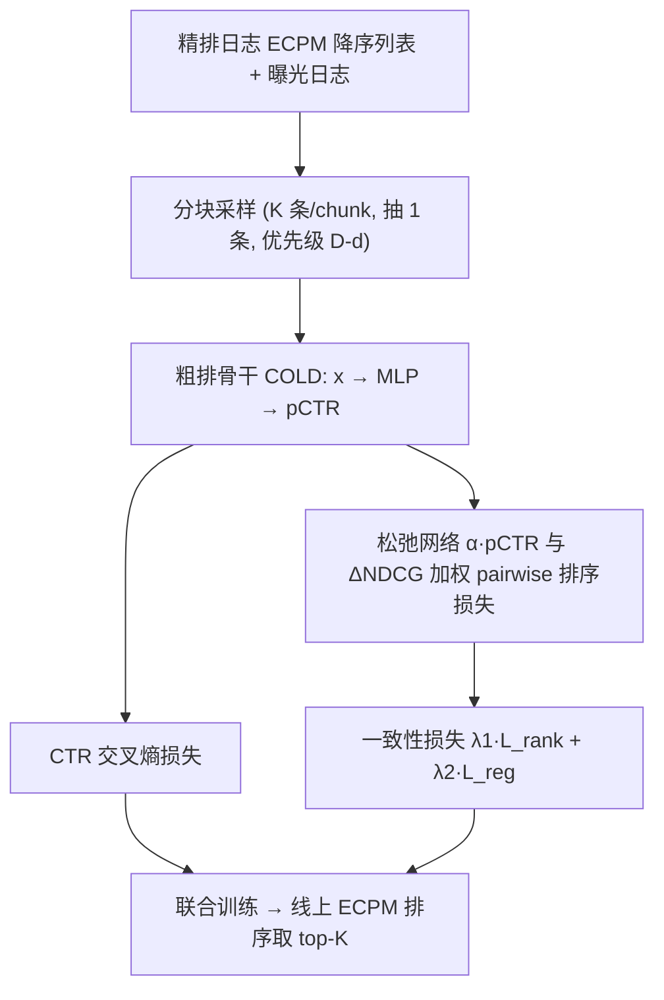
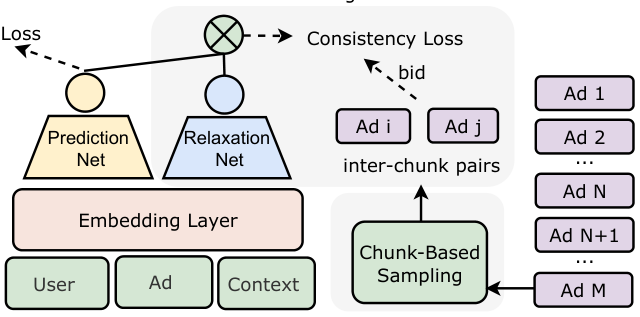

# COPR: Consistency-Oriented Pre-Ranking for Online Advertising (面向一致性的在线广告粗排框架)

- **会议/期刊**: CIKM 2023
- **作者与机构**: Zhishan Zhao, Jingyue Gao, Yu Zhang, Shuguang Han, Siyuan Lou, Xiang-Rong Sheng, Zhe Wang, Han Zhu, Yuning Jiang, Jian Xu, Bo Zheng（阿里巴巴）
- **推荐链路定位**: 粗排（Retrieval → Pre-Ranking → Ranking 级联）
- **研究方向**: 多任务学习与列表级重排 / CTR 预估与特征交叉
- **论文原文**: [https://arxiv.org/abs/2306.03516v2](https://arxiv.org/abs/2306.03516v2)
- **开源代码**: 暂未开源

## TL;DR (1分钟核心速览)

级联架构中轻量粗排与复杂精排存在容量鸿沟，导致同一候选集的 ECPM 排序结果不一致；而已有的"分数对齐"（RankFlow / RD 蒸馏）既无法消除对齐误差，误差又会被出价 `bid` 放大。COPR 把目标从"pCTR 分数一致"松弛为"ECPM 排序一致"：用分块采样构造 chunk 级优先级标签，加一个可插拔的松弛网络与 pairwise logistic 排序损失，并以 ΔNDCG 加权区分 chunk 对的重要性。在淘宝公开数据与生产数据（Homepage / Post-Purchase 双场景）上，全链路模拟排序评测的 HR@10 / NDCG@10 / MAP@10 分别较 RankFlow 提升 5.1% / 13.5% / 33.0%，线上 A/B 最高 +12.3% CTR 与 +5.6% RPM。

## Background & Motivation (背景与核心矛盾)

- **主流范式**: 广告系统采用 检索($10^4$) → 粗排($10^2$) → 精排($10^1$) 三级级联，粗排被期望是精排的"轻量近似"，以 ECPM$=1000\times bid\times pCTR$ 排序后送精排。
- **前人局限**: 一是已有粗排工作（COLD / 双塔 / NAS 选特征）只提升粗排自身精度，忽视与下游精排的交互，必然产出不同排序；二是蒸馏类一致性工作（RD、RankFlow）对齐的是**绝对 pCTR**，受容量差限制误差不可消除。
- **核心矛盾（误差放大）**: 排序由 `pCTR × bid` 决定，微小 pCTR 偏差乘以出价后足以翻转名次。文中玩具例：A(0.1, bid 21) 与 B(0.2, bid 11) 在粗排为 B>A（2.1 vs 2.2），精排 pCTR 微调为 0.11/0.19 后变为 A>B（2.31 vs 2.09）。
- **核心洞察 (Key Insight)**: 决定系统结果的是候选的**相对 ECPM 名次**而非绝对分数；把 score alignment 松弛为 **rank alignment**，既降低学习难度、又能把 bid 提前纳入优化，从源头抑制放大效应。
- **本文切入点**: 直接从精排日志（而非稀疏曝光日志）中采样 chunk 级"优先级"监督信号，显式优化粗排的 ECPM 序一致性。

## Method (核心方法设计)

### 1. 整体框架 (Overall Architecture)

输入由用户特征 $\mathrm{U}$、广告特征$\mathrm{A}$、上下文特征$\mathrm{C}$拼接为$\mathbf{x}=E(\mathrm{U})\oplus E(\mathrm{A})\oplus E(\mathrm{C})$，经嵌入层与 3 层 MLP 预测$\hat{y}=\sigma(\mathrm{MLP}(\mathbf{x}))$（骨干沿用 COLD）。离线数据侧对精排日志中 ECPM 降序列表切成大小$K$的 chunk 并每 chunk 随机抽 1 条，构造带优先级$D-d$ 的子列表；训练时同时优化 CTR 交叉熵与两类一致性损失（松弛网络 + pairwise 排序 + ΔNDCG 权重）。线上服务把训练好的松弛因子作用于 pCTR 生成 ECPM 序，取 top 送精排。整条链路通过 ODL 平台流式更新、Model Center 分发。

<figure class="paper-figure" markdown="span">
  <figcaption>图 2：面向一致性的粗排框架。</figcaption>
</figure>

### 2. 关键设计拆解 (Key Designs)

1. **分块采样 (Chunk-Based Sampling)**：让轻量模型去精确复现数百条广告的全序是不现实的。将列表切为 $D=M/K$ 个 chunk，认为同 chunk 内广告"同优先级"，模型只需在 chunk 粒度上可分：
$\mathcal{R}_{chunk}=[(ads_d, pCTR_{s_d}, bid_{s_d}, D-d)]_{d=1}^{D}$。
双重收益：$K$提供一致性粒度可调旋钮（$K\!\uparrow$则目标由细到粗，可达成），同时把日志规模压缩$K$倍（线上$K=10$），大幅降低工业训练开销。

2. **可插拔排序对齐模块 (Rank Alignment)**：不再回归精排原始分数，而是学一个因子 $\alpha$ 微调 pCTR 后再比 ECPM：
$\alpha=\mathrm{ReLU}(\mathrm{MLP}(\mathbf{x}))+10^{-6},\quad \tilde{y}=\alpha\hat{y}$，
并用 pairwise logistic 损失要求跨 chunk 对满足 $\tilde{y}_{s_i}bid_{s_i}>\tilde{y}_{s_j}bid_{s_j}$。直觉：bid 参与了"距离度量"，模型学的是**比值**而非绝对值，因此粗排无需复刻精排的标定，只需复刻偏序，容量压力骤减。$\alpha$通过对称正则$\mathcal{L}_{reg}$ 拉向 1 以免扭曲 CTR 语义。

3. **ΔNDCG 加权与训练目标**：chunk 1 vs 10 的错序远比 11 vs 20 严重（只有头部会进精排曝光）。交换第 $i,j$ 位的效用损失经 IDCG 归一化后作为权重：
$\Delta NDCG(i,j)=\frac{2^{D-i}-2^{D-j}}{IDCG}\left[\frac{1}{\log(i+1)}-\frac{1}{\log(j+1)}\right]$，
最终 $\mathcal{L}=\mathcal{L}_{ctr}+\lambda_1\mathcal{L}_{rank}+\lambda_2\mathcal{L}_{reg}$，其中
$\mathcal{L}_{rank}=\sum_{i<j}\Delta NDCG(i,j)\log\!\big[1+e^{-(\tilde{y}_{s_i}bid_{s_i}/\tilde{y}_{s_j}bid_{s_j}-1)}\big]$。
训练采用 ranking log 内天然跨 chunk 负样本（免额外负采样）；线上仅多一次 MLP 前向，开销可忽略。

## Experimental Setup & Evaluation Protocol (实验设置与评估协议)

| 数据集 | #Users | #Items | #Interactions | 稀疏度/密度 | 特征/场景说明 |
| :--- | :---: | :---: | :---: | :---: | :--- |
| Taobao 公开集 | 1M | 0.8M | 26M | 极稀疏 | 8 天曝光日志，item price 作 bid；前 7 天训精排 DIN |
| Production | 十亿量级 | — | 十亿级 | 极稀疏 | 8 天日志，分 Homepage / Post-Purchase 两场景 |

- **数据划分**: 全局时间戳切分（前 7 天训练，第 8 天评估），严格防穿越；粗排训练样本为每条曝光采样 10 个候选并取精排 ECPM 序。
- **排名评测协议**: **Sampled Ranking**（每条曝光采 100 候选模拟级联：粗排取 top-10 → 精排取 top-1），一致性指标 HR@K / NDCG@K / MAP@K 以精排 top-10 为"相关集"、精排日志次序为 relevance 代理；系统指标为模拟 CTR（点击占比）与 RPM（CTR × 点击均价），生产集使用真实线上 A/B。
- **基线与超参**: Base(COLD)、Distillation（曝光日志蒸馏精排分数）、RankFlow（排序日志分数蒸馏 + 序正则）、COPR w/o ΔNDCG；嵌入维度 16，MLP 3 层，$K=2$(公开)/$10$(生产)，$\lambda_1=1,\lambda_2=0.2$。

## Key Experimental Results (实验关键数据)

### 1. 主实验对比 (Main Results)

| Method | HR@10 | NDCG@10 | MAP@10 | CTR | RPM |
| :--- | :---: | :---: | :---: | :---: | :---: |
| Base (COLD) | 0.544 | 0.402 | 0.198 | 0.0170 | 112.66 |
| Distillation | 0.593 | 0.461 | 0.244 | 0.0176 | 117.36 |
| RankFlow | 0.722 | 0.467 | 0.270 | 0.0182 | 121.36 |
| COPR w/o ΔNDCG | 0.741 | 0.514 | 0.327 | 0.0188 | 129.20 |
| **COPR** | **0.759** | **0.530** | **0.359** | **0.0191** | **132.93** |
| Improv. vs RankFlow | +5.1% | +13.5% | +33.0% | +5.0% | +4.9% |

线上 A/B（相对生产基线提升）：

| Method | Homepage CTR | Homepage RPM | Post-Purchase CTR | Post-Purchase RPM |
| :--- | :---: | :---: | :---: | :---: |
| Distillation | +2.2% | +0.1% | +3.6% | +0.6% |
| RankFlow | +8.3% | +2.9% | +6.8% | +2.3% |
| COPR w/o ΔNDCG | +11.5% | +5.0% | +9.6% | +3.7% |
| **COPR** | **+12.3%** | **+5.6%** | **+10.8%** | **+4.4%** |

### 2. 消融实验 (Ablation Study)

| 变体 | HR@10 | NDCG@10 | MAP@10 | 线上 CTR (Home/Post) |
| :--- | :---: | :---: | :---: | :---: |
| COPR (full) | **0.759** | **0.530** | **0.359** | **+12.3% / +10.8%** |
| w/o ΔNDCG 加权 | 0.741 | 0.514 | 0.327 | +11.5% / +9.6% |
| w/o 排序对齐（≈Base+分块） | 0.544 | 0.402 | 0.198 | — |

### 3. 关键实验发现 (Key Findings)

1. **一致性即收益**：从 Base 到 COPR，HR@10 由 0.544 升至 0.759 时 RPM 由 112.66 单调涨至 132.93（+18.0%），而 MAP@10 的相对增幅（+81.3%）远高于 HR@10（+39.5%），说明增益主要来自 top 位置序关系的纠正而非粗粒度命中率。
2. **rank alignment 优于 score alignment**：RankFlow 相对 Distillation 在 HR@10 上高出 21.8%（0.722 vs 0.593），作者归因于排序日志比稀疏曝光日志提供更密的监督；而 COPR 再进一步是因为把 bid 纳入目标、避免了 Table 1 所示的放大效应。
3. **ΔNDCG 加权对头部关键**：去除权重后公开集 MAP@10 掉 8.9%（0.327→0.359）、线上 CTR 由 +12.3% 回落至 +11.5%，说明有限优化预算集中于高优先级 chunk 对确有边际收益；RPC 定性曲线亦显示 RankFlow 按 pCTR 接近理想线、按 ECPM 严重偏离，而 COPR 按 ECPM 全位置贴近理想线。

## Highlights & Limitations (亮点、对比与审稿批判)

- **与代表作对比**: 相较 COLD / 双塔类工作只做"更准的粗排"，COPR 首次把粗排—精排交互作为显式优化对象；相较 RD 的"精排选中项得高分"二值蒸馏，COPR 建模完整跨 chunk 偏序；相较 RankFlow 的分数回归，COPR 用 bid 加权的 ECPM 序取代 pCTR 对齐，把一致性目标变得可达。
- **可迁移亮点**: ① "松弛网络 + 相对序目标"可平移到召回→粗排、重排→精排等任意级联接口；② 分块采样把长列表 NDCG 优化压缩为 $D$ 条伪样本，是工业训练中降低排序损失开销的通用 trick。
- **审稿级局限批判**: ① 一致性粒度 $K$是关键超参（公开集 2 / 生产 10），论文未给$K$敏感性曲线，粗粒度下"一致性上限"被结构性压低；② 离线一致性指标以精排日志序为 relevance 代理，存在自我参照（self-referential）风险，未用真实点击做一致性之外的校验；③ 线上用$\tilde{y}=\alpha\hat{y}$排序，若同一 pCTR 还被其他模块（如计费、出价建议）复用，$\alpha$偏差可能引入副作用，论文仅以$\mathcal{L}_{reg}$ 约束而未量化该风险。

## Rating (四维评分)

- **方法创新性 (Novelty)**: ⭐⭐⭐⭐ （把 score alignment 松弛为 ECPM rank alignment 的思路简洁且切中广告计费本质，chunk 粒度控制与 ΔNDCG 加权是合理增量，但整体仍是 pairwise 排序损失的工程化组合）
- **评估协议与实验扎实度 (Protocol & Experiments)**: ⭐⭐⭐⭐ （公开集 + 十亿级生产集 + 真实线上 A/B 三段验证完整，$K\!\in\![5,100]$曲线与 RPC 定性分析有说服力；扣分在于以精排日志序作 relevance 代理、缺少$K$ 敏感性）
- **写作与数学规范度 (Clarity & Rigor)**: ⭐⭐⭐⭐ （损失与 ΔNDCG 权重推导清晰、算法与系统流程分层明确；$\alpha$ 在推理期的使用方式与 ECPM 计算的细节交代略简）
- **工业落地与复现价值 (Industrial & Practical Value)**: ⭐⭐⭐⭐⭐ （骨干沿用 COLD、模块即插即用、线上仅一次 MLP 前向，2022 年 10 月起已承载淘宝展示广告主流量，落地价值极高；仅缺开源代码）

