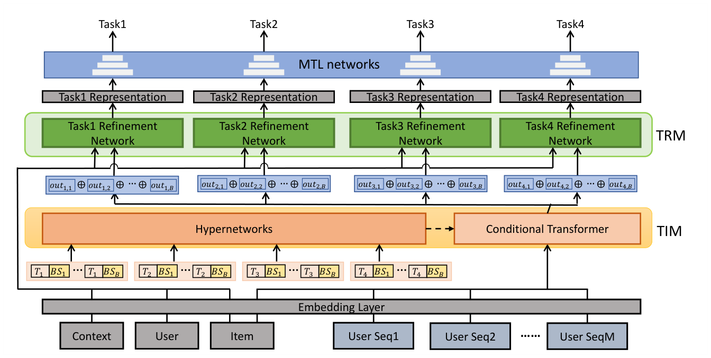

# Deep Task-specific Bottom Representation Network for Multi-Task Recommendation (任务特定底层表征网络的多任务推荐)

- **会议/期刊**: CIKM 2023
- **作者与机构**: Qi Liu, Gangwei Jiang, Defu Lian (USTC)；Zhilong Zhou, Tiezheng Ge (Alibaba Group)
- **推荐链路定位**: 精排（多任务 CTR/CVR 预估）
- **研究方向**: 多任务学习与列表级重排 / CTR/CVR 预估与特征交叉
- **论文原文**: [arXiv:2308.05996v2](https://arxiv.org/abs/2308.05996v2)
- **开源代码**: [Tenrec 数据集仓库](https://github.com/yuangh-x/2022-NIPS-Tenrec)（非 DTRN 官方实现）

## TL;DR (1分钟核心速览)

针对多任务推荐共享底层表征在冲突任务梯度下被折中、引发负迁移的问题，DTRN 显式构造每任务底层表征：TIM 用任务/行为类型嵌入驱动超网络，向共享 Transformer 的 LayerNorm 注入条件仿射参数，抽取 $T\times M$ 细粒度兴趣并按任务拼接；TRM 用每任务 SENet 式 MLP 对稀疏特征与兴趣做上下文感知重标定。电商时间切分与 Tenrec 样本级评估中四任务 AUC/LogLoss 全面最优，转化 AUC 相对 DFN +1.16%，在线 A/B 进入率 +2.23%。

## Background & Motivation (背景与核心矛盾)

- **主流范式**: MMoE/PLE/AITM 等以任务共享底层 + gating 参数共享网络隐式学习泛化表征，再经任务塔输出多目标概率。
- **前人局限**: 冲突任务在共享底层产生折中梯度，负迁移损伤所有任务；gating 方法输出的任务表征仍有重叠（PLE 可视化），难以消除共享底层的 compromise。
- **核心洞察**: 多类行为序列对任务的相关性显著不同（如 entering_seq 对 entering 的平均命中 2.57，对 watch 仅 1.56），且底层表征学习长期被忽视。
- **本文切入点**: 不做“共享底层+上层分流”，而是把任务条件注入底层，显式得到每任务专属底层表征，并可与现有 MTL 网络即插即用。

## Method (核心方法设计)

### 1. 整体框架 (Overall Architecture)

输入稀疏 ID 与 $M$类行为序列，经 Embedding 后分两路：TIM 以任务类型嵌入$T_i$和行为类型嵌入$BS_b$为条件，通过超网络生成 scale/shift，注入共享 Transformer 的 Conditional LayerNorm，对每个$(t,b)$对输出任务-行为兴趣，再按任务拼接为$interest_i$；TRM 将$interest_i$与稀疏 ID 嵌入拼接成$raw_i$，用每任务 SENet 式 MLP 生成重标定向量并逐元素调制，得到$r_i$。最后$r_i$ 并行送入 AITM/MMoE 等 MTL 网络，输出多任务 logits，以各任务 BCE 之和端到端训练。图2给出整体框架。

<figure class="paper-figure" markdown="span">
  <figcaption>图2：Deep Task-specific Representation Network(DTRN)的整体框架。DTRN由Task-specific Interest Module(TIM)和Task-specific Representation Refinement Module(TRM)组成，学习任务特定的底层表示。</figcaption>
</figure>

### 2. 关键设计拆解 (Key Designs)

1. **TIM：超网络条件 Transformer 抽取任务特定兴趣**：为免每任务-行为对独立建塔导致参数爆炸，TIM 只保留一个共享 Transformer，用两层 MLP 超网络由 $(T_i,BS_b)$生成条件仿射参数，注入 LayerNorm：$\mathrm{CLN}^{l}_{t,b}(X)=\gamma^{l}_{t,b}\cdot\gamma^{l}\cdot\frac{X-\mu}{\delta}+\beta^{l}_{t,b}+\beta^{l}$。条件 scale/shift 让同一序列编码器按任务-行为对缩放、平移或关闭中间表征，参数高效且能刻画细粒度兴趣差异。编码器 MHSA + 解码器以目标 item 为 query 做局部激活，输出$out^{dec}_{t,b}$。

2. **TRM：每任务 SENet 式底层表征精炼**：共享底层另一问题是同一特征对不同任务重要性不同、且表征需随上下文自适应。TRM 对每任务构造 $raw_i=[e_{s,1},...,e_{s,N},interest_i]$，经任务专属两层 MLP（ReLU + Sigmoid）得到 refine 向量，再$r_i=raw_i\odot MLP_i(raw_i)$。逐特征重标定使模型按上下文放大/抑制特征，得到任务相关且 context-aware 的底层表示，缓解任务间相互干扰。

3. **训练目标、负采样与推理效率**：多任务均用 BCE，总损失 $\mathcal{L}=\sum_{t=1}^{T}\mathrm{BCE}(\sigma(o_t),y_t)$；这是样本级 CTR 监督，不做负采样排序。TIM 的 Transformer 参数共享，但需按$T\times M$ 条件生成参数并编码各行为序列，在线推理/显存开销高于单塔共享底层；MTL 上层可替换为 AITM/MMoE/PLE。

## Experimental Setup & Evaluation Protocol (实验设置与评估协议)

- **数据集与预处理**:

| 数据集 | #Users | #Items | #Interactions | 稀疏度/密度 | 特征/场景说明 |
| :--- | :---: | :---: | :---: | :---: | :--- |
| 阿里微视频电商 | 59,677,310 | 41,343 | 376,197,451 | 0.0153% | 116 类稀疏 ID；5 类行为序列（watch/non-watch/click/non-click/entering）；任务 watch/click/entering/conversion |
| Tenrec QK-Video-1M | 993,554 | 821,744 | 117,551,246 | 0.0144% | 16 类特征；5 类序列（click/follow/like/share/negative）；任务 click/follow/like/share |

- **数据划分与防穿越**: 电商用一个月样本训练、后一天样本测试（全局时间戳切分）；Tenrec 原文未明确划分细节，仅说明为 QK-Video-1M 子集。
- **排名评测协议**: 采用样本级二分类 AUC 与 LogLoss，不是 Full-Ranking 全库排序，也无采样负例排序；AUC 衡量排序区分度，LogLoss 衡量概率校准。
- **对比基线与超参设置**: 基线覆盖单/多行为序列模型（YouTubeNet、DIN、DIEN、ATRANK、DFN、DMT）与 MTL 模型（MMoE、PLE、AITM、M2M、SmallHeads）。电商因任务因果链选 AITM 组合，Tenrec 选 MMoE；batch=2048，Adam，学习率 1e-4/1e-3，单 epoch；嵌入维度 $d$原文未给固定值，图4显示不同维度下 DTRN 稳定优。显著性：电商 **$p<0.01$，Tenrec *$p<0.05$。

## Key Experimental Results (实验关键数据)

### 1. 主实验对比 (Main Results)

下表保留 6 个代表性基线，AUC 最优加粗；`Improv.` 为 DTRN 相对各任务最佳基线的相对提升。DTRN 的 LogLoss 也在两数据集四任务全部最低。

| 方法 | 电商 Watch | 电商 Click | 电商 Entering | 电商 Conv. | Tenrec Click | Tenrec Follow | Tenrec Like | Tenrec Share |
| :--- | :---: | :---: | :---: | :---: | :---: | :---: | :---: | :---: |
| DMT(MMoE) | 0.7338 | 0.7246 | 0.8237 | 0.8726 | 0.9506 | 0.9152 | 0.9501 | 0.9279 |
| PLE | 0.7340 | 0.7237 | 0.8231 | 0.8693 | 0.9508 | 0.9149 | 0.9504 | 0.9283 |
| AITM | 0.7337 | 0.7245 | 0.8240 | 0.8691 | 0.9507 | 0.9102 | 0.9501 | 0.9252 |
| M2M | 0.7343 | 0.7245 | 0.8238 | 0.8674 | 0.9507 | 0.9128 | 0.9506 | 0.9289 |
| SmallHeads | 0.7342 | 0.7246 | 0.8240 | 0.8673 | 0.9510 | 0.9150 | 0.9508 | 0.9274 |
| DFN | 0.7318 | 0.7230 | 0.8232 | 0.8727 | 0.9504 | 0.9063 | 0.9489 | 0.9244 |
| **DTRN** | **0.7346** | **0.7271** | **0.8283** | **0.8828** | **0.9516** | **0.9201** | **0.9519** | **0.9331** |
| `Improv.` | +0.04% | +0.35% | +0.52% | +1.16% | +0.06% | +0.54% | +0.12% | +0.45% |

### 2. 消融实验 (Ablation Study)

| 方法（电商） | Watch | Click | Entering | Conversion |
| :--- | :---: | :---: | :---: | :---: |
| DMT | 0.7337 | 0.7245 | 0.8240 | 0.8691 |
| +TIM | 0.7339 | 0.7255 | 0.8264 | 0.8786 |
| +TRM | 0.7339 | 0.7257 | 0.8266 | 0.8724 |
| **DTRN** | **0.7346** | **0.7271** | **0.8283** | **0.8828** |

### 3. 关键实验发现 (Key Findings)

- TIM 单独将 conversion AUC 从 0.8691 提到 0.8786（+1.09%），TRM 单独把 click 提到 0.7257；二者合并后 conversion 达 0.8828（相对 DMT +1.58%），说明任务特定兴趣与特征重标定互补。
- 条件信息注入位置很关键：LN 的 conversion 0.8828 高于 QKV 0.8786、FFN-1 0.8707、FFN-2 0.8715；且 DTRN 与 ShareBottom/MMoE/PLE/AITM 组合均全面提升，AITM+DTRN 最优，证明底层任务特定化与上层 MTL 结构正交。
- 在线 10% 流量、30 天 A/B：watch +0.63%、click +1.00%、entering +2.23%、RPM +1.00%；去除 watch 任务后 DTRN 的 click/entering/conversion 降至 0.7170/0.8221/0.8780，稀疏任务更依赖任务特定底层表征。

## Highlights & Limitations (亮点、对比与审稿批判)

- **与代表作对比**: 相比 MMoE/PLE 仅在上层 gating 分流，DTRN 把任务条件前移到共享 Transformer 的 LayerNorm，直接生成任务特定底层；相比 SmallHeads 仅用辅助损失增强共享底层泛化，DTRN 显式保留每任务 $r_i$；相比 DMT 为每行为序列建独立编码器但跨任务共享，DTRN 以超网络参数高效实现$T\times M$ 任务-行为兴趣。
- **可迁移亮点**: 超网络生成 CLN 仿射参数可迁移到任意共享序列编码器的多场景/多任务条件化；每任务 SENet 式特征重标定可低成本插入现有精排底层。
- **审稿级局限批判**: 在线需按 $T\times M$ 条件编码与生成参数，延迟/显存高于单塔共享底层，论文未给推理 FLOPs；评估为样本级 AUC/LogLoss，非全库排序，Tenrec 划分与负样本构造未详，且电商/Tenrec 需人工选择 AITM/MMoE，任务因果与组合泛化仍依赖先验。

## Rating (四维评分)

- **方法创新性 (Novelty)**: ⭐⭐⭐⭐ （显式任务特定底层表征较新颖，超网络条件 LN 与 SENet 重标定组合有效，但单点技术非全新）
- **评估协议与实验扎实度 (Protocol & Experiments)**: ⭐⭐⭐⭐ （两个大规模数据集+在线 A/B+充分消融，但样本级 AUC/LogLoss 非 ranking，Tenrec 划分细节不足）
- **写作与数学规范度 (Clarity & Rigor)**: ⭐⭐⭐⭐ （TIM/TRM 公式清晰、条件注入消融有说服力；符号重复、嵌入维度与推理复杂度缺失）
- **工业落地与复现价值 (Industrial & Practical Value)**: ⭐⭐⭐⭐⭐ （阿里在线 A/B 全指标正向、可插拔 MTL，工程价值强；但官方模型代码未开，复现需自建）

