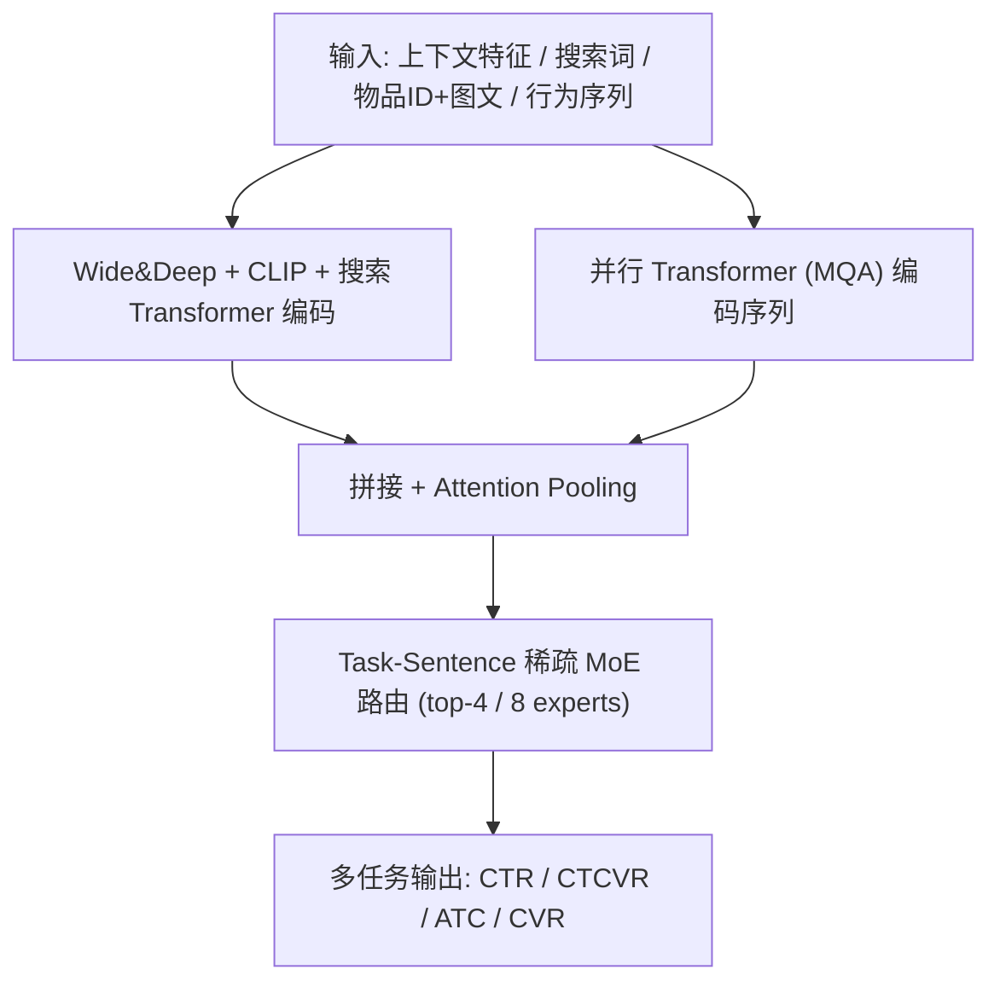
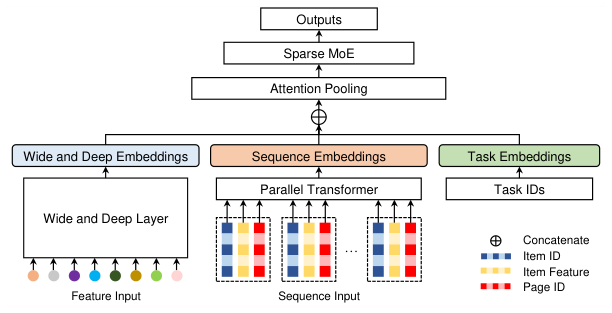

# Efficient Multi-Task Learning via Generalist Recommender (面向高效多任务学习的通才推荐模型)

- **会议/期刊**: CIKM 2023 (Industry Track, 5 页短文)
- **作者与机构**: Luyang Wang, Cangcheng Tang, Jun Ruan (Verizon)；Chongyang Zhang, Kai Huang, Jason Dai (Intel)
- **推荐链路定位**: 精排 (多任务 CTR/CVR/ATC/CTCVR 预估)
- **研究方向**: 多任务学习与列表级重排 / 多模态推荐
- **论文原文**: [https://arxiv.org/abs/2504.05318v1](https://arxiv.org/abs/2504.05318v1)
- **开源代码**: [https://github.com/intel-analytics/BigDL](https://github.com/intel-analytics/BigDL)

## TL;DR (1分钟核心速览)

针对电信网站多业务场景下"单任务模型各自为战、稀疏 CVR 任务训练数据不足、MMoE 类多任务模型任务数增加后训练/推理变慢"的痛点，本文提出 GRec：用 Wide&Deep + 并行 Transformer(MQA) + CLIP 处理多模态输入，并借鉴 LLM 稀疏 MoE 提出**任务-句子级路由**（把主任务 CTR/CVR 与辅助 flow 拼接成 task-sentence 再做门控）。在内部交易日志上离线 AP 的 CTR/CTCVR/ATC/CVR 分别提升 +0.36/+1.69/+1.12/+0.77，路由 FLOPs 与 MMoE 持平；线上 A/B 的 CVR 类任务提升 +20.3%。

## Background & Motivation (背景与核心矛盾)

- **主流范式**: 业界多目标推荐普遍采用 MMoE/PLE/SNR 等专家混合结构做参数共享，任务数通常在个位数，专家一律全激活。
- **前人局限**: ① 单任务孤岛模型看不到 AAL（加线）/EUP（换机）/NSE（拉新）等 flow 间的关联，且 CVR 类任务样本极稀疏，大参数量模型难以收敛；② MMoE 的专家必须全量参与前向计算，任务数增加时训练与推理时间线性膨胀，难以支撑线上高流量。
- **核心洞察 (Key Insight)**: 推荐中的"任务"其实由 **flow（业务流）× use case（目标指标）** 两个维度交叉而成，但若直接按任务笛卡尔积切分做 task-level 路由，会导致任务对过多、数据被切碎、训练不稳；而 token 级路由虽精度高却要为每个 token 算门控，开销翻倍。
- **本文切入点**: 把 flow ID 与 use case ID 拼成一个 "task sentence" 送入门控，在路由粒度上取 token 级与 task 级之间的折中——既保留任务语义，又把门控计算压到句子级。

## Method (核心方法设计)

### 1. 整体框架 (Overall Architecture)

输入侧分三路：上下文类目/数值特征走 Wide&Deep；搜索词经预训练 Transformer 编码用户意图，物品图文经预训练 CLIP 编码，与 item ID embedding、物品 wide/deep 分量拼接成完整物品向量；用户历史设备序列与落地页序列走并行 Transformer（多查询单键值注意力 MQA）编码。三路表征拼接后经 Attention Pooling 汇成统一表示，再送入稀疏 MoE 层，由 task-sentence 路由为每类任务挑选 top-$k$ 专家，最后接各任务塔输出 CTR/CTCVR/ATC/CVR。

<figure class="paper-figure" markdown="span">
  <figcaption>图1：我们的GRec模型框架。</figcaption>
</figure>

### 2. 关键设计拆解 (Key Designs)

1. **任务-句子级路由 (Task-Sentence Routing)**：痛点起因是 token 级路由太贵、task 级路由因任务对爆炸而数据碎片化；本文把同一 flow 与 use case 的 task ID 视作一个句子，先做句内平均再门控：
   $\mathbf{G}_{s,E}=\mathrm{GATE}\left(\frac{1}{S}\sum_{s=1}^{S}\mathrm{taskid}_s\right)$直觉上它在"任务语义可分"与"计算量可控"之间插值：门控只需按句子算一次，避免$S$ 倍 token 级开销，又不至于像 task-level 那样把相近任务完全隔离、丢失跨任务共享。

2. **多查询注意力 + 并行 Transformer**：为压低线上推理成本，把标准多头注意力的 $K,V$投影从$[h,d]$压成$[1,d]$（各头共享 K/V、Q 仍为多头），并将 Attention 与 FFN 从串行改为并行：
   $y=x+\mathrm{MLP}(\mathrm{LN}(x))+\mathrm{Attention}(\mathrm{LN}(x))$相比串行式$y=x+\mathrm{MLP}(\mathrm{LN}(x+\mathrm{Attention}(\mathrm{LN}(x))))$，减少了注意力块尺寸与一次 LayerNorm 依赖，在长序列上提速明显。

3. **训练目标、负采样与推理效率**：各任务独立二分类交叉熵求和 $\mathcal{L}=\sum_{t\in\mathcal{T}}\mathrm{BCE}(y_t,\hat{y}_t)$；跨任务的 AAL/EUP/NSE 样本按任务上采样以缓解类别与任务双重不均衡；稀疏 MoE 只激活 top-4/8 专家，专家容量设为 2 tokens、batch 2048，故总参数量随专家数增长而 FLOPs 近似不变（实测 16→48 专家时 FLOPs 稳定在 7.27M–7.29M）。

## Experimental Setup & Evaluation Protocol (实验设置与评估协议)

- **数据集与预处理**:

| 数据集 | 规模/切分 | 稀疏度/说明 | 特征/场景说明 |
| :--- | :---: | :---: | :--- |
| AliExpress (NL/ES/FR/US) | 公开，4 个国家子集 | 多任务 CTR 日志，未给精确统计 | 用于验证 top-$k$ 与专家总数对 AUC 的影响 |
| 内部交易数据 (Verizon) | 3 个月训练 + 末日后一周采样测试 | 稀疏，CVR/ATC 正例稀少 | flow ∈ {AAL, EUP, NSE} × use case ∈ {CTR, CTCVR, ATC, CVR} |

- **数据划分与防穿越 (Splitting Strategy)**: 内部数据采用**全局时间戳切分**，测试集取训练集最后一天之后一周内的真实交易，严格避免未来信息泄漏。
- **排名评测协议 (Ranking Protocol)**: 非排序型协议，采用**逐样本概率打分 + AUC**（公开集）与**Average Precision**（内部离线），线上以真实流量 A/B 的同流量对比指标评估；CTR 场景下 AUC 提升 0.1% 量级即视为显著 [22]。
- **对比基线与超参设置**: 离线主基线为 **MMoE（4 专家全激活，对齐 GRec 的 top-4 设置）**；内部模型均为 8 专家 top-4、expert capacity 2、batch 2048，embedding 维度与其余超参在 [20] 中给出；线上基线为各场景对应的**单任务推荐模型**（设备模型 / 配件模型）。

## Key Experimental Results (实验关键数据)

### 1. 主实验对比 (Main Results)

内部离线交易数据集（Average Precision，路由 FLOPs 越低越好）：

| 模型 | 专家/Top-$k$ | 路由粒度 | FLOPs (Routing) | CTR | CTCVR | ATC | CVR |
| :--- | :---: | :---: | :---: | :---: | :---: | :---: | :---: |
| MMoE (基线) | 4/4 | Sentence | 2.1M | 64.15 | 79.02 | 55.73 | 84.17 |
| GRec | 8/4 | Token | 4.1M | 64.53 | **80.72** | 56.23 | 84.63 |
| GRec | 8/4 | Sentence | 4.1M | 64.12 | 78.95 | 55.12 | 83.67 |
| GRec | 8/4 | Task | 1.0M | 64.26 | 79.24 | 55.21 | 84.24 |
| **GRec (本文)** | 8/4 | **Task-Sentence** | 2.1M | **64.51** | 80.71 | **56.85** | **84.94** |
| Improv. vs MMoE | — | — | ±0 | +0.56% | +2.14% | +2.01% | +0.91% |

线上 A/B（同流量对比单任务模型，均达统计显著）：

| 场景 (Flow×Use Case) | 基线 | 提升 |
| :--- | :--- | :---: |
| 首页 / AAL CTCVR | 加线设备模型 | +8.5% |
| 首页 / EUP CTCVR | 换机设备模型 | +2.1% |
| 配件插屏 / AAL CVR | 加线配件模型 | **+20.3%** |
| 配件插屏 / EUP CVR | 换机配件模型 | **+12.0%** |

### 2. 消融实验 (Ablation Study)

以路由策略为唯一变量（8 专家、top-4、FLOPs 仅统计路由层）：

| 路由粒度 | 门控输入 | FLOPs | CTCVR | ATC | CVR | 结论 |
| :--- | :--- | :---: | :---: | :---: | :---: | :--- |
| Token-level | 每 token 独立 | 4.1M | 80.72 | 56.23 | 84.63 | 精度上限，但开销翻倍 |
| Task-Sentence | $\frac{1}{S}\sum \mathrm{taskid}_s$ | 2.1M | 80.71 | 56.85 | 84.94 | 用 50% FLOPs 达成同等甚至更优 |
| Task-level | $\mathrm{GATE}(\mathrm{taskid})$ | 1.0M | 79.24 | 55.21 | 84.24 | 过粗，任务隔离导致掉点 |
| Sentence-level | $\frac{1}{S}\sum x_s$ | 4.1M | 78.95 | 55.12 | 83.67 | 丢失任务身份，反而不如 MMoE |

### 3. 关键实验发现 (Key Findings)

1. **路由粒度不是"越细越好"，而是"任务语义保留度"决定收益**：Task-Sentence 相比 Token 级在 CTCVR 上仅差 0.01、CVR 反超 0.31，但路由 FLOPs 从 4.1M 降到 2.1M；而 Sentence 级（对隐状态而非 task ID 求均值）丢掉任务身份后 CTCVR 掉到 78.95，比 MMoE 基线还低 0.07，说明门控输入里必须显式携带 task 语义。
2. **稀疏激活带来的容量红利是可扩展的**：在 AliExpress 四国子集上，增大 top-$k$ 与增多专家总数都能持续抬升 AUC，而 16→48 专家的 FLOPs 仅从 7.27M 漂移到 7.29M——这正是 GRec 舍弃 MMoE"全专家激活"的根本动机（MMoE 的时延随专家数线性增长）。
3. **共享参数对稀疏转化任务收益最大**：线上 AAL/EUP 的 CVR 场景提升 +20.3%/+12.0%，显著高于同页面 CTCVR 的 +8.5%/+2.1%，印证了"CVR 样本稀疏、靠 CTR/ATC 的丰富样本迁移"的假设；也说明多任务统一建模比继续堆单任务模型更划算（运维复杂度同步下降）。

## Highlights & Limitations (亮点、对比与审稿批判)

- **与代表作对比 (vs. Prior Work)**: 相比 MMoE / SNR 这类"全专家激活 + 固定共享"结构，GRec 的差异在于把 MoE 从"容量扩充手段"变成"任务隔离手段"，并用 task-sentence 解决任务对爆炸；相比 Task-MoE（机器翻译中的 task-level 路由），本文指出推荐场景的任务是 flow×use case 的二维交叉、粒度比语言对更细，故必须做句子级折中；相比 LLM4Rec 路线，它并不调用大模型，只借用 Sparse MoE + MQA + 并行层的**结构效率思想**。
- **可迁移亮点**: ① "task ID 拼句子再平均门控"这一技巧可零成本移植到任何 MMoE/PLE 变体，用于任务数多但单任务样本少的电商场景；② 多查询注意力（各头共享 K/V）+ 并行 Attention/FFN 是精排长行为序列上可直接复用的降延迟组合。
- **审稿级局限批判**: ① 离线主表只有 MMoE 一个基线，缺少 PLE、SNR、AITM 等强多任务对照，且 AliExpress 实验仅以曲线呈现、无成表数值，说服力弱于常规学术论文；② FLOPs 只统计路由层（1.0M/2.1M/4.1M），未给出端到端时延与 QPS，也未报告 Task-Sentence 引入的手工任务体系维护成本与新增任务时的重训代价；③ 线上 A/B 缺少置信区间与流量规模，CVR 提升 +20.3% 的方差未知。

## Rating (四维评分)

- **方法创新性 (Novelty)**: ⭐⭐⭐ （task-sentence 路由本身是工程化折中而非理论突破，但把 LLM 稀疏 MoE 的粒度问题正确迁移到推荐的二维任务空间，思路实用且新颖度中等偏上）
- **评估协议与实验扎实度 (Protocol & Experiments)**: ⭐⭐⭐ （有线上 A/B 与时间切分防穿越，但离线仅单基线 MMoE、公开集只给曲线无表格、缺显著性检验细节）
- **写作与数学规范度 (Clarity & Rigor)**: ⭐⭐⭐⭐ （四种路由策略公式对照清晰、架构图与 FLOPs 定义明确，5 页短文叙事紧凑；不足是复杂度分析仅停留在 FLOPs 粗算）
- **工业落地与复现价值 (Industrial & Practical Value)**: ⭐⭐⭐⭐⭐ （已在大型电信站点全流量部署，代码随 BigDL/Friesian 开源，路由策略与 MQA 可直接迁移，落地价值极高）

