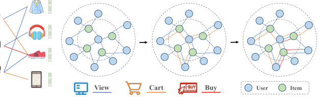
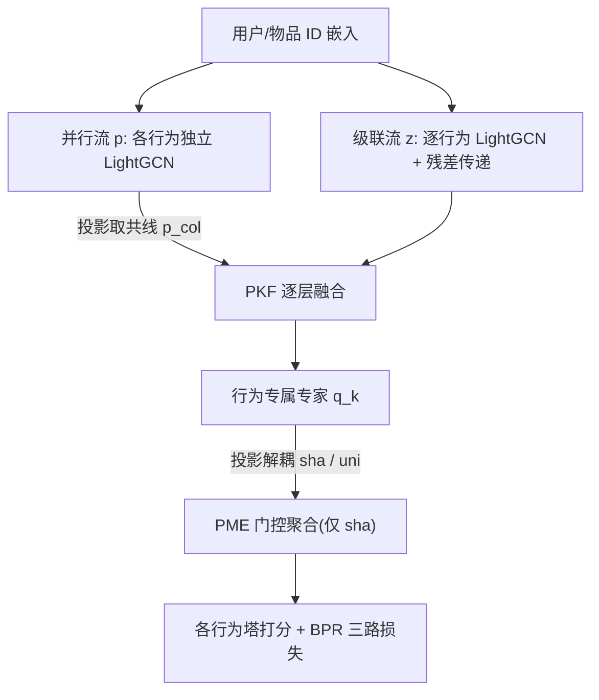

# Parallel Knowledge Enhancement based Framework for Multi-behavior Recommendation (多行为推荐的并行知识增强框架)

- **会议/期刊**: CIKM 2023
- **作者与机构**: Chang Meng, Chenhao Zhai, Yu Yang, Hengyu Zhang, Xiu Li（清华大学深圳国际研究生院）
- **推荐链路定位**: 精排（多行为多任务联合打分）
- **研究方向**: 多任务学习与列表级重排 / 图神经网络推荐
- **论文原文**: [论文原文链接](https://arxiv.org/abs/2308.04807v1)
- **开源代码**: [PKEF](https://github.com/MC-CV/PKEF)

## TL;DR (1分钟核心速览)

多行为推荐存在两大痛点：级联（cascade）融合被高频行为（view）主导，导致下游 buy 的表征被污染；MTL 预测端用耦合输入生成专家，引发梯度冲突与负迁移。PKEF 提出 PKF（并行流按层投影到级联流做共线增强）与 PME（分离输入生成专家 + 投影解耦共享/独有信息 + 独有部分辅助损失）。在 Beibei/Taobao/Tmall 上按 HR@10/NDCG@10 全库排序评测，相对最强基线 MB-CGCN 分别提升 95.16%/38.58%、12.33%/15.95%、29.78%/29.21%（$p<0.05$）。

## Background & Motivation (背景与核心矛盾)

- **主流范式**: 多行为推荐分「融合 + 预测」两步。融合端以 CRGCN、MB-CGCN 为代表，按 view→cart→buy 的层级顺序堆叠 LightGCN 层传递上游表征；预测端以 MMOE/PLE 门控多专家做多任务联合优化。
- **前人局限 1（分布失衡）**: 行为交互极度长尾（图 1），view 占绝大多数。级联范式使上游信息量压倒下游，学到的行为关联被高频行为主导（图 2），下游稀疏任务反而被干扰。
- **前人局限 2（负迁移）**: 耦合输入 $\mathbf{e}^*_u=\sum_k\lambda_k\mathbf{e}^k_u$使所有任务的梯度共同优化同一向量$\mathbf{e}^*_u\circ\mathbf{e}^*_v$，$\partial\mathcal{L}/\partial(\mathbf{e}^*_u\circ\mathbf{e}^*_v)=\sum_k a^k_{uv}\mathbf{r}^k$ 方向相互拉扯；门控聚合又无差别引入他行为噪声。
- **核心洞察**: 级联与并行是互补而非替代关系——级联给层级先验，并行给无偏行为信号；而跨行为信息应「投影取共线部分」而非「加权全量相加」。
- **本文切入点**: 用投影算子同时解决融合端的分布偏置与预测端的梯度冲突，一个算子两处复用。

<figure class="paper-figure" markdown="span">
  <figcaption>图2：级联流中学习到的多行为关联示意图。</figcaption>
</figure>

## Method (核心方法设计)

### 1. 整体框架 (Overall Architecture)

输入用户/物品 ID 嵌入，同时进入两条 GNN 流：级联流 $\mathbf{z}$按行为顺序逐级传递（上一行为的末层 + 首层残差作为下一行为输入），并行流$\mathbf{p}$对每个行为独立做 LightGCN 传播。二者在每一层通过投影融合得到增强的级联表征。融合后的$K$个行为表征分别生成行为专属专家，PME 用投影把「他行为专家」拆成与当前行为共线的共享部分与正交的独有部分：共享部分进入门控聚合打分，独有部分走辅助 BPR 任务。三路 BPR 损失加权求和联合训练，推理时仅用目标行为塔输出 top-$k$。

### 2. 关键设计拆解 (Key Designs)

1. **PKF 并行知识融合（治分布失衡）**：级联流 $\mathbf{z}^{k,l+1}=\hat{\mathbf{A}}_k\mathbf{z}^{k,l}+\mathbf{z}^{k,l}$、$\mathbf{z}^{k+1,0}=\mathbf{z}^{k,L_k}+\mathbf{z}^{k,0}$天然偏向高频行为；本文额外维护独立并行流$\mathbf{p}^{k,l+1}=\hat{\mathbf{A}}_k\mathbf{p}^{k,l}+\mathbf{p}^{k,l}$，并在每层把并行表征投影到级联表征上，只取共线分量回注：

$$\mathbf{p}^{k,l}_{col}=\frac{\mathbf{e}^{k,l}_{par}\cdot\mathbf{e}^{k,l}_{cas}}{|\mathbf{e}^{k,l}_{cas}|}\frac{\mathbf{e}^{k,l}_{cas}}{|\mathbf{e}^{k,l}_{cas}|},\quad \mathbf{z}^{k,l+1}=\mathbf{e}^{k,l}_{cas}+\mathbf{z}^{k,l}+\mathbf{p}^{k,l}_{col}$$

直觉：两流表征分布差异大，直接相加（Summation）会破坏分布，线性变换（Linear Trans.）会隐式引入噪声，而投影是显式「只吸收有用方向」，既补足下游稀疏行为的信息量又不改其分布。

2. **PME 投影解耦多专家（治负迁移）**：先用分离输入生成专家 $\mathbf{q}^k=\mathbf{z}^{k,*}_u\circ\mathbf{z}^{k,*}_v$（此时$\partial\mathcal{L}/\partial(\mathbf{e}^t_u\circ\mathbf{e}^t_v)$ 只沿自身方向，梯度冲突被彻底切断）；聚合时对他行为专家做投影解耦：

$$\mathbf{q}^{k',k}_{sha}=\frac{\mathbf{q}^{k'}\cdot\mathbf{q}^k}{|\mathbf{q}^k|}\frac{\mathbf{q}^k}{|\mathbf{q}^k|},\qquad \mathbf{q}^{k',k}_{uni}=\mathbf{q}^{k'}-\mathbf{q}^{k',k}_{sha}$$

门控 $\mathbf{g}^k=\mathrm{Softmax}(\mathbf{W}_g\mathbf{z}^{k,*}+\mathbf{b}_g)$只聚合$\{\mathbf{q}^{k',k}_{sha}\}$与$\mathbf{q}^k$，避免噪声进入；正交的$\mathbf{q}^{k',k}_{uni}$被赋予「预测$k'$且排除$k$」的辅助任务，把互斥性转化为监督信号，防止共享子空间塌缩。

3. **训练目标、负采样与推理效率**：$\mathcal{L}=\mathcal{L}_{par}+\mathcal{L}_{cas}+\mathcal{L}_{uni}+\mu\|\Theta\|_2^2$，三路均为 BPR  pairwise 损失，负样本为均匀采样未交互物品，行为系数$\lambda_k$归一化（$\sum_k\lambda_k=1$，网格搜索最优为 view/cart/buy$=(0,4/6,2/6)$，即目标行为外最上游 view 的损失权重反被置 0）。时间与空间复杂度与现有 GNN 方法同阶（$\sum_k O(L_k|\mathcal{E}_k|d)$），但并行流使传播开销近似翻倍；推理无额外候选扩张，仍为内积 top-$k$。

## Experimental Setup & Evaluation Protocol (实验设置与评估协议)

- **数据集与预处理**: 沿用 MB-CGCN/CRGCN 的三数据集，重复交互保留最早一条。

| 数据集 | #Users | #Items | #Interactions | #Target(Buy) | 行为类型 |
| :--- | :---: | :---: | :---: | :---: | :--- |
| Beibei | 21,716 | 7,977 | 3.3×10⁶ | 282,860 | View/Cart/Buy |
| Taobao | 15,449 | 11,953 | 1.2×10⁶ | 92,180 | View/Cart/Buy |
| Tmall | 41,738 | 11,953 | 2.3×10⁶ | 255,586 | View/Collect/Cart/Buy |

- **数据划分与防穿越**: 与 MB-CGCN 完全对齐（同源数据切分，目标行为留出测试），论文未额外重述划分细节。
- **排名评测协议**: HR@10 / NDCG@10，top-10 排序指标；原文仅表述「基于推荐 top-$k$ 物品评估」，未显式声明候选集为全库未交互集合还是采样集合，也未说明评测阶段负采样——这是复现时的协议盲区（同系列工作通常为全库排序）。
- **对比基线与超参**: 单行为 MF-BPR/NeuMF/LightGCN + 多行为 RGCN/GNMR/NMTR/MBGCN/CRGCN/MB-CGCN；$d=64$，Xavier 初始化，Adam，lr=$10^{-3}$，GNN 层数在$\{1,2,3,4\}$内逐行为搜索，5 次运行取均值，显著性$p<0.05$。

## Key Experimental Results (实验关键数据)

### 1. 主实验对比 (Main Results)

| Model | Beibei HR | Beibei NDCG | Taobao HR | Taobao NDCG | Tmall HR | Tmall NDCG |
| :--- | :---: | :---: | :---: | :---: | :---: | :---: |
| MF-BPR | 0.0191 | 0.0049 | 0.0076 | 0.0036 | 0.0230 | 0.0207 |
| LightGCN | 0.0391 | 0.0209 | 0.0411 | 0.0240 | 0.0393 | 0.0209 |
| NMTR | 0.0429 | 0.0198 | 0.0282 | 0.0137 | 0.0536 | 0.0286 |
| MBGCN | 0.0470 | 0.0259 | 0.0509 | 0.0294 | 0.0549 | 0.0285 |
| CRGCN | 0.0459 | 0.0324 | 0.0855 | 0.0439 | 0.0840 | 0.0442 |
| MB-CGCN | 0.0579 | 0.0381 | 0.1233 | 0.0677 | 0.0984 | 0.0558 |
| **PKEF** | **0.1130** | **0.0582** | **0.1385** | **0.0785** | **0.1277** | **0.0721** |
| Improv. | +95.16% | +38.58% | +12.33% | +15.95% | +29.78% | +29.21% |

### 2. 消融实验 (Ablation Study)

| 变体 | Beibei HR/NDCG | Taobao HR/NDCG | Tmall HR/NDCG |
| :--- | :---: | :---: | :---: |
| Base Model（仅级联 + bilinear） | 0.0734 / 0.0360 | 0.0849 / 0.0452 | 0.0829 / 0.0466 |
| w/o PKF | 0.1096 / 0.0560 | 0.1121 / 0.0610 | 0.1205 / 0.0687 |
| w/o PME（换 bilinear） | 0.0915 / 0.0460 | 0.0955 / 0.0532 | 0.0931 / 0.0514 |
| **PKEF** | **0.1130 / 0.0582** | **0.1385 / 0.0785** | **0.1277 / 0.0721** |
| 融合方案：Summation | 0.0312 / 0.0173 | 0.1142 / 0.0635 | 0.0238 / 0.0127 |
| 融合方案：Linear Trans. | 0.0847 / 0.0419 | 0.1185 / 0.0666 | 0.1084 / 0.0617 |
| 融合方案：Vanilla Fusion | 0.1105 / 0.0568 | 0.1254 / 0.0707 | 0.1180 / 0.0674 |
| MTL：PKF+SharedBottom | 0.0599 / 0.0287 | 0.0715 / 0.0381 | 0.0840 / 0.0472 |
| MTL：PKF+MMOE | 0.0830 / 0.0420 | 0.1091 / 0.0580 | 0.0890 / 0.0487 |
| MTL：PKF+PLE | 0.0845 / 0.0431 | 0.1022 / 0.0545 | 0.0944 / 0.0517 |

### 3. 关键实验发现 (Key Findings)

1. **PME 是最大贡献源，且收益随行为相关性放大**：去掉 PME 在 Taobao 上 HR 掉 31.0%（0.1385→0.0955），远大于去掉 PKF 的 19.1%；按用户行为 Pearson 相关性分桶后，相关性越高的用户群 PME 相对 MMOE/PLE 的优势越大，说明收益确来自抑制梯度冲突而非单纯扩容。
2. **投影融合优于其他融合算子，但代价是分布敏感**：Summation 在 Beibei 上崩溃到 0.0312 HR（甚至低于 Base Model），而 Projection 在 Taobao 上比 Vanilla Fusion 高 10.4% HR——证明「只取共线分量」是必要的，简单相加会因两流分布差异造成破坏性干扰。
3. **行为失衡需要「浅层下游 + 深层上游」的非对称深度**：层数网格显示 (view, cart, buy)=(4,1,1) 最优，下游稀疏行为堆叠过深会引入噪声；同时最优损失系数为 $\lambda_{view}=0$，即高频行为的表征仍需要（通过并行流与级联传递），但其监督信号应被彻底关闭，否则继续放大失衡。

## Highlights & Limitations (亮点、对比与审稿批判)

- **与代表作对比**: 相较 CRGCN/MB-CGCN 的「纯级联」，PKEF 引入并行流并用投影做定向补偿，把上游偏置从「污染源」变成「可筛选的正向先验」；相较 MMOE/PLE 的「耦合输入 + 门控」，PME 从输入分离与聚合解耦两端同时切断梯度冲突，专家利用率可视化显示 MMOE/PLE 权重近乎均匀（0.23–0.38），PME 则显著偏向特定专家（最高约 0.66）；投影思想源自 DUMN 的隐式/显式反馈解耦，本文将其迁移到行为维度。
- **可迁移亮点**: (1) 「共享-独有」投影拆分 + 独有部分辅助任务是通用的多任务去噪模板，可直接移植到 CTR 多目标（点击/转化/时长）精排；(2) 用 Pearson 相关性分桶做负迁移诊断的实验设计，可作为 MTL 论文的标准评估补充。
- **审稿级局限批判**: (1) 增益方差极大——Beibei HR 提升 95.16% 而 Taobao 仅 12.33%，且 Beibei 上 MB-CGCN 表现异常偏低，难以排除基线调参不充分或数据稀疏度差异带来的放大效应；(2) 级联 + 并行双流使 GNN 传播量近似翻倍，论文只给了同阶复杂度结论，未报告实际显存/训练时长，也未讨论 $K$个行为下并行流的内存随行为数线性增长；(3) 评测协议表述含糊，未明确全库排序还是采样排序、未给方差与显著性检验细节（仅一处$p<0.05$）；(4) 独有损失需按行为对构造「$k'$且非$k$」的训练集，工程实现与超参（$\lambda_k$ 需归一化网格搜索）成本偏高。

## Rating (四维评分)

- **方法创新性 (Novelty)**: ⭐⭐⭐⭐ （投影算子同时服务融合端去偏与预测端解耦，思路统一且有梯度层面的形式化论证，但组件本身借鉴 DUMN/PME 痕迹明显）
- **评估协议与实验扎实度 (Protocol & Experiments)**: ⭐⭐⭐ （三数据集 + 消融 + 融合/MTL 双替换 + 相关性分桶 + 门控可视化相当完整，但候选集与排序协议未明确、增益方差大且基线调参公平性存疑）
- **写作与数学规范度 (Clarity & Rigor)**: ⭐⭐⭐⭐ （梯度冲突推导从耦合到分离逐步展开，公式与符号一致，复杂度分析略显单薄）
- **工业落地与复现价值 (Industrial & Practical Value)**: ⭐⭐⭐⭐ （代码开源、基于 LightGCN 易接入现有精排，双流开销与独有损失的数据构造是主要落地门槛）

