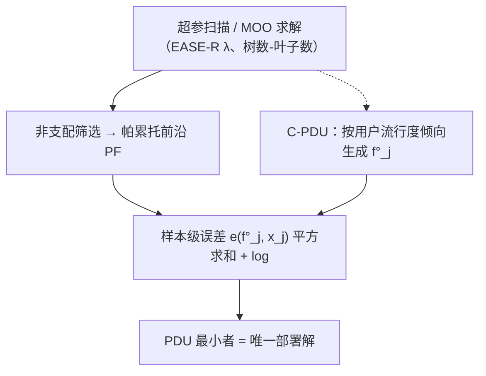
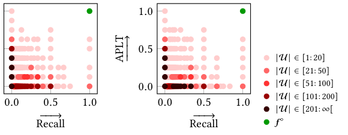

# Post-hoc Selection of Pareto-Optimal Solutions in Search and Recommendation (搜索与推荐中帕累托最优解的事后选择)

- **会议/期刊**: CIKM 2023
- **作者与机构**: Vincenzo Paparella, Vito Walter Anelli, Tommaso Di Noia（巴里理工大学）；Franco Maria Nardini, Raffaele Perego（ISTI-CNR）
- **推荐链路定位**: 重排/模型选择（离线选型与上线决策环节）
- **研究方向**: 多任务学习与列表级重排 / 去偏公平与工业架构
- **论文原文**: [论文原文链接](https://arxiv.org/abs/2306.12165v1)
- **开源代码**: [开源代码仓库链接](https://anonymous.4open.science/r/Selection-Pareto-Optimal-Solutions-IR-RS-56A4/)

## TL;DR (1分钟核心速览)

多目标推荐（如 Recall vs 长尾曝光 APLT）优化后得到的是一条帕累托前沿，而线上只能部署**一个**模型，业界却缺乏公认的"从前沿里挑一个"的准则。本文提出 PDU：把每个用户的指标点与**该用户专属 utopia 点**的误差做平方求和再取对数，用高斯似然推导证明其最优性；在 MSN30K（IR）与 Goodreads/Amazon Music（RS，70-10-20 留出）上，PDU 是唯一能"校准"的选择器，并在 Goodreads 上把选择从 $\lambda=0.5$翻转到$\lambda=60$（用户级 MAE 0.036 vs 0.039）。

## Background & Motivation (背景与核心矛盾)

- **主流范式**: IR/RS 的多目标优化分两类——启发式搜索（多目标进化算法）与标量化（线性加权、Weighted Chebyshev、$\epsilon$-Constraint），最终产出帕累托前沿。
- **前人局限 1**: 前沿上的点理论上等价，但已有选择策略各带缺陷：HV 需要参考点，而效率/能耗这类目标**无上界，nadir 点根本不存在**，参考点稍变结论就翻转；U-KP 从均匀分布随机采样权重，**不可复现**；A-KP 只支持二维。
- **前人局限 2**: 所有 MOO 选择准则只看**聚合后的均值点**，无法处理"某个用户偏好大众、某个用户偏好长尾"这种样本级异质性。
- **核心洞察 (Key Insight)**: 前沿点的坐标只是各用户指标值的均值，用户级点在目标空间中的**分布形状**携带了被均值抹掉的信息；把 utopia 点从"全局一个"推广为"每个用户一个"，选择即可做到个性化校准。
- **本文切入点**: 以样本级误差的平方和（经对数压缩）作为选择准则，用极大似然给出理论依据。

## Method (核心方法设计)

### 1. 整体框架 (Overall Architecture)

PDU 是纯**事后 (post-hoc)** 模块，不改动任何推荐/排序模型：先用任意 MOO 方法（本文为扫描超参，如 EASE$^R$的$\lambda$、LambdaMART 的树数与叶子数）在目标空间生成解集并筛出非支配前沿；随后对前沿上每个点$x^\star$，计算其$m$个用户/查询的指标点到各自广义 utopia 点$\mathbf{f}^{\circ}_j$的误差，取平方求和再取对数，最小者即为最终部署解。训练与推理开销为零，仅在前沿规模$|\mathcal{PF}|\times m\times k$ 上多一次打分。

<figure class="paper-figure" markdown="span">
  <figcaption>图 2：PDU（左）和 ED（右）所选解在目标函数空间 Recall / APLT 中的用户数据点分布。点的颜色表示该点中的用户数量。</figcaption>
</figure>

### 2. 关键设计拆解 (Key Designs)

1. **PDU：样本级距离的 log-sum 聚合**：痛点是把前沿点当"聚合点"比较（ED 只算 $\|\bar{f}(x^\star)-\mathbf{f}^{\diamond}\|$），丢失分布信息。改为

$$\mathrm{PDU}=\log\Big(\sum_{j=1}^{m} e(\mathbf{f}^{\circ}_{j},\mathbf{x}_{j})^{2}\Big),\qquad \mathbf{f}^{\circ}_{j}\in\mathbb{R}^{k}$$

其中 $e(\cdot)$为满足恒等、对称、三角不等式的任意误差函数（默认欧氏）。因$\log$ 单调，选择等价于最小化**用户级平方误差和**，即对"少数被严重伤害的用户"施以平方级重罚——这与先平均再算距离的 ED 有本质区别。

2. **极大似然推导（理论包装）**：设 $e_j=e(\mathbf{f}^{\circ}_j,\mathbf{x}_j)\sim\mathcal{N}(0,\sigma^2)$且样本独立，代入$\hat\sigma^2=\frac{1}{m}\sum_j e_j^2$化简对数似然后，唯一随模型参数变化的项为$-\log\sum_j e_j^2$，故

$$\arg\max_{\Theta}\ \log p\big(e(\mathcal{F},g(\Theta))\big)\equiv\arg\min_{\Theta}\ \mathrm{PDU}$$

3. **C-PDU 校准与推理开销**：把 utopia 第 2 维（长尾曝光 APLT）定义成用户流行度倾向的函数：$pop_u=\mu(\Gamma_u)+\sigma(\Gamma_u)$，再归一化为

$$f^{\circ}_{2}=h_2(u)=\frac{pop_{\Psi}-pop_u}{pop_{\Psi}-pop_{\Phi}}$$

用户历史越偏大众，目标 APLT 越低。整个流程无需训练、无负采样、无梯度，$O(|\mathcal{PF}|\cdot m\cdot k)$估计，可在选型阶段离线秒级完成；唯一的先验输入是$h_i(\cdot)$ 的设计。

## Experimental Setup & Evaluation Protocol (实验设置与评估协议)

- **数据集与预处理**:

| 数据集 | #Users | #Items | #Interactions | 密度 | 特征/场景说明 |
| :--- | :---: | :---: | :---: | :---: | :--- |
| MSN30K | 30,000 查询（测试 6,306） | — | — | — | LTR 基准；目标 = nDCG@10 / 每文档耗时 / 每文档能耗 |
| Goodreads | 18,892 | 25,475 | 1,378,033 | 0.286% | 图书，主流口味用户（平均 utopia APLT = 0.65） |
| Amazon Music | 14,354 | 10,027 | 145,523 | 0.101% | 音乐，长尾偏好用户（平均 utopia APLT = 0.83） |

- **数据划分与防穿越**: RS 使用 `70-10-20 hold-out`（训练/验证/测试按用户留出），测试用户在 Goodreads 为 18,070；IR 使用官方测试查询集。
- **排名评测协议**: EASE$^R$ 为闭式浅层自编码器，对全部物品一次性打分后截断 top-N，属 `Full-Ranking` 性质且**无负采样**；IR 侧用 QuickScorer 逐文档计时、Mammut 测能耗，单线程 Intel Xeon E5-2630 v3 @2.4GHz。
- **对比基线与超参**: 选择策略基线 A-KP、U-KP、HV（参考点 $\mathbf{r}=(0,0)$或$(0.5,2\times10^{-5},10^{-3})$）、ED、WM（等权 0.5/0.5）；RS 场景 min-max 归一化，IR 场景不归一化以暴露尺度敏感性；$e(\cdot)$ 取欧氏距离以便与 ED 对照。

## Key Experimental Results (实验关键数据)

### 1. 主实验对比 (Main Results)

**IR 场景（LambdaMART，准确率/效率两目标）**

| 选择策略 | 选中配置 (树/叶) | nDCG@10 ↑ | Time/doc ($\times10^{-5}$s) ↓ | Energy/doc ($\times10^{-5}$J) ↓ |
| :--- | :---: | :---: | :---: | :---: |
| **PDU** | **878 / 64** | **0.5228** | 150.36 | 89.43 |
| ED | 878 / 64 | **0.5228** | 150.36 | 89.43 |
| WM | 878 / 64 | **0.5228** | 150.36 | 89.43 |
| HV | 500 / 64 | 0.5225 | 91.92 | 54.59 |
| U-KP (非确定) | 300 / 32 | 0.5179 | 18.05 | 10.85 |

**RS 场景（EASE$^R$，Recall / APLT）**

| 选择策略 | Goodreads $\lambda$| Recall ↑ | APLT ↑ | Amazon$\lambda$ | Recall ↑ | APLT ↑ |
| :--- | :---: | :---: | :---: | :---: | :---: | :---: |
| **PDU** | 0.5 | 0.0433 | 0.0443 | 0.3 | 0.0632 | 0.1976 |
| **C-PDU** | **60** | **0.0822** | 0.0108 | 0.3 | 0.0632 | **0.1976** |
| HV | 0.5 | 0.0433 | 0.0443 | 1 | 0.0683 | 0.1898 |
| ED | 1 | 0.0503 | 0.0363 | 10 | 0.0853 | 0.1313 |
| WM | 0.3 | 0.0384 | 0.0485 | 10 | 0.0853 | 0.1313 |

### 2. 消融实验 (Ablation Study)

以 Goodreads 为探针，拆解"聚合 vs 样本级"与"全局 vs 用户级 utopia"两级设计：

| 变体 | utopia 粒度 | 选中 $\lambda$ | Recall ↑ | APLT ↑ | 说明 |
| :--- | :--- | :---: | :---: | :---: | :--- |
| ED（基线） | 全局聚合点 | 1 | 0.0503 | 0.0363 | 只看均值点 |
| PDU (global $\mathbf{f}^{\circ}=(1,1)$) | 全局 + 样本级误差 | 0.5 | 0.0433 | 0.0443 | 分布感知，偏长尾 |
| **C-PDU (per-user $h_2(u)$)** | **用户级** | **60** | **0.0822** | 0.0108 | 贴合主流用户口味 |
| HV | 全局参考点 | 0.5 | 0.0433 | 0.0443 | 位置偏置 |

### 3. 关键实验发现 (Key Findings)

1. **HV 存在"前沿中段偏置"**：由于 IR 场景效率/能耗无上界、nadir 点不可定义，参考点只能人为外推，HV 系统性选择前沿中段解（nDCG 0.5225 vs PDU 的 0.5228），一旦参考点外推更远就退化为边界解——选择结果不可靠。
2. **样本级分布确实改变决策**：三目标 IR 场景中 ED 仍锁死 878/64，而 PDU 切到 300/64（nDCG 0.5212、耗时 54.04 vs 150.36，约 3 倍加速）；量化证据是所选模型的用户点平均欧氏距离 0.4813 < ED 的 0.4945（Goodreads 上 1.3498 vs 1.352）。
3. **校准能把选择翻转一个簇**：Goodreads 平均 utopia APLT 0.65（偏主流）时 C-PDU 从 $\lambda=0.5$跳到$\lambda=60$，Recall 从 0.0433 升至 0.0822，且用户级 MAE 更低（0.036 vs 0.039）；Amazon 平均 utopia 0.83（偏长尾）时则停留在高 APLT 的$\lambda=0.3$。

## Highlights & Limitations (亮点、对比与审稿批判)

- **与代表作对比**: 相对 HV，PDU 只需 utopia 点（无需难定义的 nadir），且"对前沿所有区域一视同仁"；相对 ED/WM，PDU 在样本级聚合、天然支持校准；相对 U-KP/A-KP，PDU 确定性、支持 $>2$ 目标。
- **可迁移亮点**: ①把"离线选型"从比均值改为比"用户级误差分布（log-sum-of-squares）"，可直接用于多指标 A/B 的模型裁决；②用 $h_i(\cdot)$ 注入业务先验（如流行度、校准推荐），把人类偏好编码进 utopia 而非权重，比调权更稳定。
- **审稿级局限批判**: ①所谓"理论最优"实为把 $\sigma^2$用样本 MLE 代入后得到的重加权目标，$\log\sum e^2$与$\sum e^2$单调等价，理论增益主要体现为"罚尾部"，对数形式本身并不带来新最优性；②实验仅 4 个前沿配置组、2 个 RS 数据集，未做显著性检验，也无线上验证；③C-PDU 高度依赖设计者手工定义$h_i$，且目标量纲不同必须归一化，可复现性受限；④仍未回答"该选几个目标、目标是否互斥"的上游问题。

## Rating (四维评分)

- **方法创新性 (Novelty)**: ⭐⭐⭐ （把 utopia 点下沉到样本级是清晰的新视角，但 log-sum 形式与 MSE 等价，理论推导偏"事后包装"）
- **评估协议与实验扎实度 (Protocol & Experiments)**: ⭐⭐⭐ （同时覆盖 IR 与 RS、含能耗三维目标较难得，但配置组少、无显著性检验与线上 A/B）
- **写作与数学规范度 (Clarity & Rigor)**: ⭐⭐⭐⭐ （PDU 似然推导完整、属性对比表清晰；部分表格数值与正文表述存在轻微不一致）
- **工业落地与复现价值 (Industrial & Practical Value)**: ⭐⭐⭐⭐ （零训练开销、秒级后处理即可用于选型，代码已开源；但需业务方自行定义 utopia 函数）

