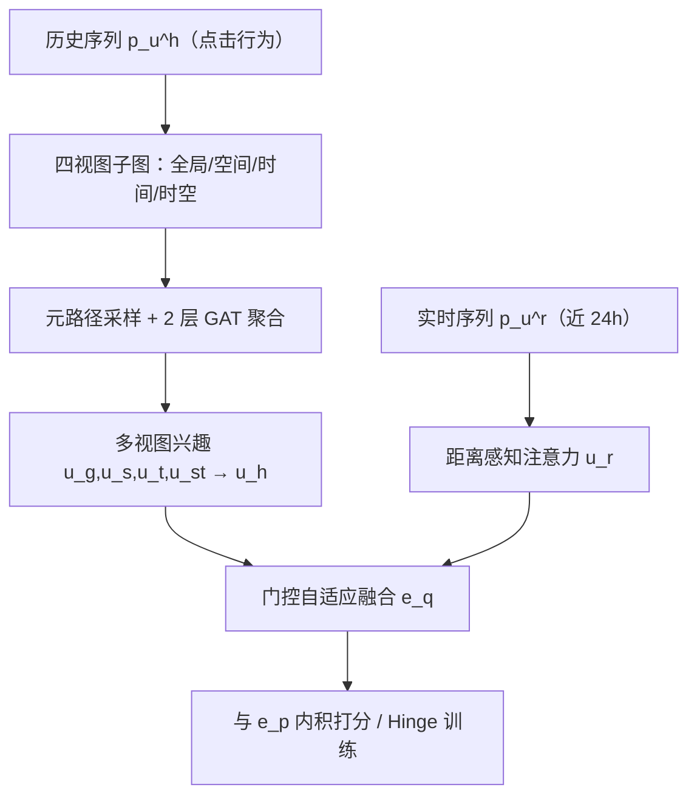
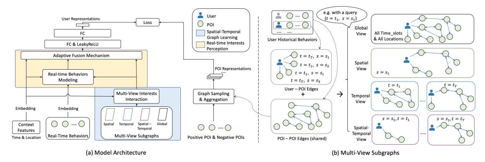

# STGIN: Spatial-Temporal Graph Interaction Network for Large-scale POI Recommendation (面向大规模 POI 推荐的时空图交互网络)

- **会议/期刊**: CIKM 2023（5 页短文）
- **作者与机构**: Shaohua Liu, Yu Qi, Gen Li, Mingjian Chen, Teng Zhang, Jia Cheng, Jun Lei（美团，共同一作三人）
- **推荐链路定位**: 召回（匹配阶段，query–POI 双塔式内积检索；作者称稍加改动可用于精排）
- **研究方向**: 时空轨迹与 POI 本地生活推荐 / 图神经网络推荐
- **论文原文**: [https://arxiv.org/abs/2309.02251v1](https://arxiv.org/abs/2309.02251v1)
- **开源代码**: [https://github.com/alibaba/euler](https://github.com/alibaba/euler)（基于阿里 Euler 图学习引擎，非论文专属仓库）

## TL;DR (1分钟核心速览)

统一图把不同时空上下文混在同一邻域，且大图构图/采样开销使图嵌入只能低频更新，无法反映最新点击。STGIN 为每个用户构造全局、空间、时间、时空四类点击子图，沿 `user→click→POI→co-click→POI` 元路径采样后两层 GAT 聚合，再用"全局视图引导的距离感知注意力 + 近 24h 实时序列注意力"门控融合成 query 向量。工业数据集 HitRate@200 达 25.87%（较最优基线相对提升 8.7%），线上 CTR +1.1%、RPM +6.3%，在线打分 5.6 ms。

## Background & Motivation (背景与核心矛盾)

- **主流范式**: POI 推荐分两支——序列模型（LSTPM / STPIL / CatDM 建模用户自身签到序列的时空周期）与图协同过滤（GE / JLGE / STGCN / STPUDGAT 借相似用户缓解稀疏）。
- **前人局限一**: 图模型把全部时空上下文压进**一张统一图**，邻域混合了"工作日早上的咖啡"和"周六下午的健身房"，无法表达上下文条件兴趣。
- **前人局限二**: 大图构图与邻居采样成本极高，图嵌入只能离线低频更新，线上无法即时并入实时点击，导致新兴趣"被冻结"。
- **核心洞察 (Key Insight)**: 上下文特异兴趣可以用**按上下文切片的小子图**精确表达，而"实时性"完全不必进图——用轻量 attention 在打分侧叠加即可。
- **本文切入点**: 多视图子图学习离线上下文兴趣，实时序列单独建模，二者**门控融合**为 query 表征，训练与在线服务解耦。

## Method (核心方法设计)

### 1. 整体框架 (Overall Architecture)

历史序列 $p_u^h$按空间（geohash-5）、时间（早/午/晚/夜四槽）、时空、全局四个视图切分为二部子图（点击边按上下文过滤，`co-click` 边四图共享）；每个视图沿固定元路径采样邻居后用两层 GAT 聚合，得到$\boldsymbol{u}_g,\boldsymbol{u}_s,\boldsymbol{u}_t,\boldsymbol{u}_{st}$四个兴趣向量，经注意力合成$\boldsymbol{u}_h$；同时把近 24 小时实时序列$p_u^r$用"时间差 + 地理距离 + 全局兴趣"三者共同打分的注意力编码为$\boldsymbol{u}_r$；最后门控网络将历史兴趣、实时兴趣、原始 query 时空上下文加权求和得$\boldsymbol{e}_q$，与共享 POI 表征$\boldsymbol{e}_p$ 内积检索 Top-K。训练用 pairwise hinge loss，服务时图嵌入存 KV 表跳过在线图推理。

<figure class="paper-figure" markdown="span">
  <figcaption>图1：整体网络结构与多视图子图构建。</figcaption>
</figure>

### 2. 关键设计拆解 (Key Designs)

1. **四视图子图与元路径采样（上下文纯净 + 跨视图协同）**：痛点在于统一图上下文混叠且邻居爆炸。做法是点击边按上下文过滤、`co-click` 边全视图共享，采样固定元路径 `user→click→POI→co-click→POI`，再两层 GAT：$\boldsymbol{u}_{t_i}=\mathrm{GAT\_AGG}(\{p\mid p\in B_u^{t_i}\})$。直觉：切片保证视图纯净（上下文可观），共享 co-click 边让稀疏视图借他人的共访关系补信号；POI 侧走 `POI→co-click→POI` 并**跳过用户节点**，避免混杂行为类型噪声，$\boldsymbol{e}_p$ 全视图共享参数。

2. **非对称视图聚合 + 实时兴趣感知（上下文加权，而非平均）**：空间视图只取与当前 geohash **精确匹配**的那一张（远端 POI 不可达，无需聚合）；时间与时空视图用"query 时刻与视图时刻的绝对差"嵌入 + 全局兴趣为 query 做注意力，$\boldsymbol{u}_t=\sum_{i=1}^{T}\alpha_{t_i}\boldsymbol{u}_{t_i}$。实时分支同理但更强，同时注入时间差、地理距离与$\boldsymbol{u}_h$：
$\alpha_{r_i}=\mathrm{softmax}\big(f(\boldsymbol{W}_{T_r}[\boldsymbol{e}_{|t_{r_i}-t_q|}\Vert\boldsymbol{e}_{|s_{r_i}-s_q|}\Vert\boldsymbol{e}_{p_{r_i}}\Vert\boldsymbol{u}_h])\big),\quad \boldsymbol{u}_r=\sum_{i=1}^{M}\alpha_{r_i}\boldsymbol{e}_{p_{r_i}}$。
为什么有效：越近、越近的点击数权越大，把"历史习惯（品牌/生活方式）"与"当下需求"压进同一个可微权重里。

3. **门控融合与训练目标**：直接拼接会让 MLP 学不出强弱，故用三分支打分 softmax 决定配比：
$\boldsymbol{e}_q=\alpha_1\boldsymbol{u}_h+\alpha_2\boldsymbol{u}_r+\alpha_3[\boldsymbol{e}_{t_q}\Vert\boldsymbol{e}_{s_q}]$，$[\alpha_1,\alpha_2,\alpha_3]=\mathrm{softmax}([\boldsymbol{w}_h^{\top}\boldsymbol{u}_h,\boldsymbol{w}_r^{\top}\boldsymbol{u}_r,\boldsymbol{w}_c^{\top}[\boldsymbol{e}_{t_q}\Vert\boldsymbol{e}_{s_q}]])$。训练用 hinge 损失，每正样本配$K=6$个负样本：$\mathcal{L}=\sum_{i=1}^{N}\sum_{j=1}^{K}\max(0, m-\mathrm{sim}(\boldsymbol{e}_q^i,\boldsymbol{e}_{p_i}^{+})+\mathrm{sim}(\boldsymbol{e}_q^i,\boldsymbol{e}_{p_j}^{-}))$。推理端图嵌入离线写入 KV 表，新点击只更新$\boldsymbol{u}_r$与$\boldsymbol{e}_q$，平均 5.6 ms/次。

## Experimental Setup & Evaluation Protocol (实验设置与评估协议)

- **数据集与预处理**: 某大型本地生活电商平台一个月（2022-08-09 至 2022-09-08）若干城市采样日志，点击为正行为，近 24h 行为划为实时序列，空间用长度 5 的 geohash 编码。

| 数据集 | #Users | #Items(POI) | #Interactions | 平均行为长度 | 特征/场景说明 |
| :--- | :---: | :---: | :---: | :---: | :--- |
| Train | 637,563 | 108,551 | 2,023,304 | 149.6 | 320 个 location 桶，4 个时段槽 |
| Test | 217,561 | 60,982 | 532,194 | 149.9 | 305 个 location 桶 |

- **数据划分与防穿越**: 原文**未明确标注**划分方式；表 1 显示训练与测试用户不重叠（637,563 vs 217,561），推断为按用户（或时间窗）切分，带有一定"新用户"倾向；实时序列严格取 query 前 24h，但全局时间戳切分与穿越防护细节缺失。
- **排名评测协议 (Ranking Protocol)**: 采用匹配召回阶段的 `HitRate@200 / Recall@200`（Top-200 命中）。原文未说明候选集是**全库 20M POI** 还是线上召回候选池/负采样池，故不能视为严格的无偏 Full-Ranking；无显著性检验。
- **对比基线与超参**: 基线含 3 个图模型（JLGE、STGCN、STPUDGAT）与 2 个序列模型（CatDM、STPIL），另有 4 个自消融变体；TensorFlow + Euler 引擎，Adam，embedding 维度 $d=16$，batch 1024，lr 0.001，LeakyReLU，负样本数 6。

## Key Experimental Results (实验关键数据)

### 1. 主实验对比 (Main Results)

| 方法 | 类型 | HitRate@200 | Recall@200 |
| :--- | :--- | :---: | :---: |
| JLGE | 多二部图联合嵌入 | 19.96% | 14.45% |
| STGCN | 统一图 + 时间邻居采样 | 18.52% | 13.14% |
| STPUDGAT | 时空 POI-POI 图注意力 | 22.21% | 16.04% |
| CatDM | 时间窗个性化注意力序列 | 21.37% | 15.42% |
| STPIL | 多粒度时空周期序列 | 23.80% | 17.45% |
| **STGIN (Ours)** | 多视图子图 + 实时融合 | **25.87%** | **19.12%** |
| **Improv.** (vs 最优基线) | — | **+2.07pp (+8.7%)** | **+1.67pp (+9.6%)** |

线上 A/B（生产流量，基线为原召回模型）：

| 指标 | CTR | RPM |
| :--- | :---: | :---: |
| 相对提升 | **+1.1%** | **+6.3%** |

### 2. 消融实验 (Ablation Study)

| 变体 | HitRate@200 | Recall@200 | ΔHR (pp) |
| :--- | :---: | :---: | :---: |
| STGIN (full) | **25.87%** | **19.12%** | — |
| w/o 实时序列 (STGIN-RT) | 19.71% | 14.10% | −6.16 |
| w/o 时间视图 (STGIN-Temporal) | 22.62% | 16.35% | −3.25 |
| w/o 空间视图 (STGIN-Spatial) | 25.12% | 18.57% | −0.75 |
| w/o 交互，仅拼接 (STGIN-Interaction) | 22.56% | 16.26% | −3.31 |

### 3. 关键实验发现 (Key Findings)

1. **图嵌入本身并不优于 SOTA，增益来自"图×实时"的交互**：去掉实时序列后 HitRate 从 25.87% 崩到 19.71%（相对 −23.8%），甚至低于纯序列基线 STPIL（23.80%）并逼近最弱的 STGCN（18.52%）——说明四视图子图若失去实时意图对齐，几乎丧失全部优势。
2. **时间视图比空间视图更关键（−3.25pp vs −0.75pp）**：四时段划分能刻画"工作日早咖啡 / 周末下午健身"的节律；而 geohash-5 在单城市内只产生约 305–320 个 location 桶，空间视图区分度有限，增益被时间粒度吸收。
3. **交互方式比信息堆叠更值钱**：仅拼接图表征与实时序列（22.56%）比门控融合低 3.31pp（相对 −12.8%）；同时 `Only_Temporal`（只取当前时段子图）略优于 `Sum_Temporal`（全时段求和池化），再次验证"距离感知加权 > 无差别聚合"，且线上在 5.6 ms 延迟下仍换来 +1.1% CTR / +6.3% RPM。

## Highlights & Limitations (亮点、对比与审稿批判)

- **与代表作对比**: STGCN / STPUDGAT 用统一图融合时空信息（上下文混叠、且被构图成本绑定），STPIL / CatDM 只用自身序列（稀疏场景失效），JLGE 多图联合嵌入但完全无实时通道。STGIN 的本质区别是"**切片保纯净 + 共享 co-click 边保协同 + 实时性出图**"，把实时性从图结构里解耦成一次轻量 attention。
- **可迁移亮点**: ①"图嵌入离线入 KV + 实时分支在线增量更新"是图召回工业化的低成本范式，可直接搬到短视频/电商召回；②视图的**非对称处理**（空间只取精确匹配、时间做距离加权注意力）比一视同仁的均匀聚合更贴合物理可达性约束。
- **审稿级局限批判**: ①评估单薄——单一工业数据集、仅两个 @200 指标，缺全库 Full-Ranking、缺方差/显著性检验与稀疏长尾分桶，划分方式与用户重叠情况含糊，复现门槛高；②建模粒度粗且扩展性受限——$d=16$、时间仅 4 槽、空间 geohash-5 可能掩盖细粒度兴趣，四视图子图仍需 50 台 VM / 约 4 小时的批量构图，对新城市与新 POI 冷启动无应对机制，线上 A/B 也未报告置信区间与基线细节。

## Rating (四维评分)

- **方法创新性 (Novelty)**: ⭐⭐⭐⭐ （首次将多视图时空子图用于 POI 推荐，"共享 co-click 边 + 实时性出图"思路清晰，但 GAT/注意力/门控均为成熟积木组合，缺理论或谱域分析）
- **评估协议与实验扎实度 (Protocol & Experiments)**: ⭐⭐⭐ （有线上 A/B 是加分项，但单数据集、排序协议未界定全库/采样、无显著性检验与分桶分析，划分细节缺失）
- **写作与数学规范度 (Clarity & Rigor)**: ⭐⭐⭐⭐ （五页短文公式紧凑、结构完整，注意力与门控定义明确；但部分符号排版混乱（如 $f(\cdot)$ 激活、视图下标），缺乏复杂度与消融的定量解释）
- **工业落地与复现价值 (Industrial & Practical Value)**: ⭐⭐⭐⭐⭐ （30 亿用户级生产数据、600M 点击、4 小时训练、5.6 ms 在线打分并给出 CTR/RPM 双指标，依托开源 Euler 引擎，落地参考价值极高）

