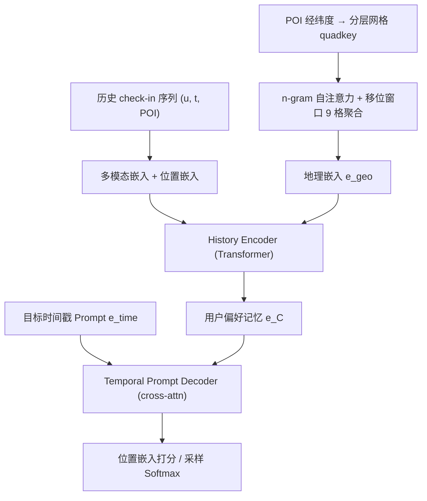
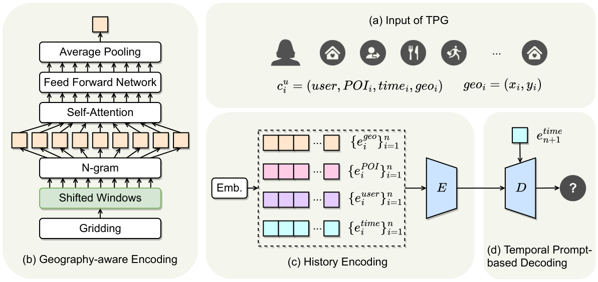
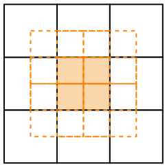

# Timestamps as Prompts for Geography-Aware Location Recommendation (以时间戳为提示的地理感知位置推荐)

- **会议/期刊**: CIKM 2023
- **作者与机构**: Yan Luo, Haoyi Duan, Ye Liu, Fu-lai Chung（香港理工大学 / MIT Media Lab / 浙江大学）
- **推荐链路定位**: 精排（Next-POI 序列打分）+ 时间条件化区间预测
- **研究方向**: 时空轨迹与 POI 本地生活推荐 / 序列与会话推荐
- **论文原文**: [https://arxiv.org/abs/2304.04151v1](https://arxiv.org/abs/2304.04151v1)
- **开源代码**: 暂未开源

## TL;DR (1分钟核心速览)

Next-POI 推荐长期把时间当作"隐式上下文"融进历史序列，导致预测第 101 与第 102 个 check-in 时模型输入完全相同，且网格化地理编码存在"硬边界"割裂邻域。TPG 把**待预测时间戳当作 Decoder 的 Query（Temporal Prompt）**，将历史编码与未来时刻解耦；再用**移位窗口**为每个网格扩充 9 个增广邻居以跨越边界。在 5 个真实数据集、1:100 采样排序协议下，Recall@5/NDCG@5 最高提升 16.2%/20.2%，且在遮蔽最近 3 个 check-in 的区间预测上仍超过 STAN 全历史结果。

## Background & Motivation (背景与核心矛盾)

- **主流范式**: 以 STAN/GeoSAN/MobTCast 为代表的自注意力或 RNN 序列模型，将 POI、时间间隔、GPS 坐标一并编码进历史轨迹，输出"下一个"位置。
- **前人局限**: ① 时间被隐式融合，模型无法针对"给定时刻"生成不同预测，做第 $k$ 步预测还得把预测值回填并重训，开销巨大；② 地理信息处理粗糙——直接喂经纬度难以刻画物理邻近（check-in 极稀疏），分层网格（GeoSAN 的 quadkey）又因边界切割而造成紧邻 POI 被人为分离，违背 Tobler 地理第一定律。
- **核心洞察 (Key Insight)**: 人的出行具有强时间周期性——中午找餐厅、早晨去公司。因此"要预测的时刻"本身就是判别性极强的条件信号，应当作为 Query 显式输入，而非混入历史。
- **本文切入点**: 用 Transformer Encoder-Decoder 结构把"历史偏好记忆"与"目标时间戳提示"分离，同时用移位窗口把硬边界"软化"。

## Method (核心方法设计)

### 1. 整体框架 (Overall Architecture)

每个 check-in 为三元组 $(u,t_i,p_i)$。地理编码器先把 POI 经纬度映射到瓦片网格 quadkey，经 n-gram 切分与自注意力得到地理表征$e^{geo}_i$；多模态嵌入模块给出 POI/用户/时间表征，与$e^{geo}_i$、位置嵌入拼接后送入堆叠 Transformer 编码器，得到用户出行偏好记忆$e_C$。解码阶段以目标时刻嵌入$e^{time}_{n+1}$为 Query、$e_C$ 为 Key/Value 做 cross-attention，输出目标位置嵌入并做全库打分。训练用采样 Softmax 的 NLL 损失。该结构天然支持"给定任意未来时间戳 → 直接预测"，无需回填重训。

<figure class="paper-figure" markdown="span">
  <figcaption>图 3：所提出 TPG 的整体架构。符号的详细说明见第 3 节。</figcaption>
</figure>

### 2. 关键设计拆解 (Key Designs)

1. **时间戳即 Prompt 的解码器（Temporal Prompt-based Decoder）**：痛点是把时间塞进历史后，模型对"第 $n{+}1$与$n{+}2$ 个位置"输出无差别。本文令目标时刻嵌入作为 query、历史记忆作为 memory，在每层 cross-attention 中深度融合：
$ATT(e_C, e_{time}^{n+1}) = w_z \sum_{j} \frac{\exp(w_q e_C \cdot w_k e_{time}^{n+1})}{\sum_{m}\exp(w_q e_C \cdot w_k e_{time,m}^{n+1})} w_v e_{time}^{n+1} + e_C$
直觉：时间周期性与"时刻—POI 类别"强相关，把时刻提为条件变量等价于对历史表征做时间条件的软检索，从而一次前向即可回答任意未来时刻的查询。

2. **移位窗口地理编码（Shifted Window Geo-Encoder）**：网格化虽缓解稀疏，但同层网格边界切断物理邻近。本文对每个网格沿 X/Y/对角方向以网格边长 1/4~1/2 的步长平移，得到自身 + 8 个增广邻居共 9 格；每格 quadkey 按 $n$-gram 切分（词表由 4 扩到$4^n$）后过自注意力与 FFN，再做平均池化得到该格表征，最后 9 格池化得$e^{geo}_i$。直觉：等价于"模糊边界"的卷积式重叠感受野，越界 POI 共享邻居上下文，物理邻近得以恢复。

<figure class="paper-figure" markdown="span">
  <figcaption>图 5：橙色标记网格的移位窗口示意图。此处滚动步长取网格尺寸的一半。</figcaption>
</figure>

3. **训练目标、负采样与推理效率**：损失为采样 Softmax 负对数似然
$\mathcal{L}_{rec} = -\log \frac{\exp(\tilde{y}_{y^+})}{\exp(\tilde{y}_{y^+}) + \sum_{y^-\in Y^-}\exp(\tilde{y}_{y^-})}$负样本由用户当前 GPS 附近 2000 个最近位置中随机抽 100 个构造（避免 GeoSAN 用 ground-truth 周围采样造成的标签泄漏）。推理为$O(L\cdot d)$ 的单次前向，无需 STAN 那种全历史矩阵运算（STAN 在 768GB 内存服务器上仍 OOM，本文被迫按用户分批跑）。

## Experimental Setup & Evaluation Protocol (实验设置与评估协议)

- **数据集与预处理**: 采用 LibCity 预处理管线；Gowalla/Brightkite 为全球数据，NYC/TKY/SIN 为 Foursquare 单城子集。

| 数据集 | #Users | #Items | #Interactions | 稀疏度/密度 | 特征/场景说明 |
| :--- | :---: | :---: | :---: | :---: | :--- |
| Gowalla | 31,708 | 131,329 | 2,963,373 | 0.001 | 全球 LBSN，极稀疏 |
| Brightkite | 5,247 | 48,181 | 1,699,579 | 0.007 | 全球 LBSN |
| NYC | 1,010 | 5,135 | 140,229 | 0.027 | Foursquare 单城 |
| TKY | 6,771 | 14,590 | 871,200 | 0.009 | Foursquare 单城 |
| SIN | 367 | 3,104 | 136,847 | 0.120 | Foursquare 单城，最稠密 |

- **数据划分与防穿越 (Splitting Strategy)**: `Leave-One-Out` 变体——每用户序列最后一条"未访问过位置"的 check-in 作为测试真值，其之前的序列用于训练，最大序列长度 100。
- **排名评测协议 (Ranking Protocol)**: `Sampled Ranking`，正负比 1:100（1 个真值 + 100 个从当前位置 2000 个最近 POI 中随机抽取的负样本），在 101 个候选上计算 Recall@{5,10} 与 NDCG@{5,10}。注意该协议比 GeoSAN 的全库/真值邻域采样更严格。
- **对比基线与超参设置**: 8 个基线覆盖 RNN 类（HSTLSTM、DeepMove、LSTPM、TMCA、CARA）、注意力类（MobTCast、STAN、GeoSAN）；POI/区域嵌入维度 50、时间嵌入 100，移位步长 = 网格边长 1/4，Adam(lr=1e-3)、dropout 0.5、训练 50 epoch、V100。

## Key Experimental Results (实验关键数据)

### 1. 主实验对比 (Main Results)

| 模型 | Gowalla R@10/N@10 | Brightkite R@10/N@10 | NYC R@10/N@10 | TKY R@10/N@10 | SIN R@10/N@10 |
| :--- | :---: | :---: | :---: | :---: | :---: |
| HSTLSTM | 54.4/35.1 | 50.4/41.3 | 31.1/21.4 | 35.7/24.3 | 21.0/13.4 |
| DeepMove | 59.1/39.0 | 58.7/43.2 | 36.5/23.8 | 39.8/27.2 | 24.7/13.4 |
| LSTPM | 53.2/33.0 | 52.4/38.5 | 30.7/18.6 | 45.4/30.9 | 20.9/12.0 |
| CARA | 60.0/40.8 | 54.7/41.2 | 37.5/24.0 | 37.2/28.0 | 20.8/14.0 |
| MobTCast | 65.5/46.6 | 59.5/46.4 | 41.3/28.1 | 65.4/52.6 | 24.6/15.1 |
| GeoSAN | 69.9/45.9 | 67.2/46.0 | 44.5/25.3 | 69.1/51.8 | 30.0/15.9 |
| STAN | 70.3/46.6 | **69.8**/47.3 | 45.9/27.3 | 71.3/54.4 | 29.5/15.7 |
| **TPG (Ours)** | **74.6/50.1** | **74.4/51.8** | **52.8/31.8** | **76.5/56.7** | **34.3/19.1** |
| Improv. | +6.1%/+7.5% | +6.6%/+9.5% | +15.0%/+13.2% | +7.3%/+4.2% | +14.3%/+20.1% |

（R@5/N@5 同样全面最优，NYC 上相对 STAN 提升 16.2%/20.2%，为全文最大改进。）

**区间预测（可"预见未来"的能力）**：遮蔽最近 1/2/3 条 check-in（前 96/97/98 条预测第 100 条）时，TPG 几乎不掉点；STAN/GeoSAN 则随遮蔽增加单调下降。

| 设置 | Gowalla R@5 | Brightkite R@5 | NYC R@5 | TKY R@5 | SIN R@5 |
| :--- | :---: | :---: | :---: | :---: | :---: |
| STAN（全历史） | 58.7 | 57.2 | 32.1 | 61.2 | 18.0 |
| GeoSAN（全历史） | 56.2 | 55.8 | 30.2 | 58.8 | 17.4 |
| TPG (int.1) | 63.7 | 60.4 | **38.0** | 64.5 | **19.9** |
| TPG (int.2) | 60.5 | 59.9 | 37.5 | 64.1 | 19.1 |
| TPG (int.3) | 59.7 | 59.8 | 37.0 | **64.9** | 19.6 |

### 2. 消融实验 (Ablation Study)

| 变体 | Gowalla R@5/N@5 | NYC R@5/N@5 | TKY R@5/N@5 |
| :--- | :---: | :---: | :---: |
| TPG (base, 无用户嵌入) | **63.2/45.5** | **37.3/26.8** | 65.4/**53.1** |
| w/o Temporal Prompt | 60.4/44.0 | 34.3/23.7 | 62.2/50.5 |
| w/o Time Embedding | 61.7/44.0 | 36.9/25.0 | 65.4/53.3 |
| w/o Shifted Window | 58.8/43.6 | 36.8/25.6 | 64.0/51.3 |
| w/o Geo Encoder | 60.3/42.6 | 34.5/25.2 | 56.2/43.3 |
| + User Embedding | 62.1/45.1 | 36.3/25.4 | 53.2/40.1 |

### 3. 关键实验发现 (Key Findings)

1. **时间提示是主增益来源，且能"以少胜多"**：去掉 Temporal Prompt 在 NYC 上 R@5 掉 3.0、R@10 掉 5.7；而 TPG 只喂 97 条历史（int.2）在五个数据集的 R@5 仍全部高于 STAN 用 100 条全历史的成绩，证明"显式时刻条件"比"更多历史"更值钱。
2. **地理模块不可省，硬边界是真实短板**：去掉整个地理编码器在 TKY 上 R@5 从 65.4 崩到 56.2（-9.2），Brightkite 掉 7.7；仅去掉移位窗口也有稳定下滑（Gowalla R@5 -4.4）。步长敏感性显示 0.25 最优，而步长 = 1（退化为直接聚合本格邻居）仍优于无窗口，说明先前网格方法确实缺失邻域关联。
3. **用户嵌入是负向因素，稠密度决定增益幅度**：加入用户嵌入使 TKY R@5 从 65.4 跌至 53.2（-12.2），作者归因为用户空间与位置/序列空间错位；同时 TPG 在稠密度更高的 NYC(0.027)/SIN(0.120) 上相对提升（+15.0%/+14.3% R@10）明显大于 Gowalla(0.001)，却在极稀疏 Gowalla 上仍保有 6.1% 增益，说明模型对稀疏度不敏感。

## Highlights & Limitations (亮点、对比与审稿批判)

- **与代表作对比 (vs. Prior Work)**: 相比 GeoSAN，本文新增"时间条件化解码"而非仅改进地理离散化；相比 STAN，本文彻底避免全历史空间-时间矩阵（STAN 需按用户分批以免 OOM），推理复杂度由序列长度平方级矩阵操作降为单次 Encoder-Decoder 前向；相比 MobTCast，本文不依赖社交/语义辅助任务，仅靠时间提示 + 地理增广即取得更优结果。
- **可迁移亮点**: ① "把目标条件（时间/场景/意图）提为 Decoder Query"这一范式可直接迁移到周期性场景推荐（如外卖时段、出行时段搜索）；② 移位窗口为任意分层网格/地理哈希编码提供通用的边界软化增广，可移植到 LBS 广告与门店推荐。
- **审稿级局限批判**: ① 评测采用 1:100 局部邻域采样而非 Full-Ranking，且该协议与 GeoSAN 原论文不同，跨文比较存在口径差异；② 区间预测并非自回归地生成未来整条序列，而是"遮蔽最近若干条 + 单点条件预测"，对多步连续规划的能力仍未被真正验证；③ 用户嵌入直接拼接即导致显著退化，说明表征对齐问题未解决，模型在冷启动新用户上的行为也缺乏讨论。

## Rating (四维评分)

- **方法创新性 (Novelty)**: ⭐⭐⭐⭐ （把时间戳提升为解码 Query 的思路简洁而击中要害，移位窗口对网格硬边界是低成本高收益的结构性修补）
- **评估协议与实验扎实度 (Protocol & Experiments)**: ⭐⭐⭐⭐ （5 个真实数据集 + 8 个基线 + 区间预测与消融齐全，但仅 1:100 采样排序、无 Full-Ranking 与显著性检验）
- **写作与数学规范度 (Clarity & Rigor)**: ⭐⭐⭐⭐ （三模块划分清晰、公式规范，n-gram 词表扩张与池化流程交代充分；复杂度分析略简）
- **工业落地与复现价值 (Industrial & Practical Value)**: ⭐⭐⭐⭐ （单次前向支持任意时刻查询，非常适合地图/本地生活"按时间出列表"场景；但无开源代码，网格与移位步长为额外离线预处理开销）

