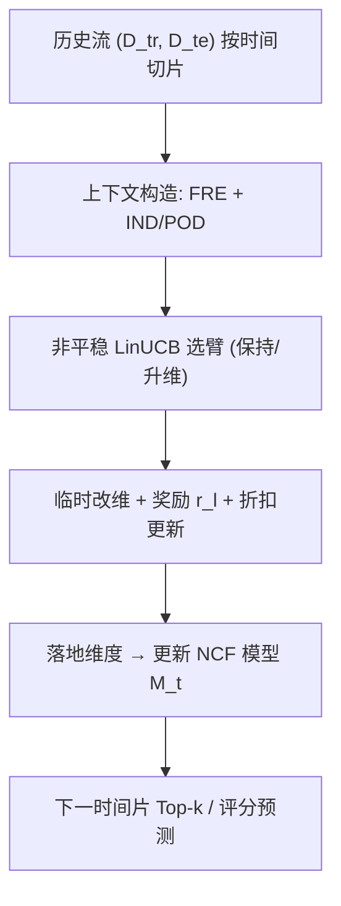
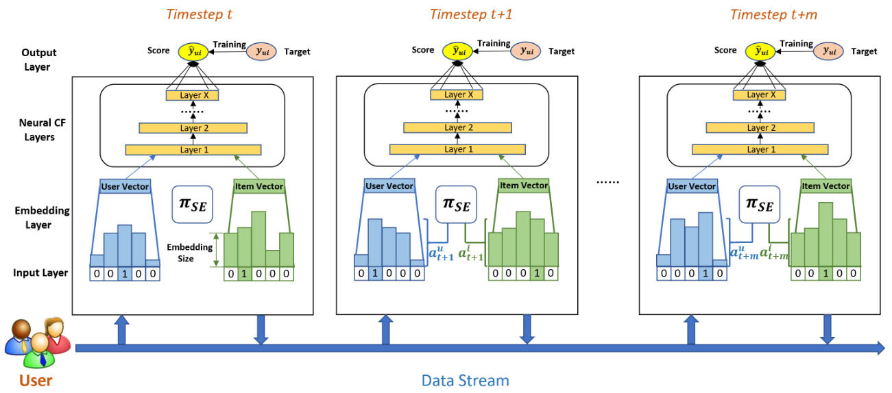
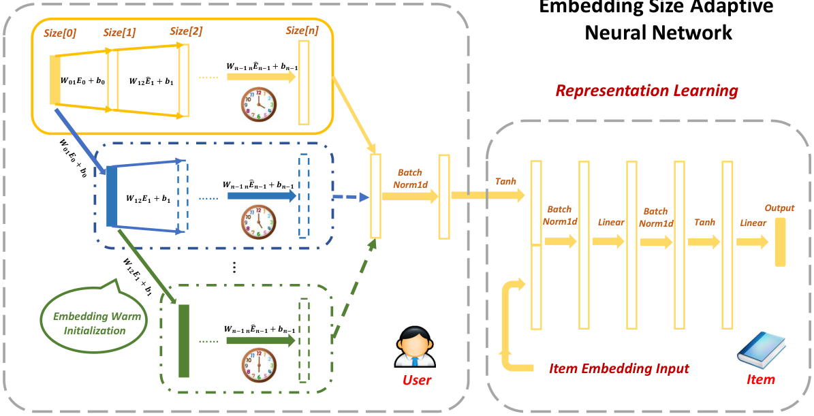

# Dynamic Embedding Size Search with Minimum Regret for Streaming Recommender System (流式推荐中最小遗憾的动态嵌入维度搜索)

- **会议/期刊**: CIKM 2023
- **作者与机构**: Bowei He、Chen Ma (香港城市大学)；Xu He、Yingxue Zhang、Ruiming Tang (华为诺亚方舟实验室)
- **推荐链路定位**: 召回/表征层（模型更新与参数效率，端到端可插拔）
- **研究方向**: 强化学习与动态探索推荐 / 协同过滤与双塔召回
- **论文原文**: [https://arxiv.org/abs/2308.07760v1](https://arxiv.org/abs/2308.07760v1)
- **开源代码**: 暂未开源

## TL;DR (1分钟核心速览)

流式推荐要求模型沿时间轴持续更新，但**统一且静态的嵌入维度**既浪费内存又限制精度；已有维度搜索方法依赖深度控制器、收敛慢、只按全历史频次决策、且把训练/测试割裂成两段。本文把动态维度搜索重构为**非平稳上下文赌博机的累积（动态）遗憾最小化问题**，提出 DESS：以「频次 + 兴趣/属性多样性」为上下文，用带折扣遗忘的 LinUCB 逐用户/逐物品决定是否升维，并给出 $O(d^{9/10}B_L^{1/5}L^{4/5})$ 的亚线性遗憾上界。在 4 个公开数据集、Top-10 与评分预测任务上，Recall@10 相对 ESAPN 提升 4.4%–8.1%，嵌入参数量仅为固定维度模型的约 1/2，训练时间不足 DARTS 的 30%。

## Background & Motivation (背景与核心矛盾)

- **主流范式**: 流式推荐（SRS）将数据流切成 $T$个时间片，每片内再分训练/测试子集，模型$M_{t-1}$继承参数并在$D_t^{tr}$上增量更新后立刻在$D_t^{te}$ 上评估；嵌入维度搜索则分为 soft-selection（DARTS、AutoEmb，对所有候选维度加权求和）与 hard-selection（ESAPN，用 REINFORCE 控制器选一个维度）。
- **前人局限**: ① soft-selection 实际同时保留全部维度嵌入，内存开销爆炸且冷启动严重；② 基于神经网络/RL 的控制器需大量交互数据才能收敛，探索-利用失衡；③ 决策只用**全历史浏览频次**，无法反映近期兴趣漂移；④ 训练/测试被割裂为前后两段，与 Twitter 式"边训练边推荐"的真实流式场景不符。
- **核心洞察 (Key Insight)**: 最优维度本质上取决于用户/物品**所携带的信息量**——不仅看频次，还要看其历史交互对象的特征离散度（离散度越大，信息量越大，越需要更大维度来表征）。
- **本文切入点**: 把维度调整视作序列决策，直接用**验证集上的累积损失遗憾**作为优化目标，用轻量线性赌博机替代深度控制器。

## Method (核心方法设计)

### 1. 整体框架 (Overall Architecture)

每个时间片 $t$，先用上一片数据$(D^{tr}_{t-1}\cup D^{te}_{t-1})$作为验证流，逐条交互地驱动 LinUCB 策略$\pi^{SE}$：对该条交互涉及的用户/物品构造上下文$\mathbf{x}_l=(\text{FRE},\text{IND})$或$(\text{FRE},\text{POD})$，计算各臂 UCB 并选出「保持 / 升维」动作，临时改维、临时微调参数后在验证交互上取奖励$r_l$，再按式 (9) 在线更新$\mathbf{V}_a,\tilde{\mathbf{V}}_a,\mathbf{b}_a$；随后把该片内所有用户的最终动作 **永久落地**，用$D^{tr}_t$正常更新推荐模型$M_t$，并在$D^{te}_t$ 上报告指标。策略更新与模型更新交替推进，完全贴合真实流式推荐。

<figure class="paper-figure" markdown="span">
  <figcaption>图 1：动态嵌入维度搜索过程示意图。每个时间步，嵌入层输出维度由𝜋𝑆𝐸确定的嵌入向量。变换后，它们将被输入 Neural CF 层以进行进一步推断。</figcaption>
</figure>

### 2. 关键设计拆解 (Key Designs)

1. **维度搜索即动态遗憾最小化**：把「一路最优维度序列」作为对手，目标是最小化 $\bar{R}_T=\max_{\pi}\mathbb{E}\big[\sum_{t}\mathcal{L}^{te}_t(\pi^{SE})-\sum_t \mathcal{L}^{te}_t(\pi)\big]$；由于测试集不可见，用上一片全量数据近似验证集，奖励定义为二元比较$r_l=\mathbb{I}(\mathcal{L}^{old}_l-\mathcal{L}^{new}_l>\tau)$。这样优化目标从"最终一次测试精度"变为"全时间轴逐步精度"，天然抑制早期探索代价。
2. **信息量上下文 (IND / POD)**：用户侧用中心点直径距离刻画兴趣多样性 $IND^u_l=\frac{1}{H}\sum_{h=1}^{H}\sqrt{(F_{i_h}-Q^u_l)(F_{i_h}-Q^u_l)^\top}$，其中$Q^u_l$为已交互物品原始特征的均值向量；物品侧对称地以交互用户的均值兴趣$Q^u_{h,l}$与物品均值$P_{i,l}$算$POD^i_l$。上下文 =$(\text{FRE}, IND)$/$(\text{FRE}, POD)$，让策略在"高频但兴趣单一"与"低频但兴趣发散"两类样本上给出不同决策——这是相对 ESAPN 只用频次的关键增量。
3. **非平稳 LinUCB 与嵌入自适应网络 + EWI**：各臂共享上下文但各自维护不相交线性奖励模型，用**折扣加权岭回归**（遗忘因子 $\gamma$）跟踪漂移的真参数：$\hat{\boldsymbol{\theta}}_{l,a}=\mathbf{V}_{l,a}^{-1}\sum_{s\le l}\mathbb{I}(a_s=a)\gamma^{l-s}\mathbf{x}_{s,a}r_s$，$\mathbf{V}_{l,a}=\sum_s\mathbb{I}(a_s=a)\gamma^{l-s}\mathbf{x}_{s,a}\mathbf{x}_{s,a}^\top+\lambda\mathbf{I}_d$；选择准则$UCB(a)=\mathbf{x}_{l,a}^\top\hat{\boldsymbol{\theta}}_a+\beta_l\sqrt{\mathbf{x}_{l,a}^\top\mathbf{V}_a^{-1}\tilde{\mathbf{V}}_a\mathbf{V}_a^{-1}\mathbf{x}_{l,a}}$，$\beta_l$随$\log(1/\delta)$与$\gamma^{2l}$增长以调节探索。模型侧：不同维度的嵌入先经一串线性变换统一到最大维度$s_n$，再 BatchNorm+Tanh 消除量纲差；升维时采用 **EWI**$E_{i+1}=\mathbf{W}_i^{i+1}E_i+\mathbf{b}_i$ 复用旧嵌入信息，避免零/随机初始化的冷启动抖动。损失即基础模型（NCF）的常规 BPR/交叉熵，无需负采样改造。

<figure class="paper-figure" markdown="span">
  <figcaption>图 2：嵌入维度自适应神经网络结构示意图。上图仅详细展示用户嵌入输入，物品嵌入输入结构类似。不同颜色表示不同时间步的模型推断过程。虚线矩形表示不参与当前前向传播的张量。空心矩形表示神经网络前向传播后不会保存的中间张量。</figcaption>
</figure>

## Experimental Setup & Evaluation Protocol (实验设置与评估协议)

- **数据集与预处理**:

| 数据集 | #Users | #Items | #Interactions | 稀疏度/密度 | 特征/场景说明 |
| :--- | :---: | :---: | :---: | :---: | :--- |
| ml-20m | 138,493 | 27,278 | 20,000,263 | 5.3e-3 | 电影评分，含原始物品特征（可算 IND/POD） |
| ml-latest | 283,228 | 58,098 | 27,753,444 | 1.7e-3 | 同上，时间跨度更长 |
| Amazon-Books | — | — | 22,507,154 | — | 每用户/每书 ≥20 条（类 20-core） |
| Amazon-CDs | — | — | 3,749,003 | — | 过滤阈值 10（类 10-core），无原始特征→仅 DESS-FRE |

- **数据划分与防穿越**: **流式时间片划分**——按时间戳切成 $T$个等长片段$D_1,\dots,D_T$，片内再分$D^{tr}_t,D^{te}_t$，$t$时刻只用$\le t$ 的数据，属严格的时间切分 + 逐片滚动评估（非 Leave-One-Out）。
- **排名评测协议**: 在每个片段的测试子集上计算 **Recall@10 / NDCG@10**，对全时间轴取平均；论文未声明 Full-Ranking 或采样负例比例（**评估协议披露不足**，是复现时的盲点）。评分任务：二分类（评分 >3.5 记 1）与五分类，指标为 Accuracy 与 MSE / 交叉熵损失。
- **对比基线与超参**: Fixed-128、Fixed-222、DARTS、AutoEmb、ESAPN；基础模型为 NCF，另验证 MF-based 与 distance-based 主干的可迁移性。结果为 5 次随机种子均值，$t$-test$p\le 0.01$ 显著。

## Key Experimental Results (实验关键数据)

### 1. 主实验对比 (Main Results)

**Top-10 推荐（Recall@10 / NDCG@10）**

| 方法 | ml-20m | ml-latest | Amazon-Books | Amazon-CDs |
| :--- | :---: | :---: | :---: | :---: |
| Fixed-128 | 0.0774 / 0.0785 | 0.0779 / 0.0783 | 0.0568 / 0.0404 | 0.0759 / 0.0402 |
| Fixed-222 | 0.0769 / 0.0779 | 0.0785 / 0.0791 | 0.0573 / 0.0416 | 0.0742 / 0.0397 |
| DARTS | 0.0786 / 0.0791 | 0.0784 / 0.0795 | 0.0597 / 0.0435 | 0.0778 / 0.0432 |
| AutoEmb | 0.0771 / 0.0782 | 0.0783 / 0.0792 | 0.0571 / 0.0412 | 0.0568 / 0.0429 |
| ESAPN | 0.0831 / 0.0842 | 0.0825 / 0.0837 | 0.0632 / 0.0475 | 0.0816 / 0.0468 |
| DESS-FRE | 0.0866 / 0.0876 | 0.0874 / 0.0879 | **0.0672** / **0.0507** | **0.0852** / **0.0493** |
| **DESS-CV** | **0.0898 / 0.0891** | **0.0884 / 0.0895** | N/A | N/A |
| Improv. (vs ESAPN) | +8.1% / +5.8% | +7.2% / +6.9% | +6.3% / +6.7% | +4.4% / +5.3% |

**评分预测（二分类 / 五分类 Accuracy）**：ml-20m 上 DESS-CV 由 ESAPN 的 71.62%/49.24% 提升至 **73.28%/51.19%**；ml-latest 由 71.40%/49.52% → **73.07%/50.73%**；Amazon-Books 上 DESS-FRE 81.76%/57.35%（ESAPN 81.51%/56.84%），Amazon-CDs 81.93%/60.15%（ESAPN 81.44%/59.50%）。

### 2. 消融实验 (Ablation Study)

| 变体 | ml-20m R@10 | ml-20m 二分类 | ml-latest R@10 | 说明 |
| :--- | :---: | :---: | :---: | :--- |
| DESS-CV | **0.0898** | **73.28%** | **0.0884** | 完整模型 |
| w/o EWI | 0.0875 | 72.29% | 0.0879 | 去掉嵌入暖初始化 |
| DESS-FRE（去掉 IND/POD） | 0.0866 | 71.93% | 0.0874 | 上下文仅用频次 |
| w/o EWI & IND/POD | 0.0858 | 71.89% | 0.0866 | 双组件均去掉 |
| ESAPN (SOTA 基线) | 0.0831 | 71.62% | 0.0825 | 深度 RL 控制器 |

### 3. 关键实验发现 (Key Findings)

1. **信息量指标 IND/POD 是主增益来源**：仅把上下文从「频次」升级为「频次+多样性」，ml-20m 二分类从 71.93%→73.28%（+1.35pt），远大于 EWI 带来的 +0.52pt，说明"该给多大维度"的瓶颈在**决策信号**而非初始化方式。
2. **遗憾曲线与精度同向、且亚线性**：DESS 的累计遗憾比 ESAPN 低数倍至数十倍，曲线呈亚线性上升，与理论界 $O(d^{9/10}B_L^{1/5}L^{4/5})$ 吻合，验证了赌博机建模相对 REINFORCE 的样本效率优势。
3. **内存与时间双赢**：ml-latest 上 DESS 嵌入参数量仅为 Fixed-128 的 50.2%、DARTS/AutoEmb 的约 28.5%；训练时间不足 DARTS 的 20%–30%、AutoEmb 的 10%，推理时间同趋势——证明线性赌博机控制器的开销远低于深度控制器。

## Highlights & Limitations (亮点、对比与审稿批判)

- **与代表作对比 (vs. Prior Work)**: 相较 DARTS/AutoEmb 的 soft-selection（同时保留全维度嵌入、内存高、冷启动差），DESS 是**硬选择**，每个 ID 每时刻只用一条嵌入；相较 ESAPN 的 REINFORCE 控制器（无理论保证、收敛慢、只用全历史频次），DESS 用带遗忘的 LinUCB 提供**非平稳不相交臂参数下的首个遗憾上界**，并把"信息离散度"引入上下文。相较静态 NCF，它把维度当作随流演化的超参而非固定常数。
- **可迁移亮点**: ①「频次 + 特征离散度」的上下文构造方式可低成本移植到任何需要按 ID 分配容量/缓存预算的场景（如特征存储淘汰、多模态塔的维度分配）；②EWI 线性映射升维，可复用于增量学习中的参数扩展与专家扩容。
- **审稿级局限批判**: ① Top-k 评测未声明 Full-Ranking 还是采样排序，Recall@10 绝对值偏低（0.07–0.09），跨论文比较的公平性存疑；② 奖励依赖"临时改维+临时微调"的在线试探，每次试探都要一次前向与微调，实际部署中 $T$与片段长度、阈值$\tau$、折扣$\gamma$、$\lambda$ 的敏感性未被系统剖析；③ Amazon 数据集缺原始特征导致 DESS-CV 无法评估，最核心的 IND/POD 组件在无内容特征的工业场景（纯 ID 域）适用性受限，此时退化为频次版 DESS-FRE，增益缩水约一半。

## Rating (四维评分)

- **方法创新性 (Novelty)**: ⭐⭐⭐⭐ （首次把流式嵌入维度搜索形式化为非平稳 LinUCB 动态遗憾最小化，给出不相交臂参数下的首个亚线性界，IND/POD 指标有清晰的信息论直觉）
- **评估协议与实验扎实度 (Protocol & Experiments)**: ⭐⭐⭐⭐ （4 数据集 × 3 任务 × 5 种子 + $t$ 检验，含内存/时间/遗憾/主干可迁移性多维分析；扣分在 Top-k 打分协议未披露、缺少线上或极端稀疏分桶实验）
- **写作与数学规范度 (Clarity & Rigor)**: ⭐⭐⭐⭐ （遗憾推导、变分预算假设与置信椭球定义完整，算法伪码清晰；但 $\beta_l$ 与各超参的取值建议散落，正文符号密度偏高）
- **工业落地与复现价值 (Industrial & Practical Value)**: ⭐⭐⭐⭐ （内存降至约 1/2、训练时间降至 DARTS 的 1/5 以内，策略层轻量易部署；遗憾在于代码未开源且 Amazon 场景无法启用核心指标）

