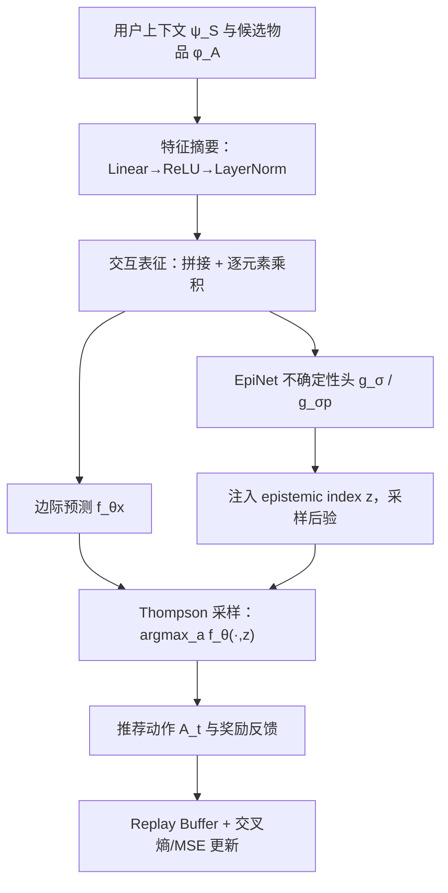
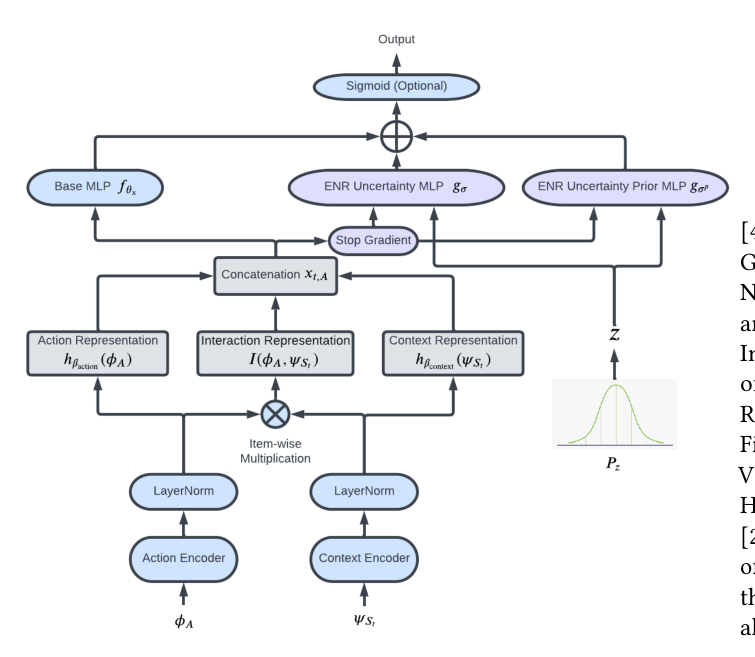

# Scalable Neural Contextual Bandit for Recommender Systems (面向推荐系统的可扩展神经上下文老虎机)

- **会议/期刊**: CIKM 2023
- **作者与机构**: Zheqing Zhu (Meta AI, Stanford University)；Benjamin Van Roy (Stanford University)
- **推荐链路定位**: 精排/在线探索决策（Contextual Bandit 动作选择）
- **研究方向**: 强化学习与动态探索推荐
- **论文原文**: [论文原文链接](https://arxiv.org/abs/2306.14834v3)
- **开源代码**: 暂未开源

## TL;DR (1分钟核心速览)

现有神经上下文老虎机（NeuralUCB/NeuralTS）虽能探索未知兴趣，但需对百万维参数矩阵求逆，工业不可用；Ensemble 又需多模型训练。本文提出 ENR：用 LayerNorm+逐元素交互构造上下文-动作表征，再接带固定先验网络的 EpiNet 不确定性头，以 Thompson 采样做动作选择，避免矩阵求逆。在 MIND/KuaiRec 在线老虎机评测中，CTR 相对提升约 9%，用户评分提升约 6%，达到同等性能少用 29–56% 交互，推理算力低 1–2 个数量级。

## Background & Motivation (背景与核心矛盾)

- **主流范式**: 推荐系统长期以监督学习（CF/深度排序）被动拟合已曝光数据，只利用“已识别兴趣”，缺乏主动试探未知偏好的机制。
- **前人局限**: NeuralUCB/NeuralTS 的不确定性估计需维护并求逆 $N\times N$协方差矩阵（MIND 约$10^6$维、KuaiRec 约$10^7$维），内存与复杂度分别达 TB 级与$O(10^{18})$–$O(10^{21})$；Ensemble 虽避开求逆，却要训练多个网络，训练成本高。
- **核心洞察 (Key Insight)**: 探索的关键不是对全部网络参数做精确后验，而是以低成本获得“认知不确定性”样本；EpiNet 用额外小头+epistemic index $z$ 即可近似后验采样，但仅用最后一层表征会丢失上下文-动作交互信息。
- **本文切入点**: 将 EpiNet 定制为推荐场景的 ENR，以更有信息量的上下文-动作表征增强不确定性头，从而在 Thompson 采样下实现可扩展探索。

## Method (核心方法设计)

### 1. 整体框架 (Overall Architecture)

ENR 将推荐建模为上下文老虎机：每步输入用户上下文 $\psi_{S_t}$与候选物品$\phi_A$，先分别经 Linear→ReLU→LayerNorm 摘要为同维向量，再拼接“上下文、动作、逐元素交互”三类表征；随后一路做边际预测$f_{\theta_x}$，另一路接 EpiNet 式不确定性头$g_\sigma$与固定先验$g_{\sigma_p}$，注入 epistemic index$z$后生成后验样本；推理时采样一个$z$，对所有候选动作取 argmax，训练时从 replay buffer 采样并更新。

<figure class="paper-figure" markdown="span">
  <figcaption>图2：认知神经推荐架构</figcaption>
</figure>
图2：ENR 认知神经推荐架构（上下文/动作摘要、EpiNet 不确定性头、Thompson 采样）。

### 2. 关键设计拆解 (Key Designs)

1. **信息量更强的上下文-动作表征**：痛点在于原始特征尺度差异大，且 NCF 式 MLP 拼接会丢失交互结构。ENR 先做层归一化与 ReLU，再显式构造逐元素交互：
$h_{\beta_c}(\psi_{S_t})=\text{LayerNorm}(\text{ReLU}(\beta_c^\top \psi_{S_t})),\quad h_{\beta_a}(\phi_A)=\text{LayerNorm}(\text{ReLU}(\beta_a^\top \phi_A))$
$x_{t,A}=\text{concat}(h_{\beta_c}(\psi_{S_t}),h_{\beta_a}(\phi_A),h_{\beta_c}(\psi_{S_t})\odot h_{\beta_a}(\phi_A))$
这样既稳住在线流式数据的梯度，又把 CF 式交互显式送入不确定性估计，避免仅靠末层表征造成信息瓶颈。

2. **带固定先验的 EpiNet 不确定性头**：痛点是用参数后验或矩阵求逆做 Thompson 采样过重。ENR 令 $g_{\sigma_p}$ 初始化后冻结，作为先验正则，输出为
$f_\theta(\psi_S,\phi_A,z)=f_{\theta_x}(x_{t,A})+\big(g_\sigma(\text{sg}[x_{t,A}],z)+g_{\sigma_p}(\text{sg}[x_{t,A}],z)\big)^\top z$其中$\text{sg}[\cdot]$截断梯度，$z\sim P_z$为离散 one-hot 或高斯认知索引。不同$z$即不同后验样本，天然适配 Thompson 采样，且避免$O(N^3)$ 求逆。

3. **训练目标、负采样与推理效率**：动作选择为
$A_t=\arg\max_{a\in\mathcal{A}} f_\theta(\psi_{S_t},\phi_a,z),\quad z\sim P_z$损失对采样到的$z$集合求和：$\mathcal{L}=\sum_{z\in Z}\ell(R_{t+1},f_\theta(\psi_{S_t},\phi_{A_t},z))$，二值奖励用交叉熵，连续评分用 MSE；训练从 replay buffer 批采样，ADAM 更新。**无负采样**；推理每个动作仅一次前向（MIND 约$9.5\times10^{-4}$秒/动作，KuaiRec 约$0.012$秒/动作），远低于末层 NeuralTS/NeuralUCB 的$1.59$–$1.60$ 秒/动作。

## Experimental Setup & Evaluation Protocol (实验设置与评估协议)

- **数据集与预处理**:

| 数据集 | #Users | #Items | #Interactions | 稀疏度/密度 | 特征/场景说明 |
| :--- | :---: | :---: | :---: | :---: | :--- |
| MIND | 1,000,000 | 160,000 | 15,000,000 | 0.0094% | 新闻推荐，含用户历史与曝光点击日志 |
| KuaiRec | 1,411 | 3,327 | 4,676,570 | 99.6% | 短视频，评分标量，近全稠密交互矩阵 |

- **数据划分与防穿越**: 非传统 `Leave-One-Out`/比例划分。MIND 做在线模拟：每步随机采样用户，训练 375,000 步，另取 2,000 个未见过用户做 out-of-sample 评估；利用完整曝光日志直接读取真实反馈，避免反事实评估。KuaiRec 跑 6,000 步，留出 100 个 context 作评估；其反馈时间略有错位，但仍优于纯反事实估计。
- **排名评测协议**: 非 `Full-Ranking`、非 `Sampled Ranking`；每步在候选动作集 $\mathcal{A}$ 上做 argmax，指标为平均奖励（MIND 平均 CTR、KuaiRec 平均用户评分），不使用 NDCG/Precision，因为在线老虎机的最优策略可能主动探索而非优化监督排序指标；无负采样。
- **对比基线与超参设置**: 基线含 Exploit、$\epsilon$-Greedy、Ensemble、NeuralUCB（末层版）、NeuralLinUCB、NeuralTS（末层版）、EpiNet；网络架构含 MLP/NCF/NAML/NRMS/Wide&Deep/DeepFM，参数量尽量对齐，统一 ADAM。ENR 的 epistemic index 维度为 5，prior scale 为 0.3；结果取 10 个随机种子均值±标准差，未明确报告显著性检验。

## Key Experimental Results (实验关键数据)

### 1. 主实验对比 (Main Results)

| 方法（统一 NCF 架构） | MIND Eval CTR | KuaiRec Eval Rating |
| :--- | :---: | :---: |
| $\epsilon$-Greedy + NCF | 0.178 | 2.31 |
| NeuralUCB (Last Layer) + NCF | 0.203 | N/A（算力不可行） |
| NeuralLinUCB + NCF | 0.203 | 2.38 |
| NeuralTS (Last Layer) + NCF | 0.206 | N/A（算力不可行） |
| Ensemble + NCF | 0.206 | 2.46 |
| EpiNet + NCF | 0.214 | 2.43 |
| **ENR** | **0.220** | **2.63** |
| **Improv. (vs 最强非 EpiNet)** | **+6.3%** | **+6.5%** |

> 注：MIND 最强非 EpiNet 为 NeuralTS+NAML 的 0.207，KuaiRec 最强为 Ensemble+DeepFM 的 2.47；表中统一列 NCF 变体便于横向比较。

### 2. 消融实验 (Ablation Study)

| 组件/设置 | 最优选择 | 偏离设置 | 观察 |
| :--- | :---: | :---: | :--- |
| LayerNorm | 启用 | w/o LayerNorm | 图6a：去掉后性能下降，原始特征尺度主导交互 |
| Epistemic index 维度 | 5 | 增大维度 | 图6b：维度增大反而衰减，5 最佳 |
| Prior network scale | 0.3 | 扫描 $(0,1)$ | 图6c：0.3 最佳，过小/过大均损害正则 |

### 3. 关键实验发现 (Key Findings)

- MIND 上 ENR 训练 CTR 达 0.228，较最强非 EpiNet 的 0.209 提升约 9.1%；Eval CTR 0.220 对 0.207 提升约 6.3%，说明探索收益可外推到未见用户，而非只拟合训练曝光。
- KuaiRec 上 ENR 评分 2.63，较最佳非 EpiNet 的 2.47 提升约 6.5%；在 3,327 个候选动作下，末层 NeuralTS/NeuralUCB 每动作约 1.6 秒，ENR 仅 0.012 秒，约两个数量级加速，且完整 NeuralUCB/TS 因矩阵求逆不可行。
- 样本效率显著：MIND 达到 0.2 CTR 只需 62k 交互，较 Ensemble 的 142k 少 56%；KuaiRec 达到 2.3 评分只需 1.7k 交互，较 2.4k 少 29%；玩具实验 regret 0.053，优于 EpiNet 的 0.064 与 NeuralTS 的 0.075。

## Highlights & Limitations (亮点、对比与审稿批判)

- **与代表作对比 (vs. Prior Work)**: NeuralUCB/NeuralTS 依赖参数或梯度的协方差求逆，理论严谨但工业不可扩展；Ensemble 用多模型近似后验，推理便宜但训练成本高；EpiNet 只取末层表征，交互信息不足。ENR 的本质区别是“用显式上下文-动作交互喂给 EpiNet 不确定性头”，在保持 Thompson 采样样本效率的同时把计算压到单次前向。
- **可迁移亮点**: ① 对原始异构特征先 LayerNorm 再逐元素交互，可迁移到 CTR/多模态召回中的上下文-物品融合；② 固定先验网络+stop-gradient 的轻量后验正则，适合任何需要“廉价不确定性”的在线排序场景。
- **审稿级局限批判**: ① 只在在线老虎机模拟中验证，未做离线预训练+线上 A/B，真实反馈回路中的位置偏差与流行度偏差未讨论；② 超参（index 维度、prior scale）敏感，且未报告显著性检验；③ 无开源代码，复现与工业部署细节不足。

## Rating (四维评分)

- **方法创新性 (Novelty)**: ⭐⭐⭐⭐ （将 EpiNet 定制为推荐场景的交互增强不确定性头，思路不算颠覆但工程与实验说服力强）
- **评估协议与实验扎实度 (Protocol & Experiments)**: ⭐⭐⭐⭐ （两个大规模真实数据+out-of-sample+算力对比完整，但缺少标准排序指标与显著性检验）
- **写作与数学规范度 (Clarity & Rigor)**: ⭐⭐⭐⭐ （算法与公式清晰，复杂度对比明确；部分符号在正文与表中略有不一致）
- **工业落地与复现价值 (Industrial & Practical Value)**: ⭐⭐⭐⭐ （推理近常数开销、训练成本低于 Ensemble，适合在线探索；但无开源代码且依赖在线模拟验证）

