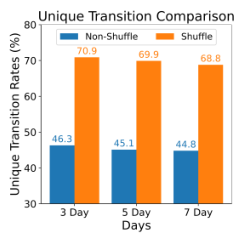
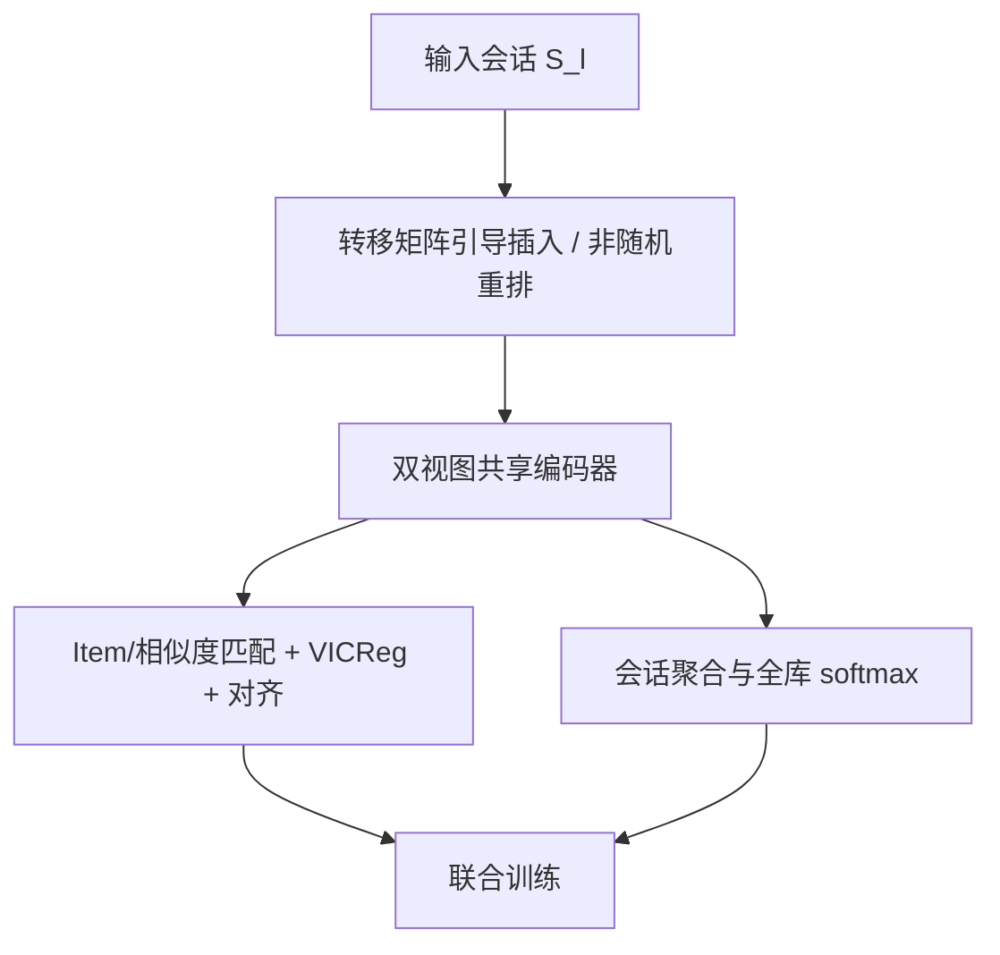
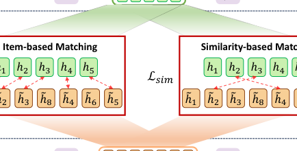

# MUSE: Music Recommender System with Shuffle Play Recommendation Enhancement (MUSE：面向随机播放推荐增强的音乐推荐系统)

- **会议/期刊**: CIKM 2023
- **作者与机构**: Yunhak Oh, Sukwon Yun, Dongmin Hyun, Sein Kim, Chanyoung Park；KAIST / POSTECH
- **推荐链路定位**: 会话级召回 / Next-Track 预测，端到端训练
- **研究方向**: 自监督对比学习与交互去噪 / 序列与会话推荐
- **论文原文**: [论文原文链接](https://arxiv.org/abs/2308.09649v2)
- **开源代码**: [开源代码仓库链接](https://github.com/yunhak0/MUSE)

## TL;DR (1分钟核心速览)

音乐流媒体中随机播放会话占总会话 40.2%，但其唯一转移率约为非随机播放的 1.5 倍，使 SBR 将大量罕见转移当作噪声，随机播放场景性能显著下降。MUSE 用全局转移矩阵引导插入高概率中间曲目，并以 item/相似度两级匹配对齐双视图；在 Spotify MSSD 全库排序上，R@10 较 GCSAN 提升 1.94%–2.41%。

## Background & Motivation (背景与核心矛盾)

- **主流范式**: 会话推荐以 GRU/Transformer/GNN 建模 next-track，CL4SRec、DuoRec 等用自监督增广提升鲁棒性。
- **前人局限**: ①现有 SBR 直接混合训练随机与非随机会话，随机播放中大量唯一转移形成训练瓶颈；②通用增广（裁剪、重排、mask）未利用音乐转移频次，无法区分“随机噪声”与“可复用转移”。
- **核心洞察 (Key Insight)**: 随机播放并非完全无信息；若把全局高频转移插入会话，可降低唯一转移比例，把随机会话转化为可学习序列。图 2 显示随机会话唯一转移率约为非随机会话的 1.5 倍。
- **本文切入点**: 不丢弃随机播放会话，而是用转移频次做“插入式增广”，再用细粒度匹配约束双视图表征。

<figure class="paper-figure" markdown="span">
  <figcaption>图 2：MSSD 数据集中非随机播放与随机播放会话之间唯一转移率的比较。唯一转移率 = 唯一转移数</figcaption>
</figure>

## Method (核心方法设计)

### 1. 整体框架 (Overall Architecture)

输入会话 $S_\ell$先经增广得到$\tilde{S}_\ell$：随机播放会话用 transition-based augmentation 插入高频中间曲目，非随机播放会话以概率$\gamma$随机重排以模拟 shuffle。原始/增广视图共享 track encoder 与 aggregation layer，得到$\mathbf{z}_\ell$、$\tilde{\mathbf{z}}_\ell$；训练同时优化 item-based matching、similarity-based matching、VICReg 正则、视图对齐与 next-track 交叉熵。推理仅走原始会话编码与全库打分，不做增广与匹配。

<figure class="paper-figure" markdown="span">
  <figcaption>图 3：MUSE 的整体架构。给定一个会话，我们首先通过基于转移的增强生成增强视图，以缓解唯一转移问题。随后，我们采用基于物品和相似度的匹配，获得能够同时处理随机播放和非随机播放会话的鲁棒且统一的编码器。</figcaption>
</figure>

### 2. 关键设计拆解 (Key Designs)

1. **转移矩阵引导插入 (Transition-based Augmentation)**：针对随机会话唯一转移过多，先统计全局转移频次 $\mathbf{T}_{i,j}=\sum_{\ell=1}^{N}\sum_{t=1}^{|S_\ell|-1}\mathbb{I}([x_t,x_{t+1}]=[x_i,x_j])$，对非零值取 log 后做行/列归一化。对会话每个插入槽，候选分布为$\mathbf{P}_{S_\ell,\cdot}=\mathrm{softmax}(\bar{\mathbf{T}}_{S_\ell^s,\cdot}\odot\bar{\mathbf{T}}^\top_{\cdot,S_\ell^t})$，再从$\mathrm{Multinomial}(\bar{\mathbf{P}}_{S_\ell}[i,:])$ 采样插入曲目。直觉是：同时满足“前驱→候选”和“候选→后继”的曲目，既降低唯一转移，又保持上下文连贯。
2. **Item/相似度两级匹配 (Fine-grained Matching)**：仅对齐会话级向量不足，MUSE 先约束两视图中相同曲目的隐表示：$\mathcal{L}_{item}=\frac{1}{|\mathcal{I}_\ell|}\sum_{x_t\in\mathcal{I}_\ell}\sum_{x_k\in\tilde{\mathcal{I}}_\ell}\mathbb{I}(x_t=x_k)\|\mathbf{h}_t-\tilde{\mathbf{h}}_k\|^2$；再用每首歌在另一视图中的 top-$\kappa$最近邻做对称匹配$\mathcal{L}_{sim}$。前者保证同物一致，后者补充相似物邻域一致性，避免只记住完全相同 item。
3. **训练目标、负采样与推理效率**：总损失 $\mathcal{L}_{final}=\alpha\mathcal{L}_{matching}+(1-\alpha)\mathcal{L}_{align}+\mathcal{L}_{rec}$，其中$\mathcal{L}_{matching}=\mathcal{L}_{item}+\mathcal{L}_{sim}+\mathcal{L}_{VICReg}$，$\mathcal{L}_{rec}$为全库 softmax 交叉熵，**无负采样**。转移矩阵用稀疏存储；增广与匹配只在训练期执行，推理只做一次编码与$|V|$ 维打分。

## Experimental Setup & Evaluation Protocol (实验设置与评估协议)

- **数据集与预处理**: Spotify MSSD 约取 50%，匿名会话、无用户 ID；过滤非 premium 用户、长度 1 会话、训练集中出现少于 5 次的曲目，并剔除用户 skip 的下一曲（随机会话连输入中的 skip 也剔除）；测试集冷启动曲目移除。

| 数据集 | #Plays | #Shuffle 会话 | #Non-shuffle 会话 | #Train/#Test 会话 | #Tracks | 平均长度 |
| :--- | :---: | :---: | :---: | :---: | :---: | :---: |
| MSSD-3d | 11,858,262 | 301,814 | 442,726 | 613,308 / 131,232 | 199,177 | 15.93 |
| MSSD-5d | 16,701,958 | 422,221 | 618,701 | 909,818 / 131,104 | 253,693 | 16.05 |
| MSSD-7d | 19,366,448 | 501,875 | 713,300 | 1,061,274 / 153,901 | 280,079 | 15.94 |

- **数据划分与防穿越 (Splitting Strategy)**: 按日期切分，3d/5d/7d 分别取连续训练日，验证/测试取后续独立日期，属于全局时间戳切分，避免未来会话泄漏。
- **排名评测协议 (Ranking Protocol)**: **Full-Ranking**，对全部 $|V|$ 个曲目做 softmax 排序，报告 Recall@K、MRR@K、NDCG@K；非采样负例排序。
- **对比基线与超参设置**: 对比 12 个模型，含 GRU4Rec、NARM、STAMP、CSRM、SASRec、SR-GNN、GC-SAN、CL4SRec、DuoRec、FMLP、CoSeRNN 等；隐藏维 $d=100$、batch 512、最大会话长度 20、单层 GNN/Transformer 单头。MUSE 搜索$\gamma\in\{0.3,0.5,0.7,0.9\}$、$\alpha\in\{0.2,0.4,0.6,0.8\}$，固定$\kappa=5$、VICReg$\lambda=1,\mu=1,\nu=10$；显著性用 paired t-test，$p<0.01$。

## Key Experimental Results (实验关键数据)

### 1. 主实验对比 (Main Results)

MSSD-5d 代表性结果如下（其余 chunk 趋势一致）：

| 模型 | R@10 | M@10 | N@10 |
| :--- | :---: | :---: | :---: |
| NARM | 0.3941 | 0.2836 | 0.3096 |
| STAMP | 0.3841 | 0.2741 | 0.3001 |
| SR-GNN | 0.4040 | 0.2967 | 0.3221 |
| GC-SAN | 0.4065 | 0.3006 | 0.3257 |
| CL4SRec | 0.3886 | 0.2781 | 0.3042 |
| DuoRec | 0.3926 | 0.2790 | 0.3059 |
| FMLP | 0.3989 | 0.2843 | 0.3114 |
| CoSeRNN | 0.3747 | 0.2554 | 0.2836 |
| **MUSE** | **0.4153** | **0.3062** | **0.3320** |
| Improv. vs GC-SAN | +2.16% | +1.86% | +1.93% |

### 2. 消融实验 (Ablation Study)

原文图 6 给出 MSSD-5d 的 MRR@5 趋势，核心结论如下：

| 变体/设置 | 随机播放 | 非随机播放 | 说明 |
| :--- | :---: | :---: | :--- |
| 无增广 (-,-) | 最低 | 最低 | 双视图退化为弱约束 |
| 仅重排非随机 (R,-) | 下降 | 提升 | 重排利于统一编码，但不解决唯一转移 |
| 仅转移增广 (-,T) | 提升 | 下降 | 插入高频转移主要修复随机会话 |
| **(R,T)=MUSE** | **最优** | **最优** | 两类增广互补 |
| 去掉 item matching | 下降 | 下降 | 同物跨视图一致性缺失 |
| 去掉 similarity matching | 下降 | 下降 | 相似邻域补充不足 |

### 3. 关键实验发现 (Key Findings)

1. 在 MSSD-5d 上，MUSE 的 R@10 从 GC-SAN 的 0.4065 提升至 0.4153（+2.16%），较骨干 SR-GNN 提升 2.80%；M@10/N@10 也分别较 GC-SAN 提升 1.86%/1.93%，说明收益不只来自更强编码器，而来自转移增广与匹配目标。
2. 细粒度划分中，MUSE 在随机播放测试集上 R@10 达 0.2400，较 GC-SAN 的 0.2295 提升 4.58%，较 SR-GNN 提升 3.00%；同时在非随机播放上仍较 GC-SAN 提升 1.59%，未出现“修好 shuffle、牺牲 non-shuffle”的跷跷板。
3. 超参分析显示 $\gamma=0.5$、$\alpha=0.2$最优：过度重排破坏原会话语义，弱重排又不足以模拟 shuffle；较小$\alpha$ 让匹配损失充当正则项。所有参数组合均优于 GC-SAN 的 MRR@5=0.2939，鲁棒性较好。

## Highlights & Limitations (亮点、对比与审稿批判)

- **与代表作对比 (vs. Prior Work)**: CL4SRec 用裁剪/mask/重排等通用序列增广，未建模音乐转移频次；DuoRec 侧重 model-level dropout 与监督对比；CoSeRNN 依赖用户/上下文而 MSSD 匿名场景不可用。MUSE 的本质区别是把“全局转移统计”作为增广先验，并用 item+NN 两级匹配替代粗粒度会话对比。
- **可迁移亮点**: ①用稀疏转移矩阵引导插入高频中间项，可迁移到电商/短视频等噪声会话去噪；②对非随机序列做重排以模拟随机环境，可训练统一鲁棒编码器；③item matching + top-$\kappa$ NN matching 的双层对齐，适合任何双视图序列推荐。
- **审稿级局限批判**: ①依赖全量会话转移矩阵，冷启动曲目或极稀疏场景下候选为空，增广失效；②实验仅在 Spotify MSSD，缺少线上 A/B、延迟与多平台泛化；全库 softmax 与 $|V|\approx 25$万打分在工业级候选集上开销仍需评估；③插入采样具随机性，且相似度匹配需 warm-up，超参$\gamma,\alpha,\kappa$ 对数据分布较敏感。

## Rating (四维评分)

- **方法创新性 (Novelty)**: ⭐⭐⭐⭐ （将 shuffle 的唯一转移问题转化为转移频次引导插入，领域洞察强，但 SSL 框架本身较常规）
- **评估协议与实验扎实度 (Protocol & Experiments)**: ⭐⭐⭐⭐ （MSSD 三个时间 chunk、12 个基线、全库排序与 $p<0.01$ 显著性较完整；消融以图呈现，缺精确数值表）
- **写作与数学规范度 (Clarity & Rigor)**: ⭐⭐⭐⭐ （转移矩阵、采样与匹配公式定义清楚；复杂度与稀疏实现有交代，理论分析偏直觉）
- **工业落地与复现价值 (Industrial & Practical Value)**: ⭐⭐⭐⭐ （代码开源，推理不增开销，稀疏转移矩阵可落地；但全库 softmax 与离线增广管线仍需工程优化）

