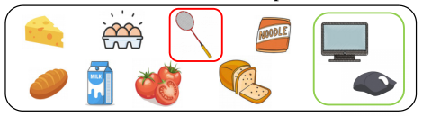
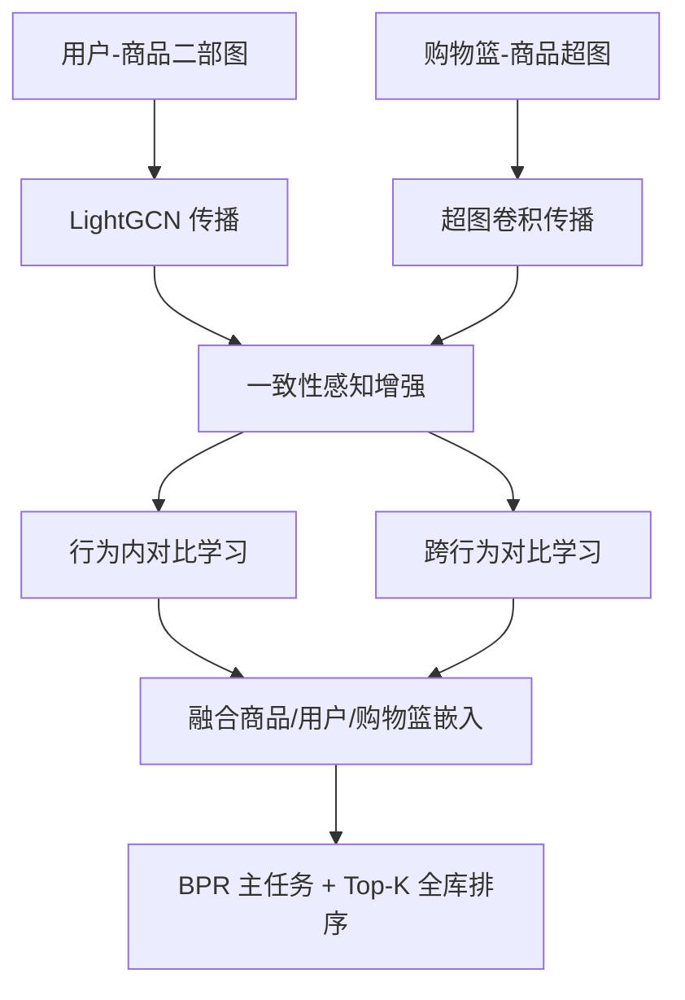
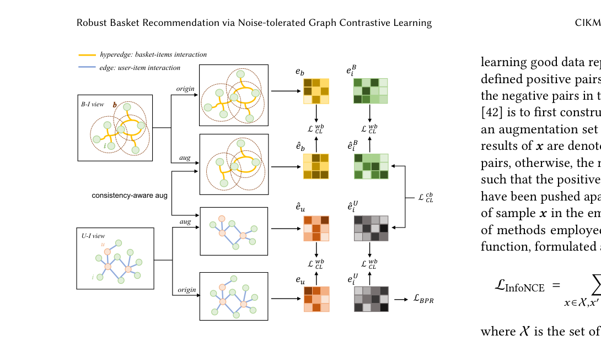

# Robust Basket Recommendation via Noise-tolerated Graph Contrastive Learning (基于噪声容忍图对比学习的鲁棒购物篮推荐)

- **会议/期刊**: CIKM 2023
- **作者与机构**: Xinrui He, Tianxin Wei, Jingrui He (University of Illinois at Urbana-Champaign)
- **推荐链路定位**: 召回/排序（Within-basket Top-K）
- **研究方向**: 自监督对比学习与交互去噪 / 图神经网络与知识图谱推荐
- **论文原文**: [论文原文链接](https://arxiv.org/abs/2311.16334v2)
- **开源代码**: [开源代码仓库链接](https://github.com/Xinrui17/BNCL)

## TL;DR (1分钟核心速览)

购物篮推荐需融合“用户购买行为”与“篮内共现行为”，但两类行为语义异质、各自含噪，直接拼接会放大噪声。BNCL 用用户-商品图与购物篮超图双视图建模，以跨行为/行为内对比学习对齐不变语义，并用一致性感知边丢弃识别双视图一致噪声。三个交易数据集、每篮 80/20 划分、全库排序下，Instacart R@60 达 21.10、NDCG@60 达 25.62，优于 SGL/CLEA 等强基线。

## Background & Motivation (背景与核心矛盾)

- **主流范式**: 早期 BR 用 MF/序列模型或 UBI 图联合建模用户购买与购物篮；近期 SGL、CLEA 等引入图对比学习或篮内拆分去噪。
- **前人局限**: 一类方法只处理用户-商品交互噪声，另一类只处理篮内噪声，缺乏跨行为联合去噪；且用户购买与篮内共现语义不一致，直接融合会引入新的跨行为噪声。
- **核心洞察 (Key Insight)**: 同一商品在一个视图可能是噪声，在另一视图可能有用；若在两个视图都表现为低重要性，则更可能是“一致噪声”，应优先丢弃。
- **本文切入点**: 用双行为图/超图 + 跨行为与行为内对比学习，把“去噪”转化为多视图不变性学习与一致性边丢弃。

<figure class="paper-figure" markdown="span">
  <figcaption>图1：购物篮推荐中噪声的一个示例：就购物篮内的内容相关性而言，购物篮3中的食品是噪声商品；从用户购物偏好的角度看，购物篮3中的电子产品可能被视为噪声。从这两个视角看，球拍都表现为一致的噪声。</figcaption>
</figure>
图1：购物篮推荐中的噪声示例：同一商品在不同行为视图下可能分别是噪声或有用信号，双视图一致低重要性才更可靠。

## Method (核心方法设计)

### 1. 整体框架 (Overall Architecture)

BNCL 将用户-商品交互建成二部图，用 LightGCN 传播得到用户/商品嵌入；将每个购物篮建成超边、篮内商品为超点，用轻量超图卷积得到篮内商品与购物篮嵌入。随后对两图做一致性感知增强，分别执行行为内对比学习；再用跨行为对比学习对齐同一商品在两视图中的表示，抑制融合噪声。最终融合用户、购物篮与商品嵌入做 Top-K 打分，并以 BPR 主任务 + 两个对比辅助任务多任务训练。

<figure class="paper-figure" markdown="span">
  <figcaption>图2：BNCL 的整体框架。(i) 在购物篮行为视图中，黄色超边表示购物篮，节点表示商品；在用户购买行为中，蓝色边表示用户-商品交互。(ii) 我们分别针对这两种行为，在增强图与原图之间采用篮内对比学习。(iii) 通过所提出的一致性感知增强，获得用户购买行为和购物篮行为的增强视图。(iv) 跨行为对比学习有助于更好地融合物品属性……</figcaption>
</figure>
图2：BNCL 整体框架：双行为图/超图建模、一致性感知增强、行为内与跨行为对比学习及多任务优化。

### 2. 关键设计拆解 (Key Designs)

1. **购物篮超图建模 + 双行为打分融合**：篮内商品天然多对多，普通二部图难表达“同一篮内商品互补/替代”的高阶关系。用关联矩阵 $\mathbf{H}$与度矩阵$\mathbf{D},\mathbf{B}$做超图传播$\mathbf{E}_I^{B(k)}=\mathbf{D}^{-1/2}\mathbf{H}\mathbf{B}^{-1}\mathbf{H}^{\top}\mathbf{D}^{-1/2}\mathbf{E}_I^{B(k-1)}$，再以$\hat{y}(u,b,i)=(1-r)\mathbf{e}_u^{\top}\mathbf{e}_i+r\mathbf{e}_b^{\top}\mathbf{e}_i$、$\mathbf{e}_i=\mathbf{e}_i^U+\mathbf{e}_i^B$融合用户偏好与当前篮意图；$r$ 控制二者权重，避免简单相加。

2. **跨行为 + 行为内对比去噪**：跨行为噪声来自两视图特征空间不一致，行为内噪声来自用户误点或篮内无关商品。跨行为损失把同一商品在两视图的增强表示拉近：$\mathcal{L}_{cb}=\sum_{i\in I}-\log\frac{\exp(\mathrm{sim}(\hat{\mathbf{e}}_i^U,\hat{\mathbf{e}}_i^B)/\tau)}{\sum_{j\in I,j\neq i}\exp(\mathrm{sim}(\hat{\mathbf{e}}_i^U,\hat{\mathbf{e}}_j^B)/\tau)}$；行为内则对原图与增强图的用户、商品、购物篮表示做 InfoNCE，合计为$\mathcal{L}_{wb}$。直觉是：噪声边在增强前后不稳定，对比学习迫使模型保留跨增强不变的本质语义。

3. **一致性感知增强与训练目标**：随机丢边可能破坏重要结构，且单视图难判噪声。作者用节点/超边度数定义边重要性 $s_{\epsilon}^{u-i}=\log(\delta_d(u)+\delta_d(i)+\delta_{d\_hyper}(i))$、$s_{\epsilon}^{b-i}=\log(\delta_{d\_hyper}(b)+\delta_{d\_hyper}(i)+\delta_d(i))$，再按$p_{\epsilon}=\frac{s_{\max}-s_{\epsilon}}{s_{\max}-s_{\min}}p$丢弃低重要性边；双视图一致低重要性的边更可能被删。总损失$\mathcal{L}=\mathcal{L}_{main}+\alpha_1\mathcal{L}_{cb}+\alpha_2\mathcal{L}_{wb}$，$\mathcal{L}_{main}$ 为 BPR，正样本取当前篮内商品、负样本从非购买商品采样；推理时对全库商品打分排序，无额外近邻检索开销。

## Experimental Setup & Evaluation Protocol (实验设置与评估协议)

- **数据集与预处理**: 三个交易数据集，过滤过短篮（Instacart 篮长 <30，Tafeng/ValuedShopper <10）：

| 数据集 | #Users | #Items | 平均篮长 | 人均篮数 |
| :--- | :---: | :---: | :---: | :---: |
| Instacart | 22,168 | 40,044 | 37.00 | 2.96 |
| Tafeng | 7,119 | 11,916 | 15.99 | 2.20 |
| ValuedShopper | 9,532 | 7,860 | 19.94 | 17.66 |

- **数据划分与防穿越**: 每个购物篮按商品做 80%/20% 划分，80% 篮内商品作训练/可见上下文，20% 作测试补全目标；非全局时间戳切分，而是篮内留出。
- **排名评测协议**: 对给定用户与当前篮，计算全库商品得分并 `Full-Ranking`，取 Top-K；报告 Recall@K、Precision@K、HR@K、NDCG@K，主表 K=40/60。
- **对比基线与超参**: 覆盖 PersonPop-k、BPR-MF、Triple2Vec、DREAM、TIFU-KNN、LightGCN、BasConv、MITGNN、SGL、CLEA；统一 batch=1024、embedding=128、hidden=64、Xavier 初始化；BNCL 取 2 层传播、lr=$5\times10^{-4}$，$r\in[0,0.5]$、$p\in[0.1,0.7]$、$\alpha_1,\alpha_2\in[10^{-1},10^{-5}]$；最优结果相对次优基线$p<0.05$。

## Key Experimental Results (实验关键数据)

### 1. 主实验对比 (Main Results)

下表保留 8 个代表性基线，报告 R@60 与 NDCG@60（%）；加粗为最优。

| 方法 | Instacart R@60 | Instacart N@60 | Tafeng R@60 | Tafeng N@60 | ValuedShopper R@60 | ValuedShopper N@60 |
| :--- | :---: | :---: | :---: | :---: | :---: | :---: |
| BPR-MF | 15.612 | 19.876 | 2.648 | 2.378 | 2.873 | 2.408 |
| Triple2Vec | 11.711 | 16.474 | 0.188 | 0.134 | 2.856 | 2.505 |
| TIFU-KNN | 20.407 | 9.263 | 2.836 | 0.978 | 8.206 | 3.253 |
| LightGCN | 17.832 | 21.504 | 3.781 | 4.244 | 7.780 | 6.634 |
| BasConv | 17.144 | 18.581 | 3.437 | 3.257 | 7.281 | 6.572 |
| MITGNN | 15.426 | 17.630 | 3.467 | 2.902 | 7.619 | 7.153 |
| SGL | 19.350 | 24.162 | 3.893 | 4.351 | 8.045 | 6.882 |
| CLEA | 20.701 | 22.760 | 4.062 | 4.428 | 7.505 | 6.008 |
| **BNCL** | **21.099** | **25.615** | **4.175** | **4.628** | **8.845** | **7.529** |

相对各数据集最强基线的 R@60/NDCG@60 提升：Instacart +1.92%/+6.01%，Tafeng +2.78%/+4.52%，ValuedShopper +7.79%/+5.25%。BNCL 的 HR@60 在 Instacart 为 74.674，亦高于 CLEA 的 74.356。

### 2. 消融实验 (Ablation Study)

Instacart 上逐组件消融（%）：

| 配置 | B-I | CA | CL Fusion | R@60 | P@60 | HR@60 | NDCG@60 |
| :--- | :---: | :---: | :---: | :---: | :---: | :---: | :---: |
| 基础 LightGCN | - | - | - | 17.83 | 2.33 | 70.31 | 21.50 |
| + 购物篮超图 | ✓ | - | - | 18.28 | 2.39 | 70.77 | 21.62 |
| + 超图 + 跨行为 CL | ✓ | - | ✓ | 20.17 | 2.64 | 73.50 | 23.91 |
| + 超图 + 一致性增强 | ✓ | ✓ | - | 20.87 | 2.73 | 73.51 | 25.22 |
| 随机增强替代 | ✓ | random | ✓ | 20.56 | 2.70 | 72.48 | 25.29 |
| 简单加和两视图 | ✓ | - | add | 20.02 | 2.67 | 72.07 | 25.30 |
| **BNCL 完整** | ✓ | ✓ | ✓ | **21.10** | **2.77** | **74.67** | **25.62** |

### 3. 关键实验发现 (Key Findings)

- 购物篮超图单独加入仅使 R@60 从 17.83 升至 18.28（+2.5%），说明篮内互补信息有效但不足以压噪；真正大幅增益来自跨行为融合方式。
- 跨行为对比学习把 NDCG@60 从 21.62 拉至 23.91（+10.59%），而完整 BNCL 相比随机增强在 R@60/NDCG@60 上再提升约 2.6%/1.3%，证明“一致性感知选边”比随机丢边更会挑噪声。
- 噪声比例从 20% 增至 80% 时，BNCL 的 R@60 仅下降 6.99%、NDCG@60 下降 2.22%；LightGCN 分别下降 18.12%/10.06%，SGL 下降 9.00%/8.49%，鲁棒性优势明确。

## Highlights & Limitations (亮点、对比与审稿批判)

- **与代表作对比 (vs. Prior Work)**: SGL 只在用户-商品视图做随机图增强，未建模购物篮；CLEA 面向 next-basket 拆正负子篮，未联合双行为去噪；MITGNN 重多意图检索但无显式噪声容忍机制。BNCL 的核心差异是“双视图 + 一致性选边 + 跨/内对比”的联合去噪。
- **可迁移亮点**: 用双视图度数构造边重要性并做一致性丢弃，可迁移到多行为电商、社交-商品异质图去噪；跨行为 CL 可作为即插模块增强 BPRMF/Fism/LightGCN 等骨干（表 4 已验证）。
- **审稿级局限批判**: (1) 将购物篮视为无序集合，忽略篮内顺序、时间间隔与 next-basket 动态，跨篮时序信息未建模；(2) $\alpha_1,\alpha_2,r,p$ 按数据集分别调优，随机丢边仍带来方差，且仅离线全库排序与人工加噪，缺少线上 A/B、先进攻击与公平性评估。

## Rating (四维评分)

- **方法创新性 (Novelty)**: ⭐⭐⭐⭐ （双行为超图 + 一致性感知对比去噪组合清晰，跨视图选边有物理直觉，但对比学习框架本身并非全新）
- **评估协议与实验扎实度 (Protocol & Experiments)**: ⭐⭐⭐⭐ （三数据集、全库排序、$p<0.05$、消融/噪声/骨干实验完整；但仅离线且 ValuedShopper 为采样交易）
- **写作与数学规范度 (Clarity & Rigor)**: ⭐⭐⭐⭐ （关键公式、损失与传播定义完整，符号较清楚；部分表格与符号排版略密）
- **工业落地与复现价值 (Industrial & Practical Value)**: ⭐⭐⭐⭐ （代码开源，超图消息传递轻量、可插拔骨干；但时序建模与超参调优成本仍需工程补足）

