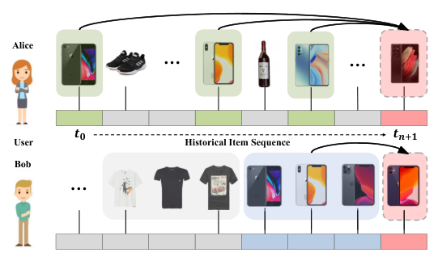
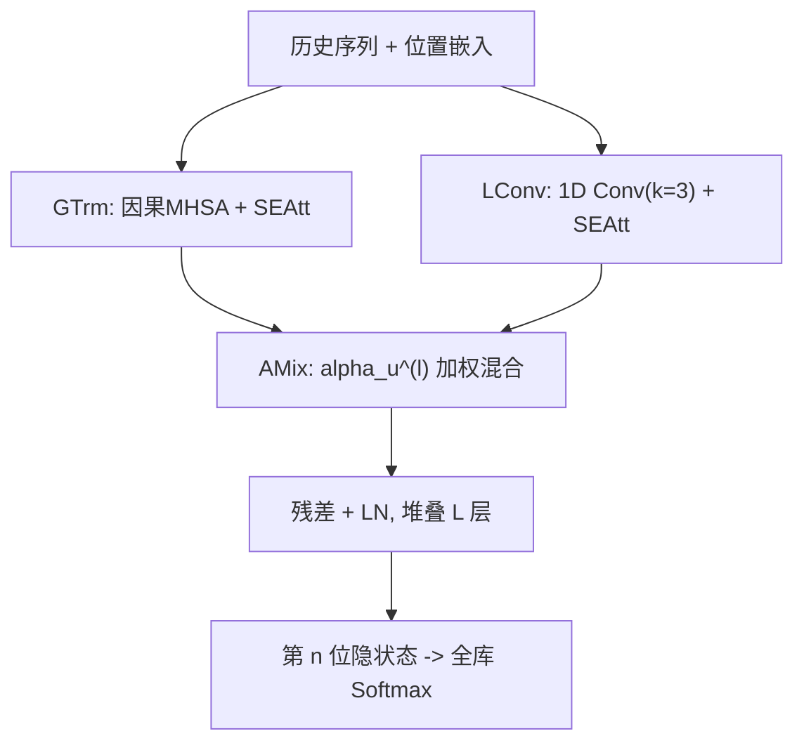
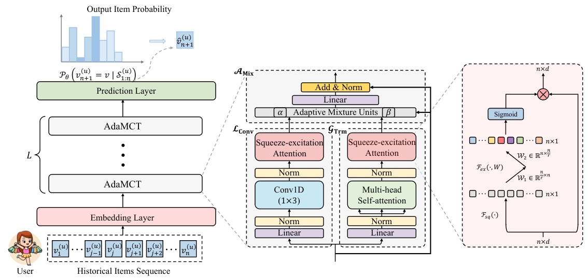

# AdaMCT: Adaptive Mixture of CNN-Transformer for Sequential Recommendation (CNN-Transformer 自适应混合的序列推荐)

- **会议/期刊**: CIKM 2023
- **作者与机构**: Juyong Jiang、Peiyan Zhang（共同一作）、Yingtao Luo、Chaozhuo Li、Kai Zhang、Senzhang Wang、Xing Xie、Sunghun Kim；HKUST(GZ)/HKUST/CMU/MSRA/ECNU/CSU
- **推荐链路定位**: 精排（Next-Item 序列打分）
- **研究方向**: 序列与会话推荐 / 自监督与鲁棒表征（局部归纳偏置）
- **论文原文**: [论文原文链接](https://arxiv.org/abs/2205.08776v3)
- **开源代码**: [开源代码仓库链接](https://github.com/juyongjiang/AdaMCT)

## TL;DR (1分钟核心速览)

序列推荐的痛点是"全局注意力 vs 局部卷积"谁更该主导因用户而异、且同一用户不同层需求也不同——现有工作要么只用单一架构，要么用常数权重/单一门控硬融合。AdaMCT 把 1D 卷积（局部、短期）与自注意力（全局、长期）并列置于每一层，由用户级、层级的自适应系数 $\alpha_u^{(l)}$ 逐层混合，并首次用 **Sigmoid 挤压-激励注意力（SEAtt）** 替换 Softmax 以解除"注意力分数和为 1"的互斥约束。在 Toys/Beauty/Sports 的 Leave-One-Out + 1:100 采样排序协议下，Recall@10 相对最强基线分别提升 4.13%/4.58%/8.46%，参数仅 0.21M（Beauty），FLOPs 比 SASRec 少 93%。

## Background & Motivation (背景与核心矛盾)

- **主流范式**: 一路以 SASRec/BERT4Rec 为代表，用自注意力捕获全局依赖；一路以 Caser/NextItNet 为代表，用 1D 卷积捕获局部序列模式；混合派（如 RCNN 类、CORE、HGN）试图两者兼得。
- **前人局限 1（融合方式僵化）**: 早期方法只用最后一个物品代表短期兴趣，并以求和/拼接融合长短期，无法为不同用户、不同物品给出个性化权重；后续门控机制虽有门，但长短期建模过程彼此**割裂**，无法互促。
- **前人局限 2（Softmax 的互斥性）**: 用户常反复对比多个同类商品（图 1 中 Alice/Bob 的多条 iPhone 记录），而 softmax 强制 $\sum_j a_{ij}=1$，导致多个高度相关历史物品无法被同时激活。
- **核心洞察 (Key Insight)**: 局部卷积对**近期**物品敏感（短期），自注意力擅长**全局**依赖（长期），二者是互补归纳偏置而非替代关系；且这种互补性在不同层、不同用户上的配比不同——混合权重应当**可学习且个性化**。
- **本文切入点**: 用"层内并联 + 逐层自适应混合 + Sigmoid 注意力"一次性解决联合建模、个性化融合、多相关物品激活三个问题。

<figure class="paper-figure" markdown="span">
  <figcaption>图1：个性化全局交互与局部特征依赖。Alice 和 Bob 具有不同的兴趣模式。对于 Alice，下一个物品更依赖于她的全局交互兴趣；而 Bob 则对其先前历史物品序列表现出局部特征依赖。</figcaption>
</figure>

## Method (核心方法设计)

### 1. 整体框架 (Overall Architecture)

输入为用户历史序列 $S^{(u)}_{1:n}$，经物品嵌入与可学习位置嵌入相加得$\mathbf{H}^{(0)}_u\in\mathbb{R}^{n\times d}$。堆叠$L$个 AdaMCT 层，每层并行两条支路：全局支路$\mathcal{G}^{Trm}$（线性层+LN → 因果掩码多头自注意力 → SEAtt，**注意：删除了标准 Transformer 的 FFN 以减参**）与局部支路$\mathcal{L}^{Conv}$（线性层+LN → 1D 卷积$k=3$、零填充、步长 1 → SEAtt）。两路输出由自适应混合单元$\mathcal{AMix}$按用户/层专属系数$\alpha$加权，残差+LN 输出。末尾取第$n$ 个位置的隐状态，经两层 FFN 与共享物品嵌入表做全库 Softmax，交叉熵训练。

<figure class="paper-figure" markdown="span">
  <figcaption>图2：所提出 AdaMCT 的模型架构。AdaMCT 首先通过嵌入层生成带有位置嵌入的物品嵌入，然后通过 𝐿× AdaMCT 层聚合序列表示，其中每一层包括三个子层，即全局注意力模块（GTrm）、局部卷积模块（LConv）和自适应混合单元（AMix）。最后，预测层为每个候选物品生成推荐分数。</figcaption>
</figure>

### 2. 关键设计拆解 (Key Designs)

1. **Squeeze-Excitation Attention（解除互斥约束）**：softmax 让多个同类历史物品互相"抢分"。SEAtt 先沿特征维做平均池化得到物品级统计 $\mathbf{z}=\frac{1}{d}\sum_{j=1}^{d}\mathbf{X}[:,j]\in\mathbb{R}^{n}$，再经瓶颈两层感知机与 **Sigmoid** 输出独立分数：$\mathrm{SEAtt}(\mathbf{X})=\sigma(\mathbf{W}_2\delta(\mathbf{W}_1\mathbf{z}))\in\mathbb{R}^{n\times 1}$，与主分支逐元素相乘$\otimes$。因 Sigmoid 无归一化和约束，多个相关物品可同时获得高分，等价于把"竞争性选择"改为"多标签门控"。压缩比$r=2$。
2. **模块级 + 层级的自适应混合单元（AMix）**：固定权重（如 0.5/0.5）无法适配用户差异。对上一层输出做平均池化得用户偏好向量，经线性层+Sigmoid 得到标量系数 $\alpha_u^{(l)}=\sigma\!\left(\mathbf{W}^{(l)}\mathrm{Pool}(\mathbf{H}^{(l-1)}_u)\right)$，混合为$\mathbf{M}=\alpha_u^{(l)}\mathcal{L}^{Conv}+(1-\alpha_u^{(l)})\mathcal{G}^{Trm}$。由于$\alpha$由用户历史池化而来且每层独立，模型获得$|U|\times L$ 个自由度，实现"谁更依赖全局、哪一层更该局部"的细粒度调配。
3. **训练目标、负采样与推理效率**：仅用交叉熵 $\mathcal{L}_{ce}=-\sum_{u}\log P_\theta(v^{(u)}_{n+1}=v\mid S^{(u)}_{1:n})$，无额外对比/辅助损失；训练不做显式负采样（全库 softmax），评测阶段才采样。推理为一次前向 + 全库内积，Beauty 上 0.21M 参数、0.34 GFLOPs、单 epoch 训练 4.75s。

## Experimental Setup & Evaluation Protocol (实验设置与评估协议)

- **数据集与预处理**: 三个 Amazon 评论数据集，按时间排序构序列，采用 `5-core` 过滤（丢弃长度 <5 的序列）：

| 数据集 | #Users | #Items | #Interactions | 稀疏度/密度 | 特征/场景说明 |
| :--- | :---: | :---: | :---: | :---: | :--- |
| Toys | 19,412 | 11,924 | 167,597 | 99.93% / 0.07% | 平均序列长 8.6，玩具品类 |
| Beauty | 22,363 | 12,101 | 198,502 | 99.93% / 0.07% | 平均序列长 8.9，美妆品类 |
| Sports | 35,598 | 18,357 | 296,337 | 99.95% / 0.05% | 平均序列长 8.3，最稀疏 |

- **数据划分与防穿越 (Splitting Strategy)**: `Leave-One-Out`——最后 1 个交互作测试、倒数第 2 个作验证、其余训练，严格按用户时间戳顺序。
- **排名评测协议 (Ranking Protocol)**: **Sampled Ranking**——每个正样本配 100 个均匀采样、用户未交互过的负样本（1:100），报告 Recall@{1,5,10} 与 NDCG@{5,10}，5 个随机种子取均值。**注意：非 Full-Ranking，存在采样偏差风险**。
- **对比基线与超参设置**: 8 个基线覆盖 RNN（GRU4Rec）、CNN（Caser、NextItNet）、Transformer（SASRec、BERT4Rec、GCSAN、CORE）、门控（HGN、SINE），全部在 RecBole 上网格搜索调优。共享设置：最大序列长 $N=50$、层数$L=2$、batch 2048、Adam + 线性衰减、早停 20 epoch。AdaMCT 最优超参：Toys$\{k=3,r=2,h=4,d=32,\text{GELU}\}$；Beauty$\{k=5,r=2,h=2,d=16,\text{Swish}\}$；Sports$\{k=3,r=5,h=4,d=64,\text{GELU}\}$。

## Key Experimental Results (实验关键数据)

### 1. 主实验对比 (Main Results)

| Dataset | Metric | GRU4Rec | Caser | NextItNet | SASRec | BERT4Rec | GCSAN | CORE | **AdaMCT** | Improv. |
| :--- | :--- | :---: | :---: | :---: | :---: | :---: | :---: | :---: | :---: | :---: |
| Toys | Recall@10 | 0.4591 | 0.4231 | 0.3952 | 0.4886 | 0.4097 | 0.4469 | 0.4860 | **0.5088** | +4.13% |
| Toys | NDCG@10 | 0.2971 | 0.2588 | 0.2361 | 0.3380 | 0.2535 | 0.3021 | 0.3180 | **0.3511** | +3.88% |
| Beauty | Recall@10 | 0.4687 | 0.4370 | 0.4605 | 0.4933 | 0.4163 | 0.4554 | 0.4951 | **0.5178** | +4.58% |
| Beauty | NDCG@10 | 0.3129 | 0.2793 | 0.2949 | 0.3424 | 0.2666 | 0.3069 | 0.3262 | **0.3554** | +3.80% |
| Sports | Recall@10 | 0.4606 | 0.4417 | 0.4578 | 0.4990 | 0.4269 | 0.4457 | 0.4933 | **0.5412** | +8.46% |
| Sports | NDCG@10 | 0.2828 | 0.2627 | 0.2708 | 0.3172 | 0.2525 | 0.2737 | 0.3010 | **0.3444** | +8.58% |

### 2. 消融实验 (Ablation Study)

核心组件消融（NDCG@10，按图 4 与表 3/4 汇总）：

| 设置 | Toys | Beauty | Sports | 说明 |
| :--- | :---: | :---: | :---: | :--- |
| **AdaMCT (full)** | **0.3511** | **0.3554** | **0.3444** | 完整模型 |
| w/o $\mathcal{G}^{Trm}$（仅卷积分支） | 0.3429 | 0.3466 | 0.3341 | 去掉全局注意力 |
| w/o $\mathcal{L}^{Conv}$（仅注意力分支） | 0.3404 | 0.3494 | 0.3297 | 去掉局部卷积 |
| w/o $\mathcal{AMix}$ + 固定 0.5/0.5 | 0.3412 | 0.3442 | 0.3314 | 放弃自适应权重 |
| 固定最优比例 0.2/0.8（无个性化） | 0.3450 | 0.3477 | 0.3334 | 全局权重固定 |
| SEAtt 双路均用 Softmax | 0.3343 | 0.3447 | 0.3226 | 退化为标准注意力 |
| SEAtt 双路均用 Sigmoid | 0.3511 | 0.3554 | 0.3444 | **+5.03%/+2.73%/+6.29%** |

**效率对比（Beauty）**：AdaMCT 0.21M 参数 / 0.79GB 显存 / 0.34 GFLOPs / 训练 4.75s·epoch⁻¹；对比 SASRec 0.88M / 2.31GB / 4.98 GFLOPs / 3.65s，Caser 2.91M / 0.62GB / 11.38 GFLOPs / 34.02s。即参数最少、FLOPs 仅为 SASRec 的约 7%，训练时间属同量级。

### 3. 关键实验发现 (Key Findings)

1. **Softmax 的互斥性是真实的性能瓶颈**：把两条支路的 Softmax 全部换成 Sigmoid 形式的 SEAtt，在三个数据集上带来 5.03%/2.73%/6.29% 的 NDCG@10 提升，远超其他单项改动；更有趣的是"卷积支路用 Softmax + 全局支路用 Sigmoid"的混合配置（0.3355/0.3525/0.3255）仍优于全 Softmax，说明**全局支路更受益于多物品同时激活**，而局部支路因窗口 $k=3$ 竞争压力小、反而适合归一化。
2. **自适应性带来的是"结构收益"而非"参数收益"**：固定 0.2/0.8 的最优静态配比仅得 0.3450/0.3477/0.3334，比自适应版低 1.7%/2.2%/3.3%，甚至略逊于 BERT4Rec；且仅保留单一支路（只有卷积 0.3429 或只有注意力 0.3404）已接近 SASRec，说明 **AMix 才是把两路互补性兑现为增益的关键开关**，图 6 的系数曲线显示训练早期卷积权重更高、后期逐步让位给 Transformer。
3. **Sports（最稀疏、序列最短）获益最大**：+8.46% Recall@10 明显高于 Toys/Beauty 的 ~4%，且模型对隐藏维不敏感（Beauty 上 $d=16$反而最优 0.3554，$d=64$ 骤降至 0.3309），说明局部卷积的归纳偏置在**数据稀缺、短期信号主导**的场景中替代了大量参数容量。

## Highlights & Limitations (亮点、对比与审稿批判)

- **与代表作对比 (vs. Prior Work)**：与 SASRec 的本质区别是去掉 FFN、引入卷积支路与 SEAtt 的多标签门控，不靠加深网络而靠归纳偏置混合取胜；与 Caser/NextItNet 的区别是把卷积从"唯一编码器"降级为"每层并联的一条支路"，保留全局注意力；与 CORE/HGN 等混合派的区别是融合权重由用户历史池化动态生成且**层层不同**，而非固定常数或单一门控。
- **可迁移亮点**: (1) 用 Sigmoid + 挤压-激励替换 Softmax，可直接移植到任何存在"多同类历史物品"的序列/会话模型（如短视频重复观看、电商复购）；(2) "池化→线性→Sigmoid 生成标量系数"的层内混合范式，可低成本地推广到多专家 / 多视图序列编码器融合。
- **审稿级局限批判**: (1) **评估协议偏弱**——仅 1:100 均匀负采样排序，未做 Full-Ranking，也无流行度/位置去偏处理，绝对数值与真实线上差距未验证；(2) **自适应系数为标量而非向量**，粒度粗，且池化抹平了序列位置信息，作者也未给出 $\alpha$分布与用户活跃度/序列长度的相关性分析；(3) 数据集仅限 Amazon 三类，序列平均长度不足 9，长序列（$n\gg50$）下卷积窗口$k$的局部性与 Transformer 的$O(n^2)$ 成本权衡未讨论。

## Rating (四维评分)

- **方法创新性 (Novelty)**: ⭐⭐⭐⭐ （SEAtt 以 Sigmoid 解除 softmax 互斥约束的思路简洁且直击序列推荐"多次浏览同类商品"的真实行为，层感知个性化混合亦有别于常数融合，但整体仍是成熟模块的组合式创新）
- **评估协议与实验扎实度 (Protocol & Experiments)**: ⭐⭐⭐ （三数据集 + 8 基线 + 5 种子 + 完整消融与效率分析较规范，但仅做 1:100 采样排序、缺乏 Full-Ranking 与显著性检验的明确统计量，长尾/冷启动分桶缺失）
- **写作与数学规范度 (Clarity & Rigor)**: ⭐⭐⭐⭐ （SEAtt、AMix、LConv 三组公式定义完整、符号统一，且给出参数量与 FLOPs 复杂度对照；表 3 的行标签含义略含混，部分符号如 $\mathcal{A}^{Mix}$与$\mathcal{AMix}$ 混用）
- **工业落地与复现价值 (Industrial & Practical Value)**: ⭐⭐⭐⭐⭐ （代码开源、基于 RecBole 可复现；0.21M 参数、0.34 GFLOPs、去掉 FFN 的设计对低资源端侧部署极友好，是少见的"又快又准"序列模型）

