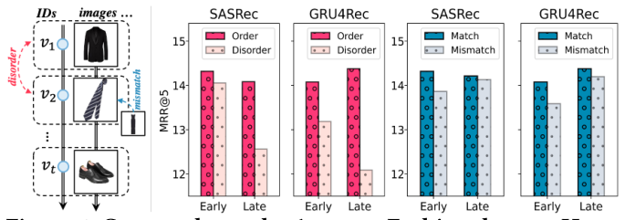
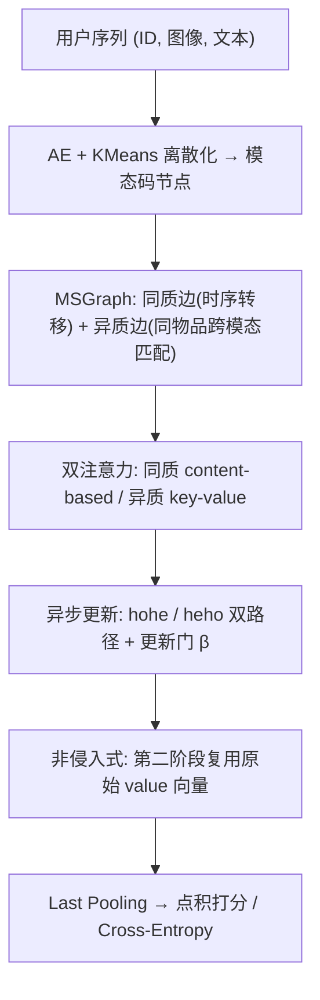
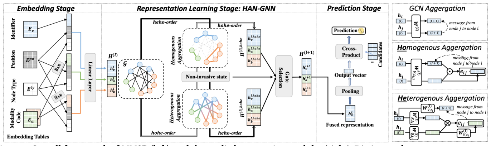

# Adaptive Multi-Modalities Fusion in Sequential Recommendation Systems (序列推荐中的自适应多模态融合)

- **会议/期刊**: CIKM 2023
- **作者与机构**: Hengchang Hu (NUS)、Wei Guo、Yong Liu (华为诺亚方舟实验室)、Min-Yen Kan (NUS)
- **推荐链路定位**: 召回 / 序列编码端到端（next-item prediction）
- **研究方向**: 序列与会话推荐 / 多模态推荐
- **论文原文**: [https://arxiv.org/abs/2308.15980v1](https://arxiv.org/abs/2308.15980v1)
- **开源代码**: [https://github.com/HoldenHu/MMSR](https://github.com/HoldenHu/MMSR)

## TL;DR (1分钟核心速览)

序列推荐中"模态特征该在序列建模前融合（early）还是后融合（late）"长期没有定论。本文把用户历史拆成 ID / 图像 / 文本三类节点构成的**模态增强序列图 (MSGraph)**，用同质边编码模态内时序转移、异质边编码同物品跨模态匹配，再以**双注意力 + 更新门异步更新 (HAN-GNN)** 让每个节点自行决定先聚合同质还是异质邻居，从而把融合顺序从"全局超参"变成"节点级可学习量"。在 Amazon 六个类目、末段 20% 留出划分下，HR@5 平均提升 8.6%、MRR@5 提升 17.2%，并天然容忍缺失模态。

## Background & Motivation (背景与核心矛盾)

- **主流范式**: 多模态序列推荐把 ID、图像、文本视作三个"特征通道"，按融合时机分为早期融合（拼接/相加/门控，如 SASRec$_F$、DETAIN）、晚期融合（如 FDSA 各通道独立建模再合并）与整体融合（Trans2D 的 4D attention）。
- **前人局限**: 早期融合对**通道内序列模式**不敏感（跨模态运算破坏模态自身的时序语义）；晚期融合对**跨模态交互**不敏感（融合前各通道互不可见）。二者都是"全序列、全物品统一顺序"的硬绑定。
- **核心洞察 (Key Insight)**: 作者做了两组破坏性案例研究（图 1）：打乱物品顺序（disordered）时晚期融合掉点更严重，说明它依赖模态内顺序；错配模态（mismatched）时早期融合掉点更严重，说明它对跨模态对齐更敏感。结论是 **融合顺序本身就是强影响因子，且最优顺序随数据集漂移**（消融中 Beauty/Clothing 偏好异质优先、Sport 偏好同质优先）。
- **本文切入点**: 用异质图同时承载"时序"与"跨模态"两类关系，再用门控让每个节点异步选序，使融合顺序成为从 early 到 late 的连续谱。

<figure class="paper-figure" markdown="span">
  <figcaption>图 1：在 Amazon-Fashion 数据集上的案例研究。其中，Order/Match 指原始模态序列，disordered（乱序）指打乱后的物品顺序序列，mis-matched（错配）指模态发生错位的情况。</figcaption>
</figure>

## Method (核心方法设计)

### 1. 整体框架 (Overall Architecture)

输入用户历史 $\mathcal{H}_u=\{x_1,\dots,x_m\}$，每个$x_i=\{v_i,a_i,b_i\}$（ID/图像/文本）。先对图像（ResNet-50）、文本（T-5）特征做线性自编码器降维 + K-means 聚类，把每个模态映射为 **top-$k$模态码**，与 ID 节点一起构成$3m$级节点的 MSGraph；图上传两轮 HAN-GNN 传播，同质/异质邻居分别聚合，两条候选路径（hohe / heho）经更新门加权合并；最后取序列末位 ID 节点的隐状态做 last pooling 得用户表征$P$，与候选物品 ID 向量点积打分，交叉熵训练。

<figure class="paper-figure" markdown="span">
  <figcaption>图 2：MMSR 的整体框架（左）及所采用的聚合模块（右）。不同节点类型由不同颜色表示。</figcaption>
</figure>

### 2. 关键设计拆解 (Key Designs)

1. **模态码构图（Modality Code，缓解稀疏与过拟合）**：若把每个模态当独立节点，节点数三倍膨胀、图极稀疏且模态表征与物品表征绑死。作者用自编码器压缩 + 逐通道 K-means（$c$个簇），取余弦最近的前$k$个簇心 ID 作为该模态的码集合，节点表征查码表得$\boldsymbol{e}_a\simeq \boldsymbol{e}_{ID_a}$。这样"多模态共享一码、一模态连多码"，既提升了图连通度，也把细粒度视觉噪声泛化为可共享的语义码——这正是其即便采用侵入式融合也不掉点的原因。

2. **异质感知双注意力 + 异步更新门（HAN-GNN 的核心）**：GCN/GAT 对所有邻居一视同仁且同步更新，无法表达融合顺序。作者分而治之：同质邻居共享语义空间，用基于内容的逐元素注意力 $e^{(l),ho}_{ij}=a_r(\boldsymbol{W}^{(l)}_{V,t_i}h^{(l)}_i \odot \boldsymbol{W}^{(l)}_{V,t_j}h^{(l)}_j)$；异质邻居处于不同空间，先用类型专属投影对齐再做 key-value 注意力$e^{(l),he}_{ij}=(\boldsymbol{W}^{(l)}_{Q,t_j}h^{(l)}_j)(\boldsymbol{W}^{(l)}_{K,t_i}h^{(l)}_i)^{\top}$，再各自 softmax 聚合得$h^{(l+1),*}_i$。两条路径可串成 hohe（先时序后跨模态）或 heho（先跨模态后时序），由门控自适应混合：
   $\beta=\mathrm{MLP}([h^{(l+1),hohe}_i;h^{(l+1),heho}_i]),\quad h^{(l+1)}_i=\beta_0 h^{(l+1),hohe}_i+\beta_1 h^{(l+1),heho}_i$。
   物理直觉：hohe 等价晚期融合、heho 等价早期融合，门控把离散的架构选择降维成 2 维软选择，故能同时吃到两种顺序的红利。

3. **非侵入式融合与训练目标**：第二阶段聚合仍使用原始 $\boldsymbol{W}_{V,t_j}h^{(l)}_j$而非已融合的中间态，只让中间态参与注意力打分，避免模态表征污染物品表征（NOVA 思路）。总损失为 next-item 交叉熵$\mathcal{L}=-\sum\log\hat{y}_{v^*}$，无显式负采样（softmax over 全物品）。复杂度$O(2L|\mathcal{U}||\mathcal{E}_u|)$，因每节点约 4 条边（$|\mathcal{E}_u|=O(\tfrac{4}{3}|\mathcal{H}_u|)$），当序列长度 > 2.66 时已优于 Graphormer 的$O(L|\mathcal{U}||\mathcal{N}_u|^2)$；线上推理与 base 模型同阶。

## Experimental Setup & Evaluation Protocol (实验设置与评估协议)

- **数据集与预处理**: Amazon Review 六个类目，统一 `5-core` 过滤（用户与物品交互数均 ≥5）：

| 数据集 | #Users | #Items | #Interactions | 稀疏度 | 特征/场景说明 |
| :--- | :---: | :---: | :---: | :---: | :--- |
| Beauty | 22,363 | 12,101 | 198,502 | 99.93% | 美妆，图文齐全 |
| Clothing | 39,387 | 23,033 | 278,677 | 99.97% | 服饰，视觉主导 |
| Sport | 35,598 | 18,357 | 296,337 | 99.95% | 运动户外 |
| Toys | 19,412 | 11,924 | 167,597 | 99.93% | 玩具，文本描述趋同 |
| Kitchen | 27,879 | 10,429 | 194,439 | 99.93% | 厨房用品 |
| Phone | 66,519 | 28,237 | 551,682 | 99.97% | 手机，外观高度相似 |

- **数据划分与防穿越**: `Leave-Last-N-Out` 变体——每用户序列**末尾 20% 作为测试集**、前 80% 训练，预筛长度 <5 的序列以保证测试集非空（无全局时间戳切分，属用户内比例留出）。
- **排名评测协议**: 采用 HR@{5,20} 与 MRR@{5,20}；**原文仅称"ranking-based evaluation"，未显式披露候选集构造**，按同源 Amazon SR 工作惯例推断为 `Sampled Ranking`（1 正 + 100 负），并非声明式的 `Full-Ranking` 全库排序——这是复现时的协议模糊点。
- **对比基线与超参**: 三类基线——基础 SR（GRU4Rec、SASRec、SR-GNN）、多模态协同（MMGCN、MGAT、BM3）、特征增强 SR（GRU4Rec$_F$晚期、SASRec$_F$早期、NOVA、DIF-SR、Trans2D）。统一$d=128$、batch=512、Adam，学习率$\{10^{-1}\sim10^{-4}\}$、$L_2$与 dropout 网格搜索，图传播层数$\{1,2,3,4\}$，五次重复取均值，$p<0.05$ 显著性检验。

## Key Experimental Results (实验关键数据)

### 1. 主实验对比 (Main Results)

| Model | Beauty HR@5 | Beauty MRR@5 | Clothing HR@5 | Clothing MRR@5 | Sport HR@5 | Sport MRR@5 | Toys HR@5 | Toys MRR@5 |
| :--- | :---: | :---: | :---: | :---: | :---: | :---: | :---: | :---: |
| GRU4Rec | 5.6420 | 3.1110 | 1.3340 | 0.6765 | 2.4388 | 1.2696 | 3.8663 | 2.0022 |
| SASRec | 6.1900 | 3.2165 | 1.5885 | 0.7820 | 2.9549 | 1.5858 | 5.0902 | 2.7536 |
| BM3 | 4.8713 | 2.3349 | 1.2851 | 0.5460 | 2.3096 | 0.9963 | 3.9084 | 2.0352 |
| SASRec$_F$ (early) | 6.4021 | 3.7990 | 1.8430 | 0.9470 | 3.1063 | 1.6997 | 5.2328 | 3.0801 |
| DIF-SR | 6.5789 | 4.0735 | 1.5524 | 0.7961 | 2.5145 | 1.3469 | **5.2363** | **3.1944** |
| Trans2D | 6.0191 | 3.4387 | 1.3929 | 0.6682 | 2.7168 | 1.4235 | 4.1908 | 2.2370 |
| **MMSR** | **7.1563** | **4.4429** | **1.8684** | **1.1365** | **3.2657** | **1.9846** | **6.1159** | **3.8987** |
| Improv. | +8.78% | +9.07% | +1.38% | +20.0% | +5.13% | +16.8% | +16.8% | +22.1% |

（Kitchen：MMSR HR@5 2.2145 vs 最优基线 SASRec$_F$ 1.9077，+16.1%；Phone：6.9550 vs 6.6908，+3.95%。）

### 2. 消融实验 (Ablation Study)

| 变体 | Beauty HR@5 | Beauty MRR@5 | Clothing HR@5 | Clothing MRR@5 | Sport HR@5 | Sport MRR@5 |
| :--- | :---: | :---: | :---: | :---: | :---: | :---: |
| **HAN-GNN (完整)** | **7.1386** | **4.6244** | **2.0402** | **1.2642** | **3.3255** | **1.9916** |
| 同步更新 (concat+Linear) | 6.8912 | 4.4515 | 1.7857 | 1.0681 | 3.0924 | 1.7849 |
| 仅 hohe 顺序 | 6.8971 | 4.4245 | 1.9575 | 1.2169 | 3.0565 | 1.8793 |
| 仅 heho 顺序 | 6.5406 | 4.3117 | 1.1495 | 0.6398 | 2.8871 | 1.6654 |
| 仅同质聚合 ($ho$) | 6.6702 | 4.1004 | 1.6012 | 0.9069 | 3.0306 | 1.7412 |
| 仅异质聚合 ($he$) | 6.9354 | 4.4460 | 1.9957 | 1.2236 | 3.0047 | 1.8648 |
| w/o 位置嵌入 $e_{po}$ | 6.9664 | 4.5653 | 2.0665 | 1.2581 | 3.1547 | 1.8968 |
| w/o 类型嵌入 $e_{ty}$ | 6.9390 | 4.5074 | 2.0370 | 1.2593 | 3.2112 | 1.9854 |
| GCN 聚合器 | 5.6348 | 3.1630 | 1.2340 | 0.6465 | 2.3177 | 1.1424 |
| GAT 聚合器 | 5.7116 | 3.1941 | 1.4092 | 0.8332 | 2.3452 | 1.3825 |
| Graphormer 聚合器 | 5.9267 | 3.3029 | 1.4573 | 0.9029 | 2.3069 | 1.3756 |
| HGAT（节点异质） | 7.0671 | 4.2494 | 1.8448 | 1.1417 | 3.0458 | 1.8501 |

### 3. 关键实验发现 (Key Findings)

- **融合顺序确实随数据分布漂移，门控才是正解**：Clothing 上纯异质聚合（HR@5 1.9957）大幅胜过纯同质（1.6012），说明服饰决策高度依赖图文跨模态匹配；Sport 上二者接近且同质略优，说明运动类目的时序信号更纯。而门控融合在两者上都超过任一单序（Clothing 2.0402、Sport 3.3255），验证"节点级选序"优于任何全局 early/late 硬选择。
- **异质建模的关键在"节点异质"而非"边异质"**：RGAT（边类型异质）Beauty HR@5 仅 6.8157，而 HGAT（节点类型异质）达 7.0671；完整 HAN-GNN 再进一步到 7.1386，比同步更新版本高 3.6%，说明把图像/文本节点与 ID 节点显式区分并对齐语义空间，才是多模态融合的主要收益来源。
- **鲁棒性与工程超参可控**：缺失模态比例 0.1–0.5 时 MMSR 的 HR@5 掉点常在 ±5% 内甚至反升（类似对抗扰动的正则效应），而 SASRec$_F$/DIF-SR 在 0.3 起即出现 10%–20% 跌幅；$e=0.7$时全部模型崩塌，说明模态不可完全替代。构图侧，聚类数$c$最优落在 20–30 区间、码连接数$k$随$c$ 增大而增大（Beauty HR@5 由 7.2889 升至 7.5482），超过后反而下降。

## Highlights & Limitations (亮点、对比与审稿批判)

- **与代表作对比 (vs. Prior Work)**: 相比 DIF-SR / NOVA 这类"固定早期、非侵入"的融合，本文首次把**融合顺序当作可学习自由度**而非架构先验；相比 Trans2D 的整体 4D attention，本文显式区分同质/异质关系并用门控建模顺序，且复杂度从 $O(|\mathcal{N}|^2)$降到$O(|\mathcal{E}|)$；相比 MGAT/MMGCN/BM3 这类纯协同多模态模型，本文保留了模态内的时序转移，因而在 SR 任务上领先 20%+ MRR@5。
- **可迁移亮点**: (1) "模态码 + top-$k$ 软连接"可复用于任意多模态图稀疏化场景，兼具正则与连通度提升；(2) 用 2 维 MLP 门控在两个聚合路径间软选择，是把"架构选择"下沉到节点级的通用范式；(3) 缺失模态直接删节点而非默认值填充，配合全局注意力即可获得鲁棒性。
- **审稿级局限批判**: (1) 每个用户独立建图，物品节点表征**从不跨用户传播**，放弃了协同过滤的全局物品共现信号，与 LightGCN 类全局图正交，理论上仍有融合空间；(2) 评测协议披露不足（候选集构造、是否 Full-Ranking 未明写），且每轮需 AE + K-means 预处理与两阶段串行传播，训练开销约 2 倍于 GCN，$c,k$ 超参还随数据集敏感，工业冷启动铺设成本偏高。

## Rating (四维评分)

- **方法创新性 (Novelty)**: ⭐⭐⭐⭐ （把"早期/晚期融合"重构为节点级可学习顺序，双注意力 + 异步门控的设计有清晰案例支撑）
- **评估协议与实验扎实度 (Protocol & Experiments)**: ⭐⭐⭐⭐ （六域 Amazon + 12 组基线 + 聚合器与组件双重消融 + $p<0.05$ 检验，但排名候选集协议未明确披露）
- **写作与数学规范度 (Clarity & Rigor)**: ⭐⭐⭐⭐ （双注意力与门控公式定义完整，另附复杂度对比；非侵入式在第二阶段的具体算子表述略绕，需配合代码阅读）
- **工业落地与复现价值 (Industrial & Practical Value)**: ⭐⭐⭐⭐ （代码开源、推理与 base 同阶、天然支持缺失模态；代价是逐用户构图与聚类预处理增加训练侧工程成本）

