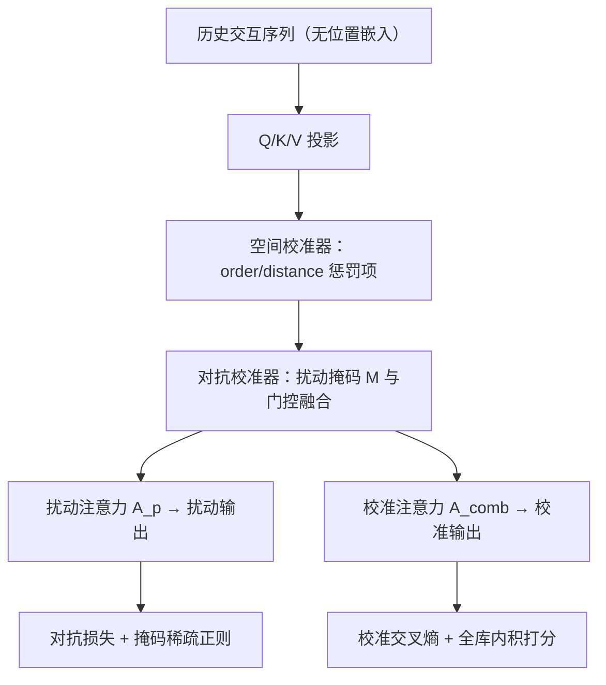

# Attention Calibration for Transformer-based Sequential Recommendation (面向 Transformer 序列推荐的注意力校准)

- **会议/期刊**: CIKM 2023
- **作者与机构**: Peilin Zhou, Qichen Ye, Yueqi Xie, Jingqi Gao, Shoujin Wang, Jae Boum Kim, Chenyu You, Sunghun Kim（HKUST-GZ / PKU / UTS / Yale）
- **推荐链路定位**: 召回（序列召回）/ 精排打分共享同一 Transformer 编码器
- **研究方向**: 序列与会话推荐 / 自监督与交互去噪
- **论文原文**: [https://arxiv.org/abs/2308.09419v3](https://arxiv.org/abs/2308.09419v3)
- **开源代码**: [https://github.com/AIM-SE/AC-TSR](https://github.com/AIM-SE/AC-TSR)

## TL;DR (1分钟核心速览)

本文直击 Transformer 序列推荐（TSR）的"注意力可信度"痛点：自注意力给出的最高权重物品往往并非真正决定下一次点击的物品。作者用"擦除实验"证实删除最高注意力权重后 Recall@20 几乎不降甚至上升，并将其归因于**次优位置编码**与**噪声交互输入**。为此提出 AC-TSR，用空间校准器（order/distance 低层特征直接惩罚 pre-softmax 注意力）与对抗校准器（扰动识别决定性物品后重分配权重）双模块即插即用地改造自注意力层。在 Beauty/Sports/Toys/Yelp 四个数据集、Leave-One-Out + Full-Ranking 协议下，AC-SASRec 的 Recall@20 相对提升 5.07%–8.65%，且可无缝嵌入 BERT4Rec/TiSASRec/SSE-PT。

## Background & Motivation (背景与核心矛盾)

- **主流范式**: SASRec/BERT4Rec 及其变体（TiSASRec、SSE-PT、LightSANs、Locker）以多头自注意力为核心，通过 query-key 内积为历史物品分配权重，默认"权重越大 = 越相关"。
- **前人局限**: ① 位置信息以绝对/相对/解耦 embedding 加和进物品表征，受 rank bottleneck 与噪声相关性干扰，无法显式表达 order/distance 这类低层结构；② 真实序列中用户因情绪、社交或凑单产生的漂移交互构成噪声，自注意力在噪声输入上易过拟合，且注意力与梯度重要性度量（Kendall-$\tau$ 仅约 0.33）显著不一致。
- **核心洞察 (Key Insight)**: 擦除实验中删掉最高注意力权重后性能变化落在约 $-25\%$至$+5\%$ 区间、多数数据集近乎无损，说明"决定性物品"根本没被高权重选中；可视化也显示与目标"sonic screwdriver"无关的"drum"获得了最高权重。
- **本文切入点**: 不改骨干、不换损失范式，而是直接在 softmax 前后**校准注意力权重本身**——用空间先验做惩罚项、用对抗扰动做重要性重估。

## Method (核心方法设计)

### 1. 整体框架 (Overall Architecture)

AC-TSR 以 SASRec/BERT4Rec 等 TSR 为骨干，将其每个自注意力层替换为 Attention Calibration (AC) 层：输入物品序列先经嵌入层（**去掉全部位置嵌入**），在每层中先由空间校准器把 order/distance 预测误差作为加性惩罚注入 $QK^{\top}/\sqrt{d}$得到$A^s$；再由对抗校准器用可学习扰动掩码$M$生成"被破坏"的注意力$A_p$与"被强化"的注意力$A_c$，门控融合得到$A_{comb}$；两路注意力分别前向得到扰动输出与校准输出，对应两个交叉熵损失，加上扰动掩码的稀疏正则共同优化。推理时可直接使用$A_{comb}$，或采用 AC-TSR-lite 移除校准器、保持与骨干同等开销。

### 2. 关键设计拆解 (Key Designs)

1. **空间校准器 SPC（用低层空间特征替代位置嵌入）**：痛点是不论绝对、相对还是解耦位置编码都要"加和进表征"再参与内积，位置信号被物品语义淹没。SPC 改为让 query/key 自己去**预测**两点间应有的顺序与对数距离，并将预测误差当作注意力惩罚：$o_{ij}=\mathbb{I}(i<j)$，$d_{ij}=\ln(1+|i-j|)$；$\hat{o}_{ij}=\sigma(\mathrm{affine}^{(o)}([\boldsymbol{q}_i;\boldsymbol{k}_j]))$，$\hat{d}_{ij}=\mathrm{affine}^{(d)}([\boldsymbol{q}_i;\boldsymbol{k}_j])$；最终$A^{s}=\mathrm{softmax}\!\left(\frac{QK^{\top}}{\sqrt{d}}+s^{(o)}+s^{(d)}\right)$，其中$s^{(d)}_{ij}=-\frac{\theta}{2}(d_{ij}-\hat{d}_{ij})^{2}$。直觉是：若某条注意力边连基本的先后与间距都预测不准，说明该边缺乏真实依赖，理应被惩罚压制。
2. **对抗校准器 ADC（扰动即重要性探测）**：痛点是噪声物品同样能拿到高权重，且无先验可依。ADC 先构造扰动掩码 $M^{l}=\sigma\!\left(\frac{Q^{l}W_{Qp}^{l}(K^{l}W_{Kp}^{l})^{\top}}{\sqrt{d}}\right)$，用它把注意力向均匀分布$\mu$拉近：$A^{l}_{p}=M^{l}\odot A^{l}_{s}+(1-M^{l})\odot\mu$；若被$M$遮住的恰是决定性物品，模型性能必然变差，因此$M$反过来揭示了关键位置，用于强化：$A^{l}_{c}=A^{l}_{s}\odot e^{\,1-M^{l}}$，再门控融合$A^{l}_{comb}=g\,A^{l}_{s}+(1-g)\,A^{l}_{c}$，$g=\sigma(Q^{l}W^{l}_{g}+b^{l}_{g})$。这是一种"最小扰动即可致性能下降"的自监督式重要性归因，无需额外标注。
3. **训练目标、负采样与推理效率**：总损失 $\mathcal{L}_{final}=\mathcal{L}_{P}^{final}+\mathcal{L}_{C}$，其中$\mathcal{L}_{P}^{final}(\theta_{P})=-\mathcal{L}_{P}(\theta)+\alpha\mathcal{L}_{norm}(\theta_{P})$，$\mathcal{L}_{norm}=\sum_{l}\lVert 1-m^{l}\rVert^{2}$迫使扰动尽量稀疏（$\alpha$最优 0.03–0.05）；$\mathcal{L}_{C}$ 为校准输出上的交叉熵。训练采用**全库 softmax + 交叉熵**（不做负采样），推理为全物品内积排序。开销方面，AC-SASRec 参数由 0.87M 增至 0.90M，推理吞吐从 2482.33/s 降至 917.54/s；AC-TSR-lite 在推理期剥离校准器，恢复到 0.87M 与 2482.33/s。

## Experimental Setup & Evaluation Protocol (实验设置与评估协议)

- **数据集与预处理**: 4 个真实数据集，统一过滤交互数 $<5$ 的用户与物品（5-core）。原文未在正文列出精确统计量，仅注明处理细节引至 DIF-SR [52]。

| 数据集 | 领域 | 过滤 | 序列长度 | 特征/场景说明 |
| :--- | :---: | :---: | :---: | :--- |
| Beauty | Amazon 美妆 | 5-core | max 50 | 隐式反馈，长尾显著 |
| Sports | Amazon 运动户外 | 5-core | max 50 | 隐式反馈 |
| Toys | Amazon 玩具 | 5-core | max 50 | 隐式反馈，噪声交互多 |
| Yelp | 本地生活商户 | 保留 2019-01-01 后交易 + 5-core | max 50 | 隐式反馈，签到序列 |

- **数据划分与防穿越 (Splitting Strategy)**: `Leave-One-Out`——按时间排序后最后一条为测试、倒数第二条为验证、其余训练。
- **排名评测协议 (Ranking Protocol)**: 无偏 `Full-Ranking`（对全部 $|\mathcal{I}|$ 个物品排序，非采样），指标 Recall@{10,20} 与 NDCG@{10,20}。
- **对比基线与超参设置**: 10 个基线，含 PopRec/BPR（通用）、GRU4Rec/Caser（非 Transformer 序列）、LightSANs/Locker/SASRec/BERT4Rec/SSE-PT/TiSASRec（Transformer 类）；全部在 RecBole 下同设定复现，Adam、200 epochs、batch 256、lr 1e-4，层数 $\{2,3\}$、头数$\{2,4\}$、隐层$\{64,128\}$网格搜索；显著性用 paired$t$-test，$p<0.01$ 标 `*`。

## Key Experimental Results (实验关键数据)

### 1. 主实验对比 (Main Results)

| 模型 | Beauty R@20 | Beauty N@20 | Sports R@20 | Sports N@20 | Toys R@20 | Toys N@20 | Yelp R@20 | Yelp N@20 |
| :--- | :---: | :---: | :---: | :---: | :---: | :---: | :---: | :---: |
| PopRec | 0.0242 | 0.0097 | 0.0244 | 0.0103 | 0.0172 | 0.0077 | 0.0161 | 0.0067 |
| GRU4Rec | 0.1002 | 0.0410 | 0.0609 | 0.0251 | 0.0708 | 0.0287 | 0.0679 | 0.0271 |
| Caser | 0.0731 | 0.0304 | 0.0364 | 0.0153 | 0.0566 | 0.0238 | 0.0608 | 0.0255 |
| LightSANs | 0.1177 | 0.0461 | 0.0781 | 0.0294 | 0.1116 | 0.0442 | 0.0904 | 0.0453 |
| Locker | 0.1197 | 0.0464 | 0.0753 | 0.0286 | 0.1094 | 0.0430 | 0.0869 | 0.0446 |
| SASRec | 0.1152 | 0.0447 | 0.0760 | 0.0289 | 0.1100 | 0.0434 | 0.0879 | 0.0453 |
| BERT4Rec | 0.0868 | 0.0358 | 0.0502 | 0.0202 | 0.0769 | 0.0324 | 0.0710 | 0.0325 |
| TiSASRec | 0.1208 | 0.0461 | 0.0799 | 0.0300 | **0.1171** | **0.0456** | 0.0909 | 0.0460 |
| **AC-SASRec (本文)** | **0.1218\*** | **0.0476\*** | **0.0817\*** | **0.0307\*** | 0.1166\* | **0.0456\*** | **0.0955\*** | **0.0480\*** |
| Improv. (vs SASRec) | +5.73% | +6.49% | +7.50% | +6.23% | +6.00% | +5.07% | +8.65% | +5.96% |

> 说明：换成更强骨干仍稳定增益——AC-TiSASRec 在 Beauty/Toys/Yelp 的 R@20 达 0.1227/0.1208/0.0939；AC-BERT4Rec 在四数据集 R@10/N@10 平均相对提升 17.24%/18.7%。

### 2. 消融实验 (Ablation Study)

Beauty 数据集，SPC 的 order/distance 开关与 ADC 开关组合：

| 设置 | order | distance | ADC | R@10 | R@20 | N@10 | N@20 |
| :--- | :---: | :---: | :---: | :---: | :---: | :---: | :---: |
| (A) 完整 AC-TSR | ✓ | ✓ | ✓ | **0.0817** | **0.1218** | **0.0375** | **0.0476** |
| (B) w/o order | ✗ | ✓ | ✓ | 0.0791 | 0.1210 | 0.0364 | 0.0470 |
| (C) w/o distance | ✓ | ✗ | ✓ | 0.0792 | 0.1201 | 0.0372 | 0.0475 |
| (D) w/o ADC | ✓ | ✓ | ✗ | 0.0800 | 0.1202 | 0.0367 | 0.0469 |
| (E) 仅 order+ADC | ✓ | ✗ | ✓ | 0.0806 | 0.1188 | 0.0367 | 0.0463 |
| (F) 仅 ADC | ✗ | ✗ | ✓ | 0.0776 | 0.1168 | 0.0353 | 0.0452 |
| (H) SASRec 原版 | ✗ | ✗ | ✗ | 0.0779 | 0.1152 | 0.0353 | 0.0447 |

位置编码策略对比（SASRec 骨干，R@20/N@20）：

| 策略 | Sports | Toys |
| :--- | :---: | :---: |
| 移除位置 | 0.0775 / 0.0294 | 0.1170 / 0.0456 |
| 绝对位置 | 0.0760 / 0.0289 | 0.1100 / 0.0434 |
| 相对位置 | 0.0753 / 0.0285 | 0.1172 / 0.0461 |
| 解耦位置 | 0.0769 / 0.0295 | 0.1153 / 0.0449 |
| **SPC (本文)** | **0.0785 / 0.0298** | **0.1193 / 0.0462** |

### 3. 关键实验发现 (Key Findings)

1. **两校准器互补且非冗余**：Beauty 上完整模型 R@20 0.1218，去掉 ADC 降至 0.1202、去掉 order 降至 0.1210、去掉 distance 降至 0.1201，而两者全去掉仅剩 0.1168——说明 SPC 提供结构先验、ADC 提供数据驱动的重要性重估，缺一即损失约 1%–4% 相对收益。
2. **显式空间惩罚优于位置嵌入加和**：Toys 上去掉位置嵌入（0.1170）反而超过绝对位置（0.1100）与解耦位置（0.1153），表明传统位置嵌入在该数据上近乎噪声；SPC 进一步到 0.1193，验证"惩罚违背 order/distance 的注意力边"比"把位置向量塞进表征"更抗噪。
3. **校准确实让注意力与重要性对齐且可零成本部署**：Kendall-$\tau$ 从 SASRec 各层约 0.33/0.37（Beauty/Toys）提升到 AC 的约 0.47–0.50；同时 AC-TSR-lite 在参数量与吞吐完全等同 SASRec（0.87M, 2482.33/s）的前提下，R@20 在 Beauty/Yelp 仍达 0.1164/0.0913（原版 0.1152/0.0879），Yelp 增益甚至接近完整版 0.0955。

## Highlights & Limitations (亮点、对比与审稿批判)

- **与代表作对比 (vs. Prior Work)**: 与 Locker（向自注意力注入卷积式局部归纳偏置）和 Rec-Denoiser（稀疏化注意力图去噪）不同，AC-TSR 不改注意力形状也不依赖先验稀疏假设，而是**保留原注意力图并逐点校正**；与 DIF-SR 的解耦位置编码相比，SPC 完全抛弃位置嵌入、把 order/distance 作为可微惩罚项注入 logits，实验上稳定优于四类位置编码方案。
- **可迁移亮点**: ① "扰动掩码揭示重要性"是一种无需标注的通用归因手段，可迁移到长序列建模中的关键 session 定位、多模态对齐中的关键 token 筛选；② 训练期挂校准器、推理期剥离（lite）本质是**结构正则化/自蒸馏**，可低成本复用于任何已有 Transformer 推荐模型的增量升级。
- **审稿级局限批判**: ① 推理代价明显——完整版吞吐降至 1/2.7，且每个 AC 层额外引入 $W_{Qp},W_{Kp},W_g$三组$d\times d$矩阵，多层堆叠时参数增长未在正文量化；② 评估面偏窄：仅 4 个 Amazon/Yelp 数据集、序列长度上限固定 50、未给出数据集稀疏度统计与冷启动/短序列专门划分，SPC 相对相对位置编码在 Toys 上优势仅 0.0021（R@20），增益的稳健性对数据集噪声水平较敏感，$\alpha$ 需逐数据集调（0.03 或 0.05）。

## Rating (四维评分)

- **方法创新性 (Novelty)**: ⭐⭐⭐⭐ （从"注意力不可信"这一被忽视的经验现象切入，用空间惩罚项与对抗扰动双路校准注意力 logits，思路简洁且有 Kendall-$\tau$ 一致性证据支撑）
- **评估协议与实验扎实度 (Protocol & Experiments)**: ⭐⭐⭐⭐ （4 数据集 + 无偏 Full-Ranking + paired $t$-test$p<0.01$，并给出 4 种骨干的即插即用验证与 8 组消融；扣分在缺少数据集统计量披露与序列长度敏感性之外的分布偏移实验）
- **写作与数学规范度 (Clarity & Rigor)**: ⭐⭐⭐⭐ （公式链条从 SPC 惩罚、扰动掩码、门控融合到对抗总损失层层递进且符号统一，复杂度与 lite 方案说明清晰；式 (10) 的 sigmoid 交叉熵写法存在笔误、部分推导省略）
- **工业落地与复现价值 (Industrial & Practical Value)**: ⭐⭐⭐⭐ （代码开源、基于 RecBole 易复现，AC-TSR-lite 可零额外推理开销上线；但完整版 2.7× 吞吐下降与逐数据集调参使其更适合作为离线训练期正则手段）

