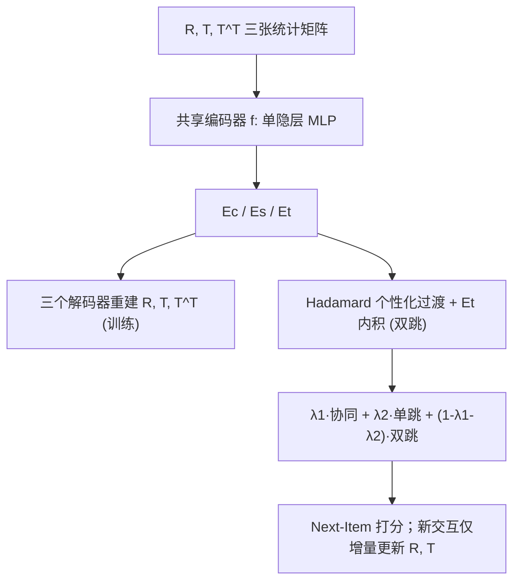
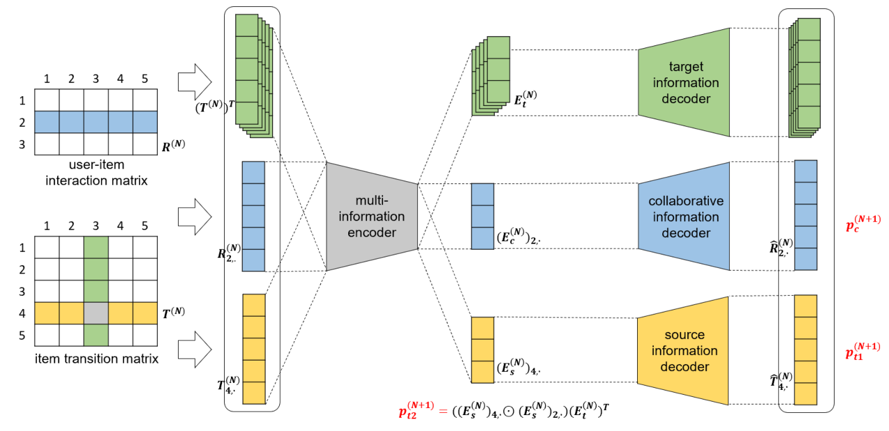

# AutoSeqRec: Autoencoder for Efficient Sequential Recommendation (面向高效序列推荐的自编码器模型)

- **会议/期刊**: CIKM 2023
- **作者与机构**: Sijia Liu、Jiahao Liu、Tun Lu、Peng Zhang、Ning Gu（复旦大学），Hansu Gu（Seattle），Dongsheng Li（微软亚洲研究院）
- **推荐链路定位**: 召回（Next-Item 打分）
- **研究方向**: 序列与会话推荐 / 协同过滤与双塔召回
- **论文原文**: [https://arxiv.org/abs/2308.06878v1](https://arxiv.org/abs/2308.06878v1)
- **开源代码**: [https://github.com/sliu675/AutoSeqRec](https://github.com/sliu675/AutoSeqRec)

## TL;DR (1分钟核心速览)

序列推荐的两难是：纯序列模型（RRN/JODIE）丢掉协同信号，图模型（LightGCN/CoPE）又把开销堆在邻域传播与重训上。AutoSeqRec 用一个共享编码器压缩「用户-物品交互矩阵 $R$」与「物品转移矩阵$T$及其转置」，再用三个解码器重建，把长期协同偏好与单/双跳短期转移拼成分数；在线只需增量改写$R,T$ 两行/两列、冻结参数即可推理。在 4 个数据集的时间切分全库排序下，MRR 相对提升 2.00%–50.00%，Recall@10 提升 10.62%–52.94%，ML-1M 训练耗时仅 11min17s（比 CoPE 快 5452×）。

## Background & Motivation (背景与核心矛盾)

- **主流范式**: 序列推荐以 RNN/Transformer 逐步编码用户点击序列（RRN、JODIE、SASRec）；动态图方法用 GNN/ODE 在用户-物品图上传播（LightGCN、CoPE）；无参方法 FreeGEM 用离线/在线 SVD 复现动态图嵌入。
- **前人局限**: ① 序列模型只把用户看成物品串，用户间协同相似性完全未建模，稀疏场景下几乎无法个性化；② 图方法需多跳邻域聚合或 ODE 求解，每次交互更新都要重算传播，训练与推理成本随图规模爆炸（CoPE 在 ML-1M 上需 1025 小时）。
- **核心洞察 (Key Insight)**: 自编码器式 CF（AutoRec）本质是「输入观测交互 $\to$ 输出预测交互」的直读映射；训练完成后它对任何用户兴趣都具备打分能力，因此兴趣漂移只需**改输入矩阵**而无需改权重——这天然是增量推荐的载体，只是 AutoRec 未建模时序。
- **本文切入点**: 把「下一物品」拆成三类可重建统计量——长期协同（$R$的行）、源信息（$T$的行，出度跳转）、目标信息（$T$ 的列，入度跳转），用同一语义空间共享编码器压缩，再在推理端做多跳近似。

## Method (核心方法设计)

### 1. 整体框架 (Overall Architecture)

对前 $N$条交互构造二值交互矩阵$R^{(N)}\in\mathbb{R}^{m\times n}$与转移计数矩阵$T^{(N)}\in\mathbb{R}^{n\times n}$（$T_{i',i''}$统计全站用户从$i'$紧接着跳到$i''$的次数）。三张矩阵$R$、$T$、$T^{\top}$的每一行都以「物品维度」为语义轴，故可共享同一个单隐层编码器压到$k$维，得到协同嵌入$E_c$、源嵌入$E_s$、目标嵌入$E_t$；三个对应解码器分别重建原矩阵，以 Frobenius 范数监督。推理时，用户$u$ 的候选分 = 协同分数 + 单跳转移分数 + 双跳转移分数三者加权，全过程不涉及序列 RNN 或图传播。

<figure class="paper-figure" markdown="span">
  <figcaption>图1：AutoSeqRec 的推理过程。假设用户2最后一次交互的物品4，该图展示了 AutoSeqRec 如何获得用户2在第 𝑁+1 次交互中对每个物品的预测分数。</figcaption>
</figure>

### 2. 关键设计拆解 (Key Designs)

1. **多信息共享编码器与三路重建**：AutoRec 只有一路重建，无法区分「长期偏好」与「即时跳转」。本文令 $f(X)=\sigma(XW_e+b_e)$，用同一$W_e$处理$R$、$T$、$T^{\top}$，损失为$\mathcal{L}=\|R-\tilde R\|_F+\|T-\tilde T\|_F+\|T^{\top}-\tilde T^{\top}\|_F$。共享权重的直觉是：三者同处物品语义空间，跳转模式相似的两个物品（无论作源还是作目标）应获得相近嵌入，从而把协同与转移信息压进同一表征；三路等权无需调平衡系数。

2. **Hadamard 个性化过渡 + 双跳近似（本文最核心算子）**：直接算两跳需 $p_{t1}\tilde T$，复杂度$O(n^2)$且需物化$n\times n$矩阵。本文改在**嵌入空间**近似：先取用户协同嵌入与末物品源嵌入的逐元素积作个性化过渡向量$\tilde p^{(N+1)}_{t2}=(E_s)_{i,\cdot}\odot(E_c)_{u,\cdot}$，再与目标嵌入内积得双跳分$p^{(N+1)}_{t2}=\tilde p^{(N+1)}_{t2}(E_t)^{\top}$。物理直觉是：$E_s$的行刻画「从该源物品出发会去哪」，$E_t$的行刻画「谁会走到该目标物品」，两者内积即两跳可达性；乘上$(E_c)_{u,\cdot}$ 相当于用用户历史给跳转方向重新加权，实现「同一条全局转移路径，不同用户权重不同」。

3. **训练目标与增量推理开销**：训练即上式重建损失，mini-batch 由三张矩阵的行分别切分后合并打乱，**无需负采样**（重建目标天然是稠密监督）。推理端最终分数 $p^{(N+1)}=\lambda_1p_c+\lambda_2p_{t1}+(1-\lambda_1-\lambda_2)p_{t2}$，其中$p_c=\tilde R_{u,\cdot}$、$p_{t1}=\tilde T_{i,\cdot}$。新增一条$(u,i)$交互时，仅需$R_{u,i}\leftarrow1$且$T_{i_{last},i}\mathrel{+}=1$，前向一次即可，参数量与训练完全冻结——这是它能比 FreeGEM 还快的根本原因。

## Experimental Setup & Evaluation Protocol (实验设置与评估协议)

- **数据集与预处理**: 沿用 JODIE/CoPE 管线，用户与物品均保留交互数 ≥5（`5-core`）。注意 Amazon 两集极度稀疏（Video 密度约 0.43%），是本文鲁棒性主张的关键压力测试。

| 数据集 | #Users | #Items | #Interactions | 稀疏度/密度 | 特征/场景说明 |
| :--- | :---: | :---: | :---: | :---: | :--- |
| ML-100K | 943 | 1,349 | 99,287 | 7.81% | 电影评分，7 个月跨度 |
| ML-1M | 6,040 | 3,416 | 999,661 | 4.85% | 电影评分，2000 年入组用户 |
| Garden | 1,686 | 962 | 13,272 | 0.82% | Amazon 园艺，极稀疏 |
| Video | 5,130 | 1,685 | 37,126 | 0.43% | Amazon 视频，极稀疏 |

- **数据划分与防穿越 (Splitting Strategy)**: **全局时间戳切分**——最早 80% 交互训练、随后 10% 验证、最新 10% 测试，与 JODIE/CoPE 完全一致，属严格的未来交互预测（future interaction prediction），不存在序列内信息泄漏。
- **排名评测协议 (Ranking Protocol)**: 主实验采用**全库 Full-Ranking**（对全部物品打分排序，不采样负例），指标 MRR 与 Recall@10。集成实验（RQ5）改用 SASRec 的 `Leave-One-Out` 划分 + 每用户随机 50 个负例的 **Sampled Ranking**，指标 NDCG@10，两种协议分开报告，未见混用。
- **对比基线与超参**: 基线含 LightGCN（静态 CF）、RRN、JODIE、CoPE、FreeGEM；隐层维度在 $\{32,64,128,256\}$网格搜索，$\lambda_1,\lambda_2$以 0.1 步长在$[0,1]$ 内搜索。

## Key Experimental Results (实验关键数据)

### 1. 主实验对比 (Main Results)

| Method | ML-100K MRR | ML-100K R@10 | ML-1M MRR | ML-1M R@10 | Video MRR | Video R@10 | Garden MRR | Garden R@10 |
| :--- | :---: | :---: | :---: | :---: | :---: | :---: | :---: | :---: |
| LightGCN | 0.012 | 0.025 | 0.014 | 0.031 | 0.019 | 0.036 | 0.025 | 0.087 |
| RRN | 0.042 | 0.084 | 0.038 | 0.071 | 0.039 | 0.074 | 0.079 | 0.169 |
| JODIE | 0.046 | 0.095 | 0.037 | 0.070 | 0.044 | 0.081 | 0.059 | 0.142 |
| CoPE | 0.049 | 0.111 | 0.040 | 0.085 | 0.036 | 0.078 | **0.082** | 0.176 |
| FreeGEM | 0.040 | 0.079 | 0.040 | 0.077 | 0.058 | 0.086 | 0.100 | 0.179 |
| **AutoSeqRec** | **0.068** | **0.150** | **0.060** | **0.130** | **0.064** | **0.107** | **0.102** | **0.227** |
| Improv.% | +38.78% | +35.14% | +50.00% | +52.94% | +10.34% | +10.62% | +2.00% | +26.82% |

### 2. 消融实验 (Ablation Study)

| 设置 | ML-100K R@10 | ML-1M R@10 | Video R@10 | Garden R@10 |
| :--- | :---: | :---: | :---: | :---: |
| 仅 $b\cdot c$（源×目标，无个性化） | 0.113 | 0.064 | 0.026 | 0.123 |
| 仅 $a\cdot c$（协同×目标） | 0.079 | 0.037 | 0.060 | 0.203 |
| $(a\odot b)\cdot c$（完整双跳算子） | **0.130** | 0.076 | 0.086 | 0.206 |
| only hidden（仅编码器隐输出） | 0.130 | 0.076 | 0.086 | 0.206 |
| hidden + 重建 $\tilde R$ | 0.138 | 0.081 | 0.078 | 0.215 |
| hidden + 重建 $\tilde T$ | 0.132 | 0.126 | 0.106 | 0.226 |
| **all（隐输出+$\tilde R$+$\tilde T$）** | **0.150** | **0.130** | **0.107** | **0.227** |

**运行时间（ML-1M 全流程）**: JODIE 374h / CoPE 1025h / FreeGEM 5h54min / **AutoSeqRec 11min17s**。

### 3. 关键实验发现 (Key Findings)

1. **增益主要来自转移矩阵的重建输出，而非编码器隐表征**：ML-1M 上仅用隐输出 R@10=0.076，加上 $\tilde T$直接跳到 0.126（+65.8%），ML-100K 也从 0.130→0.150；而单加$\tilde R$ 仅 +0.005（Video 甚至退化到 0.078），说明「全局跳转统计的显式重建」比「用户向量的隐式协同」更接近 Next-Item 任务本身。
2. **稀疏度决定协同与转移的权重分配**：在稠密的 ML-100K/ML-1M 上 $b\cdot c$（源×目标）优于$a\cdot c$（0.113 vs 0.079），但在稀疏的 Video 上完全反转（0.026 vs 0.060），即转移矩阵在低密度下统计噪声过大、用户协同信息反而更可靠——这解释了为何$\lambda_1,\lambda_2$ 的敏感性热力图在不同数据集上最优区域不同。
3. **精度与效率同时领先，且可正交叠加**：AutoSeqRec 在 ML-1M 上 MRR 0.060 超过 CoPE 的 0.040，同时快 5452×；集成到 SASRec 后 NDCG@10 提升 2.35%–2.60%（仅用 $E_s$ 替换随机初始化得 Variant 1 为 0.54%–2.30%），证明编码器学到的协同+转移嵌入可外挂到 Transformer 序列模型上。

## Highlights & Limitations (亮点、对比与审稿批判)

- **与代表作对比 (vs. Prior Work)**: 相比 JODIE/CoPE，本文彻底放弃逐事件 RNN/ODE 演化，改成「统计矩阵 + 自编码器重建」，把时序建模降级为一次性矩阵统计；相比 AutoRec，本文把单路重建扩展为三路并引入双跳嵌入近似；相比 FreeGEM 无参 SVD，本文虽需训练但参数量极小、且无需反复 SVD 分解。
- **可迁移亮点**: ①「$E_s\odot E_c$再与$E_t$ 内积」的个性化过渡打分公式可直接嵌进任何序列模型的预测层（图 4 的 SASRec 改造即模板）；②「只改输入、不动参数」的增量推理范式适合高 QPS 场景的粗召回兜底。
- **审稿级局限批判**: ① $T\in\mathbb{R}^{n\times n}$是稠密计数矩阵，物品数上万时内存与重建损失计算均为$O(n^2)$，论文仅在 3.4K 物品内验证，可扩展性存疑；② 编码器/解码器均只用一个非线性层，双跳以上的多跳信息靠$E_t^{\top}$ 连乘近似，缺乏对不同物品规模下近似误差的量化分析；③ 主实验 MRR 绝对值（0.068）偏低，Top-10 之外的排序质量与长尾物品表现未拆解分析；④ 缺少与近年序列模型（SASRec/BERT4Rec）在统一全库协议下的端到端对比，仅在集成实验中出现。

## Rating (四维评分)

- **方法创新性 (Novelty)**: ⭐⭐⭐⭐ （把 AutoRec 从静态 CF 推进到「多信息重建 + 增量推理」，Hadamard 个性化过渡的双跳近似在嵌入空间完成，思路简洁且有明确直觉支撑）
- **评估协议与实验扎实度 (Protocol & Experiments)**: ⭐⭐⭐ （时间切分 + 全库排序口径规范，四数据集覆盖不同稀疏度，但主实验未与 Transformer 序列基线在全库协议下同台，显著性检验缺失）
- **写作与数学规范度 (Clarity & Rigor)**: ⭐⭐⭐⭐ （公式与三张矩阵的语义定义清晰、符号统一，$O(n^2)$ 复杂度被坦率讨论但缺少近似误差的理论界）
- **工业落地与复现价值 (Industrial & Practical Value)**: ⭐⭐⭐⭐ （代码开源，11 分钟级训练 + 单步增量推理极具工程吸引力，但稠密 $n\times n$ 转移矩阵在百万级物品库上需额外稀疏化改造）

