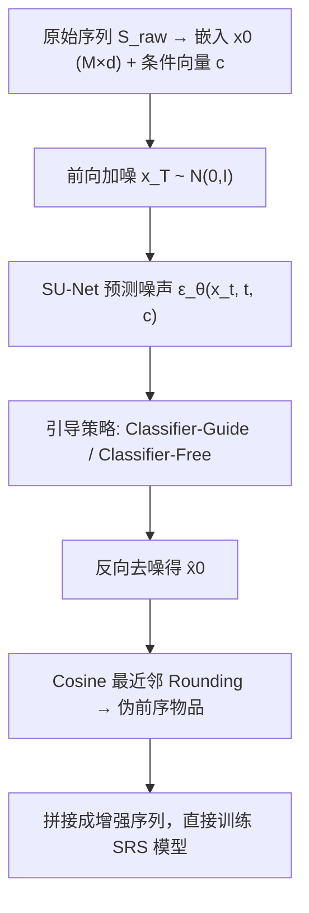
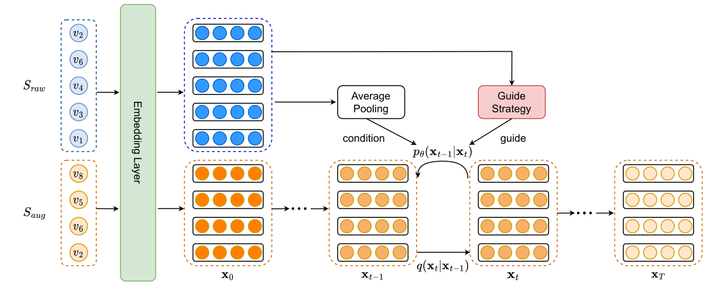

# Diffusion Augmentation for Sequential Recommendation (面向序列推荐的扩散式数据增强)

- **会议/期刊**: CIKM 2023
- **作者与机构**: Qidong Liu, Fan Yan, Xiangyu Zhao, Zhaocheng Du, Huifeng Guo, Ruiming Tang, Feng Tian（西安交通大学、香港城市大学、华为诺亚方舟实验室）
- **推荐链路定位**: 召回前的数据增强（离线生成伪序列，直接喂给任意 SRS 模型）
- **研究方向**: 序列与会话推荐 / 生成式推荐
- **论文原文**: [https://arxiv.org/abs/2309.12858v1](https://arxiv.org/abs/2309.12858v1)
- **开源代码**: [https://github.com/liuqidong07/DiffuASR](https://github.com/liuqidong07/DiffuASR)

## TL;DR (1分钟核心速览)

序列推荐同时受**数据稀疏**与**长尾用户**（交互数 <10 的用户占绝大多数、NDCG 显著更低）困扰。现有 item-level 增强（ASReP/BiCAT）用反向 SASRec **逐步迭代**生成前序物品，因 top-1 准确率本就低，导致增强质量差且分布漂移，还需复杂的迭代训练策略。本文提出 DiffuASR：把物品嵌入序列当作二维矩阵，用扩散模型**一次反向去噪生成整段伪前序序列**，配 SU-Net 与 classifier-guide / classifier-free 双引导。在 Yelp/Beauty/Steam 上以 100 负采样排序评测，Beauty+Bert4Rec 的 NDCG@10 相对提升 **9.2%**。

## Background & Motivation (背景与核心矛盾)

- **主流范式**: SASRec/Bert4Rec/S3Rec 用自注意力从用户历史序列中挖掘转移模式；面对稀疏性，数据增强分两派——sequence-level（造新序列，如 L2Aug、CauseRec）与 item-level（为每条序列补前序物品，如 ASReP、BiCAT）。
- **前人局限**: ①sequence-level 方法因生成序列含噪，往往要设计 RL 交替训练或"预训练生成器—重训推荐器"的复杂流程，无法把增强数据直接丢给模型训练；②item-level 方法虽可直接使用、且天然延长短序列，但生成器本质是**反向 SASRec 的自回归 top-1 采样**，逐步迭代会累积误差并偏离原始分布。
- **核心洞察 (Key Insight)**: 图 1 显示 Beauty 上交互长度 <10 的用户占绝大多数，而其 NDCG@10 明显低于长序列组——稀疏与长尾是同一枚硬币；扩散模型一次生成**整段**序列，可从全局保证增强序列与原始序列分布一致，避免逐步漂移。
- **本文切入点**: 把"离散物品 ID 序列"通过嵌入表转为连续矩阵，套用图像扩散范式生成，再用余弦最近邻 round 回物品 ID；用引导信号把生成方向锁在用户原始偏好上。

## Method (核心方法设计)

### 1. 整体框架 (Overall Architecture)

输入为用户原始序列 $S_{raw}=\{v_1,\dots,v_{n_u}\}$。先取其均值池化嵌入$\mathbf{c}=\mathrm{Avg}(\mathbf{e}_1,\dots,\mathbf{e}_{n_u})$作为条件向量；生成目标是长度$M$的伪前序序列$S_{aug}=\{v_{-M},\dots,v_{-1}\}$，经嵌入表得到$\mathbf{x}_0\in\mathbb{R}^{M\times d}$。前向过程按线性$\beta$调度加噪至$\mathbf{x}_T\sim\mathcal{N}(0,\mathbf{I})$；反向过程由 SU-Net 在$(\mathbf{x}_t,t,\mathbf{c})$条件下预测噪声并逐步恢复$\hat{\mathbf{x}}_0$；最后 cosine 最近邻 round 成物品 ID，拼到原序列前形成$S'=\{v_{-M},\dots,v_{-1},v_1,\dots\}$，写入增强集$\mathcal{D}_A$后**直接**训练任意 SRS 模型，无额外训练策略。训练时无真值增强序列，故取长度$>M$的序列，把**前$M$个真实物品**当作$S_{aug}$ 的监督目标。

<figure class="paper-figure" markdown="span">
  <figcaption>图 3：所提出的用于序列推荐的扩散增强（DiffuASR）概览。</figcaption>
</figure>

### 2. 关键设计拆解 (Key Designs)

1. **SU-Net：把序列当"通道"的噪声预测骨干**：标准 U-Net 把图像的行/列都视为空间维，直接吃嵌入序列会丢失序信息。本文令**序列维作为 channel**（卷积在通道上独立建模），并把每个 $d$维嵌入 reshape 成$\sqrt{d}\times\sqrt{d}$矩阵（如$64\to 8\times8$）以复用 2D 卷积；经 resnet 下采样、中部 AttnBlock 去冗余、上采样 skip 拼接后还原为$M\times d$。扩散步$t$用正弦嵌入成向量$\mathbf{t}$，与条件向量相加得$\mathbf{z}=\mathbf{c}+\mathbf{t}$，再线性投影后注入每个 resnet block，实现对噪声方向的时空双重控制。
2. **双引导策略：把生成锁在用户原始偏好上**：无引导的扩散会生成与用户无关的物品，等价于注入噪声。**Classifier-Guide** 借用"$S_{aug}$的下一个物品恰是$v_1$"这一性质，用预训练 SRS 模型当分类器，以 BCE 为目标加梯度引导：
   $\hat{\epsilon}=\epsilon_\theta(\mathbf{x}_t,t,\mathbf{c})-\gamma\sqrt{1-\bar\alpha_t}\nabla_{\mathbf{x}_t}\log p_\phi(v_1|S_{aug})$**Classifier-Free** 则免去预训练开销，用 padding 向量作无条件分支做外推：$\hat{\epsilon}=(1+\gamma)\epsilon_\theta(\mathbf{x}_t,t,\mathbf{c})-\gamma\epsilon_\theta(\mathbf{x}_t,t,\mathbf{e}_{pad})$直觉上$\gamma$ 控制"忠实度 vs 多样性"：适度增大使增强物品贴合原序列意图，过大则退化为 Random-Seq 式的自我重复。
3. **训练目标与推理开销**：损失为带条件项的标准去噪回归
   $\mathcal{L}=\mathbb{E}_{t,\mathbf{x}_0,\epsilon}\big\|\epsilon-\epsilon_\theta(\sqrt{\bar\alpha_t}\mathbf{x}_0+\sqrt{1-\bar\alpha_t}\epsilon,\,t,\,\mathbf{c})\big\|^2$增强阶段为**离线一次性**过程（$T=1000$步 DDPM 采样），不引入任何在线负采样或对比损失；推理阶段对每个用户只跑一次反向链，产出的$\mathcal{D}_A$ 可被任意 SRS 模型复用，在线服务零额外开销。

## Experimental Setup & Evaluation Protocol (实验设置与评估协议)

- **数据集与预处理**: 仅剔除交互数 $<3$ 的用户（保留长尾用户以验证动机），统计如下：

| 数据集 | #Users | #Items | 稀疏度 | 平均序列长 | 场景说明 |
| :--- | :---: | :---: | :---: | :---: | :--- |
| Yelp | 30,431 | 20,033 | 99.95% | 10.40 | 商户签到（仅用 2019-01-01 后数据） |
| Beauty | 50,498 | 57,289 | 99.99% | 7.76 | Amazon 美妆评论 |
| Steam | 332,925 | 13,047 | 99.91% | 11.06 | 游戏平台评论 |

- **数据划分与防穿越 (Splitting Strategy)**: `Leave-One-Out` —— 最后一项为测试、倒数第二项为验证，其余为训练；增强生成阶段按 [15] **显式排除每条序列的测试物品**，避免信息泄漏。
- **排名评测协议 (Ranking Protocol)**: `Sampled Ranking` —— 每个测试样本配 **100 个随机负样本**，报告 HR@10 与 NDCG@10，三次随机种子取均值，并以双侧 t 检验 $p<0.05$ 标注显著性（未做 Full-Ranking，是本文评测的主要局限）。
- **对比基线与超参设置**: 增强基线 None / Random（全库随机）/ Random-Seq（序列内随机）/ ASReP（反向 SASRec 迭代）；骨干为 Bert4Rec、SASRec、S3Rec。嵌入维 $d=64$，扩散步$T=1000$，最大序列长 200，dropout 0.6，Adam，batch 512，lr 1e-3；$M\in\{4,\dots,16\}$，$\gamma\in\{0.1,1,10,100\}$ 按验证集 HR@10 选优。

## Key Experimental Results (实验关键数据)

### 1. 主实验对比 (Main Results)

| Backbone | Augment | Yelp NDCG@10 | Yelp HR@10 | Beauty NDCG@10 | Beauty HR@10 | Steam NDCG@10 | Steam HR@10 |
| :--- | :--- | :---: | :---: | :---: | :---: | :---: | :---: |
| Bert4Rec | None | 0.4899 | 0.7702 | 0.2581 | 0.4302 | 0.6104 | 0.8561 |
| Bert4Rec | Random | 0.4559 | 0.7464 | 0.2634 | 0.4297 | 0.6022 | 0.8505 |
| Bert4Rec | Random-Seq | 0.4703 | 0.7269 | 0.2509 | 0.4257 | 0.5771 | 0.8306 |
| Bert4Rec | ASReP | 0.4714 | 0.7563 | 0.2513 | 0.4102 | 0.5765 | 0.8289 |
| Bert4Rec | **DiffuASR (CG)** | 0.5004* | 0.7820* | **0.2818*** | **0.4462*** | **0.6173*** | **0.8615*** |
| Bert4Rec | **DiffuASR (CF)** | **0.5066*** | **0.7828*** | 0.2752* | 0.4385* | 0.6156* | 0.8609* |
| SASRec | None | 0.4813 | 0.7590 | 0.2844 | 0.4343 | 0.5829 | 0.8323 |
| SASRec | Random-Seq | 0.4546 | 0.6862 | 0.2746 | 0.4204 | 0.5510 | 0.8055 |
| SASRec | ASReP | 0.4758 | 0.7604 | 0.2882 | 0.4364 | 0.5866 | 0.8348 |
| SASRec | **DiffuASR (CG)** | 0.4872* | **0.7623*** | **0.2987*** | **0.4424*** | **0.5899*** | **0.8371*** |
| SASRec | **DiffuASR (CF)** | **0.4885*** | 0.7617 | 0.2952* | 0.4380 | 0.5891* | 0.8362 |
| S3Rec | None | 0.4832 | 0.7632 | 0.2908 | 0.4372 | 0.5755 | 0.8245 |
| S3Rec | ASReP | 0.4864 | 0.7681 | 0.2655 | 0.4055 | 0.5709 | 0.8220 |
| S3Rec | **DiffuASR (CG)** | 0.4994* | 0.7710 | **0.3022*** | 0.4415 | 0.5752 | 0.8251 |
| S3Rec | **DiffuASR (CF)** | **0.4996*** | **0.7727*** | **0.3022*** | **0.4454*** | **0.5802*** | **0.8294*** |
| **Improv.**（vs 最优基线） | — | **+3.4%** | **+1.6%** | **+9.2%** | **+3.7%** | **+1.1%** | **+0.6%** |

### 2. 消融实验 (Ablation Study)

| 组件/超参 | 设置 | NDCG@10 (CG / CF) | HR@10 (CG / CF) |
| :--- | :--- | :---: | :---: |
| $\beta$ 调度 | linear | **0.5004 / 0.5066** | **0.7820 / 0.7828** |
| $\beta$ 调度 | sqrt-root | 0.4440 / 0.4495 | 0.7304 / 0.7345 |
| $\beta$ 调度 | cosine | 0.4510 / 0.4779 | 0.7386 / 0.7579 |
| $\beta$ 调度 | sigmoid | 0.4512 / 0.4533 | 0.7410 / 0.7391 |
| 增强数 $M$ | 4 → 10 | 单调上升至峰值 | 同趋势 |
| 增强数 $M$ | 10 → 16 | 掉头下降，甚至劣于 None | 同趋势 |
| 引导尺度 $\gamma$ | 0.1 → 10 | 上升 | 上升 |
| 引导尺度 $\gamma$ | ≫10（如 100） | 急剧下降 | 急剧下降 |

（上表超参实验均在 Yelp + Bert4Rec 上完成；$w/o$ 引导即退化为无控生成，论文以 CG/CF 两种变体与 Random/Random-Seq 的对比间接体现其必要性。）

### 3. 关键实验发现 (Key Findings)

1. **稀疏度越高，扩散增强收益越大**：Beauty 稀疏度 99.99%、均长 7.76，NDCG@10 相对提升 3.7%–9.2%；Steam 均长 11.06 仅提升 0.6%–1.1%。说明收益直接来自"补长序列"，与动机严格自洽。
2. **长尾用户增益明确、头部用户几乎无伤**：按交互数分组（short [3,5] / medium (5,20] / long (20,∞)）后，Random 与 ASReP 在 Bert4Rec 上三组全面下滑（Bert4Rec 对噪声最敏感），而 DiffuASR 在三组均提升；对 SASRec/S3Rec，基线方法在 long 组普遍掉点，DiffuASR 掉点最少甚至微升——即"低成本换取短序列大幅收益"。
3. **$M$与$\gamma$都存在强拐点，且拐点成因清晰**：$M$从 4 增至 10 持续提升（补更多交互），超过 10 后反降——因为训练 DiffuASR 需要$n_u>M$，$M$越大可用训练序列越少，扩散模型欠拟合；$\gamma$ 过大则生成物品高度贴近原序列，退化为 Random-Seq 的自我重复陷阱。

## Highlights & Limitations (亮点、对比与审稿批判)

- **与代表作对比 (vs. Prior Work)**: ASReP 用反向 SASRec 逐项迭代生成，BiCAT 在其上叠加前向约束与自蒸馏，二者都聚焦"如何用增强数据"而忽略生成质量；DiffuASR 换掉生成器本身（扩散一次性生成 + 引导），且**不绑定骨干**（ASReP 的预训练-微调只兼容 SASRec）。相比 DiffuRec/DiffRec 直接用扩散预测目标物品，本文把扩散定位为**离线数据增强器**，产物可跨模型复用。
- **可迁移亮点**: ①"序列维作 channel + $\sqrt{d}\times\sqrt{d}$ reshape"是把任何 2D 图像骨干迁移到嵌入序列的通用技巧；②"把下游推荐模型当 classifier、以下一物品 BCE 做梯度引导"的思路可迁移到任何条件生成式推荐/序列合成任务。
- **审稿级局限批判**: ①仅用 100 负采样排序评测，未做 Full-Ranking，稀疏数据集上采样偏差可能放大提升幅度；②增强仅限**前序**方向，且要求 $n_u>M$才能训练，冷启动/极短序列（$n_u\le M$）用户反而被排除；③$T=1000$步 DDPM 采样 + CG 变体需预训练 SRS 模型，离线生成成本与超参（$M$、$\gamma$、$\beta$ 调度）敏感性较高，缺少与 DDIM 加速采样的效率对比。

## Rating (四维评分)

- **方法创新性 (Novelty)**: ⭐⭐⭐⭐ （首个把扩散模型用于序列推荐"数据增强"而非直接打分的工作，SU-Net 的通道重排与 SRS-as-Classifier 引导设计有巧思，但扩散范式本身属迁移应用）
- **评估协议与实验扎实度 (Protocol & Experiments)**: ⭐⭐⭐ （三数据集 × 三骨干覆盖较全、含显著性检验与长尾分组分析，但仅 100 负采样、无 Full-Ranking、无独立"去掉引导"的消融行）
- **写作与数学规范度 (Clarity & Rigor)**: ⭐⭐⭐⭐ （前向/反向/引导公式链条完整、算法伪码清晰，SU-Net 与引导细节交代到位；部分符号与标准 DDPM 记号重复但未简化）
- **工业落地与复现价值 (Industrial & Practical Value)**: ⭐⭐⭐⭐ （增强数据可离线一次生成、直接喂任意 SRS 模型，在线零开销；代码已开源，但 DDPM 1000 步采样与 $M$ 依赖长序列的训练约束需工程折中）

