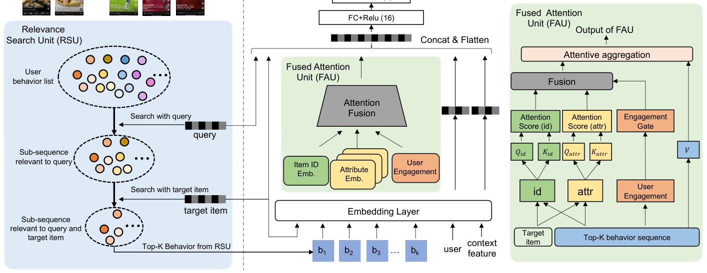
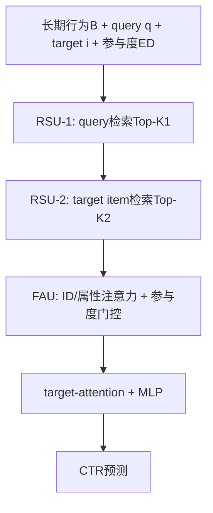

# Query-dominant User Interest Network for Large-Scale Search Ranking (面向大规模搜索排序的查询主导用户兴趣网络)

- **会议/期刊**: CIKM 2023
- **作者与机构**: Tong Guo, Xuanping Li, Haitao Yang 等，快手科技
- **推荐链路定位**: 精排（搜索 CTR 预估）
- **研究方向**: 序列与会话推荐 / CTR 预估与特征交叉
- **论文原文**: [arXiv:2310.06444v1](https://arxiv.org/abs/2310.06444v1)
- **开源代码**: 暂未开源（原文仅提及 Horovod 训练加速）

## TL;DR (1分钟核心速览)

针对个性化搜索中“搜索行为稀疏、长期推荐行为噪声大”的核心矛盾，QIN 提出两阶段相关搜索单元 RSU：先按 query 从长期行为中检索 Top-$K_1$，再按 target item 检索 Top-$K_2$；随后用参与度门控融合 ID/属性注意力的 FAU 建模用户兴趣。在 Amazon 四集 5-core、Leave-One-Out 协议下，全指标平均超基线 21.19%，线上快手搜索 CTR +7.6%。

## Background & Motivation (背景与核心矛盾)

- **主流范式**: 个性化搜索排序多基于用户搜索/点击序列学习兴趣，代表工作包括 HEM、TEM、IHGNN、MultiResAttn 等图模型或注意力模型。
- **前人局限**: 搜索行为相对推荐行为极稀疏，单用搜索序列难以刻画长期兴趣；而直接引入全量推荐行为又会把与当前 query 无关的噪声带入排序。
- **核心洞察 (Key Insight)**: 快手一周线上数据分析显示，推荐行为平均长度约为搜索行为的 20 倍；长期兴趣必须用，但必须先按 query 与 target item 两级过滤。
- **本文切入点**: 将“长行为检索”拆成 query 主导的粗筛与 target item 主导的细筛，再用参与度指导 ID/属性注意力融合。

## Method (核心方法设计)

### 1. 整体框架 (Overall Architecture)

QIN 输入用户长期行为列表 $\mathcal{B}$、query$q$、target item$i$及参与度$ED$。RSU 第一阶段用预训练语义嵌入的点积从$\mathcal{B}$中检索与$q$相关的 Top-$K_1$行为；第二阶段在子序列中按$i$检索 Top-$K_2$。随后堆叠两个 FAU：自注意力 FAU 增强历史 item 表示，target-attention FAU 增强 target item 表示；每层分别计算 ID 与属性注意力分数，用参与度门控融合后 Softmax 聚合。最后 flatten 序列，与 user/query embedding 拼接，经 MLP 输出 CTR。整体框架见图 3。

<figure class="paper-figure" markdown="span">
  <figcaption>图3：所提模型的概览，包括相关性搜索单元和融合注意力单元。原始历史行为列表输入 RSU 以选择 K 个行为。FAU 旨在从子序列中建模用户兴趣，并将 ID 字段和属性字段的注意力分数与用户参与度融合。我们堆叠两个 FAU，其中一个为自注意力，用于增强历史物品的表示；另一个为目标注意力，用于增强目标物品的表示。</figcaption>
</figure>

### 2. 关键设计拆解 (Key Designs)

1. **两阶段相关搜索单元 RSU（过滤长行为噪声）**：全量行为与 query 无关项多，而直接用 target item 对全序列检索的复杂度为 $O(NMD)$，线上不可接受。QIN 先用$r_{q,b_t}=\mathbf{e}_q^\top\mathbf{e}_{b_t}$选 Top-$K_1$，再用$r_{i,b_t}=\mathbf{e}_i^\top\mathbf{e}_{b_t}$在$K_1$内选 Top-$K_2$，复杂度降至$O(ND+MK_1D)$。由于线上通常$N\gg K_1$，该设计既保留长期兴趣又控制检索开销。

2. **融合注意力单元 FAU（解耦 ID/属性并用参与度重加权）**：ID 与属性在长尾场景可互补，DIF 式“只解耦不融合”不够。FAU 分别计算 $att_h^{ID}=(\mathbf{E}_{ID}\mathbf{W}_Q^h)(\mathbf{E}_{ID}\mathbf{W}_K^h)^\top/\sqrt{d}$与$att_h^{attr}$，再以$g=\mathrm{Softmax}(\mathbf{W}_2\phi(\mathbf{W}_1R(ED)))$为门控，得到$att_h^{fused}=g\odot(\alpha att_h^{ID}+(1-\alpha)att_h^{attr})$。观看时长/评分等参与度越高，历史行为权重越大；$\alpha\approx0.5$ 时 ID 与属性影响最平衡。

3. **训练目标、负采样与推理效率**：采用 BCE 损失 $\mathcal{L}=-\sum y_{uqi}\log p_{uqi}+(1-y_{uqi})\log(1-p_{uqi})$；每个 user-query-item 交互随机采 100 个负例，嵌入维度$d=8$，Adam 学习率$1\times10^{-3}$、batch 512。线上训练与推理均接入 RSU，并用并行点积加速；两阶段检索避免 target-only 检索的$O(NMD)$ 瓶颈。

## Experimental Setup & Evaluation Protocol (实验设置与评估协议)

- **数据集与预处理**: Amazon 四个子集，均做 `5-core` 过滤，序列长度设为 10；query 由类目按 Van Gysel 等方法合成，评论评分/helpful rate 作为参与度特征。

| 数据集 | #Users | #Items | #Interactions | #Queries | 密度 | 场景/特征 |
| :--- | :---: | :---: | :---: | :---: | :---: | :--- |
| Beauty | 22,363 | 12,101 | 198,502 | 251 | 0.0734% | 美妆；长尾 query |
| CDs & Vinyl | 75,258 | 64,443 | 1,097,592 | 22,204 | 0.0226% | 音乐；query 数最多 |
| Electronics | 192,403 | 63,001 | 1,689,188 | 1,386 | 0.0139% | 电子；用户量最大 |
| Kindle Store | 68,223 | 61,934 | 982,619 | 25,416 | 0.0233% | 电子书；query 多样 |

- **数据划分与防穿越 (Splitting Strategy)**: `Leave-One-Out`：每个用户最后两个交互分别作验证/测试，其余训练；最佳验证 checkpoint 报测试结果。
- **排名评测协议 (Ranking Protocol)**: 报告 `NDCG@N`、`MRR@N`、`HR@N`，$N\in\{4,8,20\}$，主表以 @4 为核心。原文仅明确训练每交互采 100 负例，未声明 Full-Ranking；按采样排序（约 1:100）理解，属评估透明度短板。
- **对比基线与超参设置**: 对比 HEM、ZAM、TEM、GraphSRRL、IHGNN、MultiResAttn 六类基线；嵌入维度默认 8，另测 16/32；未报告显著性检验或置信区间。

## Key Experimental Results (实验关键数据)

### 1. 主实验对比 (Main Results)

下表为 NDCG/MRR/HR@4，QIN 全面最优（粗体）：

| 方法 | Beauty | CDs & Vinyl | Electronics | Kindle Store |
| :--- | :---: | :---: | :---: | :---: |
| HEM | 0.0655/0.0540/0.0999 | 0.0619/0.0506/0.0956 | 0.0655/0.0537/0.1009 | 0.0405/0.0328/0.0638 |
| ZAM | 0.1269/0.1082/0.1826 | 0.1453/0.1242/0.2083 | 0.1861/0.1577/0.2710 | 0.1244/0.1060/0.1794 |
| TEM | 0.1370/0.1175/0.1953 | 0.1800/0.1584/0.2445 | 0.1967/0.1710/0.2735 | 0.1723/0.1481/0.2443 |
| GraphSRRL | 0.0826/0.0688/0.1238 | 0.1286/0.1069/0.1933 | 0.2335/0.2034/0.3233 | 0.1024/0.0871/0.1482 |
| IHGNN | 0.1038/0.0871/0.1539 | 0.2066/0.1819/0.2804 | 0.2408/0.2140/0.3205 | 0.1435/0.1246/0.1999 |
| MultiResAttn | 0.1806/0.1547/0.2579 | 0.2981/0.2646/0.3979 | 0.3251/0.2919/0.4239 | 0.2225/0.1914/0.3154 |
| **QIN** | **0.2305/0.2002/0.3206** | **0.3693/0.3301/0.4854** | **0.3935/0.3573/0.5011** | **0.2538/0.2218/0.3490** |

QIN 较最强基线 MultiResAttn，四个数据集 NDCG@4 分别提升 27.6% / 23.9% / 21.0% / 14.1%，全指标平均提升 21.19%。

### 2. 消融实验 (Ablation Study)

| 变体 | Beauty NDCG | Beauty MRR | Beauty HR | CDs NDCG | CDs MRR | CDs HR |
| :--- | :---: | :---: | :---: | :---: | :---: | :---: |
| RSU_one（仅 query） | 0.1683 | 0.1446 | 0.2388 | 0.2551 | 0.2248 | 0.3453 |
| RSU_SIM（SIM 式检索） | 0.2060 | 0.1782 | 0.2890 | 0.3098 | 0.2741 | 0.4161 |
| RSU_two（两阶段） | 0.2590 | 0.2274 | 0.3531 | 0.3054 | 0.2699 | 0.4109 |
| FAU-MEAN | 0.1208 | 0.1009 | 0.1830 | 0.1610 | 0.1398 | 0.2242 |
| FAU-DIN | 0.1456 | 0.1248 | 0.2078 | 0.2018 | 0.1761 | 0.2782 |
| FAU-SASRec | 0.1759 | 0.1507 | 0.2512 | 0.2786 | 0.2434 | 0.3832 |
| FAU-DIF | 0.2147 | 0.1892 | 0.2906 | 0.3079 | 0.2731 | 0.4115 |
| QIN_id（仅 ID） | 0.1498 | 0.1286 | 0.2133 | 0.2741 | 0.2416 | 0.3710 |
| QIN_s（标量门控） | 0.2478 | 0.2176 | 0.3379 | 0.3225 | 0.2865 | 0.4298 |
| **QIN（完整）** | **0.2305** | **0.2002** | **0.3206** | **0.3693** | **0.3301** | **0.4854** |

### 3. 关键实验发现 (Key Findings)

1. **两阶段检索是主要增益源之一**：RSU_one 在 Beauty/CDs 仅 0.1683/0.2551 NDCG，RSU_SIM 也仅 0.2060/0.3098，均低于完整 QIN 的 0.2305/0.3693；说明“query 粗筛 + target item 细筛”比单阶段或 SIM 式 target-only 检索更能平衡相关性与算力。
2. **参与度门控与属性互补显著**：去掉属性、仅用 ID 的 QIN_id 在 Beauty 掉到 0.1498 NDCG，远低于 QIN 的 0.2305；QIN 相比无参与度融合的 DIF，在 Beauty/CDs 上 NDCG 提升约 7.4%/19.9%，验证了“观看深度即行为权重”的有效性。
3. **线上收益与离线一致**：快手搜索 A/B 一个月、超 1 亿 query 上，CTR +7.6%、有效观看 +24.1%、换 query 率 -7.2%；说明长期行为过滤对真实搜索体验有正向作用，而非仅离线指标过拟合。

## Highlights & Limitations (亮点、对比与审稿批判)

- **与代表作对比 (vs. Prior Work)**: 相比 SIM 的 target/soft-search 方案，QIN 增加 query 先验并显式控制复杂度；相比 DIF 只解耦 ID/属性，QIN 用参与度门控做自适应融合；相比 MultiResAttn 仅建模搜索时序，QIN 把推荐长期行为纳入搜索排序。
- **可迁移亮点**: 两阶段“query→target”检索可迁移到电商/短视频长序列召回；参与度门控可作为通用样本加权或行为重要性建模技巧。
- **审稿级局限批判**: 其一，RSU 依赖预训练语义嵌入，粗筛错误会不可逆地滤掉长尾相关行为；其二，离线评估使用合成 query 与采样负例，未做 Full-Ranking/显著性检验，且模型未开源，复现与公平比较受限；线上收益也缺少置信区间与长期反转分析。

## Rating (四维评分)

- **方法创新性 (Novelty)**: ⭐⭐⭐⭐ （两阶段相关检索与参与度门控融合较新颖，但整体偏工程组合，理论分析有限）
- **评估协议与实验扎实度 (Protocol & Experiments)**: ⭐⭐⭐ （四集+线上 A/B 较完整，但合成 query、采样排序与无显著性检验削弱说服力）
- **写作与数学规范度 (Clarity & Rigor)**: ⭐⭐⭐⭐ （FAU 公式、复杂度与线上流水线清楚；门控激活符号与评测候选集描述略含糊）
- **工业落地与复现价值 (Industrial & Practical Value)**: ⭐⭐⭐⭐ （快手全流量部署、CTR +7.6% 价值高；未开源且依赖特征中心/嵌入服务，复现门槛偏高）

