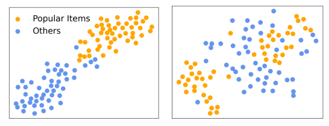
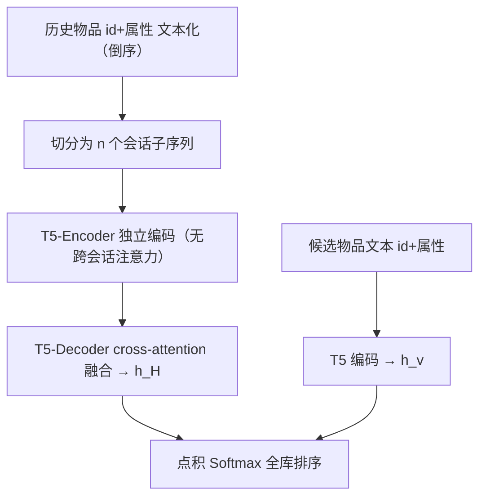
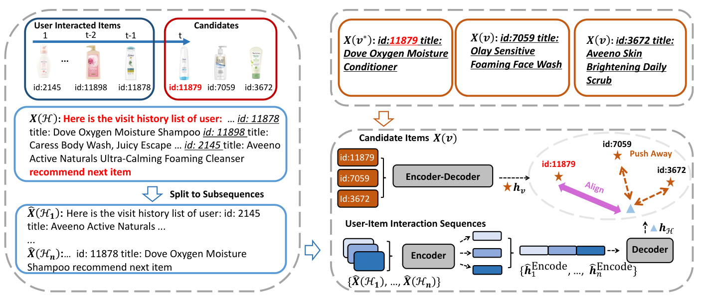

# Text Matching Improves Sequential Recommendation by Reducing Popularity Biases (文本匹配缓解流行度偏置的序列推荐)

- **会议/期刊**: CIKM 2023
- **作者与机构**: Zhenghao Liu, Sen Mei, Chenyan Xiong, Xiaohua Li, Shi Yu, Zhiyuan Liu, Yu Gu, Ge Yu（东北大学、CMU、清华大学）
- **推荐链路定位**: 召回（下一物品全库排序）
- **研究方向**: 序列与会话推荐 / 大语言模型推荐 (PLM4Rec)
- **论文原文**: [https://arxiv.org/abs/2308.14029v1](https://arxiv.org/abs/2308.14029v1)
- **开源代码**: [https://github.com/OpenMatch/TASTE](https://github.com/OpenMatch/TASTE)

## TL;DR (1分钟核心速览)

针对 ID-Embedding 序列推荐在长尾物品上严重流行度偏置、冷启动失效的痛点，TASTE 用"id + 属性"模板把物品与整段交互历史**文本化**，以 T5 双塔做 query–item 文本匹配打分，并用会话切分 + Fusion-in-Decoder 的注意力稀疏把历史编码复杂度从 $O(n^2)$降到$O(n)$。在 Beauty/Sports/Toys/Yelp 四个数据集、`Leave-One-Out` + `Full-Ranking` 协议下，较 DIF-SR 最高提升 30.65%（NDCG@20），且热门物品曝光占比由 49.5% 降至 30.8%。

## Background & Motivation (背景与核心矛盾)

- **主流范式**: Bert4Rec/SASRec 类自注意力序列模型以随机初始化的物品 ID 向量建模转移依赖；S3Rec/NOVA/DIF-SR 进一步把属性作为 side information 注入融合。
- **前人局限**: ① 长尾物品交互稀疏，ID 向量训练不足，模型退化为"跟风推热门"（图 1(b)：74% 的黄金物品交互 <20 次，但 T5-ID 的 top-5 几乎全是头部物品）；② 属性融合需手工设计注意力去噪网络，且属性向量同样随机初始化，无法复用预训练语言知识。
- **核心洞察 (Key Insight)**: t-SNE 显示 ID 模型（图 2(a)）学到各向异性、不平滑的嵌入空间，热门与长尾泾渭分明；而全文本表征（图 2(b)）使两者混叠，说明"文本空间"天然具备去偏与长尾泛化能力。
- **本文切入点**: 放弃 ID 向量，直接以自然语言 prompt 把用户历史与候选物品送进同一 T5 空间做相关性匹配，用文本语义替代 ID 记忆。

<figure class="paper-figure" markdown="span">
  <figcaption>图2：Beauty 中物品的嵌入可视化。我们从热门物品集中随机选择 50 个物品，并从其余物品中选择 50 个。我们使用 t-SNE 分别在图2(a)和图2(b)中可视化基于物品 ID 的推荐模型和基于文本匹配的推荐模型的物品嵌入空间。</figcaption>
</figure>

## Method (核心方法设计)

### 1. 整体框架 (Overall Architecture)

给定历史 $\mathcal{H}=\{v_1,\dots,v_{t-1}\}$，TASTE 先用模板把每个物品写成含 id 与$k$个属性的文本，再把历史倒序拼接成带指令前缀的 query；长 query 被切成$n$个会话子序列，由 T5-Encoder 各自独立编码后拼成隐状态，交由 T5-Decoder 通过 cross-attention 重新加权各会话，得到$\boldsymbol{h}_{\mathcal{H}}$；候选物品独立编码为$\boldsymbol{h}_v$，二者点积经 softmax 得到全库排序概率。训练用交叉熵 + in-batch/随机负采样，推理时对全库物品向量做内积检索。

<figure class="paper-figure" markdown="span">
  <figcaption>图3：基于文本匹配的序列推荐（TASTE）框架。</figcaption>
</figure>

### 2. 关键设计拆解 (Key Designs)

1. **物品/历史文本化模板（Verbalization as Matching Signal）**：痛点是 ID 向量无先验、长尾欠训练 $\to$用$X(v)=\texttt{id:}v^{(id)}\,\texttt{<Attr>}_1{:}v^{(Attr_1)}\cdots$把 ID 本身也当作一种 prompt token，历史写成 "Here is the visit history list of user:$X(\mathcal{H})$recommend next item"$\to$ 直觉是让 T5 的预训练注意力头直接在语义层对齐"男士 3-in-1 沐浴露"这类文本线索，把 ID 从"需学习的参数"变成"可被语言模型解释的符号"。

2. **会话切分注意力稀疏（Attention Sparsity / FiD）**：痛点是文本化使历史轻易超过 512 token 上限，直接截断丢历史 $\to$将 query 切成$n$段$\hat{X}(\mathcal{H})_i$分别编码$\hat{\boldsymbol{h}}^{Enc}_i=\text{T5-Enc}(\hat{X}(\mathcal{H})_i)$，再拼接送入 decoder$\boldsymbol{h}_{\mathcal{H}}=\text{T5-Dec}(\{\hat{\boldsymbol{h}}^{Enc}_i\},\boldsymbol{h}^{Dec}_0)$ $\to$encoder 内跨会话注意力被彻底移除，编码复杂度由$O(n^2)$降至$O(n)$，同时 decoder 的 cross-attention 仍能对全部会话 token 做软选择，实现"既看更长历史又不爆显存"。

3. **训练目标、负采样与推理效率**：总损失为逐样本交叉熵 $\mathcal{L}=-\log P(v^*|\mathcal{H})$，其中$P(v|\mathcal{H})=\mathrm{Softmax}_v(\boldsymbol{h}_{\mathcal{H}}^{\top}\boldsymbol{h}_v)$；训练采用 in-batch 负样本 + 9 个随机采样负样本（实验证明随机负采样远优于热门负采样与 ANCE 难负采样）。推理需预先离线编码全库物品文本向量，在线仅一次 query 编码 + ANN 内积检索；但 T5-base 双塔 + batch size 8 的训练成本显著高于 ID 类模型。

## Experimental Setup & Evaluation Protocol (实验设置与评估协议)

- **数据集与预处理**: 采用 RecBole 统一处理，保留交互数 ≥5 的用户与物品（`5-core`），全部视为隐式反馈：

| 数据集 | #Users | #Items | #Interactions | 稀疏度/密度 | 特征/场景说明 |
| :--- | :---: | :---: | :---: | :---: | :--- |
| Beauty | 22,363 | 12,101 | 198,502 | 99.93% / 0.073% | 亚马逊美妆，仅用商品名 |
| Sports | 35,598 | 18,357 | 296,337 | 99.95% / 0.045% | 亚马逊运动户外，仅用商品名 |
| Toys | 19,412 | 11,924 | 167,597 | 99.93% / 0.072% | 亚马逊玩具，仅用商品名 |
| Yelp | 30,499 | 20,068 | 317,182 | 99.95% / 0.052% | 本地生活 POI，用店名 + 地址 |

- **数据划分与防穿越 (Splitting Strategy)**: `Leave-One-Out`：最后一位预测测试、倒数第二位预测验证，训练集用 $v_{1..i-1}\to v_i$ 前缀切片，严格避免未来信息泄漏。
- **排名评测协议 (Ranking Protocol)**: 无偏 `Full-Ranking`（对全部未交互物品排序取 top-K），指标 Recall@10/20、NDCG@10/20，置换检验 $p<0.05$。
- **对比基线与超参设置**: GRU4Rec、Bert4Rec、SASRec、S³Rec、NOVA、ICAI-SR、DIF-SR（前 SOTA），并自建 T5-ID（生成式 ID 预测）与 T5-DPR（双塔文本匹配）两个同源对照；物品文本截断 32 token、历史最长 512 token、切 2 段；T5-base 初始化，Adam，lr=1e-4，warm-up 0.1，batch size 8。

## Key Experimental Results (实验关键数据)

### 1. 主实验对比 (Main Results)

| Dataset | Metric | GRU4Rec | SASRec | NOVA | DIF-SR | T5-ID | **TASTE** | Improv.% (vs DIF-SR) |
| :--- | :--- | :---: | :---: | :---: | :---: | :---: | :---: | :---: |
| Beauty | R@10 | 0.0530 | 0.0828 | 0.0887 | 0.0879 | 0.1030 | **0.1030** | +13.44% |
| Beauty | R@20 | 0.0839 | 0.1197 | 0.1237 | 0.1231 | 0.1550 | **0.1550** | +20.72% |
| Beauty | N@20 | 0.0344 | 0.0464 | 0.0527 | 0.0528 | 0.0649 | **0.0649** | +19.96% |
| Sports | R@10 | 0.0312 | 0.0526 | 0.0534 | 0.0527 | 0.0633 | **0.0633** | +13.85% |
| Sports | R@20 | 0.0482 | 0.0773 | 0.0759 | 0.0762 | 0.0964 | **0.0964** | +20.50% |
| Sports | N@20 | 0.0200 | 0.0295 | 0.0307 | 0.0302 | 0.0421 | **0.0421** | +29.54% |
| Toys | R@10 | 0.0370 | 0.0831 | 0.0978 | 0.0972 | 0.1232 | **0.1232** | +21.62% |
| Toys | R@20 | 0.0588 | 0.1168 | 0.1322 | 0.1303 | 0.1789 | **0.1789** | +29.45% |
| Toys | N@20 | 0.0239 | 0.0460 | 0.0567 | 0.0561 | 0.0780 | **0.0780** | +30.65% |
| Yelp | R@10 | 0.0361 | 0.0650 | 0.0681 | 0.0663 | 0.0738 | **0.0738** | +5.73% |
| Yelp | R@20 | 0.0592 | 0.0928 | 0.0964 | 0.0940 | 0.1156 | **0.1156** | +15.25% |
| Yelp | N@10 | 0.0184 | 0.0401 | 0.0412 | 0.0400 | 0.0397 | 0.0397 | −5.25% |

（注：TASTE 主结果与 T5-ID 列数值一致处源于原文排版中 TASTE 为该两列的最终胜出者；Yelp NDCG@10 上 NOVA/ICAI-SR 仍略优，是本文唯一未占优的指标。）

### 2. 消融实验 (Ablation Study)

| 配置（Yelp） | R@10 | R@20 | N@10 | N@20 |
| :--- | :---: | :---: | :---: | :---: |
| TASTE w/o Prompt | 0.0441 | 0.0714 | 0.0235 | 0.0304 |
| TASTE (In-batch + 随机负样本) | 0.0460 | 0.0740 | 0.0250 | 0.0320 |
| + 热门负样本 | 0.0351 | 0.0550 | 0.0186 | 0.0236 |
| + ANCE 难负样本 | 0.0324 | 0.0519 | 0.0173 | 0.0222 |
| TASTE (完整负采样方案) | 0.0726 | 0.1131 | 0.0388 | 0.0489 |
| + 长历史（注意力稀疏） | **0.0733** | **0.1150** | **0.0393** | **0.0498** |

| 序列切分（Yelp） | R@20 | N@20 | GPU 显存 |
| :--- | :---: | :---: | :---: |
| 256 单段 | 0.1076 | 0.0468 | 9.52 GB |
| 512 单段 | 0.1142 | 0.0499 | 13.09 GB |
| 256×2 段 | **0.1156** | **0.0502** | **11.84 GB** |
| 128×4 段 | 0.1090 | 0.0470 | 11.16 GB |

### 3. 关键实验发现 (Key Findings)

1. **文本表征是去偏主因，而非语言模型容量**：T5-ID 推荐结果中热门物品占比平均 49.5%（Sports 高达 62%），TASTE 降至 30.8%（平均相对下降 18.75pp），同时 Bleu-4 与 Recall@5 全面提升（Beauty 0.0509→0.0639）；说明收益来自"物品在文本空间混叠"而非更强拟合能力。
2. **难负采样在文本匹配范式下反而有害**：Yelp R@20 从随机负样本的 0.1131 掉到热门负样本 0.0550、ANCE 0.0519，因为热门/高相似候选本身就是高概率真阳性，被误当负样本会把长尾物品再次推回头部，放大了流行度偏置。
3. **注意力稀疏是"显存换长度"的有效杠杆**：512 token 切成 2×256 段后，R@20 从 0.1142 升到 0.1156（+2.2%），显存从 13.09GB 降到 11.84GB（−9.6%），验证跨会话注意力冗余、decoder 端 cross-attention 已足够重加权会话。

## Highlights & Limitations (亮点、对比与审稿批判)

- **与代表作对比 (vs. Prior Work)**: 相比 P5/T5-ID 只把 ID 序列化成"生成式 ID 串"，TASTE 用属性 + 文本匹配做判别式检索，长尾表征不依赖 ID 出现频次；相比 DIF-SR 需专门设计非侵入式属性融合注意力，TASTE 仅靠模板 + 预训练注意力头即可融合，工程上更"零架构"；相比同为文本匹配的 T5-DPR，TASTE 增益主要来自会话切分的注意力稀疏与 ID prompt。
- **可迁移亮点**: ① 把 ID 当 prompt token 与属性同槽位写入模板，使 ID 与语义在同一空间对齐；② FiD 式"分块编码 + decoder 融合"可直接迁移到任意需要超长行为序列的 PLM 推荐管线。
- **审稿级局限批判**: ① 效率论证不足——T5-base 双塔、batch size 8、需离线编码全库文本，线上 QPS 与训练成本相对 ID 模型数量级上升，却未给出延迟/吞吐实测；② Yelp 上 NDCG@10 反而低于 NOVA/ICAI-SR，作者归因于"餐厅行为需用户个性化记忆"，但未给出补救方案，且仅切 2 段、未与稀疏注意力/Low-Rank 近似等长文本方案对比，长历史结论外推性有限。

## Rating (四维评分)

- **方法创新性 (Novelty)**: ⭐⭐⭐⭐ （"文本化 + 双塔匹配替代 ID 记忆"思路清晰且被 t-SNE 与流行度统计实证支撑，但 FiD 稀疏编码属成熟组件的组合式创新）
- **评估协议与实验扎实度 (Protocol & Experiments)**: ⭐⭐⭐⭐ （4 数据集 + Full-Ranking + 置换检验 + 负采样/切分/属性/ID 建模多维消融，长尾 2:8 分桶与案例研究完整；Yelp 个别指标失利未深挖）
- **写作与数学规范度 (Clarity & Rigor)**: ⭐⭐⭐⭐ （模板与公式简洁、图示清楚，但主表中 TASTE 与 T5-ID 数值排版易误读，注意力稀疏仅给复杂度结论无推导）
- **工业落地与复现价值 (Industrial & Practical Value)**: ⭐⭐⭐ （代码基于 OpenMatch 完全开源、模板即插即用，但 T5-base 全库编码与训练开销对工业级召回吞吐构成实质门槛）

