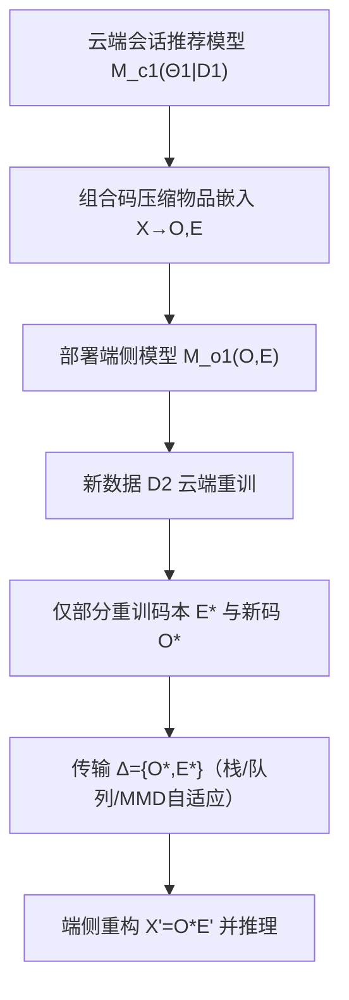
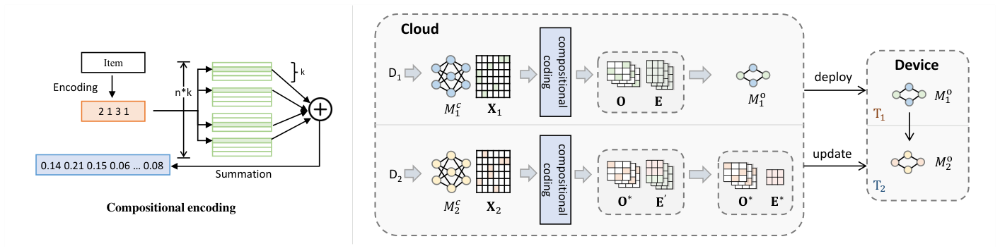
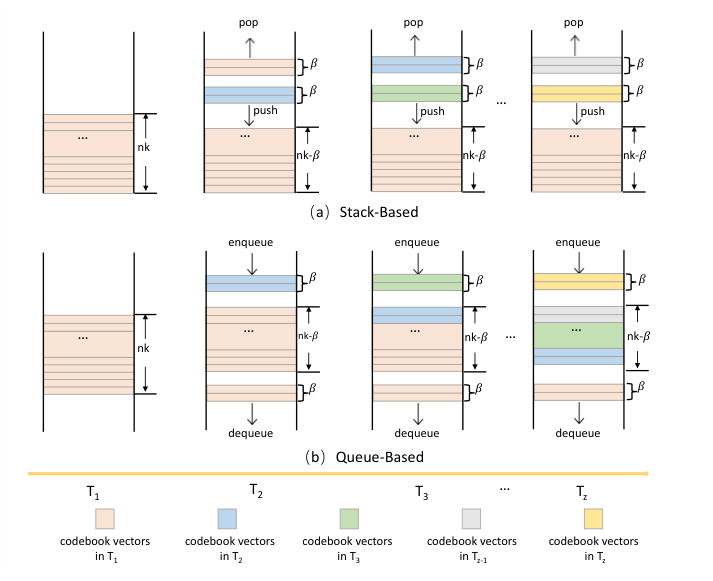

# Towards Communication-Efficient Model Updating for On-Device Session-Based Recommendation (面向端侧会话推荐的通信高效模型更新)

- **会议/期刊**: CIKM 2023
- **作者与机构**: Xin Xia, Junliang Yu, Guandong Xu, Hongzhi Yin；The University of Queensland / University of Technology Sydney
- **推荐链路定位**: 端侧推理与更新（会话推荐排序）
- **研究方向**: 序列与会话推荐 / 工业架构与可信隐私
- **论文原文**: [论文原文链接](https://arxiv.org/abs/2308.12777v1)
- **开源代码**: [开源代码仓库链接](https://github.com/xiaxin1998/ODUpdate)

## TL;DR (1分钟核心速览)

端侧会话推荐模型无法本地重训，而周期性下发全量参数会挤占带宽。本文先用组合码把物品嵌入压成“码本+离散码”，再将云端新码本的少量向量以栈/队列方式增量传输，并用MMD按数据漂移自适应调整更新量。在Gowalla/Lastfm的时序切片上，10%更新体积下精度损失<10%，总更新比云端嵌入表小约60倍，多数设置逼近重训云端模型。

## Background & Motivation (背景与核心矛盾)

- **主流范式**: 云端重训后压缩模型并部署到端侧；端侧推荐研究多聚焦嵌入表压缩（张量分解、量化、哈希），以适配内存与算力。
- **前人局限**: ① 设备算力/内存不足以本地重训，用户兴趣漂移会导致性能衰减；② 即便模型已压缩，频繁全量传输仍带来显著带宽开销；③ 联邦学习式更新压缩依赖客户端数据，且非推荐场景，SVD类方法开销偏高。
- **核心洞察 (Key Insight)**: 物品嵌入表是内存占用与信息承载的核心；更新时只需传输新码本中的少量向量与新码，复用旧码本即可在端侧重构嵌入表。
- **本文切入点**: 组合码压缩 + 栈/队列增量更新 + MMD自适应压缩比，形成模型无关的端侧更新框架。

## Method (核心方法设计)

### 1. 整体框架 (Overall Architecture)

云端先用任意会话推荐模型训练，冻结除物品嵌入表 $\mathbf{X}$外的参数；将$\mathbf{X}$用组合码表示为码矩阵$\mathbf{O}$与码本$\mathbf{E}$，部署到端侧。新数据$D_2$到来后，云端重训模型，但只部分重训码本向量并生成新码$\mathbf{O}^*$，把$\Delta=\{\mathbf{O}^*,\mathbf{E}^*\}$传给设备；设备按栈/队列规则拼接旧码本，重构$\mathbf{X}'$ 后直接推理。更新量由MMD估计的数据漂移自适应决定，整个流程可插拔到NARM/SR-GNN/SASRec。

<figure class="paper-figure" markdown="span">
  <figcaption>图 2：（左）组合编码示意图；（右）端侧更新压缩概览。</figcaption>
</figure>

### 2. 关键设计拆解 (Key Designs)

1. **组合码嵌入压缩（共享码本替代大嵌入表）**：用 $n$个码本$\mathbf{E}_i\in\mathbb{R}^{k\times d}$共享基向量，物品$v$的码$C_v=(C_v^1,\ldots,C_v^n)$唯一，嵌入为$\boldsymbol{e}_v=\sum_i \mathbf{E}_i[C_v^i]$。为端到端训练，把码写成 one-hot 矩阵$\mathbf{O}_i^v$，用 Gumbel-Softmax 近似：$(\mathbf{O}_i^v)_m=\mathrm{softmax}((\log \alpha_i^v+\mathbf{G})_m)$。压缩比$CR=1/(nk/|V|+n/d)$；靠码本共享降参，同时保留组合表达力。

2. **栈/队列更新压缩（只传少量码本向量）**：每次只重训 $\beta=nk/r$个码本向量，传新码$\mathbf{O}^*$与$\mathbf{E}^*$。栈按 LIFO 保留早期知识：$\mathbf{X}'=\mathrm{MatMul}(\mathbf{O}^*,\mathrm{CONCAT}[\mathbf{E}^*,\mathbf{E}[\beta:,:]])$；队列按 FIFO 替换旧知识：$\mathbf{X}'=\mathrm{MatMul}(\mathbf{O}^*,\mathrm{CONCAT}[\mathbf{E}^*,\mathbf{E}[:(nk-\beta),:]])$。更新压缩比$CR=1/(\beta/|V|+n/d)$，当$\beta\ll nk$ 时远小于全量嵌入表。

<figure class="paper-figure" markdown="span">
  <figcaption>图 3：高效模型更新的两种方法。</figcaption>
</figure>

3. **MMD自适应与训练目标**：用相邻切片嵌入表的MMD度量漂移，$r=\lceil 1/(C(2\sigma(\mathrm{MMD})-1))\rceil$，漂移越大$r$越小（更新越多），$C=0.2$。云端推荐损失为交叉熵$\mathcal{L}_{rec}$，压缩损失$\mathcal{L}_{mse}=\|\mathbf{O}\mathbf{E}-\mathbf{X}\|^2$；训练采用全物品交叉熵、未使用负采样，推理按码查表求和，更新只传稀疏码+少量码本，通信开销约$O(\beta d+n|V|)$。

## Experimental Setup & Evaluation Protocol (实验设置与评估协议)

**表 1：数据集统计**

| 数据集 | #Users | #Items | #Interactions (D5/Test) | 稀疏度/密度 | 特征/场景说明 |
| :--- | :---: | :---: | :---: | :---: | :--- |
| Gowalla | — | 37,722 | 1,261,076 / 99,711 | — | Next-POI；会话长度2–300 |
| Lastfm | — | 10,000 | 2,538,670 / 607,274 | — | 音乐艺人；8h会话，长度2–50，Top10k |

- **数据划分与防穿越**: 按全局时间戳切分为 $D_1$–$D_5$+Test；Gowalla 五切片比例 1:3:6:10:15，Lastfm 1:2:5:10:20；每条会话按前缀生成样本，标签为下一物品，测试集严格晚于训练切片。
- **排名评测协议**: 无偏 **Full-Ranking** 全库排序（未交互物品参与排序），指标为 Prec@5/10、NDCG@5/10；训练采用全物品交叉熵，未报告采样负例比例。
- **对比基线与超参设置**: 基模型为 NARM（RNN+attention）、SR-GNN（GNN）、SASRec（Transformer）；$d=128$，batch=100，L2=$10^{-5}$，Adam lr=$10^{-3}$，Gumbel$\tau=0.2$，$k=32$，NARM/SR-GNN 取$n=20$，SASRec 取$n=40$；未报告显著性检验。

## Key Experimental Results (实验关键数据)

### 1. 主实验对比 (Main Results)

**表 2：$D_1$ 上初始压缩模型 vs. 云端未压缩模型（Prec@5 / NDCG@10；Δ为相对同架构 -C 的变化）**

| 模型 | CR (G/L) | Gowalla P@5 | Gowalla N@10 | Lastfm P@5 | Lastfm N@10 | ΔP@5 (G/L) |
| :--- | :---: | :---: | :---: | :---: | :---: | :---: |
| NARM $n=20$ | 6 / 5 | 8.78 | 7.35 | 4.66 | 3.87 | -5.8% / -1.7% |
| NARM-C | 1 / 1 | 9.32 | 7.92 | 4.74 | 3.91 | — |
| SR-GNN $n=20$ | 6 / 5 | 15.11 | 10.34 | 4.51 | 3.77 | -1.0% / -23.0% |
| SR-GNN-C | 1 / 1 | 15.27 | 10.20 | **5.86** | **4.89** | — |
| SASRec $n=40$ | 3 / 2 | **16.36** | **14.21** | 4.72 | 3.99 | +2.3% / -1.7% |
| SASRec-C | 1 / 1 | 15.99 | 13.37 | 4.80 | 4.07 | — |

### 2. 消融实验 (Ablation Study)

**表 3：组合码压缩率消融（Gowalla $D_1$，Prec@5 / NDCG@10）**

| 模型 | 配置 | CR | Prec@5 | NDCG@10 |
| :--- | :--- | :---: | :---: | :---: |
| NARM | $n=10$ | 12 | 8.01 | 6.70 |
| NARM | $n=20$ | 6 | 8.78 | 7.35 |
| NARM | $n=40$ | 3 | 9.33 | **7.84** |
| NARM | -C | 1 | 9.32 | **7.92** |
| SR-GNN | $n=10$ | 12 | 11.81 | 8.34 |
| SR-GNN | $n=20$ | 6 | 15.11 | 10.34 |
| SR-GNN | $n=40$ | 3 | **15.24** | **10.57** |
| SR-GNN | -C | 1 | 15.27 | 10.20 |
| SASRec | $n=10$ | 12 | 10.63 | 9.18 |
| SASRec | $n=20$ | 6 | 15.07 | 13.05 |
| SASRec | $n=40$ | 3 | **16.36** | **14.21** |
| SASRec | -C | 1 | 15.99 | 13.37 |

### 3. 关键实验发现 (Key Findings)

1. **组合码在多数模型上近似“轻量正则”**：Gowalla 的 SASRec $n=40$以 CR=3 达到 P@5 16.36、N@10 14.21，反而高于未压缩的 15.99/13.37；NARM/SR-GNN 的 P@5 仅降 5.8%/1.0%。但 Lastfm 的 SR-GNN 从 5.86 降到 4.51，说明 GNN 对码本容量更敏感，不能统一$n$。
2. **10% 更新体积即可把精度损失压在 10% 内**：按 Eq.(15)，SR-GNN/NARM 的总更新比云端嵌入表小约 60 倍；图4中队列在多数切片略优，栈在 Lastfm/SR-GNN 等偏好稳定场景更稳，体现 LIFO 保留旧知识的价值。
3. **MMD 自适应有效但收益温和**：图6中 D3–D5 的自适应 P@5 与固定 10% 更新差异多在 ±3 内，且“前期小压缩、后期大压缩”更优；说明按数据漂移调节 $\beta$ 可在几乎不损精度时进一步省带宽。

## Highlights & Limitations (亮点、对比与审稿批判)

- **与代表作对比 (vs. Prior Work)**: OD-Rec/TT-Rec 只解决端侧模型压缩，不解决更新；DeepRec 依赖本地微调但仍需同步参数；联邦学习式更新压缩要求客户端数据且非推荐场景。本文首次把“更新压缩”引入端侧推荐，用组合码把更新限定在码本子集。
- **可迁移亮点**: 组合码可替换任意物品嵌入表；栈/队列的增量替换可迁移到跨域/多场景嵌入更新；MMD 自适应压缩比可作为带宽受限下的通用策略。
- **审稿级局限批判**: ① 只更新物品嵌入表、冻结其他参数，对结构/特征漂移不鲁棒；② 仅两个数据集、三种模型，无线上 A/B、无显著性检验，$C=0.2$与$n/k$ 需人工调；③ SR-GNN/Lastfm 初始压缩差距大，码本部分重训可能累积漂移，且未讨论隐私/安全。

## Rating (四维评分)

- **方法创新性 (Novelty)**: ⭐⭐⭐⭐ （首次将更新压缩用于端侧推荐，组合码+栈/队列简单但有效，有明确通信压缩比推导。）
- **评估协议与实验扎实度 (Protocol & Experiments)**: ⭐⭐⭐ （时序切片与Full-Ranking较规范，但仅两数据集、无显著性检验与线上验证。）
- **写作与数学规范度 (Clarity & Rigor)**: ⭐⭐⭐⭐ （公式与流程清晰，压缩比与重构式完整；个别超参表述略有不一致。）
- **工业落地与复现价值 (Industrial & Practical Value)**: ⭐⭐⭐⭐ （开源代码，60倍更新压缩、模型无关可插拔；但依赖云端重训且仅覆盖嵌入表。）

