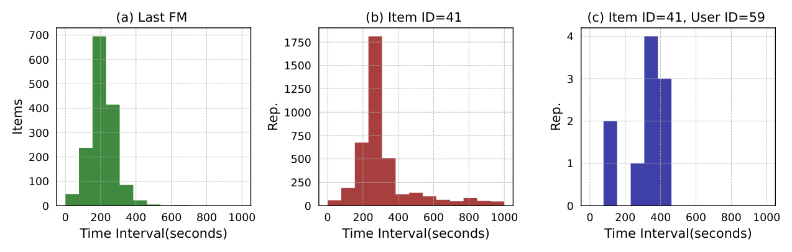
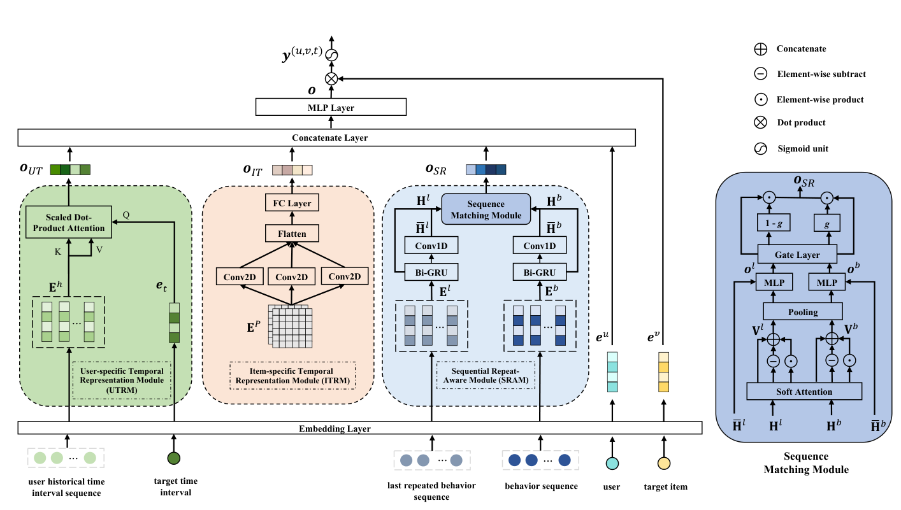
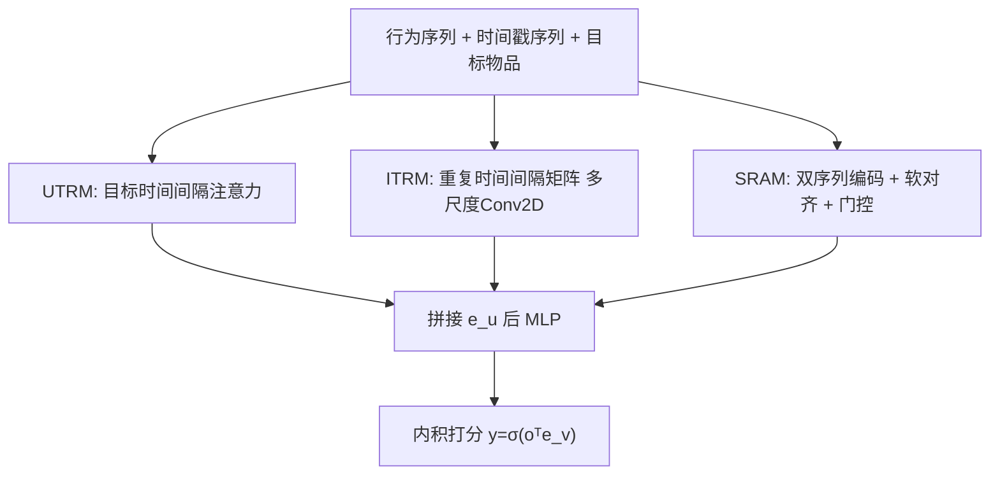

# TSRec: Enhancing Repeat-Aware Recommendation from a Temporal-Sequential Perspective (从时间-序列双视角增强重复感知推荐)

- **会议/期刊**: CIKM 2023
- **作者与机构**: Shigang Quan, Zhenzhe Zheng, Fan Wu (上海交通大学); Shui Liu (阿里巴巴)
- **推荐链路定位**: 召回 / 精排打分（Next-Item 序列预测）
- **研究方向**: 序列与会话推荐 / 冷启动与长尾推荐（跨用户时间间隔侧信息）
- **论文原文**: [https://arxiv.org/abs/2506.08531v1](https://arxiv.org/abs/2506.08531v1)
- **开源代码**: [https://anonymous.4open.science/r/TSRec-2306/](https://anonymous.4open.science/r/TSRec-2306/)

## TL;DR (1分钟核心速览)

重复消费（复购、重听）预测的痛点是：纯重复感知模型只顾" exploitation"而丢掉了新物品探索，且只建模"是否重复"却不建模"何时重复"。TSRec 提出三条支路——用户级重复时间间隔目标注意力 (UTRM)、物品级跨用户重复时间间隔矩阵卷积 (ITRM)、当前序列与上次重复序列的软对齐匹配 (SRAM)。在三数据集时间切分、100 负采样排序协议下，HR@5 相对最优基线提升 4.03%（RetailRocket）与 5.47%（Diginetica）。

## Background & Motivation (背景与核心矛盾)

- **主流范式**: 一类是通用序列模型（GRU4Rec/SASRec/BERT4Rec）用自注意力建模整条行为序列；另一类是重复感知模型（RepeatNet 的 copy 机制、SLRC_NCF 的 Hawkes 过程、ReCANet/NovelNet 的重复标签监督）。
- **前人局限**: ①统计分布模型（负二项、点过程）只刻画重复行为，无法处理重复率低的场景（RetailRocket 仅 35.03%、Diginetica 16.53%），实验上其 HR@5 甚至比 SASRec 低 20–30 个百分点；②RepeatNet/ReCANet 类模型靠"重复-探索"二分类门控或额外监督损失，把重复意图当作黑盒标签，既无法回答"何时会重复"，也削弱了对新物品的表征能力。
- **核心洞察 (Key Insight)**: 作者做了两组数据分析——(a) LastFM 上有 13.15% 的物品存在固定重复时间间隔的聚集分布（图 1），说明**重复有周期性**；(b) 目标物品之前的当前行为序列与"上一次重复该物品前的序列"的 Jaccard 重叠达 45.23%–58.10%（表 1），说明**重复有序列情境性**，用户往往成批地重听一组歌而非单曲。
- **本文切入点**: 把"时间间隔模式"和"序列上下文模式"作为两个独立表征支路显式编码，并借助跨用户的时间间隔矩阵缓解单用户重复序列的极端稀疏。

<figure class="paper-figure" markdown="span">
  <figcaption>图1：在 LastFM 数据集上，从时间角度说明重复消费固有特性的数据分析。x 轴为物品的重复时间间隔，y 轴为不同时间间隔的重复频率。</figcaption>
</figure>

## Method (核心方法设计)

### 1. 整体框架 (Overall Architecture)

输入为截断长度 $L$的行为序列、对应时间戳序列与目标物品。三条支路并行：UTRM 以"目标时间间隔"为 Query 对用户历史重复时间间隔做目标注意力；ITRM 从目标物品的 Repeat Time Interval Matrix（Top-$M$用户的间隔序列堆叠）中用多尺度 2D 卷积抽取物品固有节律；SRAM 用 Bi-GRU+Conv1D 编码"当前行为序列$S_{u,b}$"与"上次重复前序列$S_{u,l}$"，做软注意力对齐与门控融合。三向量与用户嵌入拼接后经 MLP 与目标物品做内积，sigmoid 输出点击概率，交叉熵 + 随机负采样端到端训练。

<figure class="paper-figure" markdown="span">
  <figcaption>图2：TSRec 的总体架构，由三部分组成：用户特定时间表示模块（UTRM）、物品特定时间表示模块（ITRM）和序列重复感知模块（SRAM）。UTRM 通过建模用户序列中重复时间间隔的关系来捕捉时间模式。ITRM 通过提取 Repeat Time Interval Matrix 中的时间信息来捕捉物品特定的时间模式。SRAM 首先对用户当前行为序列和先前行为序列进行编码，然后对齐这两个编码向量。所有这些表示……</figcaption>
</figure>

### 2. 关键设计拆解 (Key Designs)

1. **UTRM（用户级时间间隔目标注意力）**：痛点是把重复周期当成静态统计量会丢失个性化。做法是把离散化的重复间隔 $p_{u,i}=\lfloor |t_{k+1}-t_k|/p_{\min}\rfloor$嵌入为$\boldsymbol{e}_t$，与用户历史间隔矩阵$\mathbf{E}_h$做缩放点积注意力$\mathrm{sim}(\boldsymbol{e}_t,\boldsymbol{e}_{h_k})=\frac{(\mathbf{W}_Q\boldsymbol{e}_t)(\mathbf{W}_K\boldsymbol{e}_{h_k})^\top}{\sqrt{d}}$并加权池化得$\boldsymbol{o}_{UT}$。直觉：若目标间隔恰好落在该用户历史周期峰值上，注意力自动命中对应历史片段，等价于"周期相位匹配"。
2. **ITRM（物品级跨用户间隔矩阵 + 多尺度卷积）**：单用户对单物品的重复次数往往不足 10 次（图 1(b) 的现象），故引入物品 $i$在 Top-$M$（$M{=}10$）重度用户上的间隔矩阵$\mathbf{M}_i\in\mathbb{N}^{m\times n}$。用$1\times1,1\times3,3\times1$三种核的 Conv2D 提取不同尺度节律并双池化：$\boldsymbol{m}_{c_k}=[\mathrm{MeanPool}(\mathrm{Conv2D}_{c_k}(\mathbf{E}_P));\mathrm{MaxPool}(\cdot)]$，再$\boldsymbol{o}_{IT}=\mathrm{MLP}([\boldsymbol{m}_{c_1};\dots;\boldsymbol{m}_{c_n}])$。这是把"群体重复节律"当作文本式的局部-全局特征来读，天然抗稀疏。
3. **SRAM + 训练目标与推理**：把序列匹配（NLP 的 matching-aggregation）迁移到重复推荐：对齐矩阵 $\mathbf{A}=(\mathbf{H}_l)^\top\mathbf{H}_b$，双向 soft-align 得$\tilde{\mathbf{H}}_b,\tilde{\mathbf{H}}_l$，并拼接$[\mathbf{H};\tilde{\mathbf{H}};\mathbf{H}-\tilde{\mathbf{H}};\mathbf{H}\odot\tilde{\mathbf{H}}]$以凸显差异/冲突信息；最终门控$\boldsymbol{g}=\sigma(\mathbf{W}_1\boldsymbol{o}_l+\mathbf{W}_2\boldsymbol{o}_b)$，$\boldsymbol{o}_{SR}=\boldsymbol{o}_l\odot\boldsymbol{g}+\boldsymbol{o}_b\odot(1-\boldsymbol{g})$做维度级融合（而非标量门控）。总损失为带随机负样本的交叉熵$\mathcal{L}=\sum_u\sum_t[-\log y(u,v^+,t)-\log(1-y(u,v^-,t))]$；训练用 3 个、测试用 100 个均匀随机负样本，推理为单塔内积，无额外候选枚举开销。

## Experimental Setup & Evaluation Protocol (实验设置与评估协议)

- **数据集与预处理**: 过滤交互少于 10 次的物品（冷启动过滤），保留序列长度 > 1 的用户；仅用隐式反馈。

| 数据集 | #Users | #Items | #Interactions | 平均长度 | 重复率 |
| :--- | :---: | :---: | :---: | :---: | :---: |
| RetailRocket | 217,508 | 51,586 | 910,947 | 4.00 | 35.03% |
| LastFM (1K) | 728 | 11,543 | 1,108,999 | 15.41 | 89.29% |
| Diginetica | 187,938 | 24,700 | 861,859 | 4.59 | 16.53% |

- **数据划分与防穿越**: **全局时间戳切分**（70% / 10% / 20% 训练/验证/测试），按用户时间排序构造序列，滑窗生成样本，严格无未来信息泄漏。
- **排名评测协议**: **Sampled Ranking**——验证集 1 正 + 3 随机负、测试集 1 正 + 100 随机负（非 Full-Ranking），指标 HR@{5,10,20} 与 NDCG@{5,10,20}，配对 t 检验 $p<0.01$。
- **对比基线与超参**: 5 个通用序列基线（PopRec, GRU4Rec, NARM, Caser, SASRec, BERT4Rec）+ 4 个重复感知基线（RepeatNet, SLRC_NCF, ReCANet, NovelNet）；Adam, lr=0.001, batch=256, dropout=0.5；网格搜索 $d\in\{10,\dots,200\}$取 100，$L\in\{5,10,15,20\}$ 取 10，早停 patience=20。

## Key Experimental Results (实验关键数据)

### 1. 主实验对比 (Main Results)

| 数据集 | 指标 | GRU4Rec | NARM | Caser | SASRec | BERT4Rec | RepeatNet | SLRC_NCF | NovelNet | **TSRec** | Improv. |
| :--- | :--- | :---: | :---: | :---: | :---: | :---: | :---: | :---: | :---: | :---: | :---: |
| RetailRocket | HR@5 | 0.6923 | 0.7276 | 0.6545 | 0.7798 | 0.7729 | 0.5418 | 0.6412 | 0.6934 | **0.8112** | +4.03% |
| RetailRocket | HR@20 | 0.8415 | 0.8669 | 0.8198 | 0.8849 | 0.8808 | 0.7575 | 0.7679 | 0.8435 | **0.9087** | +2.69% |
| RetailRocket | NDCG@20 | 0.6486 | 0.6790 | 0.6001 | 0.7427 | 0.7412 | 0.5269 | 0.6229 | 0.6410 | **0.7523** | +0.62% |
| LastFM | HR@5 | 0.8162 | 0.8298 | 0.8460 | 0.8543 | 0.8484 | 0.7407 | 0.8541 | 0.8110 | **0.8660** | +1.37% |
| LastFM | HR@20 | 0.9292 | 0.9334 | 0.9237 | 0.9418 | 0.9328 | 0.8791 | 0.9392 | 0.9246 | **0.9508** | +1.22% |
| LastFM | NDCG@20 | 0.7557 | 0.7757 | 0.7655 | 0.8013 | 0.8021 | 0.7078 | 0.8025 | 0.7580 | **0.8152** | +1.57% |
| Diginetica | HR@5 | 0.7460 | 0.8899 | 0.8315 | 0.8810 | 0.8410 | 0.6392 | 0.6890 | 0.8840 | **0.9386** | +5.47% |
| Diginetica | HR@20 | 0.9004 | 0.9573 | 0.9243 | 0.9435 | 0.9284 | 0.8123 | 0.8055 | 0.9536 | **0.9699** | +1.32% |
| Diginetica | NDCG@20 | 0.6525 | 0.7810 | 0.7664 | 0.8032 | 0.7630 | 0.4594 | 0.6508 | 0.7679 | **0.8147** | +1.43% |

### 2. 消融实验 (Ablation Study)

| 数据集 | 指标 | w/o SRAM | w/o UTRM | w/o ITRM | TSRec |
| :--- | :--- | :---: | :---: | :---: | :---: |
| RetailRocket | HR@20 | 0.9066 | 0.9061 | 0.9050 | **0.9087** |
| RetailRocket | NDCG@20 | 0.7371 | 0.7365 | 0.7333 | **0.7523** |
| LastFM | HR@20 | 0.9466 | 0.9455 | 0.9443 | **0.9508** |
| LastFM | NDCG@20 | 0.8138 | 0.7913 | 0.8041 | **0.8152** |
| Diginetica | HR@20 | 0.9641 | 0.9617 | 0.9598 | **0.9699** |
| Diginetica | NDCG@20 | 0.8127 | 0.8036 | 0.7909 | **0.8147** |

### 3. 关键实验发现 (Key Findings)

1. **重复感知基线在低重复率数据集上系统性崩塌**：RetailRocket（重复率 35.03%）上 RepeatNet 的 HR@5 仅 0.5418，比 SASRec 的 0.7798 低 23.8 个百分点；而 LastFM（89.29%）上 SLRC_NCF 的 0.8541 已与 SASRec 的 0.8543 持平。说明"显式重复建模"的价值高度依赖重复率，而 TSRec 在 16.53%–89.29% 的全区间都稳定领先，体现的是**时间/序列模式而非重复率**在起作用。
2. **ITRM 的跨用户侧信息是抗稀疏主力**：Diginetica 上移除 ITRM 使 NDCG@20 从 0.8147 掉到 0.7909（−2.38pt），跌幅大于移除 UTRM 的 −1.11pt；而 LastFM 用户序列长（均值 15.41），单用户重复记录充足，此时移除 UTRM 反而跌得更多（0.8152→0.7913，−2.39pt）。即：**序列越稀疏，群体间隔矩阵越关键；序列越稠密，个性化周期越关键**。
3. **SRAM 主要修的是排序位置而非命中率**：RetailRocket 上去掉 SRAM 后 HR@20 仅降 0.21pt（0.9087→0.9066），但 NDCG@20 骤降 1.52pt（0.7523→0.7371），为单模块最大跌幅；对应图 3 中 TSRec 在新物品与重复物品上同时超过 BERT4Rec/SASRec/NovelNet，说明序列对齐提升了"把重复物品顶到首位"的置信度排序，而非简单扩大召回集合。

## Highlights & Limitations (亮点、对比与审稿批判)

- **与代表作对比**: 相比 RepeatNet/ReCANet 用"重复-探索"门控或重复标签做二分类，TSRec 不预测"是否重复"，而是预测"何时重复（间隔）"与"在什么序列情境下重复（对齐）"，因而在低重复率数据上不掉点；相比 SLRC_NCF 依赖 Hawkes 强度函数的强分布假设，TSRec 用可学习的多尺度卷积替代人工核函数。相比 SASRec/BERT4Rec，它把时间间隔与跨用户群体节律作为显式侧信息注入，而非仅靠位置编码隐式推断。
- **可迁移亮点**: ①把"Top-$M$用户对某物品的间隔序列"堆成矩阵当作 2D 图像卷积（多尺度 + 双池化），是通用的稀疏侧信息增强模板，可迁移到复购周期、会话间隔、复访周期建模；②matching-aggregation 的$[\mathbf{H};\tilde{\mathbf{H}};\mathbf{H}-\tilde{\mathbf{H}};\mathbf{H}\odot\tilde{\mathbf{H}}]$ 四路拼接与维度级门控，可直接用于"当前会话 vs. 历史相似会话"的匹配式召回。
- **审稿级局限批判**: ①评测采用 100 负采样的 Sampled Ranking，未做 Full-Ranking，且基线 SASRec/BERT4Rec 的负采样设置与本文一致但重复感知基线未必调优，5.47% 的提升幅度可能被采样难度放大；②ITRM 只取 Top-10 重度用户的间隔矩阵，对长尾物品（重复记录不足 10 条用户）退化为近似常数输入，冷启动场景的收益缺乏分桶验证；③SRAM 引入 Bi-GRU + Conv1D + 双层对齐与门控，参数量与时延显著高于 SASRec，论文未给出推理 FLOPs/延迟对比，且缺少线上 A/B。

## Rating (四维评分)

- **方法创新性 (Novelty)**: ⭐⭐⭐⭐ （首次把"重复间隔周期性"与"重复序列情境性"拆成两个独立表征支路，跨用户间隔矩阵卷积 + NLP 式序列匹配的组合在重复推荐中较新颖，但各组件本身均为已有算子的迁移）
- **评估协议与实验扎实度 (Protocol & Experiments)**: ⭐⭐⭐⭐ （三数据集覆盖 16.53%–89.29% 重复率、时间切分防穿越、9 个基线 + 消融 + 超参 + 案例研究齐全，但仅 100 负采样排序、缺少 Full-Ranking 与冷启动分桶）
- **写作与数学规范度 (Clarity & Rigor)**: ⭐⭐⭐⭐ （模块划分清晰、公式定义完整、直觉与数据分析对得上，但 SRAM 部分堆叠了较多对齐算子，缺少复杂度分析与各组件贡献的定量拆解）
- **工业落地与复现价值 (Industrial & Practical Value)**: ⭐⭐⭐⭐ （推理为单塔内积、无候选枚举爆炸，跨用户间隔矩阵可离线预计算，代码已匿名开源；但 GRU+对齐模块的在线时延与 Top-$M$ 用户选择的工程调参成本需实测）

