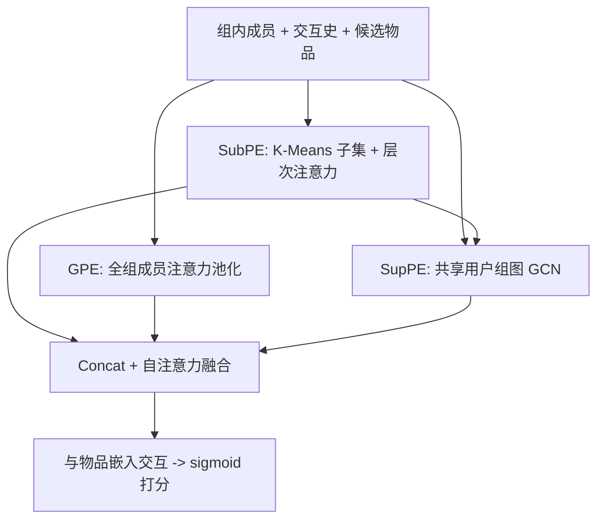
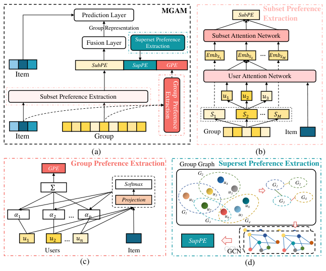

# Multi-Granularity Attention Model for Group Recommendation (群组推荐的多粒度注意力模型)

- **会议/期刊**: CIKM 2023
- **作者与机构**: Jianye Ji*, Jiayan Pei*, Shaochuan Lin*, Taotao Zhou, Hengxu He, Jia Jia, Ning Hu（阿里巴巴集团 / 饿了么）
- **推荐链路定位**: 精排（工业侧用于商品召回前的“选品”阶段）
- **研究方向**: 社交与群组推荐 / 图神经网络推荐
- **论文原文**: [https://arxiv.org/abs/2308.04017v1](https://arxiv.org/abs/2308.04017v1)
- **开源代码**: 暂未开源

## TL;DR (1分钟核心速览)

群组推荐的主流注意力聚合方法严重依赖“在候选物品上有丰富行为”的用户，对行为稀疏成员一律压低权重，导致个体兴趣学习不足且噪声放大。本文提出 MGAM，把群组偏好拆成 **子集（组内聚类）/ 群组（全成员）/ 超集（组-组共享用户图）** 三级粒度分别抽取再用自注意力动态融合，并叠加 triplet + pointwise 联合损失。在 Movielens-1M 与 Meetup 两城数据上 HR@5/NDCG@5 全面超越 GAME、GRADI 等 SOTA（Movielens HR@5 相对 AGREE +5.5%），饿了么线上 5 天 A/B 的 CTR 平均 +1.2%。

## Background & Motivation (背景与核心矛盾)

- **主流范式**: 从 NCF 的 AVG/LM/MS 静态聚合，到 AGREE、MoSAN、GAME、GRADI 等神经注意力动态加权成员，再到图方法引入组-用户二部图做高阶传播。
- **前人局限**: ①注意力权重由“该成员对候选物品的历史交互量”驱动，行为稀疏者在候选物品上无记录即被降权，但其在**其他物品**上的历史其实信息量很大（图 1 的 User A 例子）；②组-用户二部图只建模组内/组间连接，缺乏对“偏好相近成员子结构”的刻画，噪声成员直接污染组表征。
- **核心洞察 (Key Insight)**: 粒度本身就是一种去噪算子——先在组内按历史行为把成员划成若干偏好子集，让“对别的物品感兴趣”的证据通过子集内部聚合被激活，再向上聚合到组，可缓解对候选物品行为丰富度的依赖。
- **本文切入点**: 用子集（SubPE）+ 群组（GPE）+ 超集（SupPE）三视角并行编码，自注意力自适应选择粒度。

## Method (核心方法设计)

### 1. 整体框架 (Overall Architecture)

输入为组 $g_t$的成员集合、候选物品$v_j$与组-用户交互史。三条并行支路：SubPE 先 K-Means 把组内成员按交互向量聚成$M$个子集，经“用户注意力 + 子集注意力”两级层次聚合得到$h^{subpe}_{g_t}$；GPE 对全体成员做一次注意力池化得到$h^{gpe}_{g_t}$，保留用户原始表达；SupPE 以“共享用户即边”构建组图，用 GCN 在全局组图与批内组图上传播（批内图以 SubPE 嵌入为初始节点特征）得到$h^{suppe}_{g_t}$。三者拼接后经自注意力加权融合，与物品嵌入做 Hadamard 交互后过 sigmoid 打分，端到端以 triplet + pointwise 联合损失训练。

<figure class="paper-figure" markdown="span">
  <figcaption>图2：MGAM 概览（a）以及用于偏好提取的各子结构（b、c、d）。物品，并采用分层机制以缓解对在候选物品上具有丰富行为数据的用户的依赖。图1说明了子集级粒度在我们所提方法中的作用。此外，我们的方法利用群体偏好提取（GPE）模块创建独特的群体级偏好表示，该表示保留初始用户表达并辅助决策。为降低推荐噪声并更深入地理解群体表示</figcaption>
</figure>

### 2. 关键设计拆解 (Key Designs)

1. **子集粒度层次注意力（SubPE）**：针对“候选物品行为稀疏者被误降权”，先在子集内做用户注意力聚合 $h_s^i=\sum_{k\in s_i}\alpha_k e(u_k)$，$\alpha_k=\mathrm{softmax}\big(\phi(\mathbf{W}_u(e(u_k)^\top e(v_j))+b_u)\big)$；再用子集注意力比较“本子集 vs 其余子集”的一致性：$a_i=\mathbf{W}_s\phi(\mathbf{W}_i h_s^i+\mathbf{W}'_i\bar{h}_s^i+b_i)+b_s$，其中$\bar h_s^i$为除$s_i$外全部子集嵌入的拼接，最终$h^{subpe}_{g_t}=\sum_{i=1}^{M}\mathrm{softmax}(a_i)\,h_s^i$。直觉：子集内先“抱团”放大弱行为用户的证据，子集间再抑制离群噪声，避免单点稀疏直接决定权重。

2. **超集粒度组图（SupPE）**：针对“组间孤立、无法借用外部偏好”，以组为节点、共享用户为边建图，做对称归一化传播 $h^l_{gl}=\phi(\mathbf{D}_g^{-1/2}\mathbf{A}_g\mathbf{D}_g^{-1/2}h^{l-1}_{gl}\mathbf{W}^l_g)$；同时构建批内子图（$h^0_{bt}=h^{subpe}_{g_t}$）做同样传播，二者拼接$h^{suppe}_{g_t}=\mathrm{Concat}[h^l_{gl},h^l_{bt}]$。全局图提供跨组先验、批内图提供样本自适应修正，兼顾效果与显存效率。

3. **融合、损失与推理**：融合用缩放点积自注意力 $h^{fusion}=\mathrm{Softmax}(h_{g_t}h_{g_t}^\top/\sqrt{d})\,h_{g_t}$在三级粒度间自适应分配权重；预测$\hat y=\sigma(\mathbf{W}\,\mathrm{Concat}[h^{fusion},h^{fusion}\odot e(v_j),e(v_j)]+b)$。损失$\mathcal{L}=\mathcal{L}_{triplet}+\lambda_1\mathcal{L}_{point}$，其中$\mathcal{L}_{triplet}=\sum_{g_t}\big[\|\hat y-y^+_{g_t}\|_2^2-\|\hat y-y^-_{g_t}\|_2^2+\eta\big]_+$拉近正样本、推远负样本，$\mathcal{L}_{point}$为 BCE；$\lambda_1=0.5$、margin$\eta=1$、GCN 层数$l=2$。负样本按标签采样（同组不同标签物品），无额外难负例挖掘；线上推理只需一次前向，子集聚类离线完成。

## Experimental Setup & Evaluation Protocol (实验设置与评估协议)

- **数据集与预处理**:

| 数据集 | #Groups | #Users | #Items | 稀疏度/密度 | 特征/场景说明 |
| :--- | :---: | :---: | :---: | :---: | :--- |
| Movielens-1M | 1,854 | 2,032 | 3,952 | 极稀疏（组-物品交互为主） | 按 [2] 方式合成群组，电影评分转隐式 |
| Meetup-NYC | 7,134 | 16,284 | 3,071 | 稀疏 | 事件=组，参会者=成员，场地=物品 |
| Meetup-CA | 9,857 | 23,902 | 5,036 | 稀疏 | 同上，加州区域 |
| Industrial (饿了么) | 11,639 | 378,291 | 50,804,565 | 超大规模 | 7 天训练 + 1 天测试，按区域网格成组 |

- **数据划分与防穿越 (Splitting Strategy)**: 公开数据集沿用组推荐常规的组-物品交互划分（未显式声明 LOO 或时间切分，属复现细节缺失）；工业集严格按时间切分，前 7 天训练、第 8 天测试，无穿越。
- **排名评测协议 (Ranking Protocol)**: 采用 Top-K 排序指标 HR@5/10、NDCG@5/10；论文未披露候选集构造与负采样比例，无法判定是 Full-Ranking 还是 Sampled Ranking（评估透明度短板）。工业离线用 AUC，线上用 CTR。
- **对比基线与超参设置**: 3 个记忆式基线 NCF(AVG/LM/MS) + 5 个注意力基线 NeuMF、AGREE、MoSAN、GRADI、GAME；嵌入维度论文未明示，K-Means 子集数 $M$ 在 Movielens 取 3、Meetup 取 5（网格搜索），Adam lr=0.001，全部实验重复 10 次取均值（未报告显著性检验）。

## Key Experimental Results (实验关键数据)

### 1. 主实验对比 (Main Results)

| Model | ML HR@5 | ML HR@10 | ML N@5 | ML N@10 | NYC HR@5 | NYC N@5 | CA HR@5 | CA N@5 |
| :--- | :---: | :---: | :---: | :---: | :---: | :---: | :---: | :---: |
| NCF (AVG) | 0.3891 | 0.5886 | 0.3899 | 0.4561 | 0.5999 | 0.1135 | 0.6327 | 0.1257 |
| NeuMF | 0.4057 | 0.5940 | 0.4110 | 0.4702 | 0.2316 | 0.0400 | 0.2108 | 0.0328 |
| AGREE | 0.4224 | 0.6171 | 0.4121 | 0.4761 | 0.4972 | 0.0887 | 0.5873 | 0.1117 |
| MoSAN | 0.4032 | 0.6000 | 0.4012 | 0.4659 | 0.6203 | 0.1166 | 0.6471 | 0.1281 |
| GRADI | 0.3503 | 0.5292 | 0.3468 | 0.4064 | 0.7482 | 0.1714 | 0.7300 | 0.1735 |
| GAME | 0.3858 | 0.5554 | 0.3909 | 0.4447 | 0.7679 | 0.1808 | 0.7378 | 0.1787 |
| **MGAM** | **0.4458** | **0.6335** | **0.4403** | **0.5015** | **0.7741** | **0.1835** | **0.7460** | **0.1790** |
| Improv.% (vs 最优基线) | +5.54% | +2.66% | +6.84% | +5.33% | +0.81% | +1.49% | +1.11% | +0.17% |

工业集：离线 AUC 0.6880 vs AGREE 0.6570；线上 5 天 A/B 的 CTR 平均 **+1.2%**。

### 2. 消融实验 (Ablation Study)

| 变体 | ML HR@5 | ML N@5 | NYC HR@5 | NYC N@5 | CA HR@5 | CA N@5 |
| :--- | :---: | :---: | :---: | :---: | :---: | :---: |
| w/o SubPE | 0.3939 | 0.3865 | 0.7551 | 0.1776 | 0.7357 | 0.1764 |
| w/o GPE | 0.4131 | 0.4124 | 0.7710 | 0.1826 | 0.7432 | 0.1761 |
| w/o SupPE | 0.4413 | 0.4401 | 0.7626 | 0.1798 | 0.7236 | 0.1748 |
| MGAM w/ Spectral | 0.4348 | 0.4289 | 0.7580 | 0.1783 | 0.7410 | 0.1782 |
| MGAM w/ Agglomerative | 0.4112 | 0.4028 | 0.7536 | 0.1781 | 0.7391 | 0.1772 |
| **MGAM (K-Means)** | **0.4458** | **0.4403** | **0.7741** | **0.1835** | **0.7460** | **0.1790** |

### 3. 关键实验发现 (Key Findings)

1. **子集粒度是收益主引擎**：去掉 SubPE 在 Movielens 上 HR@5 从 0.4458 掉到 0.3939（−11.6%），降幅约为去掉 GPE（−7.3%）与去掉 SupPE（−1.0%）的数倍，证明“组内再分组”才是缓解稀疏成员被误降权的关键，而全局组图只是边际补强。
2. **粒度收益随数据规模收缩但稳定**：Movielens 上相对最优基线 N@5 提升 +6.84%，而 Meetup-CA 仅 +0.17%，说明当组-物品交互本身足够稠密（CA 组数 9,857、物品 5,036）时多粒度去噪的边际价值下降；但线上饿了么超大规模场景仍拿到 +1.2% CTR，说明工业侧噪声更重、收益更实。
3. **聚类算子选择敏感**：K-Means 明显优于 Agglomerative（ML HR@5 0.4458 vs 0.4112，−7.8%）与 Spectral（0.4348），且子集数 $M$需按数据集调（ML 最优 3、Meetup 最优 5），$M$ 过大导致子集内成员过少、注意力退化为个体建模——这是模型最主要的超参风险点。

## Highlights & Limitations (亮点、对比与审稿批判)

- **与代表作对比 (vs. Prior Work)**: 相较 AGREE/MoSAN 仅在“成员-候选物品”层面做单层注意力，MGAM 增加了组内子集这一中间结构；相较 GAME/GRADI 用组-用户二部图做高阶传播，MGAM 的组图以“共享用户”为边刻画组-组关系，并以批内子图做样本级修正，二者互补而非替代（消融显示 SupPE 贡献最小）。
- **可迁移亮点**: ①“先聚类再层次注意力”的子集构造可直接迁移到会话推荐的多兴趣建模与多场景推荐的场景内用户分群；②全局图 + 批内图双通道 GCN 是控制大图显存开销的通用工程技巧。
- **审稿级局限批判**: ①评估协议披露不足——未说明候选集规模、负采样比例与是否 Full-Ranking，且仅报告 10 次均值而无显著性检验，跨模型 0.1% 级差异（如 Meetup-CA N@5 +0.17%）说服力有限；②子集数 $M$与聚类算法强依赖数据集且需网格搜索，工业上线需为每个区域网格重新调参；③SupPE 的全局组图在组数增长时邻接矩阵存储与传播开销随$O(|\mathcal{G}|^2)$ 潜在膨胀，论文未给出复杂度或时延分析。

## Rating (四维评分)

- **方法创新性 (Novelty)**: ⭐⭐⭐ （“子集粒度”直觉清晰且有图 1 的示例支撑，但本质是 K-Means + 层次注意力的组合式创新，缺少理论或谱域分析）
- **评估协议与实验扎实度 (Protocol & Experiments)**: ⭐⭐⭐ （三个公开集 + 大规模工业集 + 线上 A/B 较完整，但划分/候选集协议与显著性检验披露不足，消融未报告方差）
- **写作与数学规范度 (Clarity & Rigor)**: ⭐⭐⭐⭐ （三级粒度公式与张量维度交代清楚、模块边界明确，但符号重复使用 $\mathbf{W}_i/\mathbf{W}'_i$ 等略有歧义，缺复杂度分析）
- **工业落地与复现价值 (Industrial & Practical Value)**: ⭐⭐⭐⭐ （饿了么真实场景 +1.2% CTR 验证有效，子集聚类可离线预计算、推理仅一次前向，但代码未开源且超参需逐场景调优）

