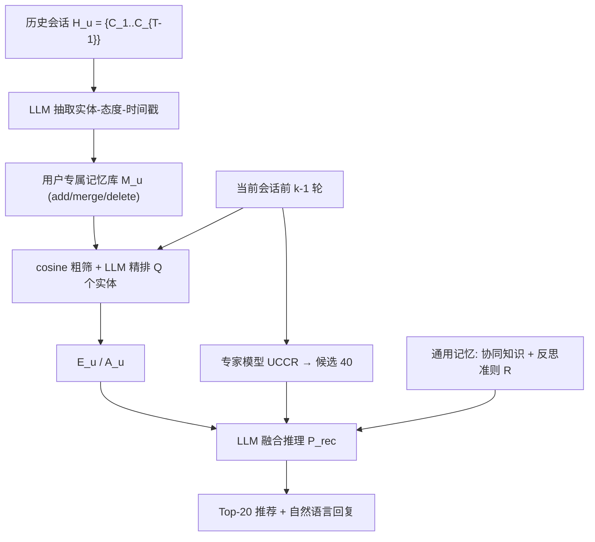
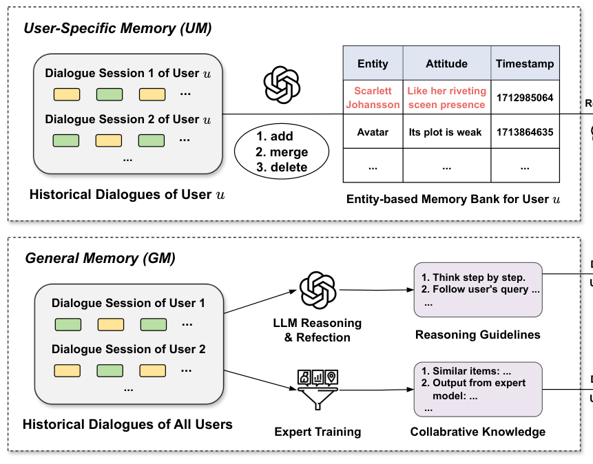

# MemoCRS: Memory-enhanced Sequential Conversational Recommender Systems with Large Language Models（记忆增强的序列对话推荐系统）

- **会议/期刊**: CIKM 2024
- **作者与机构**: Yunjia Xi, Weiwen Liu, Jianghao Lin, Bo Chen, Ruiming Tang, Weinan Zhang, Yong Yu（上海交通大学 & 华为诺亚方舟实验室）
- **推荐链路定位**: 端到端生成式（专家模型给候选 → LLM 重排 + 回复生成）
- **研究方向**: 对话推荐与智能体仿真 / 大语言模型推荐
- **论文原文**: [论文原文链接](https://arxiv.org/abs/2407.04960v1)
- **开源代码**: [mindspore-lab/models/memocrs](https://github.com/mindspore-lab/models/tree/master/research/huawei-noah/memocrs)（数据集 [TG-ReDial](https://github.com/RUCAIBox/TG-ReDial)）

## TL;DR (1分钟核心速览)

现有对话推荐（CRS）只挖当前会话，忽略用户跨会话的**偏好连续性**；而直接拼接历史会话又带来冗余噪声、超上下文窗口与冷启动失效。MemoCRS 提出两层可更新文本记忆：**用户专属的实体记忆库**（实体→态度+时间戳，支持 add/merge/delete，两阶段检索去噪）与**通用记忆**（专家模型协同知识 + LLM 反思推理准则），共同注入 GPT-4 的推荐 prompt。在 TGReDial/ReDial 按时间序重划分、全库排序协议下，MRR@20 相对最强基线提升 23.7%/38.5%。

## Background & Motivation (背景与核心矛盾)

- **主流范式**: CRS 采用「推荐器 + 生成器」双组件，靠复杂对话编码器、知识图谱（KBRD/KGSF）或统一 prompt（UniCRS）提升当前会话理解。
- **前人局限**: ①几乎所有方法只看当前 session 的对话理解，忽略历史 session 中的偏好证据（连续性与序列性）；②少数用历史的（UCCR）把整段历史会话直接编码，冗余、噪声大且不可扩展；③零样本 LLM 推荐（ZSCRS）缺乏协同信号，在中文小众电影数据上甚至崩到 HR@20=0.0100。
- **核心洞察 (Key Insight)**: 用户偏好具**连续性**——历史里「喜欢斯嘉丽·约翰逊」+ 当前「想看科幻」应推出《Her》；但历史偏好是多面的，只有与当前诉求相关的那部分才是信号，其余是噪声。
- **本文切入点**: 把历史会话压缩为**实体级**可检索文本记忆（而非整段对话），再用跨用户共享的通用记忆补足协同知识与冷启动。

## Method (核心方法设计)

### 1. 整体框架 (Overall Architecture)

每轮对话请求到来时，系统并行走三条通路：①用 LLM 离线把每个历史 session 抽取为 $(e_i,a_i)$实体-态度对写入用户记忆库$M_u$；②对当前会话前$k-1$轮，先用向量相似度粗筛候选实体，再由 LLM 精排出$Q$个最相关实体并读回对应态度$(E_u,A_u)$；③专家模型（UCCR）基于当前会话给出 40 个协同候选$\hat{I}_k$，通用记忆提供推理准则集$R$。三者与当前上下文拼入 prompt$P_{rec}$，由 GPT-4 输出 20 条推荐与自然语言回复，并按用户反馈反思更新$R$。全流程**免训练**、纯推理。

<figure class="paper-figure" markdown="span">
  <figcaption>图2：MemoCRS的整体框架。</figcaption>
</figure>

### 2. 关键设计拆解 (Key Designs)

1. **实体化记忆库（压缩与去冗余）**：痛点是整段历史会话 token 冗长（ReDial 每用户 7154 token）且噪声多。本文把记忆建模为字典键值结构，实体（片名/演员/导演/类型）作 key，态度与时间戳作 value：$M_u=\{e_i \to (a_i, t_i)\}_{i=1}^{|M_u|}$。LLM 在每个 session 结束后执行 add（Eq.2 抽取实体-态度对），冲突时执行 merge$a_i^{*}=f_{\text{LLM}}(a_i,\hat{a}_i,P_{merge})$（新态度优先），容量受限时按时间戳 rule-based delete。以「实体为线索」的存储贴合人类记忆的线索式回忆，既压缩又可直接按实体检索。
2. **两阶段记忆检索（降噪）**：全量记忆会污染决策。先做 cosine 粗筛得候选集 $\hat{E}_u$，再由 LLM 结合当前会话精排：$E_u=f_{\text{LLM}}(\hat{E}_u,\{s_j\}_{j=1}^{k-1},P_{retrieve})$，随后$A_u=\text{Read}(M_u,E_u)$。直觉：向量召回快但语义粗，LLM 判断相关性准但扛不住大候选集，二者级联互补。
3. **通用记忆与融合推理**：协同知识由外部专家模型给出 $\hat{I}_k=g(\{s_j\},\{I_j\})$，避免训练 LLM 的高成本；推理准则$R$由 LLM 对自身推理轨迹$t$与用户反馈$o$反思更新$R \leftarrow f_{\text{LLM}}(t,o,R,P_{reflect})$。最终$\tilde{I}_k=f_{\text{LLM}}(\{s_j\},E_u,A_u,\hat{I}_k,R,P_{rec})$。**训练目标**：无参数训练、无负采样，GPT-4 temperature=0；推理开销为每轮 1 次检索调用 + 1 次推荐调用，$Q=3$（TGReDial）/$1$（ReDial）。

## Experimental Setup & Evaluation Protocol (实验设置与评估协议)

| 数据集 | #Users | #Items | #Utterances | 稀疏度/密度 | 特征/场景说明 |
| :--- | :---: | :---: | :---: | :---: | :--- |
| TGReDial (中文) | 1,482 | 33,834 | 129,392（10,000 sessions） | 极稀疏，多为小众电影 | 半自动 topic-guided 构建 |
| ReDial (英文) | 504 | 51,699 | 182,150（10,006 dialogues） | 极稀疏 | AMT 众包人工对话 |

- **数据划分与防穿越**: 按 **全局时间戳/会话时序切分**（区别于 CRSLab 原始随机划分），每个用户最后若干 session 作 valid/test，其余为 train；并过滤含重复物品的对话以消除「抄上一轮提到物品」的捷径。ReDial 中训练集无 session 的用户构成**冷启动组**（Cold）。
- **排名评测协议**: `Full-Ranking` 全库未交互物品排序（CRSLab 标准实现，专家模型输出 40 候选、LLM 终排 20 条），指标 HR/NDCG/MRR@{5,10,20}；对话生成采用 3 名标注者 0–2 分人工评测（Fluency / Informativeness）。
- **对比基线**: ReDial、KBRD、KGSF、TGReDial、UniCRS、UCCR、ZSCRS（GPT-4 零样本）；LLM 骨干统一 GPT-4 (gpt-4-1106-preview)，显著性检验 $p<0.01$。

## Key Experimental Results (实验关键数据)

### 1. 主实验对比 (Main Results)

| Model | TGReDial HR@5 | TGReDial HR@20 | TGReDial MRR@20 | TGReDial NDCG@20 | ReDial HR@5 | ReDial HR@20 | ReDial MRR@20 | ReDial NDCG@20 |
| :--- | :---: | :---: | :---: | :---: | :---: | :---: | :---: | :---: |
| ReDial | 0.0030 | 0.0102 | 0.0021 | 0.0038 | 0.0293 | 0.0882 | 0.0223 | 0.0361 |
| KBRD | 0.0050 | 0.0174 | 0.0040 | 0.0069 | 0.0824 | 0.2185 | 0.0470 | 0.0842 |
| KGSF | 0.0112 | 0.0249 | 0.0051 | 0.0094 | 0.0908 | 0.2319 | 0.0508 | 0.0898 |
| UniCRS | 0.0050 | 0.0236 | 0.0042 | 0.0083 | 0.1005 | 0.2480 | 0.0528 | 0.0952 |
| UCCR | 0.0087 | 0.0286 | 0.0090 | 0.0131 | 0.1059 | 0.2672 | 0.0596 | 0.1047 |
| ZSCRS (GPT-4 zero-shot) | 0.0025 | 0.0100 | 0.0017 | 0.0035 | 0.1261 | 0.2353 | 0.0629 | 0.1018 |
| **MemoCRS** | **0.0162** | **0.0323** | **0.0112** | **0.0158** | **0.1361** | **0.2857** | **0.0871** | **0.1308** |
| Improv. vs 最强基线 | +86.2% | +13.0% | +23.7% | +20.4% | +7.9% | +6.9% | +38.5% | +25.0% |

### 2. 消融实验 (Ablation Study)

| 变体 | TGReDial HR@20 | TGReDial MRR@20 | TGReDial NDCG@20 | ReDial HR@20 | ReDial MRR@20 | ReDial NDCG@20 |
| :--- | :---: | :---: | :---: | :---: | :---: | :---: |
| MemoCRS | **0.0323** | **0.0112** | **0.0158** | 0.2857 | **0.0871** | **0.1308** |
| w/o UM（去用户记忆） | 0.0299 | 0.0084 | 0.0131 | 0.2807 | 0.0789 | 0.1228 |
| w/o CK（去协同知识） | 0.0124 | 0.0063 | 0.0076 | 0.2319 | 0.0730 | 0.1072 |
| w/o RG（去反思准则） | 0.0274 | 0.0068 | 0.0114 | **0.2924** | 0.0676 | 0.1164 |
| Manual RG（改人工准则） | 0.0311 | 0.0075 | 0.0126 | 0.2807 | 0.0706 | 0.1176 |

### 3. 关键实验发现 (Key Findings)

1. **协同知识是最大单点贡献**：去掉 CK 后 TGReDial HR@20 由 0.0323 暴跌至 0.0124（−61.6%），远超去 UM（−7.4%）与去 RG（−15.2%）。这说明纯文本记忆无法替代跨用户协同信号，LLM 对整体数据分布无感知，必须外挂专家模型。
2. **检索必须做，且要 LLM 精排**：记忆 token 从「全部历史对话」1781.89/7154.07 压缩到「全量 UM」1026.98/1526.51，再经两阶段检索降至 **21.41/50.27**（ReDial 压缩约 142 倍）；性能排序为 All < Rand < Sim < Ours，直接喂全部记忆反而最差，证明噪声主导而非长度主导。
3. **通用记忆专治冷启动**：ReDial 冷用户组上 MemoCRS-GM（去通用记忆）HR@1 低于 UCCR，补回 GM 后反超；暖用户组提升幅度明显小于冷用户组，说明 GM 的价值主要在于为无历史的用户提供先验。此外 LLM 自反思准则优于人工准则（ReDial NDCG@20 0.1308 vs 0.1176），因为反思出的经验更贴合模型自身推理风格。

## Highlights & Limitations (亮点、对比与审稿批判)

- **与代表作对比 (vs. Prior Work)**: 相对 UCCR（把历史会话整体编码进小模型），MemoCRS 把历史压到实体粒度并由 LLM 语义检索，规模化与可解释性都更好；相对 ZSCRS（纯零样本、无记忆），它补上个性化与协同两张牌——ReDial 上 HR@5 从 0.1261 升至 0.1361，而 ZSCRS 在中文 TGReDial 上几乎失效；相对 MemoryBank 类通用 agent 记忆，本文明确区分**个性化记忆**与**推荐任务特有的协同记忆**。
- **可迁移亮点**: ①「实体为 key + 态度/时间戳为 value」的轻量记忆 schema，可直接搬到时序推荐与用户画像沉淀；②「向量粗筛 + LLM 精排」的级联检索范式，成本可控且显著降噪。
- **审稿级局限批判**: ①完全依赖 GPT-4 闭源推理，每轮至少 2 次 LLM 调用、且记忆抽取错误会沿 merge 链累积污染，线上时延与成本未量化；②评估只在两个电影域数据集、仅 20 条候选做终排，缺少更大规模候选池与显著性波动的报告；③ReDial 上 w/o RG 的 HR@20 反而更高（0.2924），说明反思准则对召回宽度有副作用，机制收益并非单调。

## Rating (四维评分)

- **方法创新性 (Novelty)**: ⭐⭐⭐⭐ （首次把记忆增强 LLM 引入序列 CRS，实体级记忆 schema 与双层通用/专属记忆划分清晰，但组件多为已有范式的组合）
- **评估协议与实验扎实度 (Protocol & Experiments)**: ⭐⭐⭐⭐ （时序重划分 + 去重复捷径 + 冷/暖用户分组 + 记忆 token 效率分析到位，但仅两数据集、单一 LLM 骨干）
- **写作与数学规范度 (Clarity & Rigor)**: ⭐⭐⭐⭐ （任务形式化与 prompt 设计交代详尽，但公式多为 LLM 调用的黑箱映射，缺乏复杂度与误差传播分析）
- **工业落地与复现价值 (Industrial & Practical Value)**: ⭐⭐⭐ （框架 model-agnostic 且免训练、代码开源，但依赖商用 LLM 的成本与时延是落地主要门槛）

