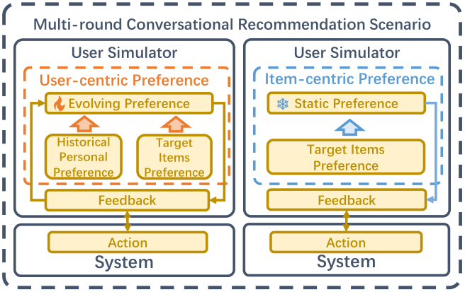
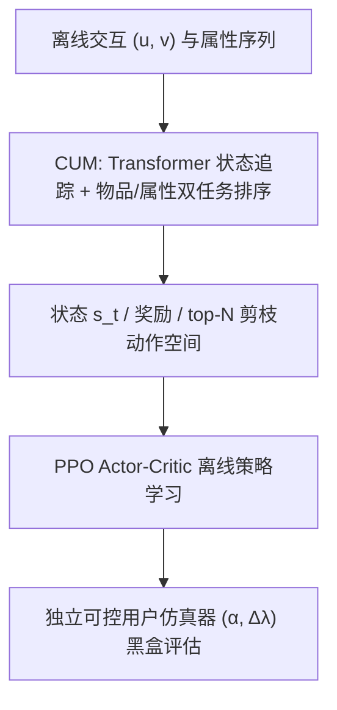
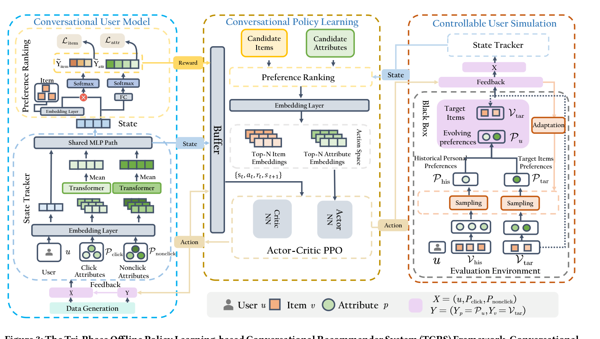

# Reformulating Conversational Recommender Systems as Tri-Phase Offline Policy Learning (将对话推荐系统重构为三阶段离线策略学习)

- **会议/期刊**: CIKM 2024
- **作者与机构**: Gangyi Zhang, Chongming Gao, Hang Pan, Runzhe Teng, Ruizhe Li（中国科学技术大学）
- **推荐链路定位**: 端到端对话策略（多轮交互决策）
- **研究方向**: 对话推荐与智能体仿真 / 强化学习与动态探索推荐
- **论文原文**: [https://arxiv.org/abs/2408.06809v2](https://arxiv.org/abs/2408.06809v2)
- **开源代码**: 暂未开源

## TL;DR（1 分钟核心速览）

多轮对话推荐（MCR）长期用同一个用户模拟器既训练又评估策略，导致**评估规则泄漏进训练**并诱发过拟合；同时模拟器只按目标物品属性生成反馈，无视用户历史上不断演化的个人偏好。TCRS 把 CRS 重构为三阶段离线流程：先训练对话用户模型（CUM）刻画动态偏好，再将其作为模拟环境用 PPO 学策略，最后用**独立且可控**的用户仿真器（个性化参数 $\alpha$与演化速率$\Delta\lambda$）做黑盒评估。在 LastFM/Yelp/Amazon-Book 上，SR@15 分别达 0.670/0.415/0.429，平均轮次 AT 同步降至 7.58/11.62/10.26，显著优于 VPPL 等 SOTA。

## Background & Motivation（背景与核心矛盾）

- **主流范式**: 策略优化型 CRS（EAR、SCPR、UNICORN、MCMIPL、VPPL）用强化学习在多轮交互中决定「问属性」还是「推物品」，训练与测试都依赖规则型用户模拟器产生 accept/reject 反馈。
- **局限一：评估泄漏**。训练与评估共用同一模拟器，策略在训练中即显式或隐式地利用评估规则，与理想离线策略学习「策略不可与环境交互」的前提相悖，导致模拟环境得分虚高、上线即崩。
- **局限二：物品中心偏好的还原论**。现有模拟器把用户偏好等同于目标物品的属性集合，同一物品对不同用户只产出同一反馈，忽略了「有人喜欢剧情、有人喜欢特效」的个性化差异，也无法刻画对话过程中偏好的漂移。
- **核心洞察**: 用户当前偏好应是**目标物品偏好**与**历史个人偏好**的双因子动态构造，且随交互轮次持续演化——α=0 即退化为传统物品中心模型，α=1 为纯个性化模型。
- **本文切入点**: 把「谁训练、谁评估」彻底拆开：CUM 只负责建模与提供模拟环境，评估交给参数可控的独立仿真器。

<figure class="paper-figure" markdown="span">
  <figcaption>图 2：多轮对话推荐场景中以用户为中心与以物品为中心的偏好建模</figcaption>
</figure>

## Method (核心方法设计)

### 1. 整体框架 (Overall Architecture)

TCRS 由三段串联构成：(1) **CUM 训练**——从离线 $(u,v)$交互中构造监督样本$X=(u,P_{\text{click}},P_{\text{nonclick}})$、$Y=(P_u,v)$，用 Transformer 编码点击/未点击属性序列并输出共享偏好状态$s$，由 Preference Ranking 联合预测物品与属性；(2) **策略学习**——以$s_t$为状态、以 CUM 排序分作为奖励、以 top-N 剪枝后的动作空间做 PPO 优化，完全在离线数据上完成；(3) **可控仿真评估**——用与训练无关的规则型双因子模拟器作为黑盒，扫描$\alpha$与$\Delta\lambda$ 检验策略适应性。

<figure class="paper-figure" markdown="span">
  <figcaption>图 3：基于三阶段离线策略学习的对话推荐系统（TCRS）框架。首先在离线数据上训练对话用户模型（CUM），以刻画动态且个性化的用户偏好。随后，学习到的用户模型作为策略学习的模拟环境，优化推荐策略以最大化长期用户满意度。最后，使用可适应多样用户偏好场景的独立可控用户模拟器评估训练后的策略，从而全面评估策略的适应性。</figcaption>
</figure>

### 2. 关键设计拆解 (Key Designs)

1. **共享偏好状态的物品-属性联合排序（CUM）**：前人要么只建模物品相关性（图策略方法建模动态图），要么把属性当作独立标签，物品与属性偏好割裂导致动作空间剪枝失真。TCRS 用同一编码器产出 $s=\mathrm{MLP}(\mathrm{Concat}(u,\mathrm{Mean}(h_{\text{click}}),\mathrm{Mean}(h_{\text{nonclick}})))$，物品端$f_{\text{item}}=\sigma(s^{\top}\mathrm{Embed}(V_{\text{cand}}))$，属性端$f_{\text{attr}}=\sigma(sW_{\text{attr}}+b_{\text{attr}})$，总损失$\mathcal{L}=\lambda\mathcal{L}_{\text{item}}+(1-\lambda)\mathcal{L}_{\text{attr}}$（$\lambda=0.8$，双端均为 BCE）。直觉：物品可比性天然要求属性可比性，联合监督把「用户为什么点」这一语义注入向量，使 top-N 动作空间既可探索又高召回。

2. **CUM 驱动的动作空间剪枝与偏好奖励**：MCR 的动作空间是「全部物品 ∪ 全部属性」，直接 RL 探索不可行。TCRS 令 $\mathcal{A}_t=\mathcal{V}^{(t)}_{\text{top-}N}\cup\mathcal{P}^{(t)}_{\text{top-}N}$（每轮 10 物品 + 10 属性），奖励取这些动作的排序分累计$\sum \text{PreferenceRanking}(s_t,\mathcal{A}_t)$，并对每轮加$-1$ 轮次惩罚。这样把 CUM 从「打分器」升级为「可微环境代理」，策略只需在少量高价值候选中学会何时问、何时推。

3. **可控双因子用户仿真（训练/评估解耦的关键）**：偏好由历史个人偏好与目标物品偏好按 $\alpha$加权初始化（默认 0.5），每轮依点击占优与否以$\Delta\lambda=0.1$增减$\alpha$——点得多则更贴近目标物品，点得少则回退到个人历史。采样侧对历史偏好用频率采样、对目标偏好用逆频率采样：前者锁定稳定口味，后者逼迫系统探索冷门属性，从而避免策略只学会「复述流行 tag」。

## Experimental Setup & Evaluation Protocol (实验设置与评估协议)

- **数据集与预处理**:

| 数据集 | #Users | #Items | #Interactions | #Attributes | 过滤与特征说明 |
| :--- | :---: | :---: | :---: | :---: | :--- |
| LastFM | 1,801 | 7,432 | 76,693 | 8,438 | 5-core；属性来自用户 tag，平均 12.71 属性/物品 |
| Yelp | 27,675 | 70,311 | 1,368,609 | 590 | 5-core；属性为 city/价格/类目，平均 808 物品/属性 |
| Amazon-Book | 30,288 | 17,739 | 477,304 | 982 | 10-core；属性来自知识图谱 |

- **数据划分与防穿越**: 交互按 **7:1.5:1.5 比例划分**训练/验证/测试；CUM 仅用训练集预训练，PPO 用训练集与验证集，测试集目标物品只交给独立仿真器作黑盒，不作为训练信号流入策略。
- **对话评测协议**: 非传统 Full-Ranking 排序，而是**多轮模拟成功率**——仿真器以 $(u,V_{\text{his}},V_{\text{tar}})$ 初始化，上限 15 轮、每轮最多 2 次属性询问与 10 个物品推荐；指标为 **SR@T**（T∈{5,10,15} 轮内命中目标物品比例）与 **AT**（平均消耗轮次，越低越好）。所有基线（含自带模拟器者）统一在该用户中心仿真器下重测，保证评测一致性。
- **超参**: 嵌入/隐层维度 64，Transformer 4 层，batch 512，学习率 1e-3（Adam），物品负采样 2000；PPO 批大小 2048、学习率 3e-4、折扣 0.99、熵系数 0.01、clip $\epsilon=0.5$。

## Key Experimental Results (实验关键数据)

### 1. 主实验对比 (Main Results)

| Models | LastFM SR@15 | LastFM AT | Yelp SR@15 | Yelp AT | Book SR@15 | Book AT |
| :--- | :---: | :---: | :---: | :---: | :---: | :---: |
| EAR | 0.405 | 11.35 | 0.229 | 13.08 | 0.251 | 12.76 |
| SCPR | 0.578 | 9.04 | 0.262 | 12.70 | 0.354 | 11.53 |
| UNICORN | 0.618 | 8.78 | 0.288 | 12.50 | 0.426 | 10.88 |
| MCMIPL | 0.574 | 9.06 | 0.316 | 12.23 | 0.414 | 10.96 |
| VPPL | 0.620 | 8.83 | 0.390 | 12.29 | 0.426 | 10.87 |
| Abs Greedy (CUM) | 0.660 | 8.14 | 0.200 | 13.41 | 0.381 | 10.47 |
| Max Entropy (CUM) | 0.522 | 9.46 | 0.293 | 13.15 | 0.397 | 11.22 |
| **TCRS** | **0.670** | **7.58** | **0.415** | **11.62** | **0.429** | **10.26** |
| Improv. vs best baseline | +8.1% | −14.2% | +6.4% | −5.5% | +0.7% | −5.6% |

### 2. 消融实验 (Ablation Study)

| 变体 | LastFM SR@15 / AT | Yelp SR@15 / AT | Book SR@15 / AT |
| :--- | :---: | :---: | :---: |
| Ours (Full) | **0.670** / **7.58** | **0.415** / **11.62** | **0.429** / **10.26** |
| (a) w/o CUM-Item | 0.682 / 8.15 | 0.257 / 12.43 | 0.349 / 11.37 |
| (b) w/o CUM-Attr | 0.598 / 8.89 | 0.224 / 13.12 | 0.360 / 11.27 |
| (c) w/o CUM-Both | 0.690 / 8.23 | 0.313 / 12.32 | 0.393 / 11.03 |
| (d) 历史偏好随机采样 | 0.630 / 8.48 | 0.321 / 12.63 | 0.405 / 10.73 |
| (e) 目标偏好随机采样 | 0.646 / 8.42 | 0.365 / 12.47 | 0.401 / 10.68 |
| (f) 目标偏好频率采样 | 0.666 / 7.88 | 0.393 / 12.32 | 0.421 / 10.65 |

### 3. 关键实验发现 (Key Findings)

1. **双任务联合建模在稀疏大库上收益最大**：Yelp 上去掉物品端排序 SR@15 从 0.415 崩至 0.257（−38%），去掉属性端降至 0.224，说明 70K 物品 + 590 属性的场景下，仅靠属性或仅靠物品都无法构造可靠的动作空间；而 Amazon-Book 上属性端贡献更明显（0.360 vs 0.349），印证属性粒度决定剪枝质量。
2. **LastFM 出现「成功率悖论」**：去掉 CUM 任一端后 SR@15 反而升到 0.682/0.690，但 AT 从 7.58 涨到 8.15/8.23，说明小库上模型倾向用更多轮次换命中率；TCRS 的真实优势是**效率**而非绝对成功率，AT 才是更敏感的判别指标。
3. **采样策略需「历史频率 + 目标逆频率」互补**：历史侧改随机采样使 Yelp AT 上升 1.01 轮，目标侧改随机采样使 SR@15 掉 0.05，验证「锁定稳定口味 + 逼迫探索冷门属性」的双向设计是必要的；而目标侧改用频率采样 (f) 在 LastFM 上不输（0.666），说明泛化与个性化的权衡取决于数据属性密度。
4. **鲁棒性**：随个性化参数 $\alpha$增大（更依赖静态偏好），Yelp/Books 性能下降而 LastFM 基本平稳；提高演化速率$\Delta\lambda$ 后 SR 波动极小，说明策略能跟上偏好漂移而不过度震荡。

## Highlights & Limitations (亮点、对比与审稿批判)

- **与代表作对比**: 相比 UNICORN/MCMIPL 仅用动态图建模物品侧状态，TCRS 显式把属性偏好纳入共享状态并用作动作空间剪枝；相比 VPPL 的「模糊偏好」假设仍在同一物品中心模拟器内闭环，TCRS 的判别性差异在于**训练模拟器与评估仿真器彻底分离**，这正是其 AT 全面领先（Yelp 11.62 vs 12.29）的根源。
- **可迁移亮点**: (1) 用「偏好排序分」当稠密奖励、用 top-N 剪枝把巨大动作空间压缩到可探索规模，这套做法可直接迁移到电商导购或搜索澄清式查询的 RL 建模；(2) 双因子加权 + 步长演化的可控仿真器，为任何交互式系统的鲁棒性压力测试提供了低成本基准工具。
- **审稿级局限批判**: (1) 最终评估仍依赖**规则型**仿真器，其演化逻辑（点击占优即降 $\alpha$ 等）本身是人为假设，论文亦承认难以模拟真实行为，因此「更真实评估」仍是相对的；(2) 三阶段流水线需先训 CUM 再训 PPO，且 PPO 跑 1e5 epoch、每轮动作空间 20 候选，相较 Abs Greedy 的推理开销与工程复杂度显著更高，论文未给出时延或在线 A/B 证据。

## Rating (四维评分)

- **方法创新性 (Novelty)**: ⭐⭐⭐⭐ （三阶段解耦是范式级重述而非模块微调，双因子可控仿真器刻画偏好演化有新意，但各模块技术均为成熟组件拼装）
- **评估协议与实验扎实度 (Protocol & Experiments)**: ⭐⭐⭐⭐ （三数据集、8 个基线统一重测、消融 + $\alpha$/$\Delta\lambda$ 鲁棒性扫描齐全；但缺少真实用户或线上验证，成败仍由规则仿真器定义）
- **写作与数学规范度 (Clarity & Rigor)**: ⭐⭐⭐⭐ （框架图与三阶段分工表述清晰、公式简洁可复现；PPO 与奖励设计偏工程化，缺收敛性与复杂度分析）
- **工业落地与复现价值 (Industrial & Practical Value)**: ⭐⭐⭐ （离线训练规避实时交互成本、剪枝策略实用，但未开源、依赖自建仿真器闭环，跨域迁移需重训 CUM）

