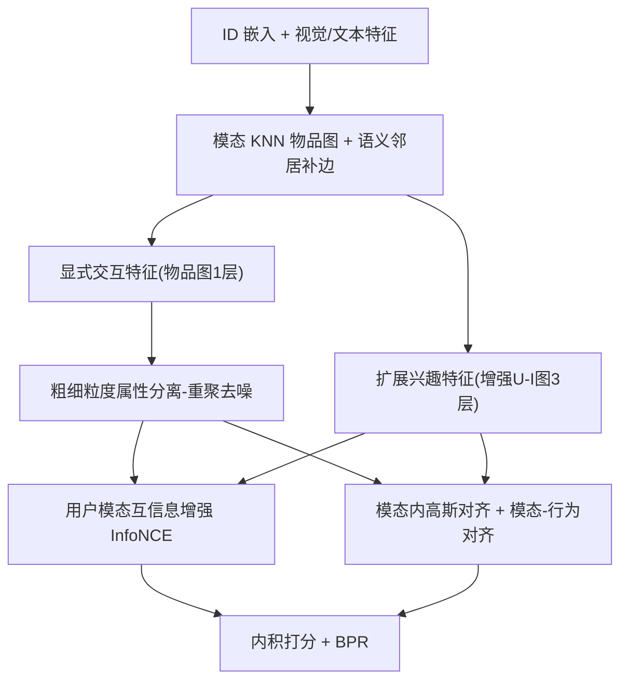
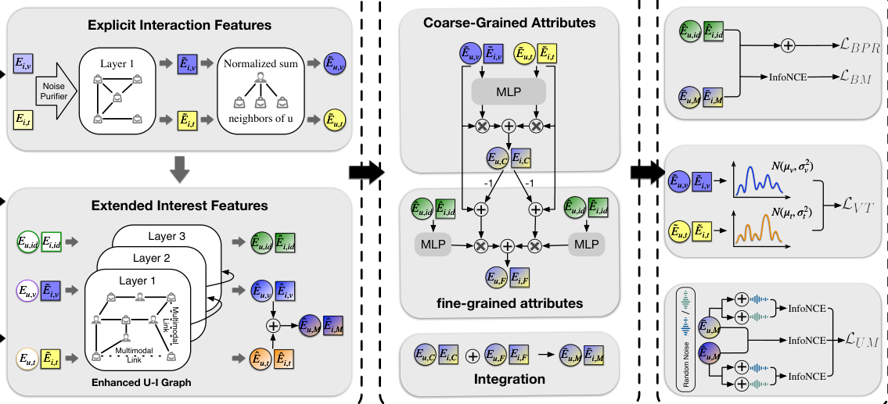
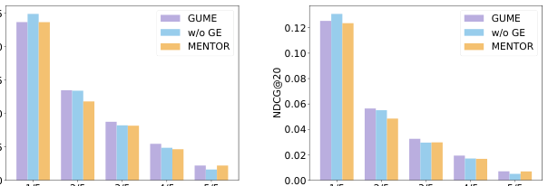

# GUME: Graphs and User Modalities Enhancement for Long-Tail Multimodal Recommendation (图与用户模态增强的长尾多模态推荐)

- **会议/期刊**: CIKM 2024
- **作者与机构**: Guojiao Lin, Zhen Meng, Dongjie Wang, Qingqing Long, Yuanchun Zhou, Meng Xiao（中科院计算机网络信息中心 / 国科大 / University of Kansas）
- **推荐链路定位**: 召回（用户-物品表示学习与 Top-N 排序）
- **研究方向**: 冷启动与长尾推荐 / 多模态推荐
- **论文原文**: [https://arxiv.org/abs/2407.12338v1](https://arxiv.org/abs/2407.12338v1)
- **开源代码**: 论文声明代码已在 GitHub 公开，但全文未给出可核验链接，暂视为暂未开源

## TL;DR (1分钟核心速览)

长尾物品交互稀疏，图传播时拿不到足量邻居信息；同时现有多模态推荐几乎只精雕物品模态，用户模态仍是"交互物品特征简单平均"或"自定义嵌入"两种粗放做法。GUME 用模态 KNN 语义邻居为用户-物品图补边提升长尾连通性，再把用户模态拆成显式交互特征与扩展兴趣特征并最大化二者互信息，辅以模态内（视觉-文本高斯对齐）与模态-行为（ID-模态 InfoNCE）双路去噪。在 Amazon 四域 **8:1:1 随机划分 + 全库排序** 协议下，Recall@20 相对最强基线 MENTOR 最高提升 **3.82%**（Electronics），NDCG@20 最高提升 **5.67%**（Clothing）。

## Background & Motivation (背景与核心矛盾)

- **主流范式**: MMRS 以 VBPR 起家，经 MMGCN/SLMRec/LATTICE/BM3/MGCN 演化到 MENTOR——用模态物品图 + 自监督对齐把图像文本注入 GCN 协同过滤。
- **前人局限一**: LATTICE/MICRO 动态学物品隐结构、MENTOR 冻结模态同质图，但这些图只作用于**物品侧**，长尾物品在用户-物品二部图上依旧只有 1–2 条边，GCN 传播时信息量近乎为零。
- **前人局限二**: BM3 干脆不学用户模态；SLMRec/MGCN 用交互物品模态特征等权聚合，把用户偏好锁死在历史行为上；MENTOR 的自定义用户模态嵌入又会引入传播噪声，丢失历史偏好。
- **核心洞察**: 图像与文本共享粗粒度属性（品类），又各自携带细粒度属性（图案/面料），因此"先分离再聚合"比"直接拼接"更能抗噪；而用户"可能感兴趣的相似物品"天然构成对未来兴趣的可信外推。
- **本文切入点**: 用多模态语义邻居同时补图（长尾连接）+ 补用户模态（兴趣外推），两条线共用一个增强图。

## Method (核心方法设计)

### 1. 整体框架 (Overall Architecture)

输入为 ID 嵌入与预训练视觉(4096d)/文本(384d)特征。先用模态 KNN 建物品图并归一化冻结，取同时在视觉与文本上 top-k 相似的物品作为**语义邻居**，把边并入用户-物品图得到增强邻接矩阵；随后在**模态物品图**上做一层卷积得到"显式交互特征"（历史偏好），在**增强用户-物品图**上做三层 LightGCN 式传播得到"扩展兴趣特征"（潜在未来偏好）。显式特征经粗细粒度属性分离重聚后去噪，两路特征分别参与模态内/外对齐与用户模态互信息增强，最终以 $\hat{e}_{id}+\bar{e}_M$ 内积打分，BPR + 三项辅助损失联合优化。

<figure class="paper-figure" markdown="span">
  <figcaption>图1：GUME 概览。首先利用图卷积网络提取显式交互特征和扩展兴趣特征。然后分离并聚合显式交互特征的属性以实现去噪。最大化显式交互特征与扩展兴趣特征之间的互信息。最后对齐内部模态内以及模态与外部行为之间的信息。</figcaption>
</figure>

### 2. 关键设计拆解 (Key Designs)

1. **多模态语义补图（Graph Enhancement, GE）**：痛点是长尾物品在 U-I 图上度数极低，传播即失效。做法是对每个模态建余弦 KNN 图并截断 top-k、做对称归一化 $\tilde{S}^m=(D^m)^{-1/2}\bar{S}^m(D^m)^{-1/2}$，把语义邻居集合$\mathcal{C}=\cup_i\{(i,j)\mid j\in\mathcal{N}_i\}$作为物品-物品块并入邻接矩阵$A=\begin{pmatrix}0 & R\\ R^{T} & C\end{pmatrix}$。直觉：补的是"同款/同类"边而非随机边，避免高阶噪声（作者明确引 GALORE 的"盲增广有害"结论），头物品可能因度数稀释略降，但长尾收益覆盖损失。

2. **粗细粒度属性分离与用户模态增强（UM）**：痛点是简单聚合把用户偏好锁死在过去、自定义嵌入又脱离行为。先用模态注意力抽取跨模态共性 $E_C=\sum_m \mathrm{softmax}(f(\tilde{E}_m))\odot\tilde{E}_m$（粗粒度），再以行为信息门控残差抽细粒度$E_F=\frac{1}{|M|}\sum_m(\tilde{E}_m-E_C)\odot \breve{f}_m(\hat{E}_{id})$，重聚为$\bar{E}_M=E_C+E_F$；随后用 InfoNCE 让$\bar{E}_{u,M}$吸收扩展兴趣$\hat{E}_{u,M}$的信息，并按 SimGCL 加两次均匀噪声构造$\mathcal{L}_{\bar{N}},\mathcal{L}_{\hat{N}}$ 防过拟合。

3. **双层对齐去噪与训练目标**：痛点是模态特征含大量与推荐无关的噪声。内部视角令视觉/文本参数化为高斯并拉近统计量 $\mathcal{L}_{VT}=|\mu_v-\mu_t|+|\sigma_v-\sigma_t|$；外部视角用 InfoNCE 对齐 ID 与模态（$\mathcal{L}_{BM}$）。总损失$\mathcal{L}=\mathcal{L}_{bpr}+\alpha\mathcal{L}_{VT}+\beta\mathcal{L}_{BM}+\gamma(\mathcal{L}_{C}+\mathcal{L}_{\bar{N}}+\mathcal{L}_{\hat{N}})+\delta\|\Theta\|_2^2$。负采样为标准 BPR 单负样本（免额外难负采样），推理仅需一次前向内积 + ANN 检索。

## Experimental Setup & Evaluation Protocol (实验设置与评估协议)

- **数据集与预处理**（沿用 MMRec 的 5-core 类过滤，物品"不流行度"极高，天然长尾）：

| 数据集 | #Users | #Items | #Interactions | 稀疏度/长尾 | 特征/场景说明 |
| :--- | :---: | :---: | :---: | :---: | :--- |
| Baby | 19,445 | 7,050 | 160,792 | 长尾占比 97.83% | 母婴，图文 |
| Sports | 35,598 | 18,357 | 296,337 | 97.62% | 户外运动 |
| Clothing | 39,387 | 23,033 | 278,677 | 96.32% | 服饰鞋饰 |
| Electronics | 192,403 | 63,001 | 1,689,188 | 99.06% | 电子产品，最大规模 |

- **数据划分与防穿越**: **随机 8:1:1** 比例划分（train/valid/test），非时间戳切分，因此存在轻度未来信息泄漏风险。
- **排名评测协议**: **Full-Ranking 全库未交互物品排序**（MMRec 默认协议），指标 Recall@10/20 与 NDCG@10/20，对测试集全体用户取平均。
- **对比基线与超参**: 2 个传统模型（MF-BPR、LightGCN）+ 7 个多模态模型（VBPR、MMGCN、SLMRec、LATTICE、BM3、MGCN、MENTOR）；嵌入维度 $d=64$，Adam，lr=$1e^{-3}$，U-I 图 3 层、物品图 1 层（Baby 2 层）、$k=10$，早停 20 epoch，以验证集 Recall@20 选模；$\alpha,\beta,\gamma\in\{1e^{-4},\dots,1e^{0}\}$，$\tau\in\{0.1,\dots,1.0\}$。

## Key Experimental Results (实验关键数据)

### 1. 主实验对比 (Main Results)

| 数据集 | 指标 | LightGCN | VBPR | SLMRec | BM3 | MGCN | MENTOR | **GUME** | Improv. |
| :--- | :--- | :---: | :---: | :---: | :---: | :---: | :---: | :---: | :---: |
| Baby | R@20 | 0.0754 | 0.0663 | 0.0810 | 0.0883 | 0.0964 | **0.1048** | 0.1042 | −0.6% |
| Baby | N@20 | 0.0328 | 0.0284 | 0.0357 | 0.0383 | 0.0427 | 0.0450 | **0.0460** | +2.22% |
| Sports | R@20 | 0.0864 | 0.0856 | 0.1017 | 0.0980 | 0.1106 | 0.1139 | **0.1165** | +2.28% |
| Sports | N@20 | 0.0387 | 0.0384 | 0.0462 | 0.0438 | 0.0496 | 0.0511 | **0.0527** | +3.13% |
| Clothing | R@20 | 0.0526 | 0.0663 | 0.0810 | 0.0621 | 0.0945 | 0.0989 | **0.1024** | +3.54% |
| Clothing | N@20 | 0.0236 | 0.0284 | 0.0357 | 0.0281 | 0.0428 | 0.0441 | **0.0466** | +5.67% |
| Electronics | R@20 | 0.0540 | 0.0453 | 0.0630 | 0.0648 | 0.0650 | 0.0655 | **0.0680** | +3.82% |
| Electronics | N@20 | 0.0250 | 0.0202 | 0.0291 | 0.0302 | 0.0302 | 0.0300 | **0.0310** | +2.65% |

（LATTICE 因显存溢出在 Electronics 上无法跑完，V100/A100 均 OOM，体现动态图构建的工程代价。）

### 2. 消融实验 (Ablation Study)

| 变体 | Baby R@20 | Sports R@20 | Clothing R@20 | Electronics R@20 |
| :--- | :---: | :---: | :---: | :---: |
| GUME 完整 | **0.1042** | **0.1165** | **0.1024** | **0.0680** |
| w/o GE（补图） | 0.1039 | 0.1155 | 0.1003 | 0.0679 |
| w/o AL（双路对齐） | 0.0954 | 0.1076 | 0.0862 | 0.0642 |
| w/o UM（用户模态增强） | 0.1011 | 0.1127 | 0.0988 | 0.0656 |

| 变体 | Baby N@20 | Sports N@20 | Clothing N@20 | Electronics N@20 |
| :--- | :---: | :---: | :---: | :---: |
| GUME 完整 | **0.0460** | **0.0527** | **0.0466** | **0.0310** |
| w/o GE | 0.0460 | 0.0525 | 0.0456 | 0.0310 |
| w/o AL | 0.0417 | 0.0477 | 0.0387 | 0.0290 |
| w/o UM | 0.0449 | 0.0509 | 0.0450 | 0.0303 |

### 3. 关键实验发现 (Key Findings)

1. **对齐损失是绝对主力，补图是长尾专项**：去掉 AL 后 Clothing R@20 从 0.1024 掉到 0.0862（−15.8%），远超其他模块；而去掉 GE 的全库指标仅掉 2.1%（Clothing），说明补边的收益被头物品的轻微下降摊薄了——其真实价值必须按度数分桶才能看见。
2. **补图的收益严格集中在长尾分桶**：按 U-I 图度数五等分后（图 2），w/o GE 在头部 1/5 反而更好，但第 2–5 组尾部桶全面劣于 GUME，且 GUME 在**每一个**分桶上都优于 MENTOR，验证"语义补边 → 长尾连通 → 传播可得信息"的因果链条，也复现了 GALORE 的结论。
3. **用户模态增强改善表征均匀性**：t-SNE 上 GUME 的用户模态分布明显比 w/o UM 更均匀（图 3），对应 InfoNCE 的 alignment-uniformity 理论；量化上 Baby/Sports 的 N@20 提升（+2.22%/+3.13%）恰是小数据集最受益，说明兴趣外推在交互稀缺时边际最大。

<figure class="paper-figure" markdown="span">
  <figcaption>图2：不同物品组的性能比较。我们还将长尾物品的推荐性能与 MENTOR 进行比较。</figcaption>
</figure>

## Highlights & Limitations (亮点、对比与审稿批判)

- **与代表作对比**: MENTOR 冻结模态同质图但只在**物品图**上增广、且用自定义用户模态嵌入；LATTICE 动态学物品隐图但显存爆炸、Electronics 直接跑不动；MGCN 用行为门控净化模态却只做单向 ID→模态对齐。GUME 的差异在于把"语义邻居"同时用于**U-I 图补边**与**用户兴趣外推**，并把对齐拆成模态内 + 模态外两个视角。
- **可迁移亮点**: (1) "语义邻居补边进 U-I 图"这一招与具体模态无关，纯 ID 场景下可用 item2vec/共现相似度替代图文相似度；(2) 粗细粒度属性分离（注意力抽共性 + 行为门控抽残差）是通用去噪模板，可直接搬到多模态 CTR 的特征融合层。
- **审稿级局限批判**: (1) 随机 8:1:1 划分而非时间切分，图文流行度与共现统计会跨越训练/测试边界，全库排序指标的绝对值可能偏乐观；(2) 物品图 KNN 建图 + 三层传播 + 三组 InfoNCE，训练开销与 $k$、$L$、$\tau$敏感度都未给复杂度或耗时分析，且 GE 在 Baby 上的 R@20 与 MENTOR 打平甚至略低，超参$\alpha$ 搜索空间跨度 4 个数量级，"相对不敏感"的结论证据偏弱。

## Rating (四维评分)

- **方法创新性 (Novelty)**: ⭐⭐⭐⭐ （把"语义补边"与"用户模态双表征互信息"耦合，粗细粒度属性分离的行为门控残差设计有新意，但各组件均为成熟算子的重组）
- **评估协议与实验扎实度 (Protocol & Experiments)**: ⭐⭐⭐ （四域全库排序 + 9 基线较完整，含长尾分桶与 t-SNE 分析，但随机划分缺时间切分、无显著性检验、无效率对比）
- **写作与数学规范度 (Clarity & Rigor)**: ⭐⭐⭐⭐ （公式与符号定义清晰、流程闭环完整，但 $\mathcal{L}_{VT}$ 的高斯假设缺乏动机论证，Fig.5/6 热力图可读性差）
- **工业落地与复现价值 (Industrial & Practical Value)**: ⭐⭐⭐⭐ （仅需一次前向内积、物品图离线冻结可预计算，易于上线；但 LATTICE 级显存教训提示 $k$ 与图规模需谨慎调优）

