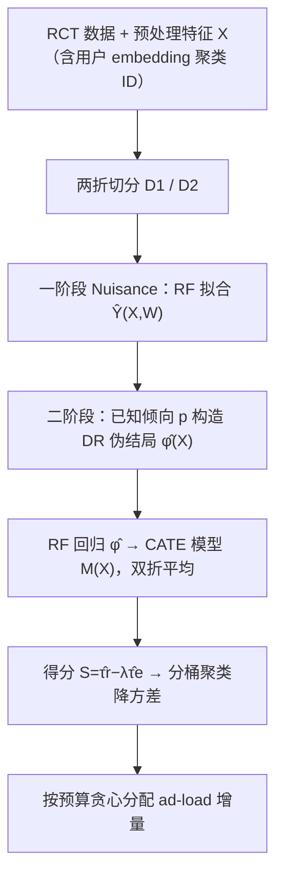

# Ads Supply Personalization via Doubly Robust Learning (基于双稳健学习的广告供给个性化)

- **会议/期刊**: CIKM 2024（Applied Research Track）
- **作者与机构**: Wei Shi, Chen Fu, Qi Xu, Sanjian Chen, Jizhe Zhang, Qinqin Zhu, Zhigang Hua, Shuang Yang（Meta Platforms, Inc.）
- **推荐链路定位**: 混排层 / 供给调控策略层（决定用户级 ad-load 增量分配，不改变广告与自然内容的排序模型）
- **研究方向**: 协同过滤与双塔召回 / 去偏公平、可信隐私与工业架构
- **论文原文**: [https://arxiv.org/abs/2410.12799v1](https://arxiv.org/abs/2410.12799v1)
- **开源代码**: 暂未开源

## TL;DR (1分钟核心速览)

社交广告中「加广告→短期增收、长期伤互动」的两难，本质是**用户级广告密度（ad-load）的异质因果效应估计**问题：treatment 幅度极小、观测窗口长达 4 个月以上、噪声淹没信号，而主流 uplift 模型依赖高复杂度 DNN outcome 模型，既估不准也不可上线。本文把工业 RCT 中**已知倾向分**灌入双稳健学习（DRL），用「nuisance（随机森林）→ DR 伪结局 → 二阶段 CATE 回归」的解耦流程替代端到端深度因果模型。在 CRITEO-UPLIFT 上人为注入 100% 标签偏差后 AUUC 保持 0.86（T-learner 崩至 0.57），产品数据 AUCC 0.77 较次优 0.63 提升 22.2%，线上 A/B 与 4 个月以上 hold-out 分别取得 +13.8%/+19.0% 与 +12.4%/+20.2% 的变现效率增益，已全量上线。

## Background & Motivation (背景与核心矛盾)

- **主流范式**: 广告与自然内容的联合个性化集中在 *ads allocation*（插位与位置），用约束优化、MDP 或 DNN 混排层在给定 ad-CTR 等既有 utility 上做多目标权衡。
- **前人局限 ①**: ad **quantity/density** 这一直接决定收入与互动的变量，要么被当作不受控混淆项、要么用固定阈值处理，缺少用户级个性化建模。
- **前人局限 ②**: 现有因果模型（S/T/X-learner、CEVAE、Dragonnet）全部依赖 outcome 模型的拟合优度，而长周期收入/互动指标被季节性、线上模型迭代等噪声主导，outcome 一旦 misspecified，CATE 估计随之崩坏。
- **核心洞察 (Key Insight)**: RCT 数据除观测结局外还白送一个**真实倾向分** $e(x)=p$，这正是 DR 估计量所需的另一半信息；DR 修正项能把 outcome 偏差挡在 CATE 之外，因此可以把 nuisance 模型做得极简。
- **本文切入点**: 用 DR 伪结局把「难估的个体结局」转成「易估的结构化 CATE」，从而在十亿级场景下同时获得精度与低延迟。

## Method (核心方法设计)

### 1. 整体框架 (Overall Architecture)

线上目标是固定互动损失预算下的收入增益最大化，被离散成 0-1 背包问题 $\max\sum_i \tau_r(x_i)z_i\ \text{s.t.}\ \sum_i \tau_e(x_i)z_i\le B,\ z_i\in\{0,1\}$，若$\tau_r,\tau_e$已知则按$\tau_r/\tau_e$贪心即最优。因此全流程围绕两个 CATE 模型（收入$\tau_r$、互动$\tau_e$）展开：先由 RCT 训练集切分出的两折分别拟合随机森林 nuisance$\hat{Y}(X,W)$，结合已知倾向分$p$构造 DR 伪结局$\hat\varphi(X)$；再把$\hat\varphi$回归到$X$上得到独立的轻量 CATE 模型$M(X)$，两折结果推理时取平均；最后融合成线性得分$S_i=\hat\tau_r-\lambda\hat\tau_e$ 并做粗聚类降方差，输出用户级 ad-load 增量名单。整个链路不改动既有广告/自然内容投放系统，仅在其上叠加一层低开销分配器。

### 2. 关键设计拆解 (Key Designs)

1. **DR 伪结局：把倾向分变成抗 bias 的监督信号**：直接估计量 $\hat\tau(X)=\hat Y(X,1)-\hat Y(X,0)$ 在 outcome 失配时不一致。本文改用
$$\hat\varphi(X)=\frac{W-p}{p(1-p)}\cdot\{Y-\hat Y(X,W)\}+\hat Y(X,1)-\hat Y(X,0)$$
第一项只用真实倾向分、不依赖任何 outcome 假设，负责保一致性；第二项负责降方差。直觉上，标签被系统性翻转时，$\{Y-\hat Y\}$的偏差被$W-p$ 的符号期望抵消，因此 CATE 估计对 outcome 偏差「免疫」。
2. **轻量实现与高维特征消费**：既然 nuisance 偏差不再传导，就用随机森林替代 DNN（满足 DRL 的稳定性条件、算力大降）；对千维用户 embedding 做无监督聚类，只把 **cluster ID 当类别特征**喂给 RF，用极低成本换来高维语义。配套做特征筛选：对每个候选特征按取值分桶计算单特征 AUUC 过滤弱特征。
3. **训练目标、选择准则与推理开销**：两阶段均以回归平方损失拟合（$\hat Y$拟合$Y$，$M$拟合$\hat\varphi$），**无需负采样**。选择准则放弃噪声放大严重的比值$\tau_r/\tau_e$，改用 Lagrangian 线性形式$S_i=\hat\tau_r-\lambda\hat\tau_e$（$\lambda$ 为搜索超参，与 DR 估计量兼容），并对原始得分再做聚类平滑。推理只需两次 RF 前向 + 一次查表，无深度网络在线依赖。

## Experimental Setup & Evaluation Protocol (实验设置与评估协议)

- **数据集与预处理**:

| 数据集 | #Users/样本 | #Items | #Interactions | 稀疏度/密度 | 特征/场景说明 |
| :--- | :---: | :---: | :---: | :---: | :--- |
| CRITEO-UPLIFT (公开) | 千万级（原文未列精确值） | — | 单目标 visit 转化 | — | 12 维匿名广告特征，RCT 采集，仅一个 uplift 目标 |
| Product Data (Meta 内部) | 数千万条用户日志 | — | 双目标（收入/互动） | — | 约 20 个 treatment 前特征 + 用户 embedding，4 个月以上长周期观测 |

- **数据划分与防穿越 (Splitting Strategy)**: 两数据集均采用 **80%/20% 随机划分**；所有特征严格取 treatment 前快照（作者显式强调不可用上线后被 treatment 影响的特征，否则形成正反馈灾难）。产品数据标签经 4 个月以上长期投影。
- **排名评测协议 (Ranking Protocol)**: 非传统 Full-Ranking/采样排序，而采用因果排序曲线指标——单目标用 **AUUC (Area under Uplift Curve)**，双目标用 **AUCC (Area under Cost Curve，X 轴为累计互动损失、Y 轴为累计收入增益)**，等价于评估「按模型排序后贪心分配」的 ROI 效率。倾向分直接取 RCT 中 treatment 组占比。
- **对比基线与超参设置**: 5 个基线——S/T/X-learner（随机森林实现）、CEVAE、Dragonnet（DNN 实现），均由 CausalML 包实现；本文 nuisance 与 CATE 回归器均为随机森林，用户 embedding 聚类簇数、$\lambda$ 通过参数搜索确定。

## Key Experimental Results (实验关键数据)

### 1. 主实验对比 (Main Results)

表 1：CRITEO-UPLIFT 上的 AUUC（$\beta$ 为标签翻转注入 bias 的比例）

| Methods | $\beta=0\%$|$\beta=100\%$ | 退化幅度 |
| :--- | :---: | :---: | :---: |
| S-learner | 0.86 | 0.81 | -5.8% |
| T-learner | 0.85 | 0.57 | -32.9% |
| X-learner | **0.87** | 0.72 | -17.2% |
| CEVAE | 0.82 | 0.63 | -23.2% |
| Dragonnet | 0.85 | 0.65 | -23.5% |
| **Proposed** | 0.86 | **0.86** | **0.0%** |

表 2：Product Data 上的 AUCC（双目标）

| Methods | AUCC | Improv. |
| :--- | :---: | :---: |
| S-learner | 0.51 | -19.0% |
| T-learner | 0.62 | -1.6% |
| X-learner | 0.63 | 基线（次优） |
| CEVAE | 0.50 | -20.6% |
| Dragonnet | 0.62 | -1.6% |
| **Proposed** | **0.77** | **+22.2%** |

表 3：线上 A/B 与长期 hold-out（变现效率，相对 Product Baseline）

| 设置 | Metric 1 | Metric 2 |
| :--- | :---: | :---: |
| 上线前 1 个月 A/B | +13.8% | +19.0% |
| 上线后 ≥4 个月 hold-out | +12.4% | +20.2% |

### 2. 消融实验 (Ablation Study)

表 4：组件级分析（nuisance 复杂度 / 倾向分偏差 / 数据规模）

| 组件设置 | 指标 | 数值 | 结论 |
| :--- | :---: | :---: | :--- |
| outcome = 常数 0 | AUCC | 0.63 | 极端 misspecification 下仍与次优基线持平 |
| outcome = Random Forest | AUCC | 0.77 | 主配置 |
| outcome = MLP | AUCC | 0.80 | 更强 nuisance 仅带来 +3.9% |
| 倾向分向真值外大幅偏移 | AUUC | 退化 <5% | 倾向分精度要求宽松 |
| 数据规模 ×1 → ×N | AUCC | 单调上升 | T-learner 则停滞 |

### 3. 关键实验发现 (Key Findings)

1. **鲁棒性来自 DR 修正项而非更强模型**：$\beta=100\%$时 T-learner 掉 32.9%、X-learner 掉 17.2%，本文 0.86→0.86 完全不退化；而在$\beta=0\%$ 无偏场景下 X-learner 的 0.87 反而略高，说明 DR 的收益是「把最坏情况兜住」而非抬高上限。
2. **主收益在双目标场景被放大**：产品数据上 AUCC 0.77 vs 0.63（+22.2%），cost curve 在多数操作点上收入增益提升约 40%，因为双目标优化才真正需要 $\tau_r/\tau_e$ 这种结构化 CATE，而非单目标结局拟合。
3. **nuisance 精度只影响方差、不影响一致性**：outcome 从常数 0（0.63）换到 RF（0.77）再到 MLP（0.80）呈现递减边际收益，而数据规模增大时本文 AUCC 持续上升、T-learner 停滞，印证 DR 估计量「偏差由倾向分消除、方差随 $n$ 收缩」的理论性质——这正是十亿级场景下可以放心用随机森林的底气。

## Highlights & Limitations (亮点、对比与审稿批判)

- **与代表作对比 (vs. Prior Work)**: 相较 S/T/X-learner 与 Dragonnet——它们把全部赌注押在 outcome 模型的拟合优度上、且需 DNN 才能勉强拟合长周期指标；本文显式把「一致性来源」与「方差来源」拆成两阶段，nuisance 可以简陋、CATE 模型独立且轻量。相较带约束优化的 ads allocation 工作（如用 ad-CTR 作 utility 的混排层），本文直接优化用户级 ad **quantity** 并对长周期指标建模，而非复用短期 utility。
- **可迁移亮点**: ①「已知倾向分 + 两折交叉拟合的伪结局 + 二阶段浅模型」是任何有 RCT 数据的推荐策略（推送频控、券发放、通知打扰度）都能直接套用的低成本范式；②高维 embedding 经无监督聚类后以 cluster ID 喂树模型，是绕过深度模型的实用降本技巧。
- **审稿级局限批判**: ① treatment 仅离散为二元 0/1，真实业务的多档位 ad-load 或连续密度未被建模，背包问题的贪心最优性在细粒度下会失真；② 论文未交代聚类簇数、$\lambda$ 与特征筛选阈值的敏感度曲线，也无显著性检验与多随机种子方差；③ 依赖 RCT 采集成本，作者自陈在非代表性 RCT / 观测数据、以及特征随时间漂移下的持续训练仍是开放问题；④ 产品数据与全部线上指标不可复现，AUCC 的 ground-truth CATE 本身来自 RCT 长期投影，存在标签定义依赖。

## Rating (四维评分)

- **方法创新性 (Novelty)**: ⭐⭐⭐ （DRL 本身非新方法，创新在于「RCT 已知倾向分 + 两阶段解耦」在广告供给密度这一新问题上的工程化落地与伪结局/选择准则细节）
- **评估协议与实验扎实度 (Protocol & Experiments)**: ⭐⭐⭐⭐ （公开 + 自有双数据集、AUUC/AUCC 双指标、含 bias 注入的受控分析、4 个月线上 hold-out，但缺少显著性检验与超参敏感度）
- **写作与数学规范度 (Clarity & Rigor)**: ⭐⭐⭐⭐ （背包形式化、DR 伪结局与一致性论证清晰，两折流程图直观；但对误设条件下方差的定量刻画略简）
- **工业落地与复现价值 (Industrial & Practical Value)**: ⭐⭐⭐⭐⭐ （随机森林级推理开销、已全量上线十亿级流量、连续半年以上正向收益，唯一遗憾是未开源）

