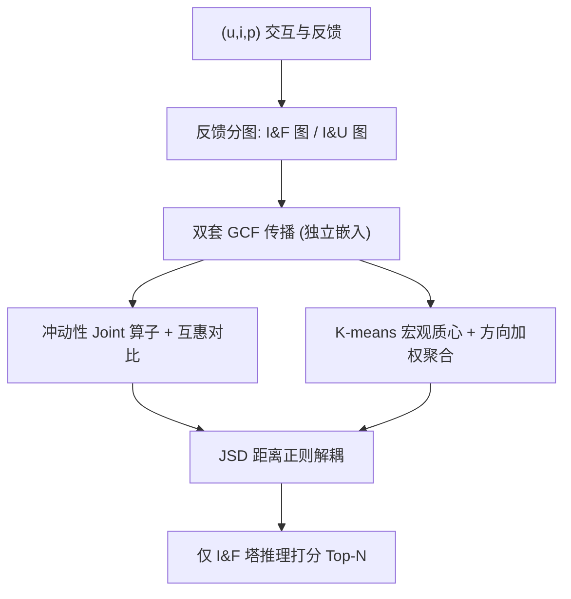
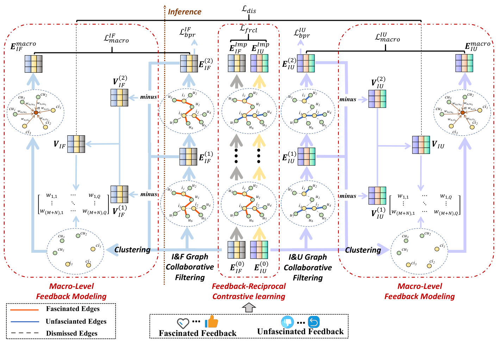

# Feedback Reciprocal Graph Collaborative Filtering (反馈互惠图协同过滤)

- **会议/期刊**: CIKM 2024 (33rd ACM International Conference on Information and Knowledge Management)
- **作者与机构**: Weijun Chen, Yuanchen Bei, Qijie Shen, Hao Chen, Xiao Huang, Feiran Huang（暨南大学 / 浙江大学 / 阿里巴巴 / 香港理工大学）
- **推荐链路定位**: 召回（图协同过滤召回，淘宝线上替代原召回模型）
- **研究方向**: 协同过滤与双塔召回 / 自监督对比学习与交互去噪
- **论文原文**: [https://arxiv.org/abs/2408.02404v1](https://arxiv.org/abs/2408.02404v1)
- **开源代码**: 暂未开源

## TL;DR (1分钟核心速览)

图协同过滤存在"跷跷板困境"：用全图训练会把用户"点了但不爱"的 I&U 物品推给用户；只用 I&F 图又丢失意图信息导致性能下降。FRGCF 将交互图按反馈拆为 I&F/I&U 双图，各训一套 GCF，再以"冲动性"互惠对比（跨子图乘积传播）与宏观聚类建模实现信息交换而不被 I&U 邻居误导，推理只走 I&F 塔。在 4 个公开集与 1 个十亿级工业集的全库排序（Recall/NDCG@20）上平均提升 6.28%/6.37%，工业集 6.55%/7.82%。

## Background & Motivation (背景与核心矛盾)

- **主流范式**: LightGCN 类 GCF 在整张用户-物品交互图上递归聚合邻居，SGL/SimGCL/NCL 进一步用对比/预测式自监督缓解稀疏与噪声。
- **前人局限**: ① 全图训练不区分"着迷（I&F）"与"未着迷（I&U）"交互，聚合了 I&U 邻居后用户表征天然靠近 I&U 物品，推荐列表混入高比例用户不喜欢的物品（图 1(b)）；② 直接丢弃 I&U 边虽降噪，却损失部分交互意图，四类 GCF 模型在 I&F 图上 NDCG@20 全面下滑（图 1(c)）。
- **核心洞察 (Key Insight)**: I&U 交互并非纯噪声，它携带"冲动性"（被封面吸引、被标题诱导）这一在两视图中共有的行为成分；只要不把 I&U 的**邻居聚合**引入推理路径，其信息仍可被安全借用。
- **本文切入点**: 用"分图双嵌入 + 跨图共享成分对比 + 宏观聚类补全"三件套，让 I&F 塔学到 I&U 的多粒度特性却不受其负向引导。

<figure class="paper-figure" markdown="span">
  <figcaption>图1：(a) 交互且着迷（I&amp;F）与交互但未着迷（I&amp;U）示例。(b) GCF 模型分别在全图和 I&amp;F 图上训练时推荐的未着迷物品。(c) GCF 模型分别在全图和 I&amp;F 图上训练时的推荐性能差异。</figcaption>
</figure>

## Method (核心方法设计)

### 1. 整体框架 (Overall Architecture)

输入为带反馈 $p$的三元组$(u,i,p)$：先按阈值把整图切成 I&F 图与 I&U 图，各自维护一套独立 ID 嵌入并做 LightGCN 式传播，得到两条互补的表征轨道；随后反馈互惠对比学习用"两图传播算子相乘"提取冲动性表征并做跨视图 InfoNCE 对齐，宏观反馈建模用 K-means 质心补全分图后的数据不完整，距离正则（JSD）强制两条轨道的更新方向解耦。训练时两塔联合优化，推理时仅用 I&F 塔计算$\hat{y}_{ui}$ 排序，保证 I&U 物品不会通过邻居聚合回流。

<figure class="paper-figure" markdown="span">
  <figcaption>图2：我们的 FRGCF 总体框架包含三个主要组件：(i) 反馈划分图协同过滤，分别针对 I&amp;F 图和 I&amp;U 图训练 GCF 模型；(ii) 反馈互惠对比学习，连接 I&amp;F GCF 模型与 I&amp;U GCF 模型；(iii) 宏观层面反馈建模，增强 I&amp;F 和 I&amp;U 的表示；(iv) 最终，推理预测由 I&amp;F 图卷积模型计算。</figcaption>
</figure>

### 2. 关键设计拆解 (Key Designs)

1. **反馈分图与双塔 GCF（Feedback-Partitioned GCF）**：痛点是"一套嵌入要同时编码多种语义"，导致表征被 I&U 稀释。本文按反馈把边集拆为 $\mathcal{E}_{IF}=\{p\in F_{pos}\}$、$\mathcal{E}_{IU}=\{p\in F_{neg}\}$，分别构造归一化邻接并独立传播：$\boldsymbol{E}^{(k+1)}_{IF}=\tilde{\boldsymbol{A}}_{IF}\boldsymbol{E}^{(k)}_{IF}$，$\tilde{\boldsymbol{A}}_{IF}=\boldsymbol{D}_{IF}^{-1/2}\boldsymbol{A}_{IF}\boldsymbol{D}_{IF}^{-1/2}$（I&U 侧同理）。降低单套嵌入的建模负担即可获得更纯净的 I&F 表征，同时保留 I&U 分支作为"信息源"而非"聚合源"。

2. **冲动性互惠对比学习（Feedback-Reciprocal Contrastive Learning）**：直接对 I&F/I&U 表征做对比会把两视图差异（正是要区分的信号）抹平。本文先用两图传播算子的乘积构造冲动性联合算子，交叉项自然给出 U-U、I-I、U-I 三类关系：$\boldsymbol{J}=\sum_{k=0}^{2}\tilde{\boldsymbol{A}}_{IF}^{(k)}\cdot\sum_{k=0}^{2}\tilde{\boldsymbol{A}}_{IU}^{(k)}$，再取$\boldsymbol{E}^{Imp}_{x}=\boldsymbol{J}\boldsymbol{E}^{(0)}_{x}$，仅对"同一节点在两视图下的冲动性表征"作正样本做 InfoNCE：
$\mathcal{L}_{frcl}=\sum_{u}-\log\frac{\exp(\mathrm{sim}(\boldsymbol{e}^{Imp}_{IF,u},\boldsymbol{e}^{Imp}_{IU,u})/\tau)}{\sum_{u'}\exp(\mathrm{sim}(\boldsymbol{e}^{Imp}_{IF,u},\boldsymbol{e}^{Imp}_{IU,u'})/\tau)}$（物品侧对称）。直觉是：只交换"共有的冲动成分"，把"是否真正着迷"的判别性差异留给各自塔保留。

3. **宏观反馈建模、解耦正则与训练/推理**：分图导致训练数据不完整，故对每视图做 K-means 得质心 $\boldsymbol{C}_x$，并用各层位移均值$\boldsymbol{V}_x=\frac{1}{K}\sum_{i=0}^{K-1}(\boldsymbol{E}^{(i+1)}_x-\boldsymbol{E}^{(i)}_x)$作为传播方向先验，按方向相似度加权聚合质心：$\boldsymbol{E}^{macro}_x=\boldsymbol{E}^{(0)}_x+\frac{1}{Q}\boldsymbol{W}_x\boldsymbol{C}_x$，再与$\boldsymbol{E}^{(K)}_x$做 InfoNCE。为防止两塔塌缩为同一表征，用$\mathcal{L}_{dis}=-\mathrm{JSD}(\boldsymbol{V}_{IF},\boldsymbol{V}_{IU})$主动拉开更新方向。总目标$\mathcal{L}=\mathcal{L}^{IF}_{bpr}+\mathcal{L}^{IU}_{bpr}+\lambda_1\mathcal{L}_{frcl}+\lambda_2\mathcal{L}_{macro}+\lambda_3\mathcal{L}_{dis}$，两侧 BPR 均采用**单负样本均匀采样**，无额外难负样本挖掘；推理仅需 I&F 塔一次前向，线上仅比基线多 0.19% 响应时间。

## Experimental Setup & Evaluation Protocol (实验设置与评估协议)

- **数据集与预处理**（**未做 5-core 过滤**，沿用 GCF 常用版本；反馈阈值人工设定）：

| 数据集 | #Users | #Items | #Interactions | 稀疏度/密度 | I&U 判定方式 |
| :--- | :---: | :---: | :---: | :---: | :--- |
| MovieLens | 6,040 | 3,952 | 1,000,209 | 4.19% | 评分 < 4 |
| Douban | 2,848 | 39,586 | 894,886 | 0.079% | 评分 < 4 |
| Beauty | 324,038 | 32,586 | 361,605 | 0.0034% | 评分 < 4 |
| KuaiRec | 7,176 | 10,728 | 12,530,806 | 16.3% | 完播率 < 50% |
| Industrial (淘宝) | ~0.17 B | ~0.31 B | ~118 B | — | 停留时长 ≤ 4s |

- **数据划分与防穿越 (Splitting Strategy)**: 随机 **比例划分**（训练/测试），**未采用全局时间戳切分**，故存在轻度未来信息泄漏风险；工业集为线上真实流量日志。
- **排名评测协议 (Ranking Protocol)**: 无偏 **Full-Ranking（全库未交互物品排序）**，指标 Recall@20 / NDCG@20；对照组额外报告**仅用 I&F 图**训练的 "(I&F)" 变体以验证跷跷板效应。
- **对比基线与超参**: 7 个基线覆盖三类——GCF（LightGCN、BUIR、DirectAU）、SSL-GCF（SGL、SimGCL、NCL）、反馈增强 GCF（SiReN）；所有模型 $d=64$、Xavier 初始化、Adam、batch=2048，5 个随机种子取均值（未报告显著性检验$p$ 值）。

## Key Experimental Results (实验关键数据)

### 1. 主实验对比 (Main Results)

| Method | MovieLens R@20 | NDCG@20 | Douban R@20 | NDCG@20 | KuaiRec R@20 | NDCG@20 | Industrial R@20 | NDCG@20 |
| :--- | :---: | :---: | :---: | :---: | :---: | :---: | :---: | :---: |
| BUIR | 0.1672 | 0.2978 | 0.0698 | 0.2014 | 0.0384 | 0.3489 | 0.1033 | 0.2034 |
| DirectAU | 0.1086 | 0.1375 | 0.0189 | 0.0377 | 0.0158 | 0.1107 | 0.0975 | 0.1389 |
| LightGCN | 0.2251 | 0.3636 | 0.0755 | 0.2110 | 0.0726 | <u>0.6131</u> | 0.1542 | 0.2763 |
| SGL | 0.2377 | 0.3839 | 0.0855 | 0.2136 | 0.0530 | 0.4614 | 0.1693 | 0.2678 |
| SimGCL | 0.2421 | 0.3750 | 0.0911 | 0.2279 | 0.0545 | 0.4888 | 0.1789 | 0.2811 |
| NCL | 0.2331 | 0.3787 | 0.0755 | 0.2206 | 0.0714 | 0.6019 | 0.1801 | 0.2756 |
| SiReN | 0.2075 | 0.3520 | 0.0699 | 0.2089 | 0.0701 | 0.5948 | 0.1765 | 0.2793 |
| **FRGCF** | **0.2533** | **0.4027** | **0.0969** | **0.2586** | **0.0767** | **0.6404** | **0.1919** | **0.3031** |
| **Improv.** | +4.62% | +4.89% | +6.36% | +7.92% | +5.64% | +4.45% | +6.55% | +7.82% |

Beauty 上同为最优（R@20 0.1198 / NDCG@20 0.0864，对比 NCL 0.1048 / 0.0809）。偏好性案例（Douban，表 3）：FRGCF 着迷物品 Recall 0.1142 / NDCG 0.2294 高于 SGL 0.1092 / 0.2062，未着迷物品 Recall 0.0473 / NDCG 0.0527 低于 SGL 0.0607 / 0.0752。

### 2. 消融实验 (Ablation Study)

| 变体 | MovieLens R@20 | Douban R@20 | 结论（原文图 3 柱状趋势） |
| :--- | :---: | :---: | :--- |
| FRGCF-w/o frcl | 最低 | 最低 | 跨视图冲动性交换贡献最大 |
| FRGCF-w/o macro | 次低 | 次低 | 宏观质心显著缓解分图数据缺失 |
| FRGCF-w/o dis | 中等 | 中等 | 解耦正则带来稳定增益 |
| **FRGCF (full)** | **0.2533** | **0.0969** | 三件套缺一不可 |

### 3. 关键实验发现 (Key Findings)

1. **"丢中间结果"是伪降噪**：LightGCN/SGL/SimGCL/NCL 在 I&F 图上训练后多数指标回落（LightGCN Industrial R@20 从 0.1542 降至 0.1343，SGL 0.1693→0.1411），定量证明 I&U 边不可简单删除，必须"借用但不聚合"。
2. **分图收益在稀疏集上更明显**：Douban（密度 0.079%）上 NDCG@20 相对 SimGCL 提升 13.5%，而稠密的 KuaiRec（16.3%）仅 +4.45%（0.6404 vs 0.6131），说明宏观聚类补全对稀疏场景最关键。
3. **降噪优于提分**：Douban 上 FRGCF 未着迷物品 Recall 较 SGL 降低约 22%（0.0473 vs 0.0607），而着迷物品仅提升 4.6%——总量提升有限但"推错"显著减少；线上 A/B（连续 4 周、2000 万用户）PCTR +1.35%、GMV +1.61%、停留时长 +2.89%、UCTR +0.91% 佐证用户体验改善。

## Highlights & Limitations (亮点、对比与审稿批判)

- **与代表作对比 (vs. Prior Work)**: 与 SGL/SimGCL/NCL 的"同图扰动/邻居对比"不同，FRGCF 的对比信号来自**语义分割后的两个子图**，正样本是"共有冲动性"而非"噪声不变性"；与 SiReN 的双编码器（正/负反馈分离）相比，FRGCF 额外提供跨视图互惠对比与宏观聚类补全，避免了负编码器污染的路径。
- **可迁移亮点**: ① 用"两个传播算子相乘"提取跨视图共享成分，可迁移到多场景/跨域召回中构造免人工标注的跨视图正样本；② 用层间位移均值 $\boldsymbol{V}_x$ 作为传播方向先验去加权聚类质心，是一种廉价的"宏观→微观"注入方式，可复用到序列/多模态召回。
- **审稿级局限批判**: ① 需同时维护两套嵌入、两套 BPR 加 K-means 聚类，训练开销接近 2 倍以上，而论文未给出复杂度与聚类频率的敏感性分析；② 反馈阈值（评分 4、完播 50%、停留 4s）为人工设定且跨域不可直接迁移，I&F/I&U 划分的鲁棒性缺失；③ 公开集用随机比例划分而非时间切分，存在未来交互泄漏嫌疑；④ 消融仅以柱状图呈现、无具体数值与显著性检验，复现门槛偏高（代码未开源）。

## Rating (四维评分)

- **方法创新性 (Novelty)**: ⭐⭐⭐⭐ （"反馈分图 + 冲动性乘积算子对比 + 宏观质心补全"组合新颖，跷跷板困境刻画清晰，但缺少理论/谱域支撑）
- **评估协议与实验扎实度 (Protocol & Experiments)**: ⭐⭐⭐⭐ （四公开集 + 十亿级工业集 + 线上 A/B 与 5 种子取均值，全库排序可信；扣分在随机划分与消融无具体数值、无显著性检验）
- **写作与数学规范度 (Clarity & Rigor)**: ⭐⭐⭐⭐ （公式链与图示基本自洽，但"冲动性"概念的数学刻画（式 10-13）略显启发性、推导跳跃，复杂度分析缺位）
- **工业落地与复现价值 (Industrial & Practical Value)**: ⭐⭐⭐⭐⭐ （淘宝召回位已上线，响应时间仅 +0.19%，GMV/停留时长双升，工程价值明确；唯代码未开源降低复现便利度）

