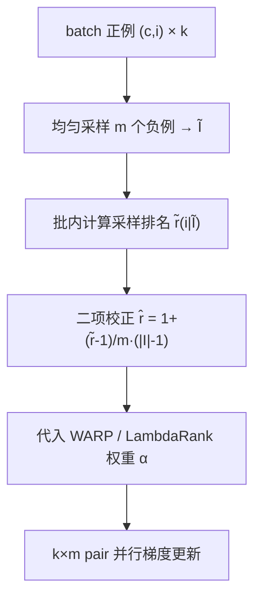
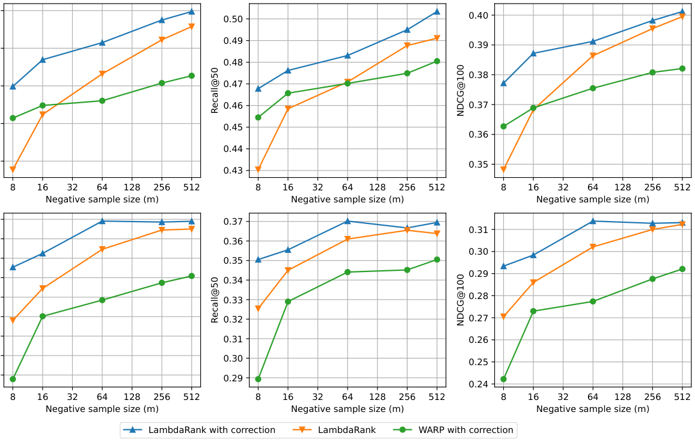

# Improved Estimation of Ranks for Learning Item Recommenders with Negative Sampling (基于负采样的推荐模型排名校正估计)

- **会议/期刊**: CIKM 2024
- **作者与机构**: Anushya Subbiah, Steffen Rendle, Vikram Aggarwal（Google Research）
- **推荐链路定位**: 召回（矩阵分解模型的训练目标）
- **研究方向**: 协同过滤与双塔召回
- **论文原文**: [论文原文链接](https://arxiv.org/abs/2410.06371v2)
- **开源代码**: [开源代码仓库链接](https://github.com/dawenl/vae_cf)（数据预处理与划分脚本仓库，非本文代码）

## TL;DR (1分钟核心速览)

针对大规模物品库中"全库排名"计算昂贵、而朴素负采样排名又会系统性低估的痛点，本文把已在**采样指标评估**中验证过的二项排名校正公式，用于修正 WARP 与 LambdaRank 两类的训练权重，同时提出"k 正 × m 负"的**批量采样**训练版本，把原先串行的 F-Rank 估计改造为可并行执行。在 ML20M（约 20k 电影）与 MSD（约 41k 歌曲）上按固定 80/20 划分做 Full-Ranking：批采样 + 校正的 WARP 在 MSD 上 Recall@20 相对原迭代版提升 16.5%，LambdaRank 提升 3.9%；ML20M 上 WARP 提升 9.9%。

## Background & Motivation (背景与核心矛盾)

- **主流范式**: 隐式反馈推荐以 pairwise 排序损失为主，WARP 依赖拒绝采样估计正例排名，LambdaRank 直接在全库上计算 NDCG 差分作为权重 $\alpha$。
- **前人局限**: (1) WARP 的迭代拒绝采样一次只处理一对样本，与 GPU/TPU 大 batch 并行模式冲突；(2) LambdaRank 需要对全库打分才能得到真实排名，物品规模达 2 万–4 万级时成本高昂；而如果退化为"在采样集内排名"，由于采样集大小仅为 $m$，会系统性低估真实排名，导致权重$\alpha$ 被扭曲。
- **核心洞察 (Key Insight)**: 在均匀采样下，采样排名服从二项分布 $\tilde{r} \sim B(m,p)+1$，其成功概率$p=(r-1)/(|\mathcal{I}|-1)$ 恰好与真实排名成比例，因此采样排名中包含了真实排名的信息，可以用来反推全库排名的尺度。
- **本文切入点**: 用校正后的 $\hat{r}$替换损失函数中所有关于排名$r$ 的项，使 WARP / LambdaRank 从迭代算法变成可批量负采样的算法。

## Method (核心方法设计)

### 1. 整体框架 (Overall Architecture)

模型主体采用标准矩阵分解（用户嵌入与物品嵌入内积打分）。训练循环不再"抽一对正负样本 + 单步梯度"，而是每 step 采样 $k$个正例$(c,i)$与$m$个负例$j$，构成$k \times m$个 pair 一次性并行求梯度；对每个正例在采样集$\tilde{\mathcal{I}}$内算采样排名$\tilde{r}$，再用二项校正映射回全库尺度$\hat{r}$，最后代入 WARP 的$\alpha=\sum_{r=1}^{\hat{r}} 1/r$与 LambdaRank 的$\alpha=|\Delta\mathrm{NDCG}(\hat{r})|$。推理时对全库打分取 top-N。

### 2. 关键设计拆解 (Key Designs)

**设计一：批量采样训练 (Sampled Batch Training)**
迭代版 WARP 用拒绝采样既做负采样、又顺带估计排名；但拒绝采样在 hinge loss 下筛选出的负例本身梯度为 0，其唯一实质作用就是估算排名——既然排名可由公式直接估，就可以**彻底去掉拒绝采样**，改为"全均匀采样 k 正 m 负"，批内共享负例，充分利用并行硬件。

**设计二：采样排名二项校正 (Rank Correction)**
采样排名 $\tilde{r}_{\tilde{\mathcal{I}}}(i|c)=|\{j\in\tilde{\mathcal{I}}: y(c,j)>y(c,i)\}|+1$的最大值只有$m$而非$|\mathcal{I}|$，直接使用会低估。利用$\tilde{r}\sim B(m,p)+1,\, p=(r-1)/(|\mathcal{I}|-1)$，先估概率$\hat{p}=(\tilde{r}-1)/m$，再用

$$\hat{r}(i|c)=1+\frac{\tilde{r}(i|c)-1}{m}\,(|\mathcal{I}|-1)$$

还原全库尺度。其物理直觉是：把"采样中比正例高的负例数"归一化为"比正例高的负例比例"，再乘全库大小恢复绝对名次，$m\to|\mathcal{I}|$ 时退化为真排名。

**训练目标、负采样与推理效率**
WARP 用合页损失 $l=\max(0,1-(y(c,i)-y(c,j)))$，权重为$\alpha=\sum_{r=1}^{\hat{r}}1/r$；LambdaRank 用 logistic 损失$l=\ln\sigma(y(c,i)-y(c,j))$，权重为$\alpha=|\mathrm{NDCG}(\hat{r}(i))-\mathrm{NDCG}(\hat{r}(j))|$。总损失为

$$\mathcal{L}=\sum_{j\in\tilde{\mathcal{I}}}\sum_{(c,i)\in\tilde{S}}\alpha(c,i,j)\,l(c,i,j).$$

负采样为**纯均匀采样、免拒绝、免难负例**；推理时全库打分，与标准 MF 一致，无额外开销。

## Experimental Setup & Evaluation Protocol (实验设置与评估协议)

- **数据集与预处理**: 沿用 [11]（Mult-VAE）的标准划分脚本，物品库规模固定：

| 数据集 | #Items | 评估 #Users | 划分方式 | 场景说明 |
| :--- | :---: | :---: | :---: | :--- |
| ML20M | ~20k 电影 | 20k（50% 调参 / 50% 测试） | 80/20 留出并固定测试集 | 电影隐式反馈 |
| MSD | ~41k 歌曲 | 100k（50% 调参 / 50% 测试） | 同上 | 歌曲隐式反馈 |

- **数据划分与防穿越**: 比例留出（80% 训练 / 20% 评估），沿用 [11] 预先固定的测试集；**注意与 [11] 的差异**：本文将测试用户 embedding 也随训练一起学习（因模型含用户嵌入且梯度训练无 iALS 闭式解），其余用户全部参与训练。
- **排名评测协议**: 无偏 **Full-Ranking**（全库未交互物品打分排序），指标为 Recall@20、Recall@50、NDCG@100。
- **对比基线与超参**: 基线为 [15] 报告的迭代 WARP 与 LambdaNet（AutoEncoder 架构上的 LambdaRank）；本文模型为矩阵分解，嵌入维度未在文中强调，超参在调参用户上调优、在测试用户上报告。

## Key Experimental Results (实验关键数据)

### 1. 主实验对比 (Main Results)

| 方法 | ML20M R@20 | ML20M R@50 | ML20M N@100 | MSD R@20 | MSD R@50 | MSD N@100 |
| :--- | :---: | :---: | :---: | :---: | :---: | :---: |
| WARP（迭代版 [15]） | 0.314 | 0.466 | 0.341 | 0.206 | 0.302 | 0.249 |
| **WARP（batch+校正，本文）** | **0.345** | **0.480** | **0.382** | **0.240** | **0.350** | **0.292** |
| LambdaNet（AE [15]） | **0.395** | **0.534** | **0.427** | 0.259 | 0.355 | 0.308 |
| LambdaRank（batch+校正，本文） | 0.379 | 0.503 | 0.401 | **0.269** | **0.370** | **0.314** |
| Improv.（WARP 本文 vs 迭代） | +9.9% | +3.0% | +12.0% | +16.5% | +15.9% | +17.3% |
| Improv.（LR 本文 vs LambdaNet） | −4.1% | −5.8% | −6.1% | +3.9% | +4.2% | +1.9% |

### 2. 消融实验 (Ablation Study)

本文的"消融"以**校正开关 × 采样量**的二维对比形式给出（原文图 1、图 2）：

| 配置 | 采样量 m=8 | m=64 | m=256 | 趋势 |
| :--- | :---: | :---: | :---: | :--- |
| LambdaRank 未校正 | 最低 | 中 | 较高 | 随 $m$ 单调上升但始终低于校正版 |
| LambdaRank + 校正 | 明显优于未校正 | 优于未校正 | 略优于未校正 | 增益随 $m$ 收敛 |
| WARP + 校正 | 优于未校正 LambdaRank | 弱于校正 LambdaRank | 弱于校正 LambdaRank | 小 $m$ 区间 WARP 有局部优势 |
| NDCG 阈值 $k$ 收缩 | 校正/未校正差距扩大 | — | — | 任务越 top-heavy，校正越关键 |

<figure class="paper-figure" markdown="span">
  <figcaption>图1：不同负样本数量下 WARP 与 LambdaRank 批处理版本的评估。</figcaption>
</figure>

### 3. 关键实验发现 (Key Findings)

1. **校正让批采样版"既快又好"**：WARP 在 ML20M R@20 由 0.314 升至 0.345（+9.9%），MSD 由 0.206 升至 0.240（+16.5%）；LambdaRank 在 MSD N@100 由 0.308 升至 0.314（+1.9%），说明并行化并未以精度为代价。
2. **校正收益在采样量小时最显著**：图 1 中 $m=8$时未校正 LambdaRank 与校正版差距最大，$m=256$时差距迅速缩小，与二项分布方差随$m$增大而衰减的理论完全吻合——小$m$ 恰好是偏差主导区间，校正即"用统计换采样"。
3. **ML20M 上本文 LambdaRank 未超 LambdaNet**（R@20 0.379 vs 0.395，−4.1%），主因在于基线用 AutoEncoder 结构、在该稠密数据集上占优，而本文矩阵分解容量更小；校正只修正权重 $\alpha$、不改模型表达力，说明该方法是**与模型正交的训练技巧**。

## Highlights & Limitations (亮点、对比与审稿批判)

- **与代表作对比**: 相对 [10] 的采样指标校正，本文把**评估阶段的静态修正扩展为训练阶段的损失权重**；相对 WARP 原版，将串行 F-Rank 重构为可批量并行；相对 LambdaRank 原版，把全库打分换成采样内估计，物品库越大收益越明显。
- **可迁移亮点**: (1) 二项校正公式 $\hat{r}=1+(\tilde{r}-1)/m\cdot(|\mathcal{I}|-1)$ 可直接嵌入任何依赖全库排名的 pairwise/listwise 损失（ListNet、Gumbel 采样等）；(2) "k 正 × m 负"批内共享负例的结构，可在 batch 内跨用户复用负例，进一步提升并行度与吞吐。
- **审稿级局限批判**: (1) **模型单一**：仅在矩阵分解上验证，未考察神经/序列模型的自适应嵌入下校正估计的额外方差；(2) **修正对象错位**：校正了排名 $\hat{r}$而非直接修正权重$\alpha$，LambdaRank 的$\Delta\mathrm{NDCG}$仍由被扰动的$\hat{r}$ 代入，误差会传导入权重；(3) **规模上限未验证**：数据仅覆盖 20k/41k 量级，10 万级以上物品库、真实工业 A/B 尚未检验。

## Rating (四维评分)

- **方法创新性 (Novelty)**: ⭐⭐⭐ （校正公式本身源自 [10] 的采样指标评估工作，核心增量是把评估修正迁移到训练权重，思路清晰但理论新颖度有限）
- **评估协议与实验扎实度 (Protocol & Experiments)**: ⭐⭐⭐ （Full-Ranking、固定划分、双侧指标完整；但仅两个数据集、单模型、缺少显著性检验与多样本量精确数值）
- **写作与数学规范度 (Clarity & Rigor)**: ⭐⭐⭐⭐ （符号表完整，从二项分布到校正估计的推导简洁自洽，算法伪代码清晰区分迭代与批采样两版）
- **工业落地与复现价值 (Industrial & Practical Value)**: ⭐⭐⭐⭐ （批采样直接解决 WARP 并行化痛点、校正无额外推理开销，代码与数据划分有公开仓库支撑，易于在现有 pairwise 框架上低成本嫁接）

