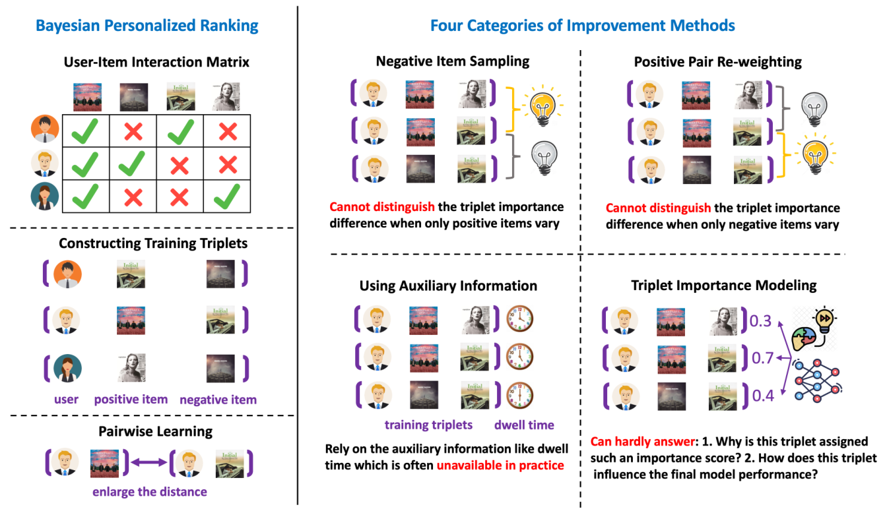
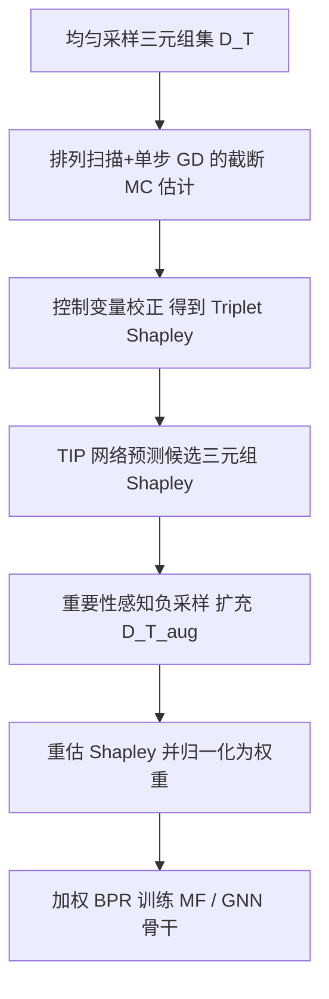
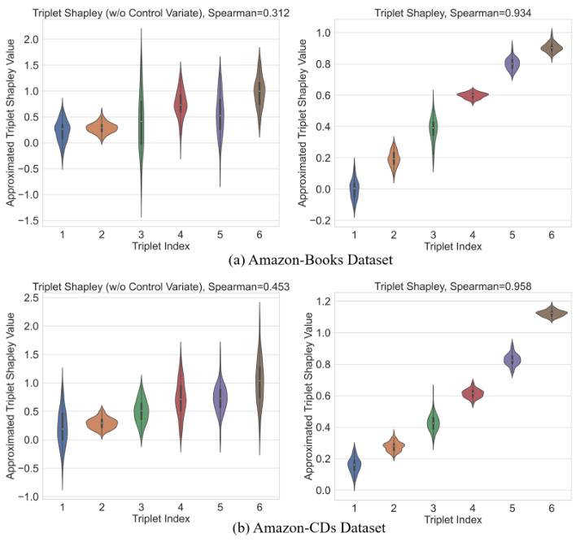

# Interpretable Triplet Importance for Personalized Ranking (面向个性化排序的可解释三元组重要性)

- **会议/期刊**: CIKM 2024
- **作者与机构**: Bowei He, Chen Ma（香港城市大学）
- **推荐链路定位**: 召回（BPR  pairwise 训练目标层面）
- **研究方向**: 协同过滤与双塔召回 / 自监督对比学习与交互去噪
- **论文原文**: [https://arxiv.org/abs/2407.19469v1](https://arxiv.org/abs/2407.19469v1)
- **开源代码**: [https://github.com/BokwaiHo/ITIPR.git](https://github.com/BokwaiHo/ITIPR.git)

## TL;DR (1分钟核心速览)

BPR 及其改进要么只对负物品、正物品对单独加权，要么用一个黑箱网络端到端生成三元组权重，导致重要性分数"无根据、不可解释、不可信"，且只在一开始构造的三元组集合 $D_T$里做文章。本文提出 ITIPR：把每个$(u,i,j)$视为合作博弈中的玩家，用 **Triplet Shapley** 定义其对排序验证性能的边际贡献；用"单步梯度下降+截断"的蒙特卡洛估计并证明无偏，再用控制变量把估计方差压到$(1-\rho^2)$倍；最后用 TIP 网络预测 Shapley 并按其 softmax 概率重采样高价值三元组、以 Shapley 归一化为权重训练 BPR。在 6 个公开数据集、MF/NeuMF/NGCF/LightGCN 四种骨干上，R@20/N@20 平均超越最强基线约 9.16%/9.62%（$p<0.01$），LightGCN 骨干下 Amazon-Books R@20 提升 23.49%。

## Background & Motivation (背景与核心矛盾)

- **主流范式**: BPR 从三元组空间 $D_S=\{(u,i,j)\mid i\in I_u, j\in V\setminus I_u\}$ 中均匀采样负物品，对所有三元组一视同仁地优化 pairwise 排序损失；后续改进分为负采样（WBPR/AOBPR/PRIS）、正对重加权（TCE/RCE）、辅助信息、三元组重要性建模（TIL）四类。
- **前人局限**: ① 只处理三元组的"局部"（只看负物品或只看正对），忽略三元组整体；② TIL 类方法用黑箱网络或启发式生成权重，分数无博弈论/信息论依据，既不可解释也可能引入未知偏差；③ 全部方法把初始 $D_T$当既定事实，浪费了构造空间$|U|\times|V|^2$ 中大量高价值三元组。

<figure class="paper-figure" markdown="span">
  <figcaption>图1：原始 BPR 及对应四类改进方法的示意图。</figcaption>
</figure>

- **核心洞察 (Key Insight)**: 数据估值领域的 Shapley 值能显式刻画"某个样本对模型性能的贡献"，且满足 inclusiveness 与 equal-value 性质；把三元组当作 player，就能得到一个既公平又可解释的重要性。
- **本文切入点**: 用 Shapley 定义重要性 → 蒙特卡洛近似 → 控制变量降方差 → 依据重要性从全空间重采样 → 重估 Shapley 作为加权 BPR 权重。

## Method (核心方法设计)

### 1. 整体框架 (Overall Architecture)

ITIPR 分三段闭环：① **重要性近似**：随机抽一个三元组排列 $\pi$，沿排列逐条做单步梯度更新，记录验证集 Recall 的增量作为该三元组的边际贡献，截断后聚合为 Triplet Shapley，并用控制变量校正；② **重要性感知重采样**：以已估 Shapley 训练 TIP 两层 MLP 预测任意候选三元组的 Shapley，对同一$(u,i)$的未采样负物品按 softmax 概率抽样，扩充得到$D_T^{aug}$；③ **加权训练**：在$D_T^{aug}$ 上重新估计并归一化 Shapley 作为权重，从零训练推荐骨干。推理解码与普通 BPR 完全一致（内积/图卷积打分 top-K），无额外在线开销。

### 2. 关键设计拆解 (Key Designs)

1. **Triplet Shapley（可解释的重要性定义）**：痛点是已有权重无出处。定义
$V_{TS}(u,i,j)=C\!\!\sum_{S\subseteq D_T\setminus\{(u,i,j)\}}\!\!\frac{A(S\cup\{(u,i,j)\})-A(S)}{\binom{|D_T|-1}{|S|}}$，
其中 $A(\cdot)$为用三元组子集训练后在验证集上的排序性能。直接计算需$2^{|D_T|}$次训练，故等价改写为"加入顺序"视角：$V_{TS}(u,i,j)=\frac{1}{|D_T|!}\sum_{\pi\in\Pi_T}[A(P_\pi(u,i,j)\cup\{(u,i,j)\})-A(P_\pi(u,i,j))]$。直觉：Shapley 值等于"该三元组在随机加入序列中的期望边际增益"，天然可解释为它对排序精度的信息增益，且对等贡献者给等分。

2. **截断 MC + 控制变量（让估计又快又稳）**：痛点是一次 Shapley 计算需多轮训练，且方差大到无法区分三元组排序。作者把内层多 epoch 训练替换为**单步、较大学习率**的梯度更新（近似收敛），当 $|A(D_T)-a_s^k|<\text{tolerance}$时截断，剩余位置增益置 0；再用相关但可精确求解的$\hat{V}_{TS,*}$（用"全体补集一次性聚合梯度"的修正版$ \Omega^*$，仅需$|D_T|$ 个循环移位排列即可精确算出）构造
$\tilde{V}_{TS}=\hat{V}_{TS}-c(\hat{V}_{TS,*}-V_{TS,*})$，取$c^*=\frac{\mathrm{Cov}(\hat{V}_{TS},\hat{V}_{TS,*})}{\mathrm{Var}(\hat{V}_{TS,*})}$后方差降为$(1-\rho^2)\mathrm{Var}(\hat{V}_{TS})$。物理直觉：用一个已知真值的"影子估计器"吸收 MC 噪声中与它共模的部分。

3. **重要性感知重采样与训练目标**：TIP 用两层 MLP $h=\mathrm{ReLU}(\mathbf{W}_1[\mathbf{p}_u;\mathbf{q}_i;\mathbf{q}_j]+\mathbf{b}_1)$、$\hat{V}_{TS}=\tanh(\mathbf{W}_2h+\mathbf{b}_2)$ 拟合 Shapley；重采样概率为
$p(j|u,i)=\frac{\exp(\mathrm{TIP}(u,i,j))}{\sum_{j'\in V\setminus I_u,(u,i,j')\notin D_T}\exp(\mathrm{TIP}(u,i,j'))}$，
把"高 Shapley（通常是高流行度或与正物品差异大）的难负样本"补回训练集。最终损失为加权 BPR：$\mathcal{L}_{TI\text{-}BPR}=-W_{TI}(u,i,j)\ln\sigma(\hat{y}_{ui}-\hat{y}_{uj})$，$W_{TI}$为归一化 Shapley。负采样无额外超参（重采样数量按原$D_T$ 比例），推理零成本。

## Experimental Setup & Evaluation Protocol (实验设置与评估协议)

- **数据集与预处理**: 显式评分数据保留 $>3$ 为正向、其余视为缺失（隐式化）：

| 数据集 | 领域 | 特征/场景说明 |
| :--- | :---: | :--- |
| Amazon-Books / Amazon-CDs | 电商 | 极稀疏，物品长尾显著，$|V|$ 大 |
| Yelp / Gowalla | LBSN | 签到隐式反馈，地理聚集 |
| ML-20M / ML-Latest | 电影 | 稠密，用于时间开销与稳定性对照 |

- **数据划分与防穿越**: 每数据集按 **8:1:1 随机比例划分** train/valid/test（非时间序切分），5 个随机种子重复取均值，1000 epoch + early stopping。
- **排名评测协议**: 报告 **Recall@20 / NDCG@20**（top-K 排序质量）；论文未显式声明候选池为全库未交互物品还是采样候选，亦未给出验证集负采样比例——这是复现时需注意的协议空白（详见局限）。
- **对比基线与超参设置**: 8 个基线覆盖三类（WBPR、AOBPR、PRIS；TCE/RCE 及其 BPR 版；TIL-UI、TIL-MI）+ vanilla BPR；骨干为 MF、NeuMF、NGCF、LightGCN；显著性用 $t$-test，$p\le0.01$。

## Key Experimental Results (实验关键数据)

### 1. 主实验对比 (Main Results)

LightGCN 骨干，R@20（括号为相对最强基线 TIL-MI 的提升）：

| 方法 | Books | CDs | Gowalla | Yelp | ML-20M | ML-Latest |
| :--- | :---: | :---: | :---: | :---: | :---: | :---: |
| BPR | 0.0501 | 0.1340 | 0.1773 | 0.0773 | 0.3228 | 0.2896 |
| WBPR | 0.0533 | 0.1352 | 0.1778 | 0.0798 | 0.3221 | 0.2875 |
| AOBPR | 0.0558 | 0.1344 | 0.1775 | 0.0833 | 0.3210 | 0.2889 |
| PRIS | 0.0637 | 0.1377 | 0.1903 | 0.0852 | 0.3259 | 0.2934 |
| TCE-BPR | 0.0613 | 0.1352 | 0.1799 | 0.0839 | 0.3247 | 0.2932 |
| RCE-BPR | 0.0601 | 0.1345 | 0.1782 | 0.0814 | 0.3237 | 0.2917 |
| TIL-UI | 0.0752 | 0.1392 | 0.1801 | 0.0918 | 0.3242 | 0.2979 |
| TIL-MI | 0.0762 | 0.1421 | 0.1861 | 0.0926 | 0.3279 | 0.2991 |
| **ITIPR** | **0.0941** (↑23.49%) | **0.1594** (↑12.17%) | **0.1998** (↑7.36%) | **0.0994** (↑7.34%) | **0.3440** (↑4.91%) | **0.3128** (↑4.58%) |

其他骨干：MF 平均 R@20 提升 7.94%，NeuMF 11.47%，NGCF 7.26%；NeuMF+Amazon-CDs 提升 10.58%（0.1333→0.1474）。N@20 上 LightGCN+Books 为 0.0676（↑30.25%）。

### 2. 消融实验 (Ablation Study)

LightGCN 骨干，R@20（括号为相对完整模型退化）：

| 变体 | Books | CDs | Gowalla | Yelp | ML-20M | ML-Latest |
| :--- | :---: | :---: | :---: | :---: | :---: | :---: |
| w/o TSWPL (去 Shapley 加权) | 0.0823 (↓12.54%) | 0.1436 (↓9.91%) | 0.1852 (↓7.31%) | 0.0921 (↓7.34%) | 0.3281 (↓4.62%) | 0.2987 (↓4.51%) |
| w/o TSAR (去重采样) | 0.0798 (↓15.20%) | 0.1418 (↓11.04%) | 0.1834 (↓8.21%) | 0.0947 (↓4.73%) | 0.3246 (↓5.64%) | 0.2963 (↓5.27%) |
| **ITIPR** | **0.0941** | **0.1594** | **0.1998** | **0.0994** | **0.3440** | **0.3128** |

### 3. 关键实验发现 (Key Findings)

1. **重采样比加权更关键**：去掉 TSAR 平均掉 10.02% R@20，高于去 TSWPL 的 8.71%，说明"从 $|U|\times|V|^2$ 空间中捞回高 Shapley 三元组"带来的增量大于单纯重新加权；稀疏的 Amazon-Books 上 TSAR 贡献最大（↓15.20%），印证稀疏场景更依赖难负样本补充。
2. **收益与稀疏度正相关**：Amazon-Books 提升 23.49%、CDs 12.17%，而稠密的 ML-20M 仅 4.91%——原始均匀采样在稀疏数据上更易采到"伪负样本"，Shapley 重采样纠正空间更大。
3. **控制变量让解释可信**：图 2 小提琴图显示校正后同一三元组的 5 次独立估计方差大幅缩小，跨次排序的 Spearman 指数收敛到 1，即不同 trial 得到的三元组重要性排序几乎一致；案例研究（表 3）中高 Shapley 三元组（1.2865、1.4084）对应高流行度或与正物品差异大的负样本，负值三元组（−0.3749）的负物品多与正物品同歌手/高度相似。

<figure class="paper-figure" markdown="span">
  <figcaption>图2：在 Amazon-Books 和 Amazon-CDs 数据集上，基于 5 次独立运行中随机选出的 6 个三元组，triplet Shapley（无控制变量）与 triplet Shapley 估计值的分布（小提琴图）。</figcaption>
</figure>

## Highlights & Limitations (亮点、对比与审稿批判)

- **与代表作对比 (vs. Prior Work)**: 相比 PRIS/AOBPR 这类只调节负物品采样分布的方法，本文对完整三元组赋权；相比 TIL-UI/TIL-MI 的黑箱权重与 bi-level 嵌套优化，本文的权重有博弈论公理支撑、无需嵌套优化即可收敛，且额外获得"重采样"这一维度；相比 CV 领域的数据 Shapley，本文首次把 Shapley 迁移到 pairwise 排序任务并给出排序性能 $A(\cdot)$ 的实例化。
- **可迁移亮点**: ① "单步大学习率 + 收敛容差截断"的截断 MC 技巧可广泛用于任何需要多轮重训的样本估值（数据增删、去噪、影响力函数）；② 用可精确求解的 $\Omega^*$ 作为控制变量来降 Monte Carlo 方差，是低成本高收益的通用配方。
- **审稿级局限批判**: ① Shapley 估计仍需 $|D_T|$次以上的排列扫描与验证集评估，$|D_T|$ 随交互数线性增长，十万级交互以上的实际场景开销量级未知（论文仅报 Amazon-Books/ML-20M 训练时间，未给复杂度曲线）；② 评测协议未明示候选池规模与验证集构造方式，若为采样排序则与全库排序结论可能存在偏差；③ 重采样依赖 TIP 对跨空间 Shapley 的外推，MLP 泛化误差会直接放大负采样偏差，论文未做 TIP 容量的敏感性分析。

## Rating (四维评分)

- **方法创新性 (Novelty)**: ⭐⭐⭐⭐ （首个把 Shapley 值公理化引入 pairwise 排序三元组估值，配合截断 MC 与控制变量形成完整可解释链条）
- **评估协议与实验扎实度 (Protocol & Experiments)**: ⭐⭐⭐ （6 数据集 × 4 骨干 + 5 seed + $t$-test 很扎实，但划分/候选池协议交代偏简略，缺全库排序与采样排序的对照）
- **写作与数学规范度 (Clarity & Rigor)**: ⭐⭐⭐⭐ （定义—定理—引理—算法的链条清晰，无偏性与方差缩减均有证明，符号略密集但一致）
- **工业落地与复现价值 (Industrial & Practical Value)**: ⭐⭐⭐ （代码开源、推理零额外开销、可与任意 BPR 类骨干即插即用，但离线 Shapley 预算在亿级交互下仍是瓶颈）

