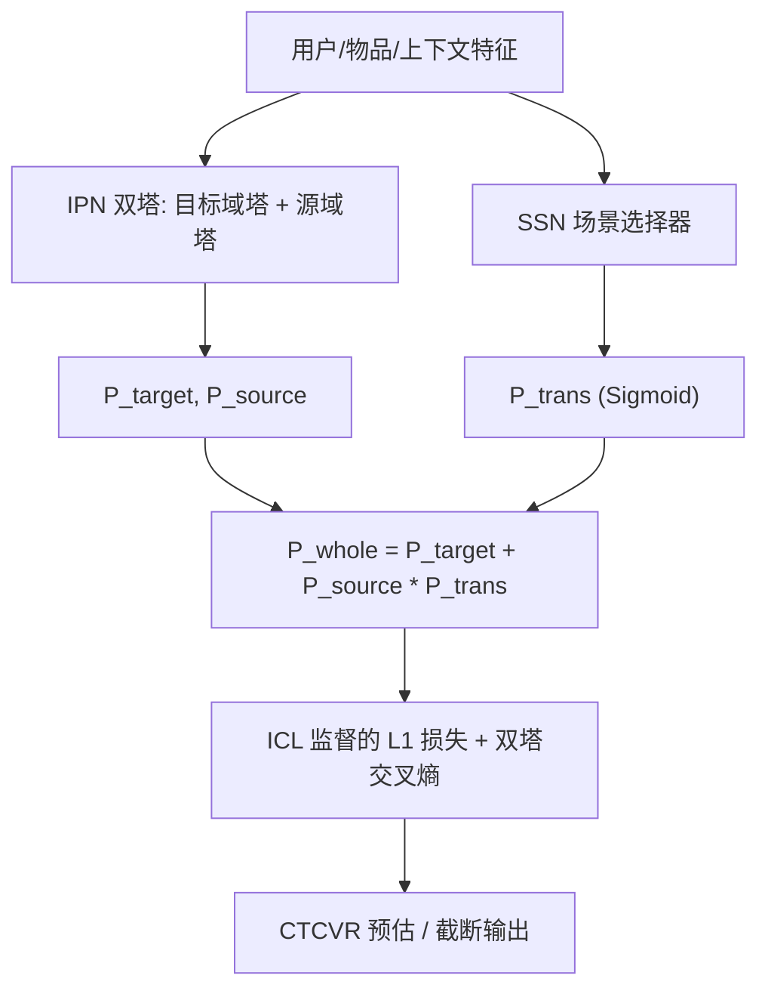
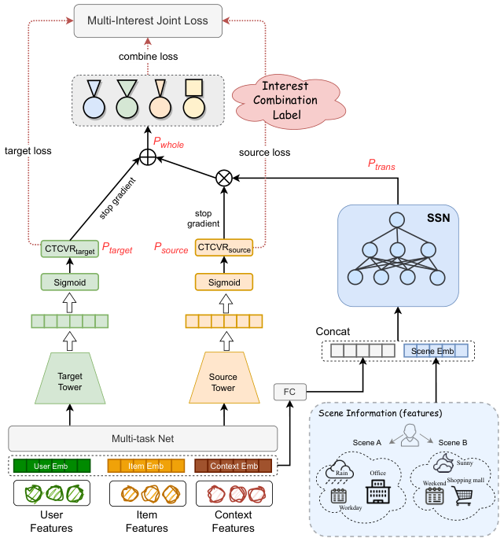

# EXIT: An EXplicit Interest Transfer Framework for Cross-Domain Recommendation (显式兴趣迁移的跨域推荐框架)

- **会议/期刊**: CIKM 2024
- **作者与机构**: Lei Huang, Weitao Li, Chenrui Zhang, Jinpeng Wang, Xianchun Yi, Sheng Chen（美团）
- **推荐链路定位**: 精排（CTCVR 预估）
- **研究方向**: 跨域与多场景推荐 / CTR-CVR 预估
- **论文原文**: [https://arxiv.org/abs/2407.20121v1](https://arxiv.org/abs/2407.20121v1)
- **开源代码**: 暂未开源

## TL;DR (1分钟核心速览)

现有跨域推荐（CDR）几乎都走「隐式」范式：靠共享 embedding 或复杂网络把源域知识混进目标域，迁移过程无监督、不可控，在美团这种「搜索域（显式需求）vs 首页推荐域（隐式需求）」差异极大的场景下极易负迁移——病中买一次药就被当成长期兴趣狂推药品。本文提出 EXIT，构造**兴趣组合标签（ICL）**把跨域迁移概率 $P_{trans}$变成有监督的回归目标，再用**场景选择器（SSN）**按细粒度场景调节迁移强度，最终兴趣写成$P_{whole}=P_{target}+P_{source}\cdot P_{trans}$。在 10.5 亿样本工业数据上 AUC 0.9052(DNN)→0.9098，线上 CTCVR +1.23%、GTV +3.65%、负反馈率 −6.62%。

## Background & Motivation (背景与核心矛盾)

- **主流范式**: CDR 从内容增广（跨域共享文本/画像）、评分模式迁移（MINDTL/DARec）演进到 embedding 共享（DTCDR 共享用户向量、MiNet 双注意力、STAR 星型共享中心、UniCDR 统一框架），核心是让源域表征参与目标域训练。
- **前人局限**: ①这些方法多在「相似域之间」验证（同一平台不同场景的推荐流），源目标域服务形态接近，负迁移不明显；一旦源域是**搜索**这类强意图域、目标域是**推荐**这类弱意图域，语义不可直接对齐。②迁移信号**无监督**，损失函数只拟合各域自身 ground truth，迁移多少、迁移什么完全隐含，无法过滤干扰兴趣。
- **核心洞察 (Key Insight)**: 负迁移的根源不是「表征不够好」，而是「迁移权重没有被显式监督」。用户在源域的行为是否值得迁移到目标域，本身是一个可以被标注的二分类/连续量问题。
- **本文切入点**: 把迁移概率从「网络副产品」变成「有标签的监督目标」，用 ICL 直接告诉模型哪些源域兴趣该传、哪些该掐掉。

## Method (核心方法设计)

### 1. 整体框架 (Overall Architecture)

EXIT 由三部分组成：IPN（兴趣预测网络）在同一 MMoE 多任务骨架上同时预测目标域兴趣 $P_{target}$与源域聚合兴趣$P_{source}$；SSN（场景选择器）以用户/物品/场景特征为输入输出迁移概率$P_{trans}$；二者按$P_{whole}=P_{target}+P_{source}\cdot P_{trans}$融合得到完整兴趣。训练时三路损失联合优化，其中 ICL 只在训练期作为$P_{whole}$的回归目标存在，推理时无需人工标注；线上服务对输出做$P'_{whole}=\min\{1,P_{whole}\}$ 截断以保证概率范围合法。

<figure class="paper-figure" markdown="span">
  <figcaption>图3：EXIT 的框架。EXIT 对用户的目标域兴趣 𝑃𝑡𝑎𝑟𝑔𝑒𝑡、源域兴趣 𝑃𝑠𝑜𝑢𝑟𝑐𝑒 以及跨域兴趣迁移概率 𝑃𝑡𝑟𝑎𝑛𝑠 建模，最终得到适合目标域的用户完整兴趣 𝑃𝑤ℎ𝑜𝑙𝑒= 𝑃𝑡𝑎𝑟𝑔𝑒𝑡+𝑃𝑠𝑜𝑢𝑟𝑐𝑒∗𝑃𝑡𝑟𝑎𝑛𝑠。</figcaption>
</figure>

### 2. 关键设计拆解 (Key Designs)

1. **兴趣组合标签 ICL（把无监督迁移变成有监督回归）**：痛点是无标签可用。作者用目标域标签 $y_t$与源域聚合标签$y_s=\max(y_{s1},\dots,y_{sn})$交叉构造四象限标签：$(0,0)\to0$、$(1,0)\to1$、$(1,1)\to2$、$(0,1)\to\eta$。含义是——用户在两域都买过同一物品即为强正迁移，标 2 拉高$P_{trans}$；用户只在源域买过则模糊，用一个**群体一致性兴趣**$\eta_i$ 作为软标签，即该物品在两域付费用户集合的 Jaccard 相似度：

$$\eta_i=\frac{|U^{pay}_{t,i}\cap U^{pay}_{s,i}|}{|U^{pay}_{t,i}\cup U^{pay}_{s,i}|}$$

2. **场景选择器 SSN（迁移强度随场景变化）**：同一份源域兴趣在工作日午间写字楼与周末商圈的价值完全不同。SSN 先把用户/物品/上下文嵌入压成 $\mathbf{E}_{hid}$，再与年龄、品类、小时、星期等场景嵌入拼接，经 MLP 与 Sigmoid 输出$P_{trans}$。由于$P_{trans}$与$P_{source}$相乘，它本质上是一个**门控**：$\eta$ 低的物品（如感冒药）天然学到接近 0 的门，从而在打分时被彻底压低。

3. **训练目标与推理效率**：三路联合损失 $\mathcal{L}_{joint}=\lambda_1\mathcal{L}_{CE}(y_t,P_t)+\lambda_2\mathcal{L}_{CE}(y_s,P_s)+\lambda_3|y_{icl}-(P_t+P_s\cdot P_{trans})|$，$\lambda$均取 1（图 4 显示 0.5–3 区间 AUC 波动仅约 0.001，极不敏感）。源域多业务用$\max$聚合成单标签，**域扩展时无需改网络结构，只改样本标签**；网上部署仅替换多任务模型中 CTCVR 这一路塔，其余目标结构不动，故推理成本几乎与 DNN 持平。$\eta$ 由 Spark 每日离线统计更新。

## Experimental Setup & Evaluation Protocol (实验设置与评估协议)

- **数据集与预处理**: 无公开数据集可用（Amazon 源/目标域不同时共享用户与物品），故自建美团工业日志：目标域=首页推荐，源域=搜索 + 频道栏目。

| 数据集 | #Samples | #Users | #Items | 目标域购买 | 源域购买 |
| :--- | :---: | :---: | :---: | :---: | :---: |
| Train | 1,047,491,213 | 126,274,195 | 21,410,172 | 13,283,510 | 29,777,834 |
| Test | 260,800,669 | 53,307,975 | 12,481,469 | 3,097,937 | 7,163,564 |

- **数据划分与防穿越**: 按曝光-购买日志的**时间顺序划分**训练/测试（工业样本量级，非 Leave-One-Out 或采样排序）。
- **排名评测协议**: 严格说是**曝光样本上的 Pointwise 打分评估**——离线用 AUC 与 Logloss 衡量 CTCVR 预估校准与区分度（非 Full-Ranking 全库排序）；作者明确指出离线只在目标域兴趣空间内评估会低估 CDR，因此额外做**线上 7 天 A/B**（桶间约百万用户，候选集约 1 亿）以 CTCVR / GTV / NFR 为准。
- **对比基线与超参设置**: 单域 LR/DNN/DeepFM/DCN，跨域 MV-DNN/CoNet/MiNet/STAR/UniCDR；embedding 维度 8，batch 384，Adam，MMoE 双共享专家，双塔为 2 层 PReLU DNN，各方法离线跑 3 次取均值。

## Key Experimental Results (实验关键数据)

### 1. 主实验对比 (Main Results)

| 方法 | AUC↑ | Logloss↓ | CTCVR↑ | GTV↑ | NFR↓ |
| :--- | :---: | :---: | :---: | :---: | :---: |
| DNN | 0.9052 | 0.06677 | 基准 | 基准 | 基准 |
| DeepFM | 0.9069 | 0.06685 | +0.278% | +1.374% | −1.245% |
| DCN | 0.9067 | 0.06675 | +0.448% | +0.896% | −0.921% |
| MV-DNN | 0.9008 | 0.06820 | −0.024% | +0.858% | +2.025% |
| CoNet | 0.9073 | 0.06662 | +0.540% | +1.616% | +0.272% |
| MiNet | 0.9078 | 0.06655 | +0.650% | +2.174% | −0.251% |
| STAR | 0.9069 | 0.06672 | +0.520% | +1.199% | −0.781% |
| UniCDR | 0.9075 | 0.06668 | +0.775% | +2.718% | −1.211% |
| **EXIT (ours)** | **0.9098** | **0.06637** | **+1.336%** | **+4.109%** | **−6.937%** |

### 2. 消融实验 (Ablation Study)

| 变体 | AUC↑ | Logloss↓ | CTCVR↑ | GTV↑ | NFR↓ |
| :--- | :---: | :---: | :---: | :---: | :---: |
| w/o ICL（无差别迁移全部源域兴趣） | 0.9055 | 0.06749 | +0.581% | +1.226% | +0.779% |
| w/o SSN（去场景特征与场景嵌入） | 0.9075 | 0.06661 | +1.092% | +1.971% | −4.159% |
| w/o joint loss（仅 L1） | 不收敛 | — | — | — | — |
| ICL($\eta=0$，纯个性化标签) | 0.9081 | 0.06643 | +0.874% | +3.053% | −5.231% |
| ICL($y_t+\eta$，全场景用群体一致性) | 0.9074 | 0.06658 | +0.544% | +1.814% | −3.670% |
| **EXIT (full)** | **0.9098** | **0.06637** | **+1.336%** | **+4.109%** | **−6.937%** |

### 3. 关键实验发现 (Key Findings)

1. **负迁移在离线指标上几乎隐身，只有线上 NFR 能暴露**：MV-DNN、CoNet 的 AUC 与 Logloss 均优于 DNN，GTV 也有提升，但 NFR 分别恶化 +2.025% 与 +0.272%；说明纯离线目标域评估无法度量跨域引入的干扰兴趣，NFR 才是负迁移的敏感探针。EXIT 是唯一同时把 AUC、GTV、NFR 三项全部拉开的方法（NFR −6.937%）。
2. **ICL 是"防负迁移"而非"补信息"的开关**：移除 ICL 后 AUC 反落至 0.9055（低于所有完整跨域基线），NFR 由负转正 +0.779%——证明无过滤的源域信号净效应为负；而 $\eta$的取法也很关键，去掉群体一致性（$\eta=0$）损失 1.1 个千分点 CTCVR，全场景改用$\eta$亦下降，只有"仅在$y_t=0,y_s=1$ 的冲突象限启用群体一致性"这一设计最优。
3. **联合损失不可省，双塔独立建模是前提**：去掉两路交叉熵、仅保留最终 ICL 的 L1 回归时训练直接不收敛——因为 $P_{whole}$是$P_{target}$与$P_{source}\cdot P_{trans}$ 的可加组合，缺少分域监督会让两个分量互相补偿、陷入平凡解；这从训练动力学上验证了式 (2) 的加法分解是必要的归纳偏置。

## Highlights & Limitations (亮点、对比与审稿批判)

- **与代表作对比 (vs. Prior Work)**: 与 STAR/UniCDR 这类"共享网络结构 + 无监督迁移"路线不同，EXIT 不改塔结构，只改**监督信号**，把迁移系数变成一个可学、可解释、可截断的门；与 MiNet 的双层注意力相比，EXIT 的门控是显式标签驱动，且乘法形式使得源域兴趣与迁移概率必须同时高才生效，天然具备 AND 逻辑的过滤性。
- **可迁移亮点**: ①"标签交叉构造 + 软标签（群体 Jaccard）"这一套路可直接搬到多场景/多目标推荐中的门控单元（如 PEPNet 的 domain gate 监督化）；②$\max$ 聚合多源域标签使域扩展零改网，对业务快速接入极友好。
- **审稿级局限批判**: ①实验仅限美团内部数据，且源目标域**完全共享用户与物品**，无法回答非重叠域（作者亦在结论中承认为未来工作）下的有效性，泛化性论证偏弱；②离线只有 AUC/Logloss，缺少排序类指标与显著性检验，线上也未报告置信区间与实验时长对季节性的稳健性；③$\eta$ 依赖全量付费用户集合统计，冷启动物品 Jaccard 为 0 会被系统性判为不可迁移，可能加剧长尾物品在跨域链路中的劣势。

## Rating (四维评分)

- **方法创新性 (Novelty)**: ⭐⭐⭐⭐ （把无监督跨域迁移改写为有监督软标签回归，思路朴素但切中 CDR 范式盲点，ICL 四象限设计与群体一致性软标签有巧思）
- **评估协议与实验扎实度 (Protocol & Experiments)**: ⭐⭐⭐⭐ （10 亿级工业数据 + 两周线上 A/B + 含 NFR 的用户体验指标很扎实，但缺排序指标、显著性检验与非重叠域验证）
- **写作与数学规范度 (Clarity & Rigor)**: ⭐⭐⭐⭐ （公式极简、$P_{whole}$ 加法分解与截断处理交代清楚，但 ICL 为何取 0/1/2 的具体量纲与 L1 损失尺度匹配缺少理论说明）
- **工业落地与复现价值 (Industrial & Practical Value)**: ⭐⭐⭐⭐⭐ （只改一路塔、参数量几乎不增、域扩展零改网、线上 GTV +3.65%，是少见的"低成本高确定性"工业范式；可惜未开源）

