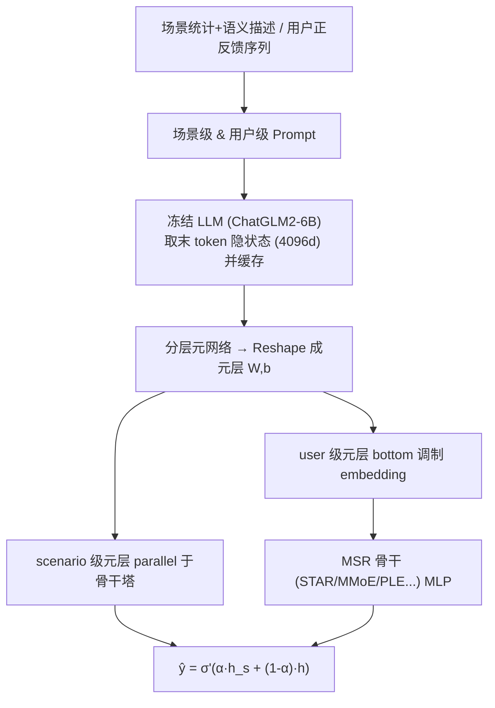

# LLM4MSR: An LLM-Enhanced Paradigm for Multi-Scenario Recommendation (LLM 增强的多场景推荐范式)

- **会议/期刊**: CIKM 2024 (Full Research Paper)
- **作者与机构**: Yuhao Wang, Zichuan Fu, Wanyu Wang, Yuyang Ye, Xiangyu Zhao (CityU HK); Yichao Wang, Xiangyang Li, Huifeng Guo, Ruiming Tang (华为诺亚方舟实验室)
- **推荐链路定位**: 精排 (多场景 CTR 预估) — 以通用增强范式挂载于任意 MSR 骨干
- **研究方向**: 跨域与多场景推荐 / 大语言模型推荐
- **论文原文**: [arXiv:2406.12529v2](https://arxiv.org/abs/2406.12529v2)
- **开源代码**: [Applied-Machine-Learning-Lab/LLM4MSR](https://github.com/Applied-Machine-Learning-Lab/LLM4MSR)

## TL;DR (1分钟核心速览)

现有多场景推荐 (MSR) 只用 domain ID 作为场景知识、且忽略用户跨场景个性化偏好；而现有 LLM4Rec 需样本级对齐或微调，推理延迟高、无法上线。本文提出 LLM4MSR：用**冻结** ChatGLM2-6B 通过场景级（统计量+语义描述）与用户级（仅正反馈历史）Prompt 零样本推理出场景相关性与跨场景兴趣，取末 token 隐状态，再由**分层元网络**生成元层（user 级置于骨干底部、scenario 级与骨干塔并行），可学习权重 $\alpha$ 自适应融合。在 KuaiSAR-small / KuaiSAR / Amazon 上以 AUC 评估，相对骨干分别提升约 1.5% / 1% / 40%，推理仅 52ms。

## Background & Motivation (背景与核心矛盾)

- **主流范式**: STAR / MMoE / PLE / AITM / Shared-Bottom 通过"共享参数 + 场景专属塔/门控"的 MTL 参数共享模式建模场景共性与差异。
- **前人局限**: ①场景知识仅用 domain indicator 表达，场景语义（描述、交互量级、物品重叠度）被丢弃，场景相关性建立不充分；②偏好建模只依赖协同信号，用户**跨场景**的共同/差异兴趣未被解耦建模。
- **核心洞察 (Key Insight)**: LLM 的 next-token 预训练使其不只是"编码已有信息"（如 BERT 做 encoder），而能**推理出新知识**——原文用同一 Prompt 喂 GPT-2 只输出无意义文本，而 ChatGLM2-6B 能给出结构化兴趣总结，证明"reasoner"与"encoder"的本质差异。
- **本文切入点**: 把 LLM 调用从高成本的"样本级"降到"用户级/场景级"，一次推理产出向量并缓存复用，再用元网络把语义空间桥接到推荐空间。

## Method (核心方法设计)

### 1. 整体框架 (Overall Architecture)

两阶段闭环：**(a) 多场景知识推理**——对每个场景 $d$构造场景级 Prompt（平台描述、各场景交互/用户/物品数、重叠物品数、专家先验），对每个用户$u$构造用户级 Prompt（各场景下最近$T$条正反馈的 `behavior + item_type + category`），冻结 LLM 前向一次，仅取**最后一个 token 的隐状态**（ChatGLM2-6B 为 4096 维）作为语义知识向量并离线缓存；**(b) 多级知识融合**——两个分层元网络分别把两个隐状态映射并 reshape 成$K$层全连接层的权重与偏置，用户级元层插在 embedding 之后（bottom）逐层调制表征，场景级元层与 MSR 骨干的塔并行（parallel），最终以可学习$\alpha$ 加权融合后过 sigmoid 输出 CTR。全流程与骨干端到端训练，LLM 全程不更新。

### 2. 关键设计拆解 (Key Designs)

1. **多级 Prompt 的场景/用户知识推理（解决"场景知识贫乏 + 跨场景偏好缺失"）**：场景级 prompt 显式要求"总结三场景共性 + 本场景差异性"，把交互规模、物品重叠率等统计量转成语义；用户级 prompt **只保留正反馈**（click/forward/like）并按阈值 $T$截断最近交互，规避负样本噪声与 LLM 8K 上下文限制。关键算子极简：$\boldsymbol{h}_{\text{LLM}} = \text{LLM}(\text{Prompt})[\text{-1}]$，一次调用即"用户级"而非"样本级"，这是效率提升的根源。
2. **分层元网络生成元层（解决"语义→推荐空间对齐丢信息"）**：现有做法把 LLM 输出当普通特征字段（被大量 field 淹没）、或线性投影对齐（信息损失）、或微调 LLM（昂贵）。本文改为**参数生成**：$\boldsymbol{h}_{mw},\boldsymbol{h}_{mb}=\text{MetaNet}(\boldsymbol{h}_{\text{LLM}})$，随后$\boldsymbol{W}^{(i)}_{l}=\text{Reshape}(\boldsymbol{h}_{mw})$、$\boldsymbol{b}^{(i)}_{l}=\text{Reshape}(\boldsymbol{h}_{mb})$，$\boldsymbol{h}^{(i)}=\sigma(\boldsymbol{W}^{(i)}_{l}\boldsymbol{h}^{(i-1)}+\boldsymbol{b}^{(i)}_{l})$。直觉：直接把语义知识"编译"成网络权重，等效于用语义先验对骨干做一次条件化，而不是把语义当作与其他特征平权的输入。
3. **分层融合与训练目标**：$\boldsymbol{h}=\text{MSR}(\boldsymbol{h}^{(K)}_{u})$，$\hat{y}=\sigma'(\alpha\cdot\boldsymbol{h}^{(K)}_{s}+(1-\alpha)\cdot\boldsymbol{h})$，其中$\alpha$可学习。训练沿用 BCE：$\mathcal{L}=-\frac{1}{B}\sum_{i}\left[y_i\log\hat{y}_i+(1-y_i)\log(1-\hat{y}_i)\right]$；**无需负采样设计**（CTR 二分类，负样本即曝光未点击），LLM 侧免微调、免梯度；用户级隐状态可训练前离线预计算（单卡 2–4 秒/用户），在线仅走元网络 + 骨干，无 LLM 前向。

## Experimental Setup & Evaluation Protocol (实验设置与评估协议)

- **数据集与预处理**:

| 数据集 | #Users | #Items (Rec / Search) | #Interactions (Rec / Search) | 稀疏度(未点击占比) | 特征/场景说明 |
| :--- | :---: | :---: | :---: | :---: | :--- |
| KuaiSAR-small | 25,877 | 2,281,034 / 1,974,165 | 7,493,101 / 3,038,362 | 50.49% / 87.87% | 快手短视频，9 天，搜索+推荐，9.8 万物品重叠，用户全重叠 |
| KuaiSAR | 25,877 | 4,046,363 / 2,974,596 | 14,605,712 / 4,828,690 | 50.40% / 87.88% | 快手 19 天，18.2 万物品重叠 |
| Amazon | 24,752 | 8,788 / 193,304 / 6,980 | 33,929 / 370,840 / 56,356 | 21.50% / 19.61% / 20.67% | All Beauty / Clothing / Luxury Beauty 三相关场景，滤除重叠用户、保留无重叠物品，标签为 rating>3 |

- **数据划分与防穿越 (Splitting Strategy)**: **按时间顺序 8:1:1** 划分 train/val/test（chronological split），严格避免未来交互泄漏。
- **排名评测协议 (Ranking Protocol)**: 指标为 **AUC**；属 CTR 二分类全样本评估（非采样排序），显著性用 $t$-test，标准为$p<0.05$（表中 ★ 标注）。
- **对比基线与超参设置**: 骨干 6 个（STAR / OMoE / MMoE / PLE / AITM / Shared-Bottom），增强基线 2 个（**Dynamic Network**：场景知识生成场景专属 attention+tower；**EPNet**：PEPNet 式 domain 门控）；Embedding 维度 $d=16$，batch 4096（Amazon 1024），lr 2e-4（Amazon 2e-3），骨干隐层 [256,128,64]（Amazon [64,32,16]），Adam，结果取 3 次均值。

## Key Experimental Results (实验关键数据)

### 1. 主实验对比 (Main Results)

| 模型 | KuaiSAR-small Rec | KuaiSAR-small Search | KuaiSAR Rec | KuaiSAR Search | Amazon Rec#1 | Amazon Rec#2 | Amazon Rec#3 |
| :--- | :---: | :---: | :---: | :---: | :---: | :---: | :---: |
| STAR | 0.7225 | 0.6089 | 0.7387 | 0.6268 | 0.6156 | 0.6320 | 0.6225 |
| STAR_DN | 0.7241 | 0.6116 | 0.7404 | 0.6270 | 0.6306 | 0.6350 | 0.6355 |
| STAR_EP | 0.7230 | 0.6082 | 0.7388 | 0.6266 | 0.6211 | 0.6302 | 0.6378 |
| **STAR_ours** | **0.7276**★ | 0.6181★ | 0.7408★ | 0.6332★ | **0.8720**★ | **0.6364**★ | **0.7543**★ |
| OMoE_ours | 0.7265★ | **0.6186**★ | 0.7413★ | 0.6332★ | 0.8182★ | 0.6180★ | 0.6823★ |
| MMoE_ours | 0.7264★ | 0.6166★ | **0.7410**★ | 0.6341★ | 0.7860★ | 0.6222★ | 0.6854★ |
| PLE_ours | 0.7269★ | 0.6184★ | 0.7408★ | 0.6343★ | 0.8265★ | 0.6250★ | 0.7074★ |
| AITM_ours | 0.7273★ | 0.6178★ | 0.7407★ | **0.6349**★ | 0.8196★ | 0.6178★ | 0.7089★ |
| SharedBottom_ours | 0.7269★ | 0.6182★ | 0.7400★ | 0.6341★ | 0.8323★ | 0.6262★ | 0.7182★ |

相对骨干的整体 AUC 提升：KuaiSAR-small **+1.5%**、KuaiSAR **+1.0%**、Amazon **+40%**（相对值，Amazon 因 Rec#1/#3 极稀疏而放大）。

### 2. 消融实验 (Ablation Study)

（以 STAR 为骨干，图 3 报告相对 STAR 的 AUC 提升百分比，此处给出方向性结论）

| 变体 | 元层位置 | 趋势 |
| :--- | :--- | :--- |
| user-bottom（仅用户级） | bottom | 三数据集均正增益，Amazon 上贡献最大 |
| user-parallel（仅用户级） | parallel | 弱于 bottom，多场景甚至**负增益** |
| domain-bottom（仅场景级） | bottom | 弱于 parallel；KuaiSAR 系列贡献最大的单组件 |
| domain-parallel（仅场景级） | parallel | 优于 domain-bottom，但不及全模型 |
| **LLM4MSR (user-bottom + domain-parallel)** | 混合 | **三数据集全场景最优** |
| 隐状态替换为随机初始化向量 | — | **无任何增益**（证明增益来自 LLM 语义而非额外参数） |

### 3. 关键实验发现 (Key Findings)

1. **稀疏场景收益最猛**：Amazon Rec#1 用户平均仅 1.4 条交互，STAR 从 0.6156 跃至 0.8720（+41.6% 相对）；而 Rec#2 每用户 2.3 条交互、信息本已充足，提升仅约 0.7%——说明 LLM 语义先验主要在协同信号稀缺处兑现价值。
2. **层级位置与知识粒度强耦合**：user 级知识是跨场景的"完整画像"，适合在**低层**调制 embedding；scenario 级知识是"域区分"，适合在**高层**与塔并行（类比 STAR 辅助网络）。错配（如 user-parallel）会破坏骨干原有表征，出现负增益。
3. **效率可控**：KuaiSAR-small 上 STAR 训练/推理 0.028s/0.017s，LLM4MSR 为 0.15s/0.052s（仍低于工业 0.1s 延迟线）；超参上正反馈阈值 $T$越大越好直至 LLM 8K token 上限，元层数$K=2$最优、$K$ 增大过拟合。可退化部署为"仅 domain-parallel"以换取免去用户级 LLM 推理。

## Highlights & Limitations (亮点、对比与审稿批判)

- **与代表作对比 (vs. Prior Work)**: 相比 **STAR/PEPNet** 仅用 domain ID 与门控缩放参数，本文引入语义空间的场景/用户双粒度知识；相比 **CTRL / KAR / S&R Foundation Model** 的样本级语义对齐（推理时逐样本过 LM），本文把调用粒度抬到 user/scenario 级并离线缓存，把"对齐"换成"参数生成"；相比微调 LLM 的路线，完全冻结带来部署可行性。
- **可迁移亮点**: ①"末 token 隐状态 → Reshape 成 FC 层权重"的元层注入范式可低成本迁移到任何 CTR 骨干（无需改特征 schema）；②正负样本过滤 + 阈值扫描构造用户级 Prompt，是把任意交互日志塞进有限上下文窗口的通用工程配方。
- **审稿级局限批判**: ①**离线缓存脆弱**：用户兴趣随时间漂移，论文未量化缓存过期（staleness）对 AUC 的影响，也未见增量刷新策略；②**幅度表述存疑**：Amazon 上"40%"相对提升主要来自极稀疏场景，#2 场景几乎持平，泛化性说明力有限；③prompt 模板与超参（$T$、正反馈行为定义、Amazon 场景选择）高度依赖数据集，跨行业迁移需重新人工设计；④仅报告 AUC（CTR 排序），未做校准或线上 A/B，元层生成的 8256 维权重共享同一隐状态，容量上界未讨论。

## Rating (四维评分)

- **方法创新性 (Novelty)**: ⭐⭐⭐⭐ （把 LLM 从"样本级特征增强器"转为"用户/场景级知识推理器 + 元层参数生成器"，双粒度分层融合有清晰直觉支撑）
- **评估协议与实验扎实度 (Protocol & Experiments)**: ⭐⭐⭐⭐ （3 数据集 × 6 骨干 × 2 增强基线，时间序切分与 $p<0.05$ 显著性齐备；扣分在消融仅以柱状图相对值呈现、缺绝对数值表）
- **写作与数学规范度 (Clarity & Rigor)**: ⭐⭐⭐⭐ （公式 2–7 简洁自洽、Prompt 模板与算法流程完整附录；但对"为何末 token 承载全局信息"仅一句直觉，缺理论论证）
- **工业落地与复现价值 (Industrial & Practical Value)**: ⭐⭐⭐⭐⭐ （LLM 冻结 + 隐状态预计算 + 52ms 在线推理，代码开源且有 MindSpore 版本，工程可落地性在同类 LLM4Rec 中突出）

