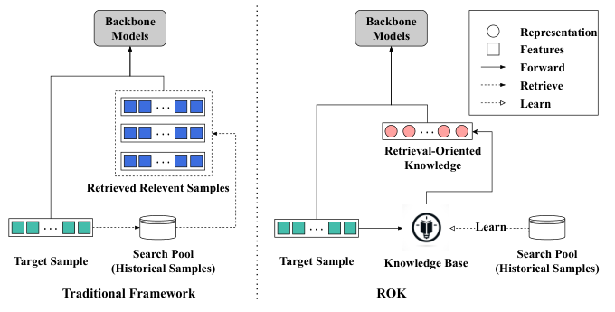
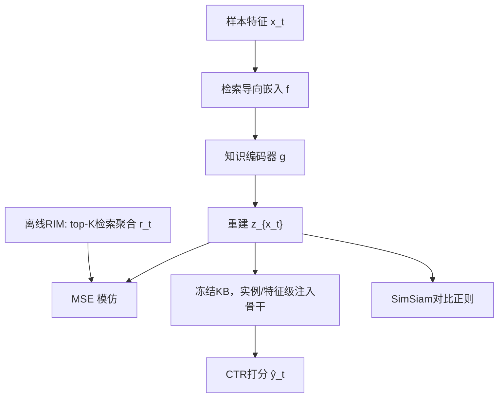
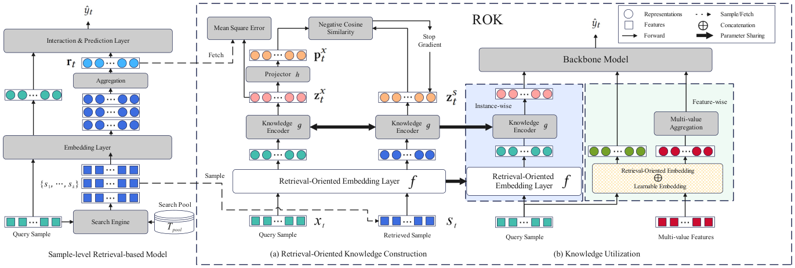

# Retrieval-Oriented Knowledge for Click-Through Rate Prediction（面向点击率预估的检索导向知识）

- **会议/期刊**: CIKM 2024
- **作者与机构**: Huanshuo Liu (NUS/Huawei Noah’s Ark 实习)、Bo Chen、Menghui Zhu、Jiarui Qin、Hao Zhang、Yang Yang、Ruiming Tang (Huawei Noah’s Ark)；Jianghao Lin (SJTU)
- **推荐链路定位**: 精排（CTR预估）
- **研究方向**: CTR预估与特征交叉
- **论文原文**: [论文原文链接](https://arxiv.org/abs/2404.18304v2)
- **开源代码**: [开源代码仓库链接](https://github.com/HSLiu-Initial/ROK.git)

## TL;DR (1分钟核心速览)

样本级检索（RIM）靠在线检索百万级样本提升CTR，但推理慢、资源高、链路割裂。ROK用“分解-重建”知识库模仿检索聚合表征，以MSE蒸馏+SimSiam对比正则训练，推理时仅前向传播。在Tmall/Taobao/Alipay按时间切分、AUC/LogLoss评测，ROK相对骨干AUC提升10.08%/34.96%/16.85%，Tmall/Alipay超教师RIM。

## Background & Motivation (背景与核心矛盾)

- **主流范式**: CTR模型分特征交叉与行为建模两条线；检索增强从item-level（SIM/UBR）走向sample-level（RIM），用top-K近邻样本聚合增强目标样本。
- **前人局限**: RIM须在线逐样本检索与聚合，检索池达百万/十亿级，推理不可缓存且资源随QPS线性增长；同时形成“inference-retrieval-inference”割裂链路，工程部署困难。
- **核心洞察 (Key Insight)**: 检索聚合结果可在离线阶段预存，并用参数化网络模仿；一旦知识库学会“检索后表征”，在线即可绕开真实检索。
- **本文切入点**: 提出ROK，以decomposition-reconstruction知识库蒸馏非参数检索知识，并用对比正则提升泛化与稳定性。

<figure class="paper-figure" markdown="span">
  <figcaption>图1：传统样本级检索框架与ROK的比较。</figcaption>
</figure>

## Method (核心方法设计)

### 1. 整体框架 (Overall Architecture)

ROK分两阶段。①知识构建：先按RIM预训练，离线缓存每个样本的top-K检索聚合表征 $r_t$；知识库由检索导向嵌入层$f$将离散特征映射为特征级向量，再由知识编码器$g$重建实例级表征$z_{x_t}=g(f(x_t))$，以MSE模仿$r_t$，并用对比正则稳定。②知识利用：冻结知识库，将$z_{x_t}$以实例级拼接或特征级融合注入DeepFM/DIN/DIEN等骨干，最终BCE训练。在线只需一次前向，复杂度$O(1)$，避免检索-聚合循环。

<figure class="paper-figure" markdown="span">
  <figcaption>图2：ROK的整体框架。流程从面向检索的知识构建阶段开始，其中基于样本级检索的模型已完成预训练，检索与聚合结果已离线预存。随后设计定制知识库以模仿聚合结果，并通过对比正则化确保训练阶段的稳定性。该设计允许以神经网络快速前向传播替代耗时的检索与聚合过程。在后续的知识利用阶段</figcaption>
</figure>

### 2. 关键设计拆解 (Key Designs)

1. **分解-重建知识库（免检索的核心）**：痛点在于检索聚合不可缓存、在线开销大；ROK先将样本分解为特征级嵌入，再重建实例级聚合表征 $z_{x_t}=g(f(x_t))$，以$\mathcal{L}_{imit}=\mathrm{MSE}(z_{x_t},r_t)$蒸馏教师知识。直觉是用共享嵌入+轻量编码器把“查池子”变成“算函数”，将检索复杂度压到$O(1)$；为控参，嵌入维度取$d/2$。
2. **对比正则（防塌缩并提取局部特征）**：RIM聚合只利用近邻全局特征，top-K中仍有噪声；ROK取top-1最相关样本 $s_t$为正样本，经projector$h$得$p_{x_t}=h(z_{x_t})$、$p_{s_t}=h(z_{s_t})$，采用带stop-gradient的对称余弦损失$\mathcal{L}_{contra}=-\frac{1}{2}[D(p_{x_t},z_{s_t})+D(p_{s_t},z_{x_t})]$。其作用是把相似样本拉近、抑制检索噪声，并借SimSiam免负样本稳定训练。
3. **训练目标、负采样与推理效率**：总损失 $\mathcal{L}=(1-\alpha)\mathcal{L}_{imit}+\alpha\mathcal{L}_{contra}$，无额外负采样；知识利用阶段冻结KB，仅用BCE训练骨干，$\hat{y}_t=\mathrm{backbone}(\phi(x_t)\oplus z_{x_t})$。在线推理仅增一次前向，避免检索与聚合。

## Experimental Setup & Evaluation Protocol (实验设置与评估协议)

- **数据集与预处理**: 三个大规模数据集统计如下：

| 数据集 | #Users | #Items | #Interactions | 稀疏度/密度 | 特征/场景说明 |
| :--- | :---: | :---: | :---: | :---: | :--- |
| Tmall | 424,170 | 1,090,390 | 54,925,331 | 极稀疏 | 电商，9字段 |
| Taobao | 987,994 | 4,162,024 | 100,150,807 | 极稀疏 | 电商，4字段 |
| Alipay | 498,308 | 2,200,291 | 35,179,371 | 极稀疏 | 支付，6字段 |

- **数据划分与防穿越 (Splitting Strategy)**: 按时间顺序切分：最旧样本构成search pool，中间样本为训练集，最新样本为测试集；行为序列亦从search pool生成，避免未来信息穿越。
- **排名评测协议 (Ranking Protocol)**: CTR点式评测，采用AUC与LogLoss；未使用Full-Ranking或Sampled Ranking，也未做负采样排序。
- **对比基线与超参设置**: 传统模型GBDT/DeepFM/FATE/HPMN/MIMN/DIN/DIEN；item-level检索SIM/UBR；sample-level教师RIM。ROK嵌入与骨干嵌入取 $d/2$以控参，显著性检验$p<0.01$。

## Key Experimental Results (实验关键数据)

### 1. 主实验对比 (Main Results)

| 模型 | Tmall AUC/LL | Taobao AUC/LL | Alipay AUC/LL | Rel.Impr.@骨干 |
| :--- | :---: | :---: | :---: | :---: |
| GBDT | 0.8319/0.5103 | 0.6134/0.6797 | 0.6747/0.9062 | — |
| DeepFM | 0.8581/0.4695 | 0.6710/0.6497 | 0.6971/0.6271 | — |
| FATE | 0.8553/0.4737 | 0.6762/0.6497 | 0.7356/0.6199 | — |
| DIN | 0.8796/0.4292 | 0.7433/0.6086 | 0.7647/0.6044 | — |
| DIEN (骨干) | 0.8839/0.4272 | 0.7506/0.6082 | 0.7485/0.6019 | 0.00% |
| SIM | 0.8857/0.4520 | 0.7825/0.5795 | 0.7600/0.6089 | — |
| UBR | 0.8975/0.4368 | 0.8169/0.5432 | 0.7952/0.5747 | — |
| RIM (教师) | 0.9151/0.3697 | **0.8567**/**0.4546** | 0.8005/0.5736 | — |
| **ROK** | **0.9226**/**0.3546** | 0.8382/0.5098 | **0.8093**/**0.5304** | **10.08%/34.96%/16.85%** |

### 2. 消融实验 (Ablation Study)

| 消融项/探针 | 设置 | 结果与结论 |
| :--- | :--- | :--- |
| 对比正则 | $\alpha=0$（w/o contra） | AUC下降；$\alpha=0$或$1$均劣于中间值（图6趋势） |
| 检索模仿 | $\alpha=1$（w/o imitation） | AUC下降；两项损失互补 |
| 正样本选择 | 随机替代top-1 | AUC下降；top-1近邻有信息，随机引入噪声 |
| KB更新策略 | Upd $g$/ Upd$f+g$ | 均低于Fix；冻结KB最佳 |
| 知识探针 | RIM(LR/MLP)→ROK(LR/MLP) | Tmall 0.8379/0.8426→0.8572/0.8643；Alipay 0.6613/0.6773→0.6862/0.6923 |

### 3. 关键实验发现 (Key Findings)

- **增益主要来自检索知识蒸馏**：ROK相对DIEN在Tmall/Taobao/Alipay的AUC提升10.08%/34.96%/16.85%，LogLoss从0.4272/0.6082/0.6019降至0.3546/0.5098/0.5304，说明参数化KB可替代search pool。
- **对比正则使ROK在2/3数据集超过教师**：Tmall AUC 0.9226 vs RIM 0.9151（+0.75 pt），Alipay 0.8093 vs 0.8005（+0.88 pt）；但Taobao 0.8382低于RIM 0.8567（-1.85 pt），说明蒸馏并非全场景无损。
- **兼容性与效率兼具**：接入DeepFM/DIN/DIEN平均AUC提升4.30%/8.01%/5.59%，LogLoss平均降11.80%/8.51%/8.22%；推理仅增0.12–0.25 ms/样本，而检索法需17.78–206.22 ms。

## Highlights & Limitations (亮点、对比与审稿批判)

- **与代表作对比 (vs. Prior Work)**: RIM在线做真实top-K检索+聚合；PET在检索样本上建超图传播；DERT用稠密向量加速检索但仍需检索。ROK根本区别是“不检索”，用参数化KB模拟聚合表征，且模型无关、KB可冻结复用。
- **可迁移亮点**: ①分解-重建范式可蒸馏任意非参数检索/近邻教师；②SimSiam式top-1正样本+stop-gradient，可在无负样本下稳定蒸馏表征。
- **审稿级局限批判**: ①两阶段依赖教师RIM与离线检索缓存，教师换代会带来额外预训练与缓存维护成本；②Taobao未超教师，且仅报告AUC/LogLoss，缺校准、线上A/B与真实高QPS延迟验证；③对比正则依赖top-1近邻质量，检索噪声可能被继承。

## Rating (四维评分)

- **方法创新性 (Novelty)**: ⭐⭐⭐⭐ （首次将sample-level检索聚合蒸馏为参数化KB，分解-重建+对比正则机制清晰）
- **评估协议与实验扎实度 (Protocol & Experiments)**: ⭐⭐⭐⭐ （三个大规模数据集、时间切分与$p<0.01$显著性检验较扎实，但缺线上A/B与校准评测）
- **写作与数学规范度 (Clarity & Rigor)**: ⭐⭐⭐⭐ （公式与两阶段流程清楚，部分消融仅给趋势图，超参敏感性讨论略简）
- **工业落地与复现价值 (Industrial & Practical Value)**: ⭐⭐⭐⭐⭐ （O(1)推理、仅增0.12–0.25 ms、插件式兼容多种骨干，且已开源）

