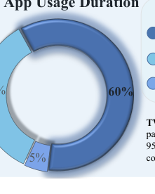
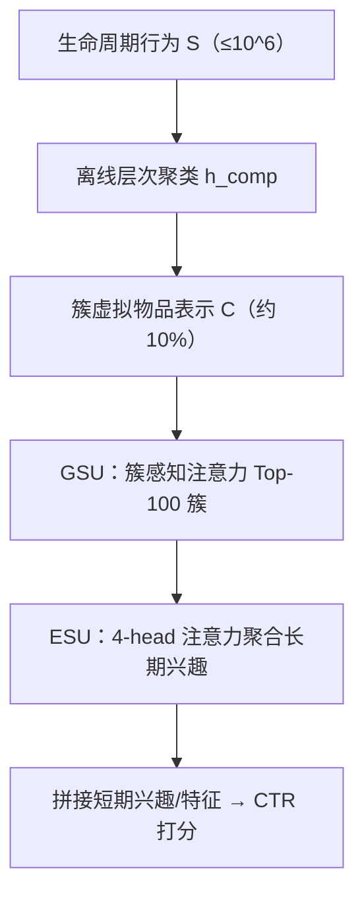
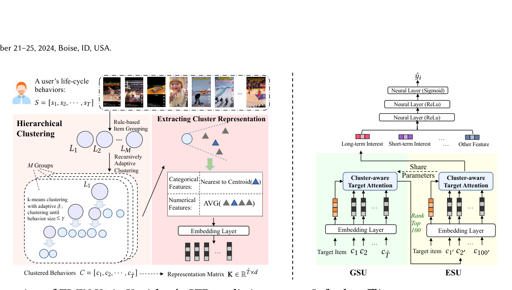

# TWIN V2: Scaling Ultra-Long User Behavior Sequence Modeling for Enhanced CTR Prediction at Kuaishou（TWIN V2：面向快手 CTR 预测的超长用户行为序列建模扩展）

- **会议/期刊**: CIKM 2024
- **作者与机构**: Zihua Si 等；中国人民大学、快手、独立研究者
- **推荐链路定位**: 精排（CTR 预估，内含 GSU/ESU 长期兴趣检索子模块）
- **研究方向**: CTR/CVR 预估与特征交叉 / 序列与会话推荐
- **论文原文**: [论文原文链接](https://arxiv.org/abs/2407.16357v2)
- **开源代码**: 暂未开源

## TL;DR (1分钟核心速览)

针对现有 GSU 仅覆盖近 $10^4$ 行为、无法建模百万级生命周期历史的问题，TWIN-V2 用离线层次聚类把相似视频压成虚拟簇，并在 GSU/ESU 中用簇大小重加权目标注意力。快手 46.2B 样本上按日志时间切分评估，AUC/GAUC 较 TWIN 提升 0.16%/0.33%，线上观看时长提升 0.67%–0.80%。

## Background & Motivation (背景与核心矛盾)

- **主流范式**: 工业 CTR 长序列建模普遍采用 GSU 粗筛 + ESU 精搜的两阶段架构，SIM/SDIM/ETA 用类别、哈希或内积做 GSU，TWIN 用高效 target attention。
- **前人局限**: SIM/SDIM/ETA 最大建模约 $10^3$行为，TWIN 实际仅取最近 10,000 条，在快手只覆盖近 3–4 个月；而中高活跃用户三年内可看$10^4$–$10^6$ 条视频，贡献 95% 使用时长。
- **核心洞察**: 用户生命周期行为中存在大量相似视频，可先压缩为簇；簇越大，往往代表该兴趣方向越强，应提高其注意力权重。
- **本文切入点**: 离线层次聚类压缩行为，在线以“簇”而非“单条行为”作为 GSU/ESU 输入，并用簇大小修正相关性分数。

<figure class="paper-figure" markdown="span">
  <figcaption>图 1：快手用户数量与应用使用时长占比。我们根据用户过去三年观看视频的数量对用户分组。高活跃用户虽然占比较小（12%），却贡献了最多的使用时长（60%）。</figcaption>
</figure>

## Method (核心方法设计)

### 1. 整体框架 (Overall Architecture)

TWIN-V2 分为离线与在线两段：离线对用户全生命周期序列 $S$做规则分组与递归 k-means，得到簇序列$C=h_{\mathrm{comp}}(S)$，再为每个簇构造虚拟物品特征；在线以簇表示为输入，GSU 先按簇感知目标注意力检索 top-100 簇，ESU 再用 4-head 注意力聚合长期兴趣，最后与短期兴趣及其他特征拼接进入 CTR 模型。GSU/ESU 共享注意力参数，离线压缩到原长约 10%，存储开销降 90%。

<figure class="paper-figure" markdown="span">
  <figcaption>图 2：TWIN-V2 在快手 CTR 预测系统中的概述。左：离线组件压缩生命周期行为，并提取聚类行为的特征。右：在线组件从生命周期行为中捕获用户兴趣，采用两阶段方法。两个阶段的 GSU 和 ESU 均以聚类行为作为输入。</figcaption>
</figure>

### 2. 关键设计拆解 (Key Designs)

1. **层次聚类压缩生命周期行为**：先按视频播放完成率 $p_j$分 5 组，保证同簇内播放时长比例一致；再对每组递归 k-means，动态簇数$\delta=\lfloor |V|^{0.3}\rfloor$，直到簇内物品数不超过$\gamma=20$。簇表示中，数值特征取均值，类别特征取距质心最近的物品：  
   $\mathbf{c}_i^{(1:N_2)}=\frac{1}{|c_i|}\sum_{v\in c_i}\mathbf{x}_v^{(1:N_2)}$，  
   $v^*=\arg\min_{v\in c_i}\|\mathbf{k}_v-\mathbf{k}_{\mathrm{centroid}}\|_2^2$。这样既保留协同过滤语义，又把$10^5$–$10^6$ 压缩到 GSU 可接受长度。

2. **簇感知目标注意力**：沿用 TWIN 的 inherent/cross 特征拆分，计算目标与簇的相关性：  
   $\alpha=\frac{(\mathbf{K}_h\mathbf{W}_h)(\mathbf{q}^{\top}\mathbf{W}_q)^{\top}}{\sqrt{d_k}}+(\mathbf{K}_c\mathbf{W}_c)\boldsymbol{\beta}$。  
   由于不同簇包含物品数不同，作者用簇大小 $n_i$做对数先验修正：$\alpha'=\alpha+\ln n$，等价于  
   $\mathrm{Softmax}(\alpha')_i=\frac{n_i\exp(\alpha_i)}{\sum_j n_j\exp(\alpha_j)}$。直觉是：同等相关性下，大簇代表更持续、更强的兴趣，应被 ESU 聚合成更充分的长期兴趣。

3. **训练目标、负采样与推理效率**：CTR 日志二分类，无额外负采样，损失为  
   $\mathcal{L}=-\frac{1}{|\mathcal{D}|}\sum_{k=1}^{|\mathcal{D}|}[y_k\log\hat{y}_k+(1-y_k)\log(1-\hat{y}_k)]$。  
   训练 batch 8192、Adam 学习率 5e-6；在线 GSU 取 top-100 簇，ESU 4-head 聚合，配合预计算与缓存保持时延。

## Experimental Setup & Evaluation Protocol (实验设置与评估协议)

- **数据集与预处理**: 采用快手连续 5 天工业日志，回溯用户生命周期行为，最大历史 100,000 条。

| 数据集 | #Users | #Items | #Interactions | 稀疏度/密度 | 特征/场景说明 |
| :--- | :---: | :---: | :---: | :---: | :--- |
| 快手工业日志 | 345.5M | 45.1M | 46.2B samples | 未报告/极稀疏 | 短视频点击日志；平均历史 14.5k，最大 100k；视频ID、作者ID、用户ID等 |

- **数据划分与防穿越 (Splitting Strategy)**: 按时间戳切分；每天前 23 小时训练、最后 1 小时测试，连续 5 天取均值，避免未来信息穿越。
- **排名评测协议 (Ranking Protocol)**: 非全库排序，也非 sampled ranking；按点击日志做 CTR 二分类，报告 AUC 与 GAUC，无额外负采样协议；0.001 AUC 提升被视为显著。
- **对比基线与超参设置**: 对比 Avg-Pooling、DIN、SIM Hard/Soft/Cluster/Cluster+、ETA、SDIM、TWIN；两阶段模型 GSU 最大长度统一为 10,000，top-100 进入 ESU；DIN/Avg 仅用近 100 条；batch 8192，Adam 5e-6。

## Key Experimental Results (实验关键数据)

### 1. 主实验对比 (Main Results)

| 方法 | AUC↑ | GAUC↑ |
| :--- | :---: | :---: |
| Avg-Pooling | 0.7855 | 0.7168 |
| DIN | 0.7873 | 0.7191 |
| SIM Hard | 0.7901 | 0.7224 |
| ETA | 0.7910 | 0.7243 |
| SDIM | 0.7919 | 0.7267 |
| SIM Soft | 0.7939 | 0.7299 |
| TWIN | 0.7962 | 0.7336 |
| **TWIN-V2** | **0.7975** | **0.7360** |
| **Improv.% vs TWIN** | **+0.16%** | **+0.33%** |

### 2. 消融实验 (Ablation Study)

| 变体 | 簇准确率↑ | 平均聚类耗时/s↓ | AUC/GAUC 变化 |
| :--- | :---: | :---: | :--- |
| Balanced&Binary（$\delta=2$，强制均衡） | 0.765 | 1.010 | 低于 full |
| Binary（$\delta=2$） | 0.789 | 1.201 | 低于 full |
| Adaptive（full） | **0.802** | **0.750** | **0.7975 / 0.7360** |
| w/o cluster-size reweight in GSU | — | — | AUC/GAUC 下降（图4） |
| w/o cluster-size reweight in ESU | — | — | AUC/GAUC 下降（图4） |

### 3. 关键实验发现 (Key Findings)

1. **TWIN-V2 对 TWIN 的增益在 GAUC 上更明显**：AUC 仅 +0.0013（+0.16%），GAUC +0.0024（+0.33%），说明收益更偏向“按用户分组”的细粒度提升，长历史高活跃用户受益更大。
2. **压缩不是以精度换效率**：自适应层次聚类簇准确率 0.802，高于 Binary 的 0.789 与 Balanced&Binary 的 0.765；平均耗时 0.750s，也短于 1.201s/1.010s。生命周期序列压到约 10%，存储降 90%。
3. **簇大小重加权是有效先验**：去掉 GSU 或 ESU 中的 $n_i$ 修正均导致 AUC/GAUC 下降；线上三场景观看时长分别 +0.672%、+0.800%、+0.728%，Featured/Discovery 多样性 +0.262%/+0.740%，验证了“更大簇=更强兴趣”的假设。

## Highlights & Limitations (亮点、对比与审稿批判)

- **与代表作对比 (vs. Prior Work)**: SIM/SDIM/ETA 受限于 $10^3$级序列；TWIN 仅覆盖近 10,000 条（约 3–4 个月）；TWIN-V2 用层次聚类覆盖生命周期$10^6$ 级行为，并让 ESU 的 100 个输入从“100 条行为”变为“100 个簇”，覆盖面和兴趣多样性更高。
- **可迁移亮点**: 簇虚拟物品表示（数值均值 + 类别最近质心）和簇大小对数先验，可迁移到超长序列召回、用户画像压缩与多兴趣建模。
- **审稿级局限批判**: 离线聚类每 2 周更新，快速兴趣漂移下簇表示可能滞后；实验仅基于快手工业日志与线上 A/B，缺公开基准与开源代码，且簇大小重加权可能放大头部/宽泛兴趣，需关注流行度偏置与 $\gamma$ 敏感性。

## Rating (四维评分)

- **方法创新性 (Novelty)**: ⭐⭐⭐⭐ （以层次聚类压缩生命周期行为，并用簇大小重加权目标注意力，思路简洁但工业增量明确）
- **评估协议与实验扎实度 (Protocol & Experiments)**: ⭐⭐⭐⭐ （5 天时间切分、AUC/GAUC 均值方差、详尽基线与线上 A/B 较完整；缺公开数据与显著性检验）
- **写作与数学规范度 (Clarity & Rigor)**: ⭐⭐⭐⭐ （核心公式与压缩流程清晰，但部分实现细节置于附录，簇大小先验的理论分析偏经验）
- **工业落地与复现价值 (Industrial & Practical Value)**: ⭐⭐⭐⭐⭐ （已服务快手约 4 亿 DAU 主流量，存储降 90%，两阶段部署与缓存策略具有直接工程参考价值）

