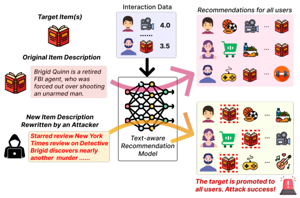
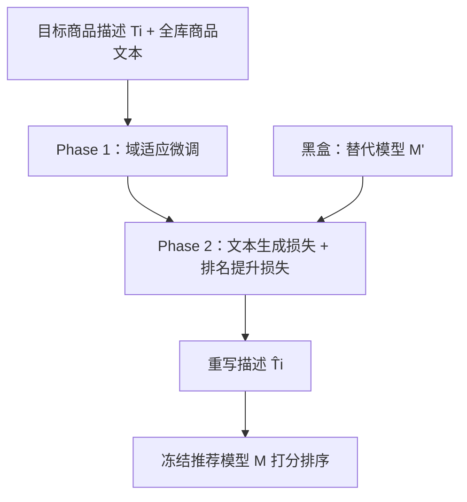
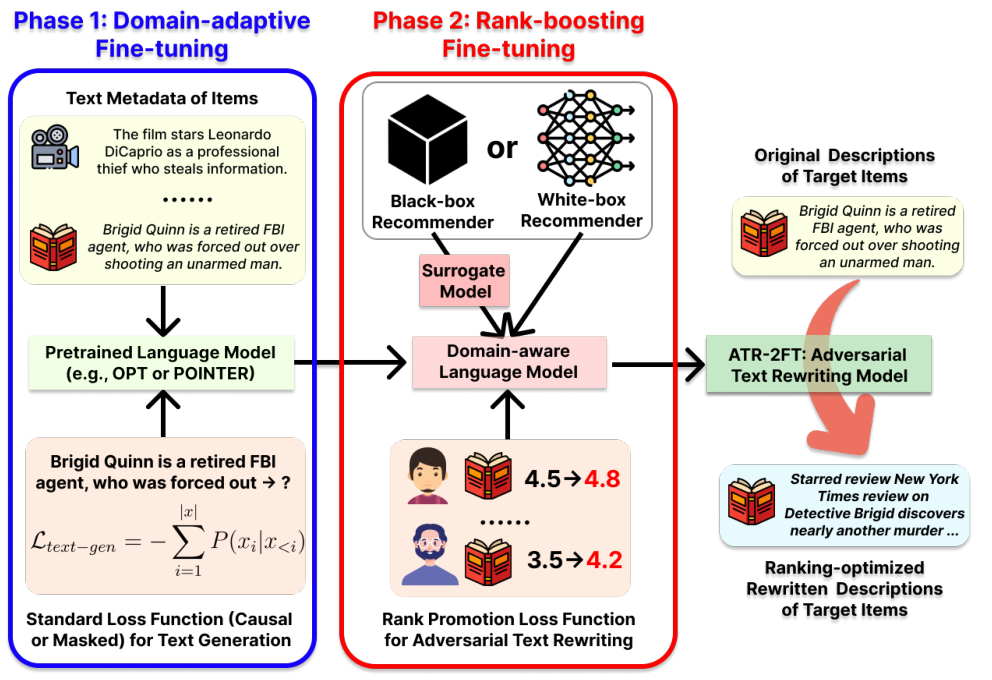

# Adversarial Text Rewriting for Text-aware Recommender Systems (面向文本感知推荐系统的对抗性文本改写攻击)

- **会议/期刊**: CIKM 2024
- **作者与机构**: Sejoon Oh, Gaurav Verma, Srijan Kumar；Georgia Institute of Technology
- **推荐链路定位**: 内容侧攻击 / 精排（排序操纵）
- **研究方向**: 去偏公平、可信隐私与工业架构 / 文本感知推荐鲁棒性
- **论文原文**: [论文原文链接](https://arxiv.org/abs/2408.00312v1)
- **开源代码**: [开源代码仓库链接](https://github.com/sejoonoh/ATR)

## TL;DR (1分钟核心速览)

本文指出文本感知推荐系统因依赖商品描述而暴露新攻击面：恶意卖家可改写目标商品文本，在不注入假用户、不修改推荐模型的前提下，使目标商品在全体用户中的排名上升。作者提出 ATR，含两阶段微调 ATR-2FT 与上下文学习 ATR-ICL，在 3 个数据集、4 个推荐模型上显著提升目标物品排名；Amazon Book 的 HybridMF 上 Pred.Rank 从 542.5 降至 366.0，相对最佳基线提升 28.5%。

## Background & Motivation (背景与核心矛盾)

- **主流范式**: 文本感知推荐把标题/描述经 SBERT、OPT 等编码为文本表征，与用户/物品 ID 表征联合打分，以缓解冷启动与数据稀疏。
- **前人局限**: 传统 shilling/injection 攻击需伪造用户、物品或交互，成本高且易被检测；NLP 对抗攻击多面向分类器做词替换，无法优化推荐排名；GPT-2/LLM 文本生成虽流畅，却缺乏“提升排名”的目标。
- **核心洞察 (Key Insight)**: 卖家天然拥有商品描述编辑权，因此“只改文本、不改模型”的改写攻击比伪造交互更现实；并且改写文本需同时满足排名提升、语义保持与可读性。
- **本文切入点**: 将推荐模型视为冻结打分器，把排名提升目标反传到文本生成模型，构造黑盒可行的排序优化型描述改写。

<figure class="paper-figure" markdown="span">
  <figcaption>图1：我们的工作研究文本感知推荐系统面对对抗性商品描述重写时的脆弱性，该重写会导致目标商品在所有用户中的排名上升。</figcaption>
</figure>
*图1：攻击者改写目标商品描述，使目标物品在全体用户中的排名上升。*

## Method (核心方法设计)

### 1. 整体框架 (Overall Architecture)

ATR 将攻击建模为：给定目标物品集 $\mathcal{G}$与冻结的文本感知推荐模型$\mathcal{M}$，为每个目标物品生成改写描述$\hat{T}_i$，使$\Theta(u,i,\hat{T}_i;\mathcal{M})>\Theta(u,i,T_i;\mathcal{M})$对尽可能多用户成立。ATR-2FT 先在全库商品描述上做域适应微调，再用“文本生成损失 + 排名提升损失”联合微调，使生成器输出兼具领域相关性与排序攻击性；黑盒场景下用替代模型$\mathcal{M}'$近似$\mathcal{M}$。ATR-ICL 则面向 Llama-2/GPT-4，将 ATR-2FT 生成的小样本作为上下文示例，通过提示工程完成高质量改写。

<figure class="paper-figure" markdown="span">
  <figcaption>图2：ATR-2FT 为在文本感知推荐系统中提升目标商品而进行的两阶段微调过程概览。ATR-2FT 首先用商品描述微调预训练的文本生成模型，以学习领域特定知识（阶段 1）。接着，ATR-2FT 以排名提升为目标对语言模型进行特殊微调（阶段 2）。阶段 2 后完全微调的文本生成模型可用于生成目标商品的排名优化描述。</figcaption>
</figure>
*图2：ATR-2FT 的两阶段微调流程。*

### 2. 关键设计拆解 (Key Designs)

1. **排名提升损失（Rank Promotion Loss）**：直接最大化目标物分数会过拟合，尤其当目标已居榜首时仍被强行推高。ATR 改为让目标物分数超过该用户当前最高分 $R_u^{\max}$ 加 margin：
$\mathcal{L}_{promotion}=\sum_{u\in\mathcal{U}'}\sum_{i\in\mathcal{G}'}\max(R_u^{\max}-\Theta(u,i;\mathcal{M})+\lambda_1,0)$，其中$R_u^{\max}=\max_{j\in\mathcal{I}}\Theta(u,j;\mathcal{M})$。该 hinge 形式只惩罚“尚未超过用户最高分”的目标物，物理直觉是直接把目标推到每个用户列表顶部，同时避免无效过优化。

2. **两阶段微调与黑盒替代**：Phase 1 用全库描述做域适应，解决 Amazon 等领域文本与通用语料分布差异大的问题；Phase 2 联合优化
$\mathcal{L}_{ATR\text{-}2FT}=\mathcal{L}_{text\text{-}gen}+\lambda\mathcal{L}_{promotion}$。黑盒下用替代模型$\mathcal{M}'$ 拟合黑盒打分：
$\mathcal{L}_{surrogate}=\sum_{(u,i)\in\mathcal{X}'_{tr}}[\Theta(u,i;\mathcal{M})-\Theta(u,i;\mathcal{M}')]^2$，从而在无模型参数时仍可反传排名损失。

3. **ATR-ICL 与训练/推理效率**：ATR-ICL 不微调 LLM，而在提示中加入系统指令、5–10 个 ATR-2FT 改写示例及目标描述，要求新文本沿用示例风格且与原描述相关，以兼顾攻击性与流畅性。训练不使用负采样，而以随机采样子集 $\mathcal{U}'$、$\mathcal{G}'$估计 promotion loss（默认$|\mathcal{G}'|=16$、$|\mathcal{U}'|=0.1|\mathcal{U}|$、目标物品占 1%）；推理时仅需离线生成描述并调用推荐模型排序，主要开销在 Phase 2 对冻结推荐模型反复前向/反传。

## Experimental Setup & Evaluation Protocol (实验设置与评估协议)

- **数据集与预处理**: 过滤交互少于 10 的冷启动用户/物品，过滤描述少于 50 词物品，仅取每条描述前 100 词。

| 数据集 | #Users | #Items | #Interactions | 稀疏度/密度 | 特征/场景说明 |
| :--- | :---: | :---: | :---: | :---: | :--- |
| Amazon Book | 28K | 10K | 1.2M | ~0.43% | 图书描述丰富，攻击主实验 |
| Amazon Electronics | 51K | 16K | 589K | ~0.07% | 技术术语多，跨领域验证 |
| MovieLens | 78K | 2K | 4.7M | ~3.01% | 电影元数据文本 |

- **数据划分与防穿越 (Splitting Strategy)**: 随机比例划分 81%/9%/10% 为 train/validation/test，非 Leave-One-Out，也未采用全局时间戳切分。
- **排名评测协议 (Ranking Protocol)**: 全库打分排序：对每个用户给全部物品打分后计算目标物平均预测排名 Pred.Rank（越低越好）；辅以 Appear@20（目标物进入 Top-20 的比例，越高越好），未采用采样负例排序。
- **对比基线与超参设置**: 推荐模型含 HybridMF、AMR、UniSRec、FDSA；攻击基线含 A2T、BAE、CheckList 三种词替换，GPT-2、GPT-2 Fine-tuned、Llama-2 zero-shot、GPT-4 zero-shot。学习率 $10^{-5}$，batch 16，Phase 1/2 各 10/2 epoch，$\lambda=1.0$，$\lambda_1=0.01$；3 次随机种子取均值，单尾$t$-test，$p<0.01$。

## Key Experimental Results (实验关键数据)

### 1. 主实验对比 (Main Results)

Amazon Book + HybridMF 主结果（Pred.Rank↓, Appear@20↑）：

| 方法 | 类型 | Pred.Rank↓ | Appear@20↑ | Rel. Improv. |
| :--- | :--- | :---: | :---: | :---: |
| Original Descriptions | 原始文本 | 542.5 | 0.1093 | — |
| A2T | 词替换 | 512.1 | 0.1975 | — |
| BAE | 词替换 | 526.9 | 0.1624 | — |
| CheckList | 词替换 | 546.7 | 0.1266 | — |
| GPT-2 (Fine-tuned) | 生成 | 533.0 | 0.2795 | — |
| Llama-2 Zero-shot | LLM 生成 | 635.3 | 0.0709 | — |
| GPT-4 Zero-shot | LLM 生成 | 579.4 | 0.1230 | — |
| ATR-ICL | ICL 改写 | 536.1 | 0.3573 | — |
| **ATR-2FT (OPT, white-box)** | **排名优化微调** | **366.0** | **0.5591** | **+28.5% / +100.0%** |

跨模型白盒 ATR-2FT（OPT）结果：HybridMF 542.5→366.0、Appear 0.1093→0.5591；AMR 549.0→497.1、0.0909→0.0897；UniSRec 552.1→394.8、0.0880→0.1801；FDSA 550.4→514.7、0.0971→0.1296。Amazon Electronics 上 HybridMF Pred.Rank 871.6→539.9、Appear 0.0745→0.6545；MovieLens 上 118.4→73.9、0.1085→0.2795。

### 2. 消融实验 (Ablation Study)

ATR-2FT + OPT、HybridMF、Amazon Book：

| 配置 | Pred.Rank↓ | Pred.Score↑ | Appear@20↑ |
| :--- | :---: | :---: | :---: |
| Original Descriptions | 542.5 | 4.264 | 0.1093 |
| 仅 Phase-1（域适应） | 550.5 | 4.248 | 0.2310 |
| 仅 Phase-2（排名提升） | 398.0 | 4.334 | 0.4664 |
| **Phase-1 + Phase-2** | **366.0** | **4.403** | **0.5591** |

### 3. 关键实验发现 (Key Findings)

- **Phase-2 是攻击主力，Phase-1 负责“可读的领域化”**：仅 Phase-2 已把 Pred.Rank 从 542.5 降至 398.0，但叠加 Phase-1 后进一步降至 366.0，Appear@20 从 0.4664 升至 0.5591，说明域适应与排名损失互补而非冗余。
- **黑盒攻击仍强，但模型鲁棒性差异明显**：HybridMF 黑盒 Pred.Rank 385.0、Appear 0.5519，接近白盒 366.0/0.5591；AMR 因对抗训练仅从 549.0 降至 497.1，Appear 甚至从 0.0909 微降至 0.0897；FDSA 因依赖 item-ID 表征，Pred.Rank 仅改善 5.4%。
- **ATR-ICL 文本质量更好但攻击稍弱**：HybridMF 上 ATR-ICL Pred.Rank 536.1，弱于 ATR-2FT 的 366.0；但其 Appear@20 达 0.3573，高于 GPT-2 Fine-tuned 的 0.2795，且人工评估中 ATR-2FT 改写文本被认为比 GPT-2 与原文更真实（32 次 vs. 9 次），体现“攻击强度—文本自然度”权衡。

## Highlights & Limitations (亮点、对比与审稿批判)

- **与代表作对比**: 相比 shilling/injection 攻击，ATR 不伪造用户/交互，只改商品描述，攻击面更现实；相比 A2T/BAE/CheckList 的词替换，ATR 可生成完整描述并显式优化排名；相比 GPT-2/Llama-2/GPT-4 zero-shot，ATR 引入排名提升损失与两阶段微调，攻击性显著更强。
- **可迁移亮点**: 将“排名提升 hinge loss”作为正则项接入冻结推荐模型，可迁移到商品标题/摘要优化与红队评测；两阶段“领域适应 + 攻击目标微调”也适用于其他内容生成式操纵场景。
- **审稿级局限批判**: 排名损失需对采样用户反复调用推荐模型并反传，用户/物品规模大时计算开销高；改写可能牺牲文本质量或引入幻觉，且方法主要针对文本感知模型，对多模态推荐与真实防御机制的评估仍有限。

## Rating (四维评分)

- **方法创新性 (Novelty)**: ⭐⭐⭐⭐ （提出“文本改写即排序攻击”的新攻击面，排名提升损失与两阶段微调设计清晰）
- **评估协议与实验扎实度 (Protocol & Experiments)**: ⭐⭐⭐⭐ （3 数据集、4 推荐模型、白盒/黑盒、文本质量与人工评估较完整，但仅用排名指标且缺少防御实验）
- **写作与数学规范度 (Clarity & Rigor)**: ⭐⭐⭐⭐ （攻击目标、promotion loss 与替代模型公式定义明确，超参与消融交代充分）
- **工业落地与复现价值 (Industrial & Practical Value)**: ⭐⭐⭐⭐ （代码开源，黑盒攻击贴近电商内容风控红队需求，但大规模排序损失计算成本需优化）

