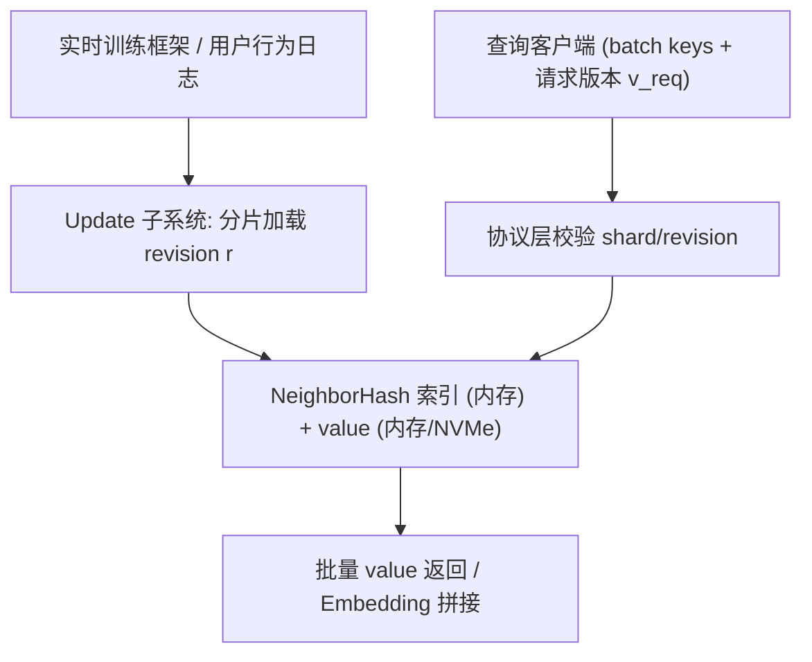
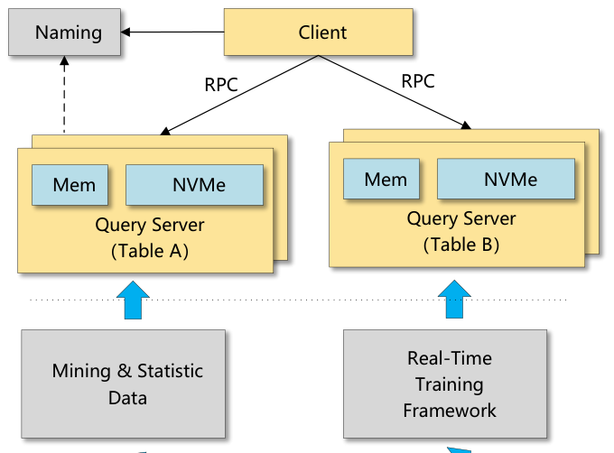
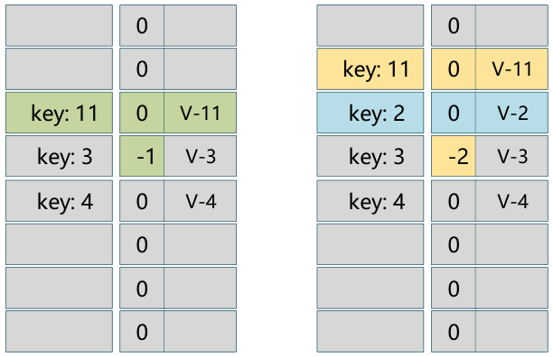

# An Enhanced Batch Query Architecture in Real-time Recommendation (实时推荐中的增强批量查询架构)

- **会议/期刊**: CIKM 2024 (Applied Research Track)
- **作者与机构**: Qiang Zhang, Jiayin Wang (西安交通大学)；Zhipeng Teng, Disheng Wu (Bilibili)
- **推荐链路定位**: 端到端特征/Embedding 服务底座（召回、粗排、精排、训练参数同步共用）
- **研究方向**: 去偏公平、可信隐私与工业架构 / CTR 预估与特征交叉
- **论文原文**: [https://arxiv.org/abs/2409.00400v1](https://arxiv.org/abs/2409.00400v1)
- **开源代码**: [https://github.com/slow-steppers/NeighborHash](https://github.com/slow-steppers/NeighborHash)

## TL;DR (1分钟核心速览)

工业推荐需在毫秒内从十亿级内容池完成 TB 级特征与 Embedding 的批量点查，而 RocksDB 等 LSM 存储把 CPU 耗在多层检索上、传统 Coalesced Hashing 又受固定 cellar 区拖累。本文提出 NeighborHash（Lodger Relocation + 缓存行感知双向邻域探测 + 12-bit 内联相对偏移），并叠加内存/NVMe 分层与版本强一致滚动更新协议。在 SQR=90%、负载因子 0.8、16GB 数据集上吞吐 39 MOPS（Coalesced 19 MOPS），配合 AMAC 达随机访存理论上界的 90%；线上 batch=500 时延 3.31ms（RocksDB 25.81ms），一致性协议带来 2.23%–6.94% CTR 相对提升。

## Background & Motivation (背景与核心矛盾)

- **主流范式**: 以 Redis / RocksDB(LSM-tree) / absl flat_hash_map 或 F14 构建 Feature Store 与 Embedding Server，召回与排序阶段按 batch 拉取 user/item 特征与向量。
- **前人局限①**: Coalesced Hashing 的 cellar 区大小固定，cellar 满后冲突记录溢出到地址区并与后插入记录二次冲突，PSL 对 cellar 尺寸高度敏感，cacheline 不友好。
- **前人局限②**: LSM 类 KV 为写优化设计，批量点查需多层查找与反序列化；线上滚动更新时命名服务的元数据传播延迟迫使客户端"等确认"，多分片多副本之间版本错配使单次预估混用多版本 Embedding 权重。
- **核心洞察 (Key Insight)**: 推荐负载是**读多写少、高命中率（SQR=90%）、高负载因子（0.8）的批量点查**，且 16GB 规模下 LLC miss 已达 99.2%、BPL 收敛于 82.1，吞吐完全由内存延迟主导——因此优化目标应是**每次查询触碰的 cacheline 数（APCL）**，而非插入指令数。
- **本文切入点**: 做一笔"插入变复杂、查询变快很多"的交易：把冲突链上的节点物理地搬进同一 cacheline，并用内联偏移替代独立指针数组。

## Method (核心方法设计)

### 1. 整体框架 (Overall Architecture)

系统由 Update 与 Query 两个子系统解耦组成，灵感来自 Google Mesa。Update 子系统从实时训练框架接收表部署与增量数据，按分片加载 revision $r$，仅把实例接口（IP:port）注册到命名服务；Query 子系统以多分片多副本横向扩展（峰值约 100k QPS），客户端自带 shard/routing 元数据、在协议层协商表版本并做异步 pipeline 打包 payload，直接访问 Embedding 表避免代理带宽开销。底层统一由 NeighborHash 承载 key→offset 索引，value 字节按 1-bit 标记分层落内存或 NVMe，异步淘汰线程周期性扫描热数据元信息完成下沉。

<figure class="paper-figure" markdown="span">
  <figcaption>图2：面向多数据查找的批量查询架构</figcaption>
</figure>

### 2. 关键设计拆解 (Key Designs)

1. **Lodger Relocation（动态 cellar，压缩 PSL）**: 传统方案把 $M'-M$个桶固定划为 cellar，cellar 溢出即产生长探测链。本文彻底取消 cellar：桶$i$中满足$\mathrm{Hash}(x.key)=i$者为 host，否则为 lodger；插入新记录$y$命中桶$j$且$j$被 lodger 占据时，先为 lodger 另寻空位迁移、再把$y$落到$j$。其效果等价于"无限 cellar"，使 PSL 与分离链接持平，代价仅是插入路径变复杂——在读主导负载下这是合算交易。
2. **Cacheline-aware Neighbor Probing + Inline Chaining（把冲突链压进一行缓存）**: 线性探测只单向扩展，易跨越 cacheline。本文在链尾节点所在 cacheline 内**双向**探测，找不到再向左右最近 cacheline 扩展，从而把相对偏移压到极小，进而可用 value 域高 12 bit 内联存储相对偏移 $\delta=\mathrm{idx}(\text{next})-\mathrm{idx}(\text{host})\in[-2047,2048]$，剩余 52 bit 存 payload，省去独立 offset 数组的一次额外访存。查询代价可用$\mathrm{APCL}=\frac{1}{|Q_s|}\sum_{q\in Q_s}L(q)$（$L(q)$ 为该次成功查询触碰的 cacheline 数）度量；16GB 下本文 APCL=1.14，线性探测 1.47，单向探测配 Lodger Relocation 为 1.24，说明双向探测单独贡献约 9% 带宽节省。

<figure class="paper-figure" markdown="span">
  <figcaption>图3：带 Lodger Relocation 的 NeighborHash 插入</figcaption>
</figure>

3. **训练目标、写入开销与查询效率**: 本文为系统论文，无学习损失；核心"目标"是最大化 $\mathrm{MOPS}$同时约束$\mathrm{BPL}$。写入端需多次探测 + lodger 迁移（写放大），查询端为一次 hash 加约 1.14 次 cacheline 访存；小数据集（≤2MB，驻留 L2）选 SIMD 向量化最优，大数据集选 AMAC 最优，二者结合在大表上接近翻倍吞吐。

## Experimental Setup & Evaluation Protocol (实验设置与评估协议)

- **数据集与预处理**: 采用均匀分布随机 64-bit 键值，键值各 64 bit、每元素 16 字节；另测偏斜分布仅做趋势与定性一致性验证。

| 数据集(表规模) | #元素 | 内存占用 | 负载因子 | 说明 |
| :--- | :---: | :---: | :---: | :--- |
| 256KB / 2MB | 16K / 128K | ≤2MB | 0.80 | 驻留 L1/L2，指令数主导 |
| 16MB / 32MB | 1M / 2M | 16–32MB | 0.80 | LLC miss 起升（32MB 达 34%） |
| 256MB / 2GB | 16M / 128M | 0.25–2GB | 0.80 | BPL 快速上升后收敛 |
| 16GB | 1G | 16GB | 0.80 | 内存延迟完全主导（LLC miss 99.2%） |

- **数据划分与防穿越**: 无监督划分概念；构建后固定 SQR=90%（模仿线上命中率）为主协议，另以 SQR=30% 复核趋势一致性。
- **排名评测协议**: 非排名任务，评测协议为**成功点查吞吐**（MOPS）与 **BPL/APCL/LLC-miss**；并设 **RA (Random Access)** 零冲突假想表作为吞吐上界（不保证正确性，仅用于探底）。
- **对比基线与超参设置**: 基线含 Linear Probing、`ska::bytell_hash_map`、Coalesced Hashing、Random Access；哈希函数统一 `absl::Hash<uint64_t>`，关闭硬件预取，负载因子 0.8，用 PCM 采带宽换算 BPL。线上 A/B 采用 bilibili 单张 40M item × 1KB 高流量物品特征表，峰值约 700k KPS，batch ∈ {10, 100, 500}，CTR 对比跨度 24 小时。

## Key Experimental Results (实验关键数据)

### 1. 主实验对比 (Main Results)

标量哈希吞吐（单位 MOPS，SQR=90%，LF=0.8）：

| 哈希表 | 256KB | 2MB | 16MB | 256MB | 16GB | Improv.@16GB |
| :--- | :---: | :---: | :---: | :---: | :---: | :---: |
| Linear Probing | 38 | 29 | 22 | 12 | 11 | −42% |
| `ska::bytell_hash_map` | 72 | 53 | 38 | 20 | 19 | 0% |
| Coalesced Hashing | 92 | 56 | 48 | 21 | 19 | 0% |
| **NeighborHash (Ours)** | **116** | **74** | **66** | **37** | **36** | **+89%** |
| Random Access (上界) | / | / | / | / | 67 | — |

线上批量点查时延（单表 40M item × 1KB，峰值 ~700k KPS）：

| KV 方案 | batch=10 | batch=100 | batch=500 |
| :--- | :---: | :---: | :---: |
| KV (RocksDB, 内存表 10GB) | 1.11 ms | 10.56 ms | 25.81 ms |
| **KV (NeighborHash)** | **1.05 ms** | **1.78 ms** | **3.31 ms** |

### 2. 消融实验 (Ablation Study)

16GB、SQR=90%、LF=0.8 下逐组件叠加：

| 配置 | MOPS | 相对增益 | APCL |
| :--- | :---: | :---: | :---: |
| Coalesced Hashing | 19 | 1.00× | 1.72 |
| + Lodger Relocation (PerfectCellarHash) | 23 | 1.21× | 1.48 |
| + Neighbor Probing (双向探测) | 30 | +30% | 1.34 |
| + Inline Chaining (**NeighborHash**) | **39** | **+30%** | **1.14** |

### 3. 关键实验发现 (Key Findings)

1. **吞吐增益几乎全部来自 APCL 下降而非指令优化**：三组件串联使 MOPS 19→23→30→39，APCL 同步 1.72→1.14；而 16GB 规模下 LLC miss 达 99.2%、BPL 82.1，说明系统已完全处于内存延迟受限区，任何减少 cacheline 触碰的设计都直接换算为吞吐。256KB 小表上 NeighborHash 也已 116 MOPS，领先次优 Coalesced 26%。
2. **双向探测与偏移压缩存在耦合，不能单独归因**：单向探测配 Lodger Relocation 时 APCL 仅 1.24，双向后降至 1.14（约 9%），但正是这 ~0.1 行的缩短让 12-bit 相对偏移足以覆盖 80%+ 负载因子，从而把独立 offset 数组并入 value 域，再拿一档访存收益；并行优化（SIMD/AMAC）后可达随机访存上界 90%（约 60 MOPS 量级）。
3. **批量越大，架构差距越悬殊，且一致性带来可量化收益**：batch 从 10 增至 500，NeighborHash 时延 1.05→3.31ms（3.2×），RocksDB 1.11→25.81ms（23×），因 perf 显示前者约一半 CPU 耗在 payload 打包 IO、哈希查找占比很小，而后者约 30% CPU 耗在内存检索。无一致性协议时约 3% 请求混用多版本 Embedding，引入强一致后 CTR 相对提升 2.23%(更新间隔 4h)、5.41%(1h)、6.53%(30min)、6.94%(15min)，更新越频繁收益越大，最终节省约 30% 机器资源。

## Highlights & Limitations (亮点、对比与审稿批判)

- **与代表作对比 (vs. Prior Work)**: 相比 Coalesced Hashing（固定 cellar、cacheline 不友好）与 F14/flat_hash_map（靠 SIMD 加速但 APCL 仍高），本文从**数据物理布局**入手把 APCL 压到 1.14；相比 RocksDB/LevelDB 的 LSM 多层查找，改为单层内存索引 + 直接 payload 访问；相比 F2/SlimDB 的冷热分离系统，把冷热判定下沉到 KV 层用 1-bit 标记 + 异步淘汰，避免传统 LRU 对哈希表的并发读写争用。
- **可迁移亮点**: ① 12-bit 内联相对偏移 + 双向邻域探测这一组合可直接移植到任何 batch point-query 特征存储（如用户侧实时特征、序列索引）；② 把 shard/revision 元数据从命名服务搬到查询协议中随请求下发，绕开元数据传播延迟，是通用的滚动更新一致性技巧。
- **审稿级局限批判**: ① 评测以均匀分布随机键为主，偏斜数据仅"趋势一致"的定性结论，未给出 Zipf 指数扫描，而真实 Embedding 访问是强偏斜；② 插入路径含迁移与多次探测、存在写放大，论文未量化写入吞吐与尾延迟，也未与 F14 在大表偏斜场景做端到端对比；③ CTR 提升归因于一致性，但仅给相对百分比与一天 A/B，缺显著性检验与置信区间，且 NVMe 冷热阈值、AMAC/SIMD 切换的数据集尺寸边界均需人工调参。

## Rating (四维评分)

- **方法创新性 (Novelty)**: ⭐⭐⭐⭐ （以"动态 cellar + 缓存行内双向探测 + 偏移压缩"重构经典 Coalesced Hashing，属于对老结构的精准算子级改造，理论新颖度中等但工程洞察到位）
- **评估协议与实验扎实度 (Protocol & Experiments)**: ⭐⭐⭐⭐ （6 档规模 × 多基线 + 逐组件消融 + 线上 700k KPS 真机 A/B，SQR/LF 协议贴近线上；扣分在偏斜分布只做定性、缺显著性检验）
- **写作与数学规范度 (Clarity & Rigor)**: ⭐⭐⭐ （APCL/BPL/MOPS 指标定义清楚，但插入迁移的复杂度与写放大缺乏形式化分析，部分章节因篇幅删减细节）
- **工业落地与复现价值 (Industrial & Practical Value)**: ⭐⭐⭐⭐⭐ （代码已开源，B 站线上稳定运行一年以上、支撑 10× 模型算力增长，节省约 30% 机器，落地证据链完整）

