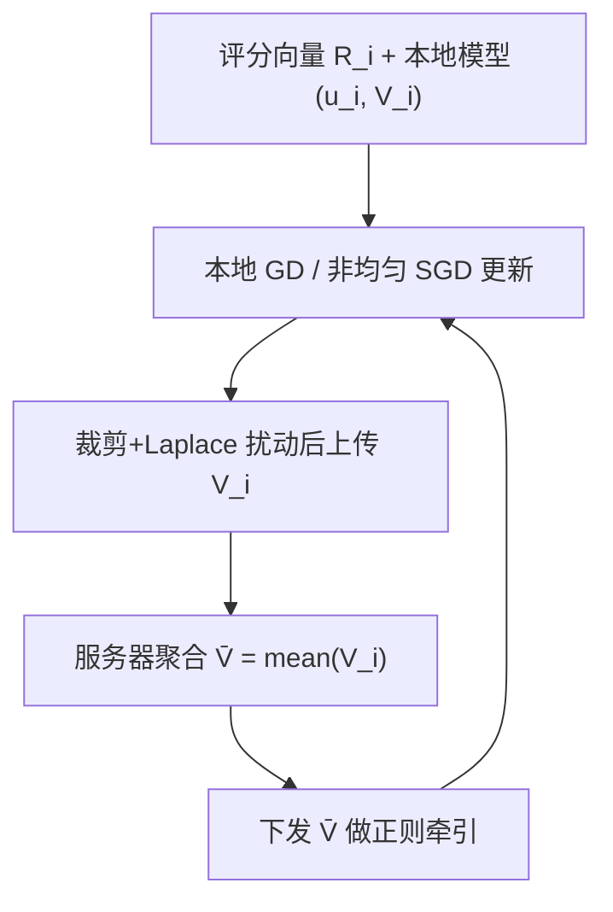
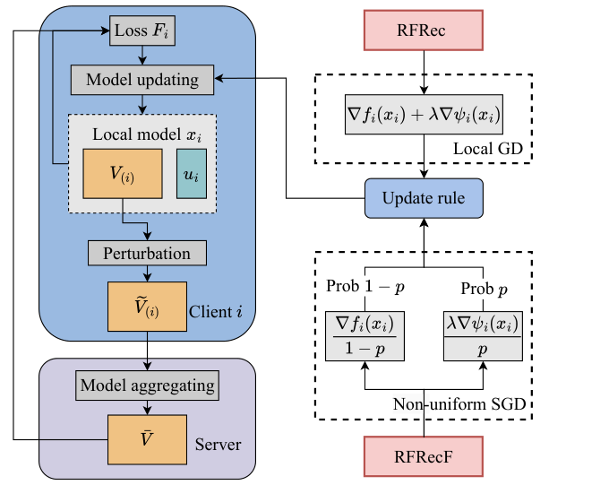

# Efficient and Robust Regularized Federated Recommendation (高效鲁棒的正则化联邦推荐)

- **会议/期刊**: CIKM 2024
- **作者与机构**: Langming Liu, Wanyu Wang, Xiangyu Zhao 等（香港城市大学、吉林大学、昆士兰大学等）
- **推荐链路定位**: 召回（MF 表征学习）/ 云端协同训练
- **研究方向**: 去偏公平、可信隐私与工业架构 / 协同过滤
- **论文原文**: [论文原文链接](https://arxiv.org/abs/2411.01540v1)
- **开源代码**: [RFRec 仓库](https://github.com/Applied-Machine-Learning-Lab/RFRec)

## TL;DR (1分钟核心速览)

现有联邦推荐（FedRS）基于交替更新的 MF 直接最小化非凸损失，存在收敛到次优、设备掉线即中断、梯度传输可反推评分、通信轮次高达 $O(\log m+\log\frac{1}{\varepsilon})$四大痛点。本文把 FedRS 重写为**凸的 RERM**（局部损失 + 全局一致性正则），提出 RFRec（局部 GD）与 RFRecF（非均匀 SGD），理论保证线性收敛、通信轮次降为与物品数无关的$O(\log\frac{1}{\varepsilon})$。在 ML-100k/1M、KuaiRec、Jester 四个数据集上以 MAE/RMSE 评价，RFRec 的 RMSE 逼近甚至超过集中式 PMF，通信轮次较 FedFast 减少约 1.5–4 倍，90% 设备掉线时 RMSE 仅升约 2%。

## Background & Motivation (背景与核心矛盾)

- **主流范式**: FedRS 沿用集中式 MF 目标，用户向量在端侧本地更新、物品向量梯度在服务器聚合（式 (3)(4) 的交替更新）。
- **前人局限**: ① 直接最小化 $\|\mathbf{R}-\mathbf{U}^T\mathbf{V}\|^2$本质**非凸**，易陷次优且端云强耦合训练不稳；② 交替更新依赖端云同步，网络/设备故障即中断；③ 连续两次梯度可被服务器代数反推评分（FedMF 已证）；④ 交替 GS/ALS 需$O(\log m+\log\frac{1}{\varepsilon})$ 轮，物品多时通信爆炸。
- **核心洞察 (Key Insight)**: 若给每个客户端一个**本地物品矩阵** $\mathbf{V}^{(i)}$并施加"贴近全局均值$\bar{\mathbf{V}}$"的二次正则，目标函数可由非凸转为**强凸**，从而锁定全局最优且通信与$m$ 解耦。
- **本文切入点**: 用 RERM 统一"个性化局部模型 + 共享全局模型"，再以梯度下降/随机梯度两条路径求解。

## Method (核心方法设计)

### 1. 整体框架 (Overall Architecture)

每个客户端持有本地模型 $x_i=(\boldsymbol{u}_i,\mathbf{V}^{(i)})$与评分向量$\mathbf{R}_i$，端侧做 GD/SGD 更新个体兴趣；服务器仅承担聚合$\bar{\mathbf{V}}=\frac{1}{n}\sum_i\mathbf{V}^{(i)}$并经裁剪+Laplace 扰动回传，学习用户"共性兴趣"。RFRec 每轮上传+下发各一次；RFRecF 以伯努利变量$\zeta$随机决定"本地主更新"还是"向均值靠拢"，仅在$\zeta$翻转时通信，从而大幅压缩轮次。训练/推理解码均为端侧内积打分$\hat{r}_{ij}=\boldsymbol{u}_i^T\boldsymbol{v}_j$。

<figure class="paper-figure" markdown="span">
  <figcaption>图1：RFRec 与 RFRecF 概览。</figcaption>
</figure>

### 2. 关键设计拆解 (Key Designs)

1. **凸 RERM 重构（把非凸变强凸）**: 痛点是非凸+端云耦合。本文将目标写为
$\min_{x_1,\dots,x_n} F(x):=f(x)+\lambda\psi(x)$，其中
$f(x)=\sum_i\{\|\mathbf{R}_i-\boldsymbol{u}_i^T\mathbf{V}^{(i)}\|^2+\lambda_u\|\boldsymbol{u}_i\|^2\}$，
$\psi(x)=\frac{1}{2}\sum_i\|\mathbf{V}^{(i)}-\bar{\mathbf{V}}\|^2$。删去原目标的$\lambda_v\|\mathbf{V}^{(i)}\|^2$（由$\psi$接管）。当$\lambda>2\lambda_u M_r^2+6M_u^2$时$F$强凸且$L_F$-光滑，直觉是"全局一致性正则"既提供个性化-共性平衡，又充当强凸项锁定唯一最优。

2. **RFRecF 非均匀 SGD（降通信）**: 痛点每轮需双向通信。定义无偏随机梯度
$G(x)=\frac{\nabla f(x)}{1-p}$（概率$1-p$），$\frac{\lambda\nabla\psi(x)}{p}$（概率$p$），
仅当相邻 $\zeta$不同才通信，期望轮次为$2p(1-p)T$。物理直觉：让"主更新"与"向均值收缩"按概率交错，避免每次迭代都同步。

3. **训练目标、负采样与推理效率**: 总损失即 $F(x)$，无显式负采样（评分预测任务）。收敛保证$\mathbb{E}[\|x^k-x(\lambda)\|^2]\le(1-\alpha\mu)^k\|x^0-x(\lambda)\|^2$，迭代次数$O(\log\frac{1}{\varepsilon})$；通信轮次 RFRec 为$O(\log\frac{1}{\varepsilon})$，RFRecF 期望$O(\log\frac{1}{\varepsilon})$（最优$p=\frac{\lambda}{L+\lambda}$时不超过 RFRec 一半）。隐私经$\tilde{\mathbf{V}}^k_{(i)}=\text{Clip}(\mathbf{V}^k_{(i)},\delta)+\text{Laplace}(0,s)$实现$\epsilon=\frac{2\delta}{s}$-DP。

## Experimental Setup & Evaluation Protocol (实验设置与评估协议)

- **数据集与预处理**: 采用评分数据，KuaiRec 过滤 watch ratio>20 的极端值（丢失<1‰）。

| 数据集 | #Users | #Items | #Interactions | 场景 |
| :--- | :---: | :---: | :---: | :--- |
| ML-100k | 943 | 1,682 | 100,000 | 电影评分 |
| ML-1M | 6,041 | 3,706 | 1,000,209 | 电影评分 |
| KuaiRec | 7,176 | 10,728 | 12,530,806 | 短视频 |
| Jester | 73,421 | 100 | 4,136,360 | 笑话评分 |

- **数据划分与防穿越**: 采用**评分预测**范式（非序列切分），按已知评分矩阵拟合，用 MAE/RMSE 评价预测点误差。
- **排名评测协议**: 非 `Full-Ranking`/`Sampled Ranking`，而是**评分回归**（pointwise MAE/RMSE）；文献以固定 $d=20$、$K=100$迭代、$\lambda_u=\lambda_v=0.1$ 训练。
- **对比基线与超参**: 集中式 PMF、SVD++；联邦 FCF、FedRec、FedFast、SemiDFEGL、FedNCF。RFRec 取 $\alpha=0.05$、$\lambda=10$；RFRecF 取$\alpha=0.025$、$p=0.5$；显著性用双侧 t 检验$p<0.05$。

## Key Experimental Results (实验关键数据)

### 1. 主实验对比 (Main Results)

RMSE（越低越好；**加粗**为联邦基线中最优，RFRec 为本文最优联邦值）：

| 数据集 | PMF | SVD++ | FCF | FedRec | FedFast | FedNCF | RFRec | RFRecF |
| :--- | :---: | :---: | :---: | :---: | :---: | :---: | :---: | :---: |
| ML-100k | 0.9318 | 0.9273 | 0.9614 | 0.9832 | 0.9403 | 0.9612 | **0.9325** | 0.9385 |
| ML-1M | 0.8762 | 0.8863 | 0.8874 | 0.9161 | 0.8860 | 0.8966 | **0.8831** | 0.8840 |
| KuaiRec | 0.7275 | 0.7145 | 0.7569 | 0.7969 | 0.7387 | 0.7474 | **0.7163** | 0.7280 |
| Jester | 1.0440 | 1.0430 | 1.0718 | 1.0755 | 1.0982 | 1.0712 | **1.0447** | 1.0565 |

（MAE 趋势一致：ML-1M RFRec 0.6937 优于 FedRec 0.7289、FedFast 0.7056；KuaiRec RFRec 0.3684 优于 FedNCF 0.3934。）

### 2. 消融实验 (Ablation Study)

| 变体 | ML-100k | ML-1M | KuaiRec | Jester |
| :--- | :---: | :---: | :---: | :---: |
| w/o Regular（去 $\psi$） | RMSE 大幅↑ | 大幅↑ | 大幅↑ | 大幅↑ |
| w/o Penalty（去 $\lambda_u\|\boldsymbol{u}_i\|^2$） | 小幅↑ | 小幅↑ | 小幅↑ | 小幅↑ |
| Full | 最优 | 最优 | 最优 | 最优 |

鲁棒性（ML-1M，掉线率 0%→90%）：RFRec RMSE 0.8831→0.9001、RFRecF 0.8840→0.9057，MAE 仅升约 0.02。

### 3. 关键实验发现 (Key Findings)

1. **逼近集中式**：RFRec 的 RMSE 与最优集中式 SVD++/PMF 差距仅 0.0006–0.009（KuaiRec 0.7163 vs 0.7145），证明凸 RERM 通过调 $\lambda$ 可近似原始 MF 目标而不牺牲隐私。
2. **通信效率质变**：ML-1M 收敛所需轮次 RFRec 148、RFRecF 89，对比 FedFast 150、FCF >200（未达 $\varepsilon_0$准则）；Jester 上 RFRecF 仅 110 轮，验证$O(\log\frac{1}{\varepsilon})$ 与物品数解耦。
3. **正则项是命脉**：消融显示去掉 $\psi$后 RMSE 大幅上升，因失去全局一致性牵引后本地$\mathbf{V}^{(i)}$无法收敛到$\bar{\mathbf{V}}$；惩罚项$\lambda_u\|\boldsymbol{u}\|^2$ 仅缓解过拟合贡献较小。鲁棒性实验中 90% 设备掉线 RMSE 仅升约 2%，因服务器只做聚合、端侧可离线继续更新。

## Highlights & Limitations (亮点、对比与审稿批判)

- **与代表作对比 (vs. Prior Work)**: FedMF/FCF 用交替更新且梯度可被反推；RFRec 改为**传模型不传梯度**并加 LDP；相较 FedFast 靠聚类采样提速，本文从**优化理论**根源把通信复杂度降到与 $m$ 无关；相较 SemiDFEGL/FedNCF 的架构改造，本文给出闭式强凸性与收敛率证明。
- **可迁移亮点**: ① "本地副本 + 均值二次正则" 是弱化端云耦合、换取鲁棒/强凸的通用模板；② 非均匀 SGD（按概率在主损失/正则间切换、仅状态翻转时通信）可移植到任何正则化联邦目标以压缩通信。
- **审稿级局限批判**: ① 仍在**评分预测**范式（MAE/RMSE），未在全库排序/召回指标（Recall/NDCG）上验证，且 $K=100$、$d=20$规模偏小；② 隐私-性能-通信三角需手调$\delta,s,p,\lambda$，强凸条件$\lambda>2\lambda_u M_r^2+6M_u^2$依赖未知界$M_r,M_u$，增大了工业部署的调参成本。

## Rating (四维评分)

- **方法创新性 (Novelty)**: ⭐⭐⭐⭐ （以凸 RERM 重构联邦推荐，配合强凸性与线性收敛证明，理论支撑扎实且视角新颖）
- **评估协议与实验扎实度 (Protocol & Experiments)**: ⭐⭐⭐ （四数据集+集中式/联邦基线齐备，但仅评分回归、缺排序指标与显著性细节展开）
- **写作与数学规范度 (Clarity & Rigor)**: ⭐⭐⭐⭐ （强凸/光滑、收敛率与通信轮次推导闭环完整，附录证明充分）
- **工业落地与复现价值 (Industrial & Practical Value)**: ⭐⭐⭐⭐ （代码开源，通信降阶+掉线鲁棒+LDP 对工业联邦场景直接可用，仅调参成本略高）

