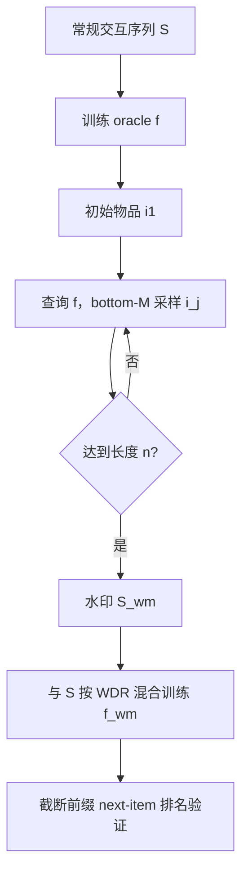
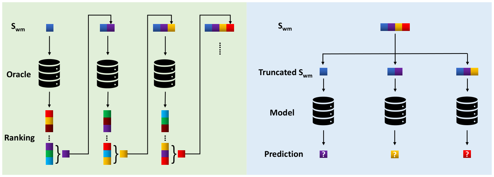

# Watermarking Recommender Systems (推荐系统水印)

- **会议/期刊**: CIKM 2024
- **作者与机构**: Sixiao Zhang, Cheng Long (NTU)；Wei Yuan, Hongxu Chen, Hongzhi Yin (University of Queensland)
- **推荐链路定位**: 序列召回/排序（Next-Item Prediction）
- **研究方向**: 去偏公平、可信隐私与工业架构 / 序列与会话推荐
- **论文原文**: [论文原文链接](https://arxiv.org/abs/2407.21034v3)
- **开源代码**: [开源代码仓库链接](https://github.com/RinneSz/AOW)

## TL;DR (1分钟核心速览)

针对推荐模型易被窃取且现有 CV 水印难迁移到排序任务的问题，本文提出 AOW：用 oracle 低分 bottom-M 项自回归生成整条 OOD 水印序列，再以加权训练写入模型，黑盒下用截断前缀 next-item 排名验证。四个数据集 leave-one-out + full-ranking 下，AOW 的 R@1 达 100%，效用逼近 Oracle，且抗蒸馏/微调。

## Background & Motivation (背景与核心矛盾)

- **主流范式**: 模型水印在 CV 中分白盒参数加密与黑盒后门映射；推荐系统版权保护仍主要靠 GRO 等防御模型抽取的方法。
- **前人局限**: GRO 通过 swap loss 干扰攻击者模型，但会牺牲目标模型效用；CV 的 OOD 图像/分类标签无法直接表达推荐中的序列输入与 top-k 排序输出。
- **核心洞察 (Key Insight)**: oracle 打分低的 bottom-M 物品天然偏离训练分布；若 bottom-M 与 top-k 不交，则 oracle 在水印序列上 top-k 召回必为 0，而该序列可被目标模型通过训练记住。
- **本文切入点**: 不用假物品，构造整条自回归低分序列作为黑盒水印，用截断前缀的 next-item 预测验证所有权。

## Method (核心方法设计)

### 1. 整体框架 (Overall Architecture)

先在常规数据上训练 oracle $f$；选初始物品后，反复用当前前缀$S^{wm}_{<j}$查询$f$，从最低分 bottom-M 中抽一个物品追加，直到长度$n$，得到整条 OOD 水印。将$S^{wm}$按 WDR 复制/加权混入训练集训练$f_{wm}$；验证时把水印截成$n-1$ 个前缀，要求模型把真实下一项排进 top-k。推理沿用原 next-item 排序，不增加在线开销。

<figure class="paper-figure" markdown="span">
  <figcaption>图 1：AOW 的示意图。（左）水印序列 𝑆𝑤𝑚 的生成过程。使用一个初始项目（蓝色）查询 oracle 模型以获得排序列表，并选择一个排名靠后的随机项目（紫色）作为下一项。然后，用包含两个项目的新的 𝑆𝑤𝑚 查询 oracle 以获得第三项（黄色）。重复该自回归过程，直到 𝑆𝑤𝑚 达到预定义长度。（右）AOW 的评估过程。水印序列 𝑆𝑤𝑚 被截断为若干子序列。模型需要为每个截断预测下一项</figcaption>
</figure>

### 2. 关键设计拆解 (Key Designs)

1. **自回归 OOD 水印生成**：痛点在于 CV 噪声/白像素不适配序列，且分类标签不适配 top-k 排序。AOW 用 oracle 自身低分项构造序列：$i^{wm}_{j}\in \mathrm{BottomM}\left(f(\cdot\mid S^{wm}_{<j})\right)$。若 bottom-M 与 top-k 不交，则 oracle 在 top-k 上必为 0；低分项偏离训练分布，整条序列即为 OOD，避免 ID 水印的效用损失。
2. **水印注入与黑盒验证**：把 $S^{wm}$按 WDR 复制/加权混入训练，$\mathcal{L}=\mathcal{L}_{\mathrm{rec}}(\mathcal{S})+\lambda\mathcal{L}_{\mathrm{rec}}(\{S^{wm}\})$，$\lambda$对应 WDR。验证时对每个截断前缀$S^{wm}_{\le t}$计算 next-item 排名：$\mathrm{Recall@}k=\frac{1}{n-1}\sum_{t=1}^{n-1}\mathbb{I}\left[\mathrm{rank}(i^{wm}_{t+1}\mid S^{wm}_{\le t})\le k\right]$。前缀依赖使简单 shuffle/swap 不易移除；要移除只能压低目标项排名，会伤及正常效用。
3. **训练目标、负采样与推理效率**：沿用 Bert4Rec 的 next-item 训练目标，未引入额外负采样器；水印仅作为加权序列参与训练。默认 $n=5$、$M=100$、WDR=0.1、冷门初始项。由于只增加少量训练序列/权重，在线推理与普通序列模型完全一致，额外成本可忽略。

## Experimental Setup & Evaluation Protocol (实验设置与评估协议)

- **数据集与预处理**: 沿用公开序列推荐预处理，每用户一条交互序列；统计如下（交互数按平均长度估算）：

| 数据集 | #Users | #Items | #Interactions | 稀疏度/密度 | 特征/场景说明 |
| :--- | :---: | :---: | :---: | :---: | :--- |
| ML-1M | 6,040 | 3,416 | ≈1.00M | 4.84% | 电影推荐，序列较长 |
| ML-20M | 138,493 | 18,345 | ≈20.0M | 0.79% | 大规模电影评分 |
| Steam | 334,542 | 13,046 | ≈4.22M | 0.10% | 游戏购买/交互，短序列 |
| Beauty | 40,226 | 54,542 | ≈0.35M | 0.02% | 亚马逊美妆，极稀疏 |

- **数据划分与防穿越 (Splitting Strategy)**: 采用 `Leave-One-Out`，每用户最后一项为测试集，倒数第二项为验证集。
- **排名评测协议 (Ranking Protocol)**: 无偏 `Full-Ranking (全库 top-k 排序)`；Recall@k / NDCG@k 同时衡量模型效用与水印有效性。未报告采样排序正负比。
- **对比基线与超参设置**: 原文保护基线仅 GRO，另设 Oracle（未保护上界）；主干为 Bert4Rec，SASRec 验证结论类似。默认水印长度 $n=5$、$M=100$、WDR=0.1、冷门初始项；嵌入维度沿用 Bert4Rec 原设置（文中未单列$d$），未报告显著性$p$ 值。

## Key Experimental Results (实验关键数据)

### 1. 主实验对比 (Main Results)

Oracle 为未保护上界；AOW 在保护方法中粗体，相对 GRO 的 R@10 提升以 `Δ` 表示：

| 数据集 | Oracle R@10 | GRO R@10 | AOW R@10 | Δ(AOW-GRO) | AOW 有效性 R@1 | 蒸馏后 R@10 | 微调1% R@10 |
| :--- | :---: | :---: | :---: | :---: | :---: | :---: | :---: |
| ML-1M | 20.16 | 18.08 | **19.69** | +1.61 | **100.00** | **100.00** | **100.00** |
| ML-20M | 14.96 | 13.95 | **14.35** | +0.40 | **100.00** | **100.00** | **100.00** |
| Steam | 19.93 | 19.87 | **19.90** | +0.03 | **100.00** | **100.00** | **100.00** |
| Beauty | 2.96 | 2.85 | **2.95** | +0.10 | **100.00** | **75.27** | **100.00** |

### 2. 消融实验 (Ablation Study)

原文无传统逐模块消融，以下汇总关键组件/鲁棒性分析：

| 分析项 | 设置 | 关键结果 |
| :--- | :--- | :--- |
| OOD 选择范围 | Bottom-100 / Top-100 | oracle 检测 R@100：0 / 34.02 |
| 水印长度 $n$| 2,5,10,20 |$n\le5$四数据集 R@1=100；$n=20$ Steam cold 91.01、pop 85.79 |
| 抗蒸馏 | $n=5$, cold | R@10：ML-1M/ML-20M/Steam 100，Beauty 75.27 |
| 抗微调 | 1% / 20% | 1% R@10 全 100；20% 显著下降且效用同步下降 |
| WDR | 0.01~4.0 | WDR↑ 水印 recall↑、utility↓；0.1 已足够高 |
| $M$ | 100~3000 | validity 恒 100%，utility 无显著差异 |

### 3. 关键实验发现 (Key Findings)

1. 默认 $n=5$、cold 初始项、WDR=0.1 时，四数据集水印 R@1 均为 100%；AOW R@10 为 19.69/14.35/19.90/2.95，与 Oracle 差 0.47/0.61/0.03/0.01，而 GRO 为 18.08/13.95/19.87/2.85，说明 AOW 几乎不损效用且优于 GRO。
2. bottom-M 是有效性的关键：bottom-100 的 oracle R@100=0，而 top-100 达 34.02，说明若把高分项纳入生成范围，水印会在无辜 oracle 中被误检，破坏所有权验证。
3. 鲁棒性呈长度/数据量权衡：$n=5$ 水印经蒸馏后 R@10 除 Beauty(75.27) 外均 100，1% 微调后全 100；但当微调数据达 20% 时水印显著衰减，然而此时模型效用也大幅下降，攻击者难以同时保留可用模型并移除水印。

## Highlights & Limitations (亮点、对比与审稿批判)

- **与代表作对比 (vs. Prior Work)**: GRO 通过 swap loss 防御模型抽取但牺牲效用；CV OOD 水印依赖图像/分类标签，不能直接处理序列 top-k；AOW 首次把黑盒 OOD 水印迁移到序列推荐，且无需假物品。
- **可迁移亮点**: 低分项自回归生成 OOD 序列 + WDR 加权训练可作为通用版权指纹；截断前缀排名验证适用于任意 next-item 模型。
- **审稿级局限批判**: 仅验证 Bert4Rec/SASRec 序列场景，未覆盖图、CTR、生成式推荐；只与 GRO 对比，缺显著性检验与更强自适应攻击；$n=20$ 或 20% 微调下鲁棒性有限，且未讨论水印序列泄露后的安全边界。

## Rating (四维评分)

- **方法创新性 (Novelty)**: ⭐⭐⭐⭐ （首次将黑盒模型水印引入推荐系统，bottom-M 自回归 OOD 序列构造简洁且有明确零召回条件）
- **评估协议与实验扎实度 (Protocol & Experiments)**: ⭐⭐⭐ （四数据集、leave-one-out、full-ranking 与蒸馏/微调鲁棒性较完整，但仅 GRO 一个保护基线且缺显著性检验）
- **写作与数学规范度 (Clarity & Rigor)**: ⭐⭐⭐⭐ （问题约束、生成/验证公式清楚，理论保证主要限于 bottom-M 与 top-k 不交时的零召回）
- **工业落地与复现价值 (Industrial & Practical Value)**: ⭐⭐⭐⭐ （代码开源、在线零额外推理、WDR 加权训练开销低，但强微调攻击下鲁棒性仍有限）

