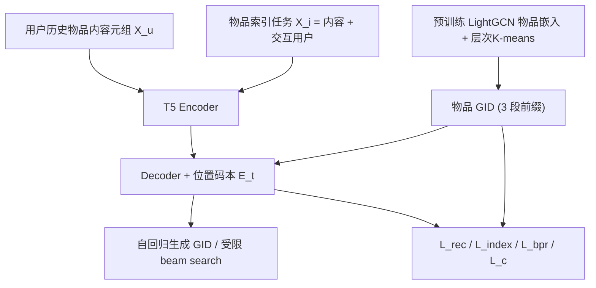
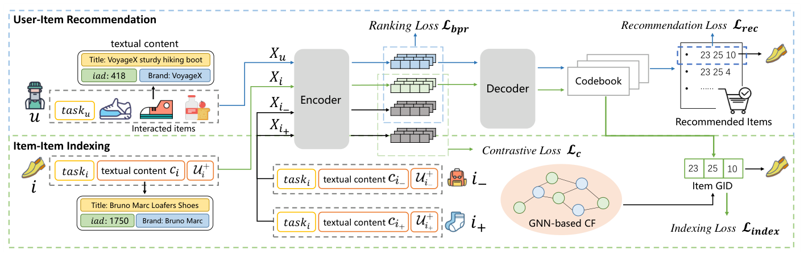

# Content-Based Collaborative Generation for Recommender Systems (基于内容的协同生成式推荐)

- **会议/期刊**: CIKM 2024 (33rd ACM International Conference on Information and Knowledge Management)
- **作者与机构**: Yidan Wang, Zhaochun Ren, Weiwei Sun, Jiyuan Yang, Pengjie Ren, Zhumin Chen, Xin Xin (山东大学 / 莱顿大学) 与 腾讯微信 Xin Chen, Ruobing Xie, Su Yan, Xu Zhang
- **推荐链路定位**: 端到端生成式召回（直接生成物品 GID）
- **研究方向**: 生成式推荐与离散语义 ID / 协同过滤与双塔召回
- **论文原文**: [https://arxiv.org/abs/2403.18480v2](https://arxiv.org/abs/2403.18480v2)
- **开源代码**: [https://github.com/Junewang0614/ColaRec](https://github.com/Junewang0614/ColaRec)

## TL;DR (1分钟核心速览)

现有生成式推荐要么只用品类/标题文本构造语义 ID（TIGER 类，丢失协同信号），要么只用 SASRec 序列嵌入构造标识（丢失内容信息），且缺乏显式的空间对齐学习；LLM 路线则受困于“语言生成 $\neq$物品推荐”的任务错配与 grounding 开销。ColaRec 用预训练 LightGCN 的物品嵌入做层次$K$-means 得到 3 段式 GID，以 T5 编码用户历史物品的**内容元组**、自回归解码目标 GID，并新增“物品索引”辅助任务与对比损失显式对齐内容空间与协同空间。在四个 Amazon/Recipe 数据集上按 8:1:1 随机划分、**全库 Full-Ranking** 评测，Recall@20 相对最强基线提升 3.54%–6.72%，长尾用户组提升更显著。

## Background & Motivation (背景与核心矛盾)

- **主流范式**: 生成式推荐沿用生成式检索（DSI）范式：为每个物品分配一段离散 token 序列 GID，用 seq2seq 模型直接从用户历史生成目标 GID，无需语言建模与 grounding。
- **前人局限 1**: 语义 ID 构造单一化——TIGER/RQ-VAE、DSI-S 仅从文本嵌入量化，协同共现信号完全缺失；而 Si 等用 SASRec 嵌入建 ID，则物品内容文本被弃用。两类方法各丢一半信息。
- **前人局限 2**: 即使把语义串与协同 ID 朴素拼接（P5 类），也只是字符串层面的并置，没有可学习过程，两个空间从未真正对齐，导致生成空间中的“邻近”与协同意义上的“相似”脱耦。
- **核心洞察 (Key Insight)**: GID 的层级前缀天然编码了物品相似关系（共享前缀 $\Rightarrow$ 相似），因此 GID 既是生成目标，也是一个可用来**监督对齐**的结构信号——这正是作者设计索引任务与对比损失的出发点。
- **本文切入点**: 让 GID 由协同图模型产生（携带协同信号），再让内容编码器学会“反推”这个 GID，从而把内容空间强行拉到协同空间的坐标系里。

## Method (核心方法设计)

### 1. 整体框架 (Overall Architecture)

输入侧，用户 $u$的历史被组织成**无序**内容元组序列$X_u=[\texttt{task}_u,\{c_i\mid i\in\mathcal{I}^+_u\}]$，其中$c_i=[i_{ad},k_1{:}v_1,k_2{:}v_2,\dots]$是扁平化的属性字典加上物品原子 ID，保证同一段文本既能被内容编码器读懂、又能唯一定位物品。编码器（T5-small 初始化并微调）产出隐状态，解码器基于位置相关码本$E_t$逐步生成长度$l=3$ 的 GID。除主推荐任务外，共享同一编码器-解码器与同一码本的“物品索引”任务把物品内容+交互用户集合映射回该物品的 GID，起到空间桥接作用；再叠加 BPR 排序损失与 GID 前缀对比损失联合优化。推理时用受限 beam search 仅在合法前缀子树内扩展，避免生成无效 GID。

<figure class="paper-figure" markdown="span">
  <figcaption>图 3</figcaption>
</figure>

### 2. 关键设计拆解 (Key Designs)

1. **协同感知的 GID 构造（协同信号注入生成空间）**：痛点是从文本嵌入量化的码本只保留语义近邻。做法是在 LightGCN 物品表示上做**受限层次 $K$-means**：第$t$层（$t\in[1,l-1]$）每簇物品数不超过$K^{l-t}$，叶子层再随机分配$1..K$，形成$K$叉树，根到叶路径即 GID$=[z^1_i,\dots,z^l_i]$。因此共享前缀的物品在交互图上本就相近，生成的每一步都是在“由粗到细地检索协同邻域”，显著缩小了单步搜索空间。
2. **物品索引任务 + 前缀对比损失（显式空间对齐）**：痛点是内容编码与协同码本之间没有梯度通路。索引任务令 $X_i=[\texttt{task}_i,c_i,\{u_{ad}\mid u\in\mathcal{U}^+_i\}]$，用同一码本重建$i$的 GID，于是码本$E_t$被迫吸收内容语义：$\mathcal{L}_{index}=-\sum_{t=1}^{l}\log p(z^t_i\mid X_i,z^{<t}_i)$。对比损失进一步约束“GID 前缀重叠$\Rightarrow$内容表征相近”：取与$i$共享前缀的$i^+$、与$i$无前缀重叠的$i^-$，$\mathcal{L}_{c}=-\ln\sigma\big(h(X_i)\cdot(h(X_{i^+})-h(X_{i^-}))\big)$，把层级结构的偏序关系蒸馏进编码器隐状态$h(\cdot)$。
3. **训练目标、负采样与推理效率**：$\mathcal{L}=\mathcal{L}_{rec}+\mathcal{L}_{index}+\mathcal{L}_{bpr}+\alpha\mathcal{L}_{c}$，其中$\mathcal{L}_{bpr}=-\ln\sigma\big(h(X_u)\cdot(h(X_i)-h(X_{i^-}))\big)$补足生成式交叉熵缺失的“相对排序”信号，$\alpha\in\{0.02,0.08,0.1,0.05\}$。负样本统一用均匀分布采样（作者明确将生成式负采样策略留作未来工作），$i^-$同时被约束为与$i$无前缀重叠。推理仅需$l=3$ 步解码 + 受限 beam search，开销远低于需 grounding 的 LLM 路线。

## Experimental Setup & Evaluation Protocol (实验设置与评估协议)

- **数据集与预处理**: Amazon 三个子类 + Food.com，均做 `5-core` 过滤；内容侧 Amazon 用 title/brand/categories，Recipe 用 name/description/tag。

| 数据集 | #Users | #Items | #Interactions | 稀疏度/密度 | 特征/场景说明 |
| :--- | :---: | :---: | :---: | :---: | :--- |
| Beauty | 22,363 | 12,101 | 198,502 | 0.073% | Amazon 美妆，通用（非序列）推荐 |
| Sports | 35,598 | 18,357 | 296,337 | 0.045% | 户外运动 |
| Phone | 27,879 | 10,429 | 194,439 | 0.067% | 手机配件 |
| Recipe | 17,813 | 41,240 | 555,618 | 0.076% | 食谱，物品数最多 |

- **数据划分与防穿越 (Splitting Strategy)**: 每个用户历史交互按 **8:1:1 随机比例划分** train/valid/test（非 Leave-One-Out、非全局时间戳切分），因此任务是通用推荐而非序列下一项预测，输入刻意使用无序元组。
- **排名评测协议 (Ranking Protocol)**: **Full-Ranking（全库未交互物品排序）**，候选集为整个物品集，不做负采样排序；指标 Recall@{5,10,20} 与 NDCG@{5,10,20}，各实验跑 3 次取均值，配对 t 检验报告 $p<0.1$（长尾表用$p<0.05$）。
- **对比基线与超参设置**: CF 类 NeuMF / LightGCN / SimpleX / NCL；生成类 MultiVAE / DiffRec / DSI-R / DSI-S / TIGER / LC-Rec。$l=3$，$K=32$（Recipe 为 48），嵌入与码本维度$d=512$（对齐 T5-small），AdamW、lr$5\times10^{-4}$、batch 128；所有基线用户/物品嵌入统一设为 512 以保证公平。

## Key Experimental Results (实验关键数据)

### 1. 主实验对比 (Main Results)

| 数据集 | 指标 | LightGCN | NCL | MultiVAE | DiffRec | DSI-S | TIGER | LC-Rec | **ColaRec** | Improv. |
| :--- | :--- | :---: | :---: | :---: | :---: | :---: | :---: | :---: | :---: | :---: |
| Beauty | R@10 | 0.0952 | 0.0940 | 0.0776 | 0.0741 | 0.0705 | 0.0799 | 0.0770 | **0.0993** | +4.31% |
| Beauty | N@10 | 0.0549 | 0.0547 | 0.0443 | 0.0450 | 0.0385 | 0.0443 | 0.0415 | **0.0556** | +1.28% |
| Sports | R@10 | 0.0623 | 0.0631 | 0.0476 | 0.0403 | 0.0497 | 0.0572 | 0.0617 | **0.0660** | +4.60% |
| Sports | N@10 | 0.0355 | 0.0359 | 0.0261 | 0.0235 | 0.0284 | 0.0313 | 0.0335 | **0.0364** | +1.39% |
| Phone | R@10 | 0.1052 | 0.1043 | 0.0855 | 0.0668 | 0.0625 | 0.0895 | 0.0919 | **0.1121** | +6.56% |
| Phone | N@10 | 0.0590 | 0.0593 | 0.0470 | 0.0379 | 0.0347 | 0.0498 | 0.0506 | **0.0611** | +3.04% |
| Recipe | R@10 | 0.0296 | 0.0298 | 0.0285 | 0.0235 | 0.0270 | 0.0292 | 0.0289 | **0.0306** | +2.68% |
| Recipe | N@10 | 0.0182 | 0.0182 | 0.0167 | 0.0135 | 0.0158 | 0.0176 | 0.0175 | **0.0185** | +1.65% |

注：Recall@20 相对提升为 Beauty 3.87%、Sports 3.54%、Phone 6.72%、Recipe 3.88%；NDCG@5 在 Beauty 上仍以 0.0449 略逊 NCL 的 0.0452（作者称“可比”），说明本文优势主要体现在召回而非头部排序精度。

### 2. 消融实验 (Ablation Study)

| 变体 | Beauty R@5 | Sports R@5 | Phone R@5 | Recipe R@5 | Beauty N@5 |
| :--- | :---: | :---: | :---: | :---: | :---: |
| ColaRec | **0.0667** | **0.0442** | **0.0745** | **0.0198** | **0.0449** |
| (1) w/o textual content | 0.0527 | 0.0364 | 0.0636 | 0.0181 | 0.0346 |
| (2) w/o indexing task | 0.0637 | 0.0422 | 0.0728 | 0.0179 | 0.0428 |
| (3) w/o $\mathcal{L}_{bpr}$ | 0.0612 | 0.0424 | 0.0719 | 0.0184 | 0.0412 |
| (4) w/o $\mathcal{L}_{c}$ | 0.0657 | 0.0422 | 0.0731 | 0.0188 | 0.0434 |
| (5) GID = 单 token $i_{ad}$ | 0.0658 | 0.0428 | 0.0719 | 0.0189 | 0.0437 |
| (6) GID = Random | 0.0600 | 0.0411 | 0.0667 | 0.0190 | 0.0401 |
| (7) GID = Content( BERT+K-means ) | 0.0662 | 0.0423 | 0.0716 | 0.0183 | 0.0440 |

### 3. 关键实验发现 (Key Findings)

1. **内容文本是最大单一贡献项**：去掉物品文本后 Recall@5 在四数据集分别暴跌 20.99%/17.65%/14.63%/8.59%，远超去掉索引任务（约 4.5%/4.5%/2.3%/9.6%）——说明内容信息不仅提供语义先验，更是稀疏用户冷启动式泛化的主要来源。
2. **GID 的“协同味”比“语义味”更值钱**：把协同 GID 换成同等长度/码本规模的内容 GID，Beauty R@5 从 0.0667 掉到 0.0662、Phone 从 0.0745 掉到 0.0716；换成随机 GID 更差（0.0600/0.0667），而单 token $i_{ad}$也明显落后——证明性能增益主要来自“前缀$\Leftrightarrow$ 协同近邻”的结构对应，而非仅仅来自多 token 编码。
3. **长尾用户上增益放大**：按 20%:80% 划分头/尾用户后，ColaRec 在四个数据集 Recall@{5,10,20} 全部最优且显著（$p<0.05$），例如 Phone R@20 从 NCL 的 0.1473 提升到 0.1590（+7.9%），说明内容元组对交互稀疏用户的协同信号缺失形成了有效补偿。
4. **GID 长度与簇数存在 U 形甜点**：$l$从 1 增至 4 时，$l=2$反而因“步数+1 而单步空间仍大”下滑，$l=3$在解码步数与搜索空间之间取得最优；$K$从 32 升到 128 会因搜索空间膨胀而轻微掉点。$l=3,K=32$ 是默认配置。

## Highlights & Limitations (亮点、对比与审稿批判)

- **与代表作对比 (vs. Prior Work)**: 相比 TIGER（RQ-VAE 语义 ID + 序列生成），ColaRec 把 ID 的构造源从内容嵌入换成 LightGCN 协同嵌入，并额外用索引任务把内容“拉回”协同坐标系；相比 LC-Rec / DSI 系（把推荐改写成语言/文档检索任务），它完全回避语言 grounding 与 prompt 设计；相比 P5 类拼接方案，它用可学习任务而非字符串拼接实现对齐。
- **可迁移亮点**: (i)“用协同模型的聚类路径当作生成目标”这一 GID 构造法可直接移植到任意 RQ-VAE/语义 ID 生成框架中替换量化码本；(ii) 索引任务本质是“内容 $\to$ 结构标签”的自监督重建，可低成本复用为冷启动物品的 ID 分配器。
- **审稿级局限批判**: (i) 评测仅用随机 8:1:1 划分，未做时间戳切分或严格 cold-start 划分，与真实线上分布存在 gap；且 GID 由全量交互图上的 LightGCN 聚类得到，若训练/测试按时间切分则存在**信息泄漏风险**，作者未讨论；(ii) 输入的“用户历史”与索引任务的“交互用户集合”均为**随机采样**子集，采样比例未做敏感性分析，且模型需 T5-small 级预训练参数，推理成本与 LightGCN+NCL 不在同一量级，缺少效率对比。

## Rating (四维评分)

- **方法创新性 (Novelty)**: ⭐⭐⭐⭐ （“协同聚类路径作 GID + 索引任务反推”构成一个自洽的对齐闭环，思路干净，但各组件均为已有模块的新组合，理论分析偏弱）
- **评估协议与实验扎实度 (Protocol & Experiments)**: ⭐⭐⭐⭐ （四数据集 + 10 个基线 + 全库排序 + 长尾分桶 + 配对检验，扎实；扣分于单一切分方式与随机采样输入的敏感性缺失）
- **写作与数学规范度 (Clarity & Rigor)**: ⭐⭐⭐⭐ （任务形式化与四个损失定义清晰、符号统一，受限 beam search 与复杂度交代到位；索引任务为何必然带来对齐缺乏形式化论证）
- **工业落地与复现价值 (Industrial & Practical Value)**: ⭐⭐⭐⭐ （代码已开源，$l=3$ 短解码 + 受限搜索开销可控，GID 构造可离线完成；但依赖 T5 微调与全库受限搜索，超大规模类目下的词表规模仍需工程验证）

