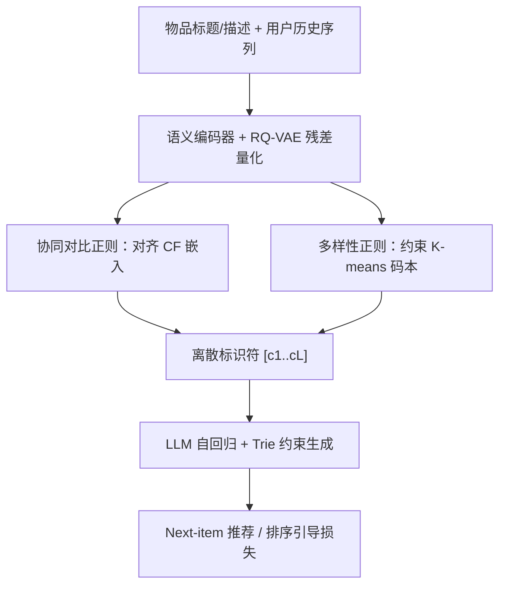
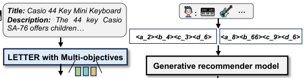

# Learnable Item Tokenization for Generative Recommendation（面向生成式推荐的可学习物品分词）

- **会议/期刊**: CIKM 2024
- **作者与机构**: Wenjie Wang, Honghui Bao, Xinyu Lin, Jizhi Zhang, Yongqi Li, Fuli Feng, See-Kiong Ng, Tat-Seng Chua；NUS、USTC、PolyU
- **推荐链路定位**: 端到端生成式
- **研究方向**: 生成式推荐与离散语义ID / 大语言模型推荐
- **论文原文**: [论文原文链接](https://arxiv.org/abs/2405.07314v3)
- **开源代码**: [开源代码仓库链接](https://github.com/HonghuiBao2000/LETTER)

## TL;DR (1分钟核心速览)

针对 LLM 生成式推荐中物品标识符语义层级弱、协同信号缺失与码本分配偏差三大痛点，LETTER 在 RQ-VAE 上叠加协同对比对齐和码嵌入多样性正则，并引入排序引导生成损失；在 Instruments/Beauty/Yelp 的 Leave-One-Out 全库排序下，R@10 较 TIGER/LC-Rec 提升 4.7%–10.8%。

## Background & Motivation (背景与核心矛盾)

- **主流范式**: LLM 生成式推荐先把物品转成标识符，再自回归生成下一物品；现有标识符分 ID、文本与码本三类。
- **前人局限**: 文本标识符缺乏从粗到细的层级语义且没有协同信号；码本标识符虽用 RQ-VAE 做层级量化，但码序列仍只由语义决定，且码分配天然不均衡，导致“高频码物品更易被生成”的生成偏差。
- **核心洞察 (Key Insight)**: 理想标识符应同时满足三点：层级语义、与协同信号对齐、码分配多样；码嵌入分布偏置是码分配偏置的根因。
- **本文切入点**: 把 tokenizer 变成可学习模块，用三种正则分别约束语义、协同与多样性，并用排序引导损失增强生成模型的 top-K 排序能力。

## Method (核心方法设计)

### 1. 整体框架 (Overall Architecture)

LETTER 先用 LLaMA-7B 提取物品标题/描述语义向量，经 encoder 压缩后用 L 级 RQ-VAE 残差量化得到码序列 $[c_1,\dots,c_L]$；训练时同时用语义重构、协同对比和码嵌入多样性三种正则更新码本与编码器。训练好的 tokenizer 将用户历史交互序列转为标识符序列，交给 TIGER/LC-Rec 自回归生成下一物品；推理用 Trie 约束只生成合法标识符，并用温度$\tau$ 的 token softmax 强化 hard-negative 惩罚。

<figure class="paper-figure" markdown="span">
  <figcaption>图1：利用 LETTER 进行基于 LLM 的生成式推荐概览。</figcaption>
</figure>

### 2. 关键设计拆解 (Key Designs)

1. **层级语义 + 协同对齐的码分配**：RQ-VAE 逐层量化残差 $c_l=\arg\min_i\|\boldsymbol{r}_{l-1}-\boldsymbol{e}_i\|_2,\ \boldsymbol{r}_l=\boldsymbol{r}_{l-1}-\boldsymbol{e}_{c_l}$，得到粗到细码序列；再用$\mathcal{L}_{CF}=-\frac{1}{B}\sum_i\log\frac{\exp(\langle\hat{\boldsymbol{z}}_i,\boldsymbol{h}_i\rangle)}{\sum_j\exp(\langle\hat{\boldsymbol{z}}_i,\boldsymbol{h}_j\rangle)}$将量化嵌入$\hat{\boldsymbol{z}}$与预训练 CF 嵌入$\boldsymbol{h}$ 对齐。直觉是让协同相似物品共享码序列，而不只共享语义。

2. **多样性正则缓解码分配偏差**：对每个码本用 constrained K-means 聚成 $K$簇，$\mathcal{L}_{Div}=-\frac{1}{B}\sum_i\log\frac{\exp(\langle\boldsymbol{e}_{c_l}^i,\boldsymbol{e}^+\rangle)}{\sum_{j=1}^{N-1}\exp(\langle\boldsymbol{e}_{c_l}^i,\boldsymbol{e}_j\rangle)}$ 拉近同簇码、推远异簇码；码嵌入更均匀后，低频码不再被高频码挤压，分配更均衡，生成偏差随之缓解。

3. **排序引导生成损失与训练推理**：总损失 $\mathcal{L}_{LETTER}=\mathcal{L}_{Sem}+\alpha\mathcal{L}_{CF}+\beta\mathcal{L}_{Div}$；LLM 微调用$\mathcal{L}_{rank}=-\sum_t\log\frac{\exp(p(y_t)/\tau)}{\sum_{v\in\mathcal{V}}\exp(p(v)/\tau)}$，无显式 item 负采样，靠 token softmax 与较小$\tau$对 hard negative 加权。推理用 Trie 约束合法码前缀，开销主要在$L$ 步自回归。

## Experimental Setup & Evaluation Protocol (实验设置与评估协议)

- **数据集与预处理**: 三个真实数据集，均按 5-core 过滤，用户历史截断至 20。

| 数据集 | #Users | #Items | #Interactions | 稀疏度/密度 | 特征/场景说明 |
| :--- | :---: | :---: | :---: | :---: | :--- |
| Instruments | — | — | — | — | Amazon 音乐器材；标题/描述 |
| Beauty | — | — | — | — | Amazon 美妆；标题/描述 |
| Yelp | — | — | — | — | 本地商户评论 |

注：原文仅说明过滤与划分方式，未在正文列出统计量。

- **数据划分与防穿越 (Splitting Strategy)**: `Leave-One-Out`，最后一件为测试、倒数第二为验证；未采用全局时间戳切分或冷启动划分。
- **排名评测协议 (Ranking Protocol)**: 遵循 TIGER 式 `Full-Ranking`：Trie 约束只在合法标识符前缀内生成 top-K，未采样负例；指标为 R@5/10、N@5/10。
- **对比基线与超参设置**: 传统 MF/Caser/HGN/BERT4Rec/LightGCN/SASRec；LLM 侧 BIGRec、P5-TID、P5-SemID、P5-CID、TIGER、LC-Rec。RQ-VAE 为 4 级码本、每级 256 码、$d=32$；CF 嵌入 32 维（SASRec）；$\alpha=0.02$、$\beta\approx1e-4$、$K=10$、$\tau$ 约 0.7–1.0；原文未报告显著性检验。

## Key Experimental Results (实验关键数据)

### 1. 主实验对比 (Main Results)

| Model | Instruments R@10 | Instruments N@10 | Beauty R@10 | Beauty N@10 | Yelp R@10 | Yelp N@10 |
| :--- | :---: | :---: | :---: | :---: | :---: | :---: |
| SASRec | 0.0947 | 0.0690 | 0.0588 | 0.0313 | 0.0296 | 0.0152 |
| P5-CID | 0.0987 | 0.0751 | 0.0597 | 0.0347 | 0.0347 | 0.0181 |
| TIGER | 0.1058 | 0.0797 | 0.0610 | 0.0331 | 0.0407 | 0.0213 |
| LC-Rec | 0.1006 | 0.0772 | 0.0642 | 0.0374 | 0.0359 | 0.0199 |
| LETTER-TIGER | **0.1122** | 0.0831 | 0.0672 | 0.0364 | **0.0426** | **0.0231** |
| LETTER-LC-Rec | 0.1115 | **0.0854** | **0.0703** | **0.0418** | 0.0393 | 0.0211 |
| **LETTER-TIGER vs TIGER (Improv.%)** | **+6.05%** | **+4.27%** | **+10.16%** | **+9.97%** | **+4.67%** | **+8.45%** |
| **LETTER-LC-Rec vs LC-Rec (Improv.%)** | **+10.83%** | **+10.62%** | **+9.50%** | **+11.76%** | **+9.47%** | **+6.03%** |

### 2. 消融实验 (Ablation Study)

| 变体 | Instruments R@10 | Instruments N@10 | Beauty R@10 | Beauty N@10 |
| :--- | :---: | :---: | :---: | :---: |
| (0) TIGER | 0.1058 | 0.0797 | 0.0610 | 0.0331 |
| (1) + 协同正则 | 0.1078 | 0.0810 | 0.0660 | 0.0351 |
| (2) + 多样性正则 | 0.1075 | 0.0809 | 0.0618 | 0.0335 |
| (3) + 协同 + 多样性 | 0.1092 | 0.0819 | **0.0672** | 0.0357 |
| (4) LETTER-TIGER（+排序损失） | **0.1122** | **0.0831** | **0.0672** | **0.0364** |

### 3. 关键实验发现 (Key Findings)

1. **协同正则贡献最大在 Beauty**：单独加协同正则使 R@10 从 0.0610 升至 0.0660（+8.2%）；单独多样性仅使 Instruments 从 0.1058 升至 0.1075（+1.6%），说明仅均匀化码本不够，必须先把 CF 信号写入码分配。
2. **三正则叠加与排序损失互补**：三正则叠加后 Instruments R@10 0.1058→0.1092（+3.2%）、Beauty +10.2%；再加排序损失 Instruments R@10 进一步升至 0.1122（+2.7%），Beauty N@10 0.0357→0.0364，验证 $\tau$ 对 hard negative 的惩罚有效。
3. **码分配与协同对齐有直接证据**：首层码使用数 TIGER 148→多样性正则 199；加入协同正则后降至 76，LETTER 恢复至 150；相似协同物品的码序列相似度 TIGER 0.0849/0.1135→LETTER 0.2760/0.3312，量化嵌入 Beauty R@10 0.0213→0.0343。

## Highlights & Limitations (亮点、对比与审稿批判)

- **与代表作对比 (vs. Prior Work)**: TIGER 只用 RQ-VAE 语义量化，码分配不可学习；LC-Rec 用辅助对齐与 Sinkhorn 归一化，但没有直接约束码嵌入分布；P5-CID 依赖固定谱聚类树，难适应新物品。LETTER 的关键区别是把“码分配”本身作为可学习对象，并用 CF 对比与多样性正则同时塑形。
- **可迁移亮点**: 将量化码嵌入与 CF 嵌入做对比对齐，可迁移到任何“语义 ID + 生成式召回”管线；用 constrained K-means 做码本多样性正则，可缓解语义 ID 的高频码塌缩；排序引导温度可直接用于生成式模型的 hard-negative 强化。
- **审稿级局限批判**: ① tokenizer 需单独预训练，码本训练后固定，新物品/冷启动与动态更新未充分验证；② 仅离线 LOO 全库排序，缺少线上 A/B、推理延迟与统计显著性报告，且 $\alpha,\beta,K,\tau$ 多超参需调优。

## Rating (四维评分)

- **方法创新性 (Novelty)**: ⭐⭐⭐⭐ （三正则精准对应层级语义、协同缺失与码分配偏差，ranking loss 有 OPAUC 关联命题支撑）
- **评估协议与实验扎实度 (Protocol & Experiments)**: ⭐⭐⭐ （三数据集 + LOO 全库生成排序 + 消融完整，但数据集统计缺失、未报告显著性检验）
- **写作与数学规范度 (Clarity & Rigor)**: ⭐⭐⭐⭐ （RQ-VAE、对比与多样性损失定义清楚，命题与附录证明较规范；个别实验表排版有异常）
- **工业落地与复现价值 (Industrial & Practical Value)**: ⭐⭐⭐⭐ （代码开源，tokenizer 可离线训练，Trie 约束推理工程友好；但码本固定与超参敏感限制动态场景）

