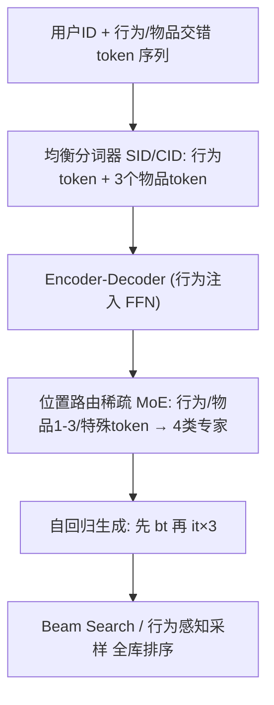
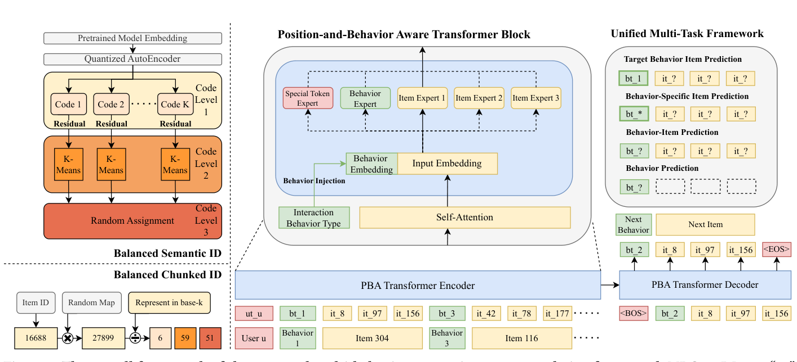

# Multi-Behavior Generative Recommendation (多行为生成式推荐)

- **会议/期刊**: CIKM 2024 (Camera-ready)
- **作者与机构**: Zihan Liu†, Yupeng Hou†, Julian McAuley (University of California, San Diego)
- **推荐链路定位**: 端到端生成式（召回级 Next-Item 生成）
- **研究方向**: 生成式推荐与离散语义 ID / 序列与会话推荐
- **论文原文**: [https://arxiv.org/abs/2405.16871v2](https://arxiv.org/abs/2405.16871v2)
- **开源代码**: [https://github.com/anananan116/MBGen](https://github.com/anananan116/MBGen)

## TL;DR (1分钟核心速览)

多行为序列推荐（MBSR）此前几乎只做「给定目标行为 → 预测下一个物品」的单步目标，行为类型从未进入学习目标本身，因而无法刻画用户意图。MBGen 把 MBSR 拆成 $P(b_n,v_n|S_u)=P(b_n|S_u)\cdot P(v_n|S_u,b_n)$ 的连续两步，将行为 token 与物品 token 交错铺平成一条序列，用 encoder-decoder 统一 next-token 预测，同时给出均衡语义 ID（SID/CID）分词器与位置路由稀疏 MoE。在 Retail/IJCAI 的 `Leave-One-Out` + **Full-Ranking 全库排序**协议下，目标行为任务 Recall/NDCG@10 相对最优基线提升 **31.3%~70.1%**。

## Background & Motivation (背景与核心矛盾)

- **主流范式**: 两条路线——(a) 两阶段聚合（DMT/DIPN 按行为切子序列分别编码再加权）；(b) 行为作为辅助输入注入整条物品序列（MB-STR 用行为路由 FFN，PBAT 学个性化行为模式，MBHT 用超图）。
- **前人局限**: ① 训练目标只预测物品，行为类型最多作辅助多任务，模型**无法联合预测下一行为**，也无法在给定任意目标行为时条件生成物品（HSTU 虽有行为 token，但把行为放在物品之后，故无多任务能力）；② 物品解空间达百万级、行为不足十种，两个目标量级悬殊，直接多任务会造成学习失衡。
- **核心洞察**: 行为预测即「意图框架化」——加购之后可能是去结算、可能是买互补品、也可能是继续逛，意图确定后物品分布被大幅收窄；同时「先行为后物品」天然构成自回归的前后依赖，可用同一条 token 序列建模。
- **本文切入点**: 用数据中心的 token 化把两步依赖压进一条交错序列，让 attention 自己学 behavior→item / item→item 依赖，而非设计两个耦合损失。

## Method (核心方法设计)

### 1. 整体框架 (Overall Architecture)

用户 ID 经 hashing 映射为 `ut` 置于序列首部；每次交互表示为 $(b, c^v_1, c^v_2, c^v_3)$的四元组 token，全部铺平为一条异构序列送入 4 层 encoder + 4 层稀疏 decoder。训练即标准的 next-token 交叉熵：模型在预测完行为 token 后才被要求预测三个物品 token，两步依赖由因果掩码天然保证。推理时把 prompt 设为$[\langle BOS\rangle, b]$即得「给定行为的物品预测」，只给$\langle BOS\rangle$ 即得「行为+物品联合预测」，实现一套权重三任务复用。最后在稀疏 FFN 中按 token 相对位置硬路由到不同专家。

<figure class="paper-figure" markdown="span">
  <figcaption>图1：所提出的多行为生成式推荐框架 MBGen 的整体框架。我们用“ut”表示用户 token，“bt”表示行为 token，“it”表示物品 token。</figcaption>
</figure>

### 2. 关键设计拆解 (Key Designs)

1. **均衡语义 ID 分词器（Balanced SID / CID）**: RQ-VAE 用一个**全局码本**量化所有残差，导致同一首位码的物品残差高度相关、次位码严重塌缩（Retail L1 方差 15.2 万、第四位产生 51,083 次碰撞，需额外一位码兜底）。MBGen 改为**按首位码分组、每组独立跑一次 k-means**：首位码由单层量化自编码器给出 $r=\arg\min_j\|\boldsymbol{z}-\boldsymbol{e}_j\|$，损失$\mathcal{L}=\|\hat{\boldsymbol{x}}-\boldsymbol{x}\|^2+\beta\|\boldsymbol{z}-\mathrm{sg}[\boldsymbol{e}_r]\|^2$，残差再按$r$分桶聚类，第三位码纯随机分配以消歧。CID 则把随机重映射后的 ID 表示成 base-$k$数位，理论分布完全均衡。均衡化的收益是把码本层数从 4 压到 3、码本规模压到$K$=64/96，直接缩小解码解空间并缩短序列。
2. **位置路由稀疏 MoE + 行为注入 FFN**: 交错序列中「第 1 个 token 必是行为、第 2~4 个必是物品位」，传统可学习 gating 易表征塌缩。MBGen 直接**按 token 的相对位置硬路由**：行为 token、三个物品位各到一个 FFN 专家，$\langle BOS\rangle/\langle EOS\rangle/$用户 token 到第五个专家，路由函数$g(t)=\mathrm{pos}(t)$ 无需训练。同时 FFN 额外拼接当前行为 embedding（物品 token 取其所属行为的 embedding，其余置 padding），把行为语义渗透到 token 级。该设计在同等 FLOPs 下参数更多、性能更好。
3. **训练目标、负采样与推理效率**: 总损失为统一的自回归交叉熵 $\mathcal{L}=-\sum_t \log P_\theta(y_t\mid y_{<t})$，**免负采样**（全库 softmax，分词器把$|\mathcal{V}|$拆成$K^3$级联）。推理用 50-beam 搜索；针对行为长尾（click 远多于 purchase）导致联合概率高但稀有行为被 beam 挤掉的问题，提出**行为感知采样**：按各行为概率$[0.3,0.42,0.18,0.1]$分配 beam 预算$[3,4,2,1]$，在 10-beam 预算下即超过 50-beam 原始搜索。

## Experimental Setup & Evaluation Protocol (实验设置与评估协议)

- **数据集与预处理**: 过滤训练集中出现次数 $<5$ 的物品（`5-core`），并明确弃用 Yelp（评分硬切成 dislike/neutral/like 与真实行为分布不符）。

| 数据集 | #Users | #Items | #Interactions | 平均序列长 | 特征/场景说明 |
| :--- | :---: | :---: | :---: | :---: | :--- |
| Retail (Taobao/Tmall) | 147,894 | 97,842 | 7,651,493 | 78.20 | 4 行为：点击/加购/收藏/购买，购买为目标行为 |
| IJCAI | 423,119 | 351,221 | 32,685,371 | 93.06 | 同上，规模约 4 倍，用于可扩展性检验 |

- **数据划分与防穿越**: `Leave-One-Out`——最后一条交互作测试、倒数第二条作验证，序列统一截断至 50。
- **排名评测协议**: 无偏 `Full-Ranking`（真值物品在**全部未交互物品**中排序，而非采样的 100/101 负样本），指标 HR@5/10、NDCG@5/10；生成式模型用 50 束搜索取 top-10。
- **对比基线与超参设置**: 覆盖 MB-GCN/MB-GMN（非序列）、GRU4Rec/SASRec$_M$/BERT4Rec$_M$/TIGER（序列与生成式）、PBAT/MBHT/MB-STR/SASRec$_B$/BERT4Rec$_B$（多行为序列）、HSTU（行为 token 生成式）；$d$=256、inner 512、6 头、每层 5 专家；学习率$\{0.0008,0.001,0.0012\}$、权重衰减$\{0.005,0.001\}$；以 paired t-test$p<0.05$ 标显著性。

## Key Experimental Results (实验关键数据)

### 1. 主实验对比 (Main Results)

| 模型 | Retail HR@5 | Retail NDCG@5 | Retail HR@10 | Retail NDCG@10 | IJCAI HR@5 | IJCAI NDCG@5 | IJCAI HR@10 | IJCAI NDCG@10 |
| :--- | :---: | :---: | :---: | :---: | :---: | :---: | :---: | :---: |
| GRU4Rec | 0.2869 | 0.2060 | 0.3554 | 0.2282 | 0.2117 | 0.1539 | 0.2720 | 0.1734 |
| SASRec$_M$ | 0.3041 | 0.2243 | 0.3678 | 0.2449 | 0.2294 | 0.1785 | 0.2818 | 0.1954 |
| TIGER | 0.2887 | 0.2049 | 0.3523 | 0.2263 | 0.3728 | 0.2595 | 0.4310 | 0.2788 |
| PBAT | 0.1112 | 0.0750 | 0.1545 | 0.0890 | 0.1497 | 0.1048 | 0.2011 | 0.1214 |
| MBHT | 0.2984 | 0.2183 | 0.3608 | 0.2385 | 0.1652 | 0.1249 | 0.2069 | 0.1384 |
| MB-STR | 0.2814 | 0.2066 | 0.3500 | 0.2289 | 0.1874 | 0.1386 | 0.2360 | 0.1544 |
| **MBGen (SID)** | 0.4859 | **0.3800** | **0.5329** | **0.3954** | **0.4895** | **0.3498** | **0.6285** | **0.3949** |
| **MBGen (CID)** | **0.4886** | 0.3815 | 0.5245 | 0.3934 | 0.4866 | 0.3454 | 0.6281 | 0.3913 |
| **Improv.%** | +60.67% | +70.08% | +44.89% | +61.45% | +31.30% | +34.45% | +45.82% | +41.64% |

行为特定物品预测（NDCG@5/10）：MBGen-SID Retail **0.2053/0.2131**、IJCAI **0.3023/0.3317**，对比最强基线 MB-STR 的 0.0606/0.0715 与 0.1109/0.1257；行为-物品联合预测（NDCG@5/10）：HSTU 0.1579/0.1616（Retail）、0.1607/0.1654（IJCAI），MBGen-CID 达 **0.1720/0.1800** 与 **0.2443/0.2730**。

### 2. 消融实验 (Ablation Study)

| 变体 | Retail 目标行为 NDCG@5/10 | Retail 行为-物品 NDCG@5/10 | IJCAI 目标行为 NDCG@5/10 | IJCAI 行为-物品 NDCG@5/10 |
| :--- | :---: | :---: | :---: | :---: |
| w/o 位置路由稀疏 FFN (PR) | 0.3765/0.3894 | 0.1643/0.1730 | 0.3325/0.3778 | 0.2122/0.2258 |
| w/o 行为注入 (BI) | 0.3818/0.3970 | 0.1593/0.1697 | 0.3138/0.3575 | 0.2029/0.2159 |
| w/o PR & BI | 0.3853/0.3999 | 0.1633/0.1729 | 0.3155/0.3607 | 0.1945/0.2085 |
| w/o 物品分词器（单 token） | 0.3565/0.3598 | 0.1585/0.1637 | 0.3318/0.3396 | 0.2373/0.2506 |
| RQ-VAE ($K^4$=128$^4$) | 0.3690/0.3861 | 0.1592/0.1715 | 0.2993/0.3265 | 0.1853/0.1947 |
| RQ-VAE ($K^4$=256$^4$) | 0.3460/0.3634 | 0.1315/0.1445 | 0.3323/0.3684 | 0.2008/0.2149 |
| **MBGen (SID)** | **0.3800/0.3954** | **0.1712/0.1803** | **0.3498/0.3949** | **0.2155/0.2301** |

### 3. 关键实验发现 (Key Findings)

1. **两步生成是主要增益来源，且在数据越稀疏时越关键**：行为特定任务上 MBGen 相对 MB-STR 提升 3.4 倍（0.2053 vs 0.0606），说明把目标行为显式作为 prompt 条件，比让模型从行为序列中隐式猜测意图有效得多；联合任务相对 HSTU 仅 +8.4%（Retail），但相对同架构去掉行为前置顺序的 HSTU 分词方式在消融中差距明显（0.1585 vs 0.1712）。
2. **均衡分词器通过「压缩解空间」而非「增强语义」取胜**：Balanced SID 把首位码方差从 152,325 降到 90,093、第三位方差从 0.6778 降到 0.2368，并消除第四位 51,083 次碰撞；而 CID 完全无语义信息却在联合预测上最优（IJCAI 0.2730 vs SID 0.2301），反证语义 ID 的收益主要来自码分布均衡带来的 beam 检索可分辨性；反之去掉分词器（单 token）虽在联合任务尚可（0.2506），目标行为任务却掉到 0.3396。
3. **稀疏 MoE 与行为注入的收益随数据规模放大，小数据集上甚至出现反效果**：IJCAI 上 w/o PR&BI 使目标行为 NDCG@10 从 0.3949 掉到 0.3607（−8.7%），但 Retail 上 w/o PR&BI 的 NDCG@5 反而略高于完整模型（0.3853 vs 0.3800），提示小规模数据下专家稀疏化引入的方差大于其容量收益；同时图 2/图 3 显示 MBGen 在同等 FLOPs 下性能随容量单调上升，而 MB-STR/PBAT 扩容后性能退化。

## Highlights & Limitations (亮点、对比与审稿批判)

- **与代表作对比**: 相比 TIGER（纯物品语义 ID、单步生成），MBGen 把行为 token 置于物品 token **之前**并作为可条件 prompt，因而具备三任务复用能力；相比 HSTU（行为置于物品之后、仅作排序偏好信号），本文明确建模 behavior→item 的因果两步依赖；相比 MB-STR（行为路由 FFN 但目标仍是单步物品预测），本文的生成式目标与分词器共同把行为纳入学习目标。
- **可迁移亮点**: ① 「按首位码分组重跑 k-means」这一残差均衡化技巧可低成本插入任何 RQ-VAE 类语义 ID 流水线；② 按行为频率分配 beam 预算的行为感知采样，可推广到任何长尾条件生成检索（如多品类、多场景 prompt 生成）。
- **审稿级局限批判**: ① 稀疏 MoE 与 4 层 decoder 的推理开销未与基线在同等 FLOPs 下给出端到端延迟（仅给单次前向 MFLOPS），且 50-beam 全库检索的线上可用性存疑；② 只在两个同源淘宝系电商数据集（4 行为、购买为目标）上验证，行为语义与目标行为设定单一，缺乏跨域/跨行为体系（如视频互动、内容社区）的泛化证据；③ Retail 上组件消融出现「去掉更多组件反而更好」的反常现象，作者未给出方差分析或多次运行置信区间。

## Rating (四维评分)

- **方法创新性 (Novelty)**: ⭐⭐⭐⭐ （把 MBSR 重构为行为→物品两步自回归生成，并用位置硬路由 MoE 处理异构 token，问题是拼接式工程创新多于理论突破）
- **评估协议与实验扎实度 (Protocol & Experiments)**: ⭐⭐⭐⭐⭐ （严格 Full-Ranking 全库排序 + paired t-test + 三任务 + 分词器分布定量分析 + 可扩展性曲线，远超同类 MBSR 论文的采样排序设定）
- **写作与数学规范度 (Clarity & Rigor)**: ⭐⭐⭐⭐ （两步概率分解与三任务定义清晰，但 MoE 路由与行为注入的公式化程度偏弱，主要为文字描述）
- **工业落地与复现价值 (Industrial & Practical Value)**: ⭐⭐⭐⭐ （代码开源、分词器与采样策略可独立复用；但 50-beam 全库生成与百万级物品解码的线上延迟仍需工程折衷）

