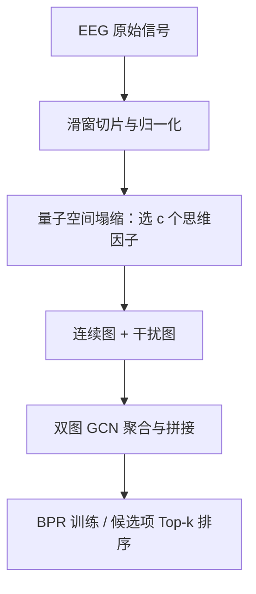
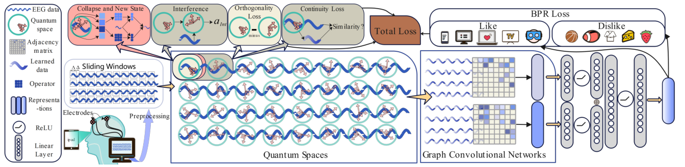

# Quantum Cognition-Inspired EEG-based Recommendation via Graph Neural Networks (量子认知启发的基于脑电信号与图神经网络推荐)

- **会议/期刊**: CIKM 2024
- **作者与机构**: Jinkun Han, Wei Li, Yingshu Li, Zhipeng Cai; Georgia State University
- **推荐链路定位**: 召回 (Top-k 候选项检索)
- **研究方向**: 图神经网络与知识图谱推荐（脑电信号驱动）
- **论文原文**: [论文原文链接](https://arxiv.org/abs/2501.02671v1)
- **开源代码**: [开源代码仓库链接](https://github.com/KK429312/CIKM2024Appendix)

## TL;DR (1分钟核心速览)

针对历史行为无法反映实时想法、EEG 信号又混杂且受过去思维干扰的痛点，QUARK 用滑窗切片、量子认知塌缩、连续/干扰双图和 GCN 学习脑电表征，并以 BPR 排序。在 MBD 的采样 100 候选 P@10 协议下，QUARK 较 BPR 在 8_LongTail 提升 95.71%，在 111_Normal 提升 24.63%。

## Background & Motivation (背景与核心矛盾)

- **主流范式**: 现有推荐依赖历史行为、社交关系、评分与多模态内容；EEG 推荐仍近乎空白，经典模型直接把 EEG 当普通特征输入。
- **前人局限**: 其一，EEG 是多种思维因子的混合态，普通网络难以分解；其二，过去思维会干扰未来思维，传统时序或图模型未显式建模这种“干涉”。
- **核心洞察 (Key Insight)**: 量子认知理论可将“思维事件”投影到可学习基底上，用塌缩概率选出少量思维因子，并用量子干涉项度量前一事件对后一事件的促进/抑制。
- **本文切入点**: 将 EEG 切片为事件，以量子空间生成混合态，再构造连续图与干扰图，用 GCN 聚合为实时偏好表征。

## Method (核心方法设计)

### 1. 整体框架 (Overall Architecture)

输入 EEG 先做均值归一化，经滑窗得到事件集 $\Phi$；每个事件归一化为 Hilbert 态，在可学习基底下按塌缩概率选取$c$个思维因子，得到混合态$x^\circ$。随后由$x^\circ$分别构造连续图与干扰图，经因果掩码$i>w$、ReLU 与阈值过滤后送入 GCN；两图各层表征拼接，经 MLP 得 EEG 表征，与候选项表征内积打分。训练用 BPR，推理对采样候选排序取 top-$k$。

<figure class="paper-figure" markdown="span">
  <figcaption>图2：QUARK 的框架。</figcaption>
</figure>

### 2. 关键设计拆解 (Key Designs)

1. **滑窗事件化 + 量子态塌缩**：EEG 思维因子短时混叠，直接池化会丢失组合结构。QUARK 将每个片段归一化为 $|x^*_{m,i}\rangle=\frac{x^*_{m,i}}{\sqrt{\sum_{j=1}^{\Lambda}(x^*_{m,i,j})^2}}$，计算$P_{m,i}=\{|\langle b_j|x^*_{m,i}\rangle|^2\}_{b_j\in B_{m,i}}$，取概率最高的$c$个基底生成$|x^\circ_{m,i}\rangle=\sum_{j\in\epsilon^c_{m,i}}|b_j\rangle\langle b_j|x^*_{m,i}\rangle$。直觉是用可学习投影把混合思维拆成少数主导因子，类似自适应集成而非随机 dropout。

2. **连续图与干扰图的双关系建模**：连续图用事件表征点积衡量重复性，保留 $i>w$的因果方向；干扰图按量子干涉项$e_{a_{j,k}}=2\langle x^*_{m,i}|o_{\bar\Theta_{v,w}}o_{\Theta_{m,i}}o_{\Theta_{m,i}}o_{\Theta_{v,w}}|x^*_{m,i}\rangle$建模过去事件对当前事件的促进/抑制，仅保留正权重。两图经行归一化后进入 GCN：$\mathbf{x}_{d+1}=[\xi\,\mathbf{x}^\circ+(1-\xi)\mathbf{A}\mathbf{x}_d]\mathbf{H}_d$。这样既保留原始脑电模式，又聚合高阶思维影响。

3. **训练目标、负采样与推理效率**：总损失为 $\mathcal{L}=\mathcal{L}_{\mathrm{BPR}}+\mathcal{L}_{\mathrm{orth}}+\mathcal{L}_{\mathrm{cont}}+\rho\|\Gamma\|_F$，其中$\mathcal{L}_{\mathrm{orth}}$约束基底正交，$\mathcal{L}_{\mathrm{cont}}$约束相邻事件表征连续。BPR 以同类正例 vs 不同类负例构造 pairwise 监督，未用 hard negative；推理时每例采样 100 个候选项并内积排序。主要开销在$|\Phi|\times|\Phi|$ 双图构造与 GCN 聚合，图规模随滑窗段数增长。

## Experimental Setup & Evaluation Protocol (实验设置与评估协议)

- **数据集与预处理**: MBD 为视觉刺激 EEG 数据集，5 电极、$N=360$ 时间步；图像用 ViTAE2 提取表征。按类别粒度与分布构造 8 个子集：

| 数据集 | #EEG | #Items | #Classes | 稀疏度/密度 | 特征/场景说明 |
| :--- | :---: | :---: | :---: | :---: | :--- |
| MBD-Normal | 7,048 | 13,998 | 111/50/25/8 | 未报告 | 近似正态类别分布 |
| MBD-LongTail | 14,012 | 13,998 | 111/50/25/8 | 未报告 | 长尾，动物类偏多 |

- **数据划分与防穿越 (Splitting Strategy)**: 85% 训练、15% 测试；原文未说明按用户/时间切分，属于随机比例划分。
- **排名评测协议 (Ranking Protocol)**: `Sampled Ranking`，每例 100 候选（15 个同类正例 + 85 个随机类负例），报告 P@10、R@10、F1@10；非全库 Full-Ranking。
- **对比基线与超参设置**: 对比 Random Guess、MF、DeepFM、DLRM、NCF、BPR；MBD 无用户/物品图关系，未比较图推荐 SOTA。主要超参：$\Lambda=10/15$、$\Delta=20/25$、$|B_{m,i}|=10/15$、$c=2$、$\alpha=0.8/0.9$、$\beta=0.4/0.7$、$d=5$、$\xi=0.3$、lr=$10^{-4}$、batch=16；未报告显著性检验与统一 embedding 维度。

## Key Experimental Results (实验关键数据)

### 1. 主实验对比 (Main Results)

| 场景 | Random | MF | DeepFM | DLRM | NCF | BPR | QUARK | Δ vs BPR |
| :--- | ---: | ---: | ---: | ---: | ---: | ---: | ---: | ---: |
| 111_Normal P@10 | 0.1530 | 0.1401 | 0.1453 | 0.1472 | 0.1576 | 0.2416 | **0.3011** | +24.63% |
| 50_Normal P@10 | 0.1498 | 0.1427 | 0.1515 | 0.1529 | 0.1541 | 0.2247 | **0.3070** | +36.63% |
| 25_Normal P@10 | 0.1482 | 0.1404 | 0.1416 | 0.1546 | 0.1505 | 0.2566 | **0.3945** | +53.74% |
| 8_Normal P@10 | 0.1541 | 0.1847 | 0.3276 | 0.2651 | 0.2459 | 0.5105 | **0.6807** | +33.34% |
| 111_LongTail P@10 | 0.1489 | 0.1378 | 0.1453 | 0.1456 | 0.1488 | 0.1581 | **0.2034** | +28.65% |
| 50_LongTail P@10 | 0.1521 | 0.1405 | 0.1411 | 0.1519 | 0.1423 | 0.1597 | **0.2261** | +41.58% |
| 25_LongTail P@10 | 0.1454 | 0.1417 | 0.1457 | 0.1492 | 0.1494 | 0.1690 | **0.2601** | +53.91% |
| 8_LongTail P@10 | 0.1495 | 0.1645 | 0.1702 | 0.1597 | 0.1499 | 0.2029 | **0.3971** | +95.71% |

R@10 与 F1@10 同向；如 111_Normal 的 F1@10 从 BPR 0.1933 升至 **0.2409**（+24.62%），8_LongTail 从 0.1623 升至 **0.3177**（+95.75%）。

### 2. 消融实验 (Ablation Study)

| 变体 | 111_Normal F1@10 | 111_LongTail F1@10 |
| :--- | ---: | ---: |
| ¬GCN | 0.2187 | 0.1364 |
| ¬QM（量子空间） | 0.2231 | 0.1475 |
| ¬Interference | 0.2256 | 0.1490 |
| ¬Continuity | 0.2269 | 0.1545 |
| ¬($i>w$) | 0.2287 | 0.1591 |
| ¬Continuity loss | 0.2347 | 0.1617 |
| ¬QM loss | 0.2376 | 0.1619 |
| QUARK | **0.2409** | **0.1627** |

### 3. 关键实验发现 (Key Findings)

1. **GCN 是最大贡献模块**：去掉 GCN 后 111_Normal 的 F1@10 从 0.2409 降至 0.2187（-9.2%），111_LongTail 从 0.1627 降至 0.1364（-16.2%），说明双图聚合比单纯量子投影更关键；干扰图移除后的跌幅大于连续图（0.2256 vs 0.2269、0.1490 vs 0.1545），验证“过去思维干涉未来”是有效先验。
2. **类别越多经典模型越接近随机**：当类别数超过 8 时，MF/DeepFM/DLRM/NCF 在 50/111 类场景已接近 Random Guess；BPR 因 pairwise 区分仍优于随机，但 QUARK 在 111_Normal 达 0.3011、8_Normal 达 0.6807，分别较 BPR 提升 24.63% 与 33.34%。
3. **长尾反而放大相对收益**：8_LongTail 的 P@10 从 BPR 0.2029 提至 0.3971（+95.71%），25_LongTail 从 0.1690 提至 0.2601（+53.91%）；表明量子分解与双图聚合能缓解少数类主导参数更新，表征可视化也显示 QUARK 簇更清晰。

## Highlights & Limitations (亮点、对比与审稿批判)

- **与代表作对比 (vs. Prior Work)**: 与 MF/DeepFM/DLRM/NCF/BPR 将 EEG 视作普通特征不同，QUARK 显式分解混合思维并建模思维间干涉；与常规 GCN 推荐相比，其图关系不是用户-物品图，而是由量子塌缩生成的双关系思维图。
- **可迁移亮点**: “因果掩码 $i>w$+ 双关系图 + 原始表征残差”可迁移到时序信号或匿名会话推荐；选取少量$c$ 个主导因子的投影也可作为轻量去噪模块。
- **审稿级局限批判**: 仅 MBD 单数据集、同域图像推荐，100 候选采样（15 正例）并非全库排序，且未报告显著性检验；EEG 设备依赖、隐私与实时性未评估，双图构造为 $O(|\Phi|^2)$，大规模场景需稀疏化或分块。

## Rating (四维评分)

- **方法创新性 (Novelty)**: ⭐⭐⭐⭐ （量子认知塌缩 + 连续/干扰双图 GCN 的组合新颖，但量子模块本质仍是可学习投影，理论解释强于算法普适性）
- **评估协议与实验扎实度 (Protocol & Experiments)**: ⭐⭐⭐ （MBD 单数据集、85/15 划分与 100 候选采样，缺全库排序和显著性检验；消融与可视化较完整）
- **写作与数学规范度 (Clarity & Rigor)**: ⭐⭐⭐⭐ （框架与损失闭环清晰，量子算子符号偏重但附录给出干涉项推导）
- **工业落地与复现价值 (Industrial & Practical Value)**: ⭐⭐⭐ （代码开源，但 EEG 采集、隐私、实时性与 $O(|\Phi|^2)$ 图构造限制线上部署）

