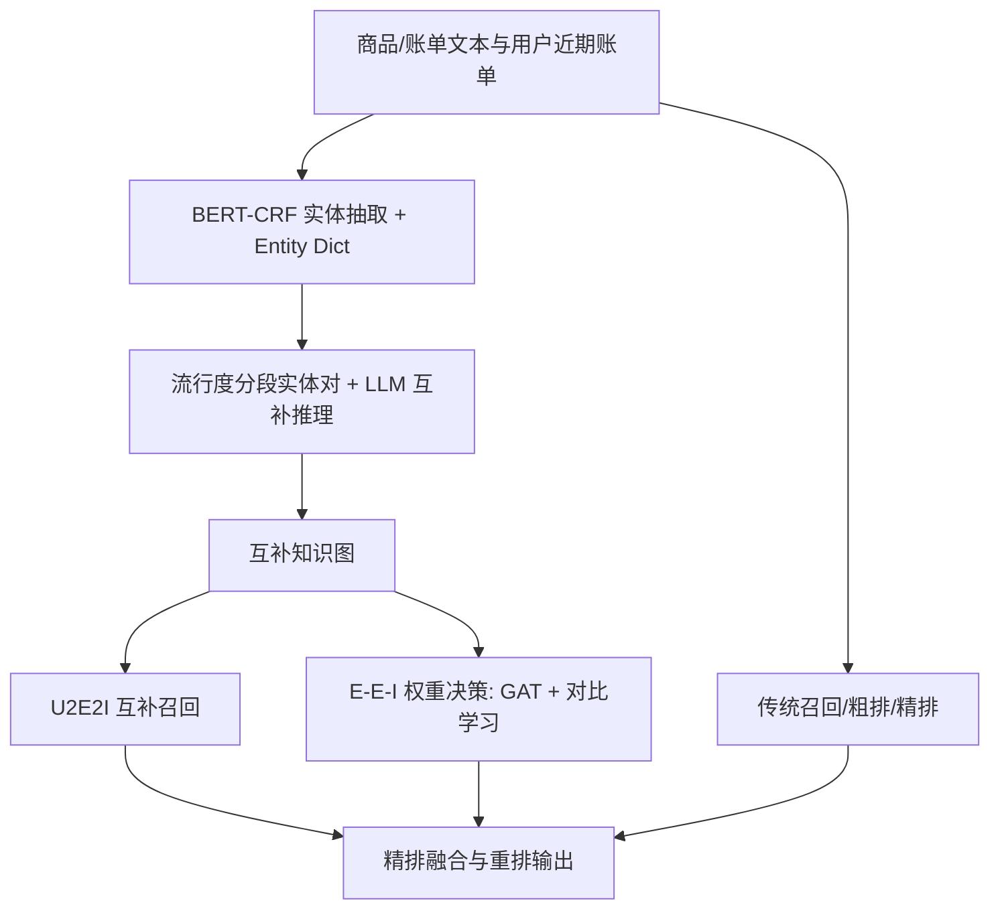
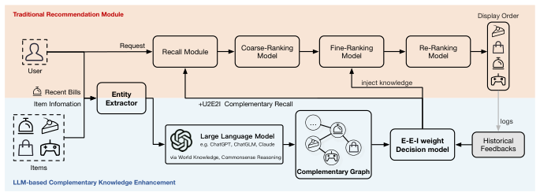

# Breaking the Barrier: Utilizing Large Language Models for Industrial Recommendation Systems through an Inferential Knowledge Graph (用大语言模型与推理知识图突破工业推荐瓶颈)

- **会议/期刊**: CIKM 2024
- **作者与机构**: Qian Zhao, Hao Qian, Ziqi Liu, Gong-Duo Zhang, Lihong Gu（蚂蚁集团）
- **推荐链路定位**: 召回 + 精排（互补召回注入精排）
- **研究方向**: LLM推荐 / 图与知识图谱推荐
- **论文原文**: [arXiv:2402.13750](https://arxiv.org/abs/2402.13750v1)
- **开源代码**: 暂未开源

## TL;DR (1分钟核心速览)

针对工业推荐过度依赖曝光点击、难以捕捉“买了 A 后买 B”的意图迁移，本文提出 LLM-KERec：用 BERT-CRF 从商品与账单抽取统一实体，按流行度剪枝实体对，再由 LLM 推理互补关系构建知识图；线上以 U2E2I 互补召回与 E-E-I 双塔/图对比学习模型校准精排。在支付宝三场景离线 AUC 与线上 A/B 中，转化率相对提升最高约 10.07%。

## Background & Motivation (背景与核心矛盾)

- **主流范式**: 工业推荐以曝光点击日志训练 DNN/CTR 模型，擅长基于历史反馈推荐相似替代品。
- **前人局限**: ① 曝光样本与反馈稀疏导致冷启动、新商品适配差；② 互补品推荐弱于替代品，专家规则/知识图谱维护成本高且难随电商演化更新。
- **核心洞察 (Key Insight)**: LLM 的世界知识与常识推理能判断跨品类互补关系，但其对“用户偏好强度”判断不可靠；需用真实曝光点击反馈校准图边权重。
- **本文切入点**: LLM 只在离线做低成本、周期更新的互补关系推理，线上用轻量 E-E-I 模型把知识注入召回与精排。

## Method (核心方法设计)

### 1. 整体框架 (Overall Architecture)

LLM-KERec 保留传统召回—粗排—精排—重排链路，并增加互补知识增强支路。先由实体抽取器把商品信息、用户账单、访问日志映射到统一 Entity Dict；再按实体流行度分段生成候选实体对，用 Claude 2 等 LLM 判断互补关系并构建互补图。线上请求到来时，U2E2I 召回从用户近期账单实体出发检索互补候选；E-E-I 权重决策模型以双塔点积、GAT 双视角与对比学习得到实体/商品表示，向精排注入分数与 embedding，最终与常规候选合并排序。LLM 不参与在线推理，图按日增量更新以适配新商品。

<figure class="paper-figure" markdown="span">
  <figcaption>图1：我们提出的 LLM-KERec 系统总体框架。</figcaption>
</figure>

### 2. 关键设计拆解 (Key Designs)

1. **统一实体与流行度感知实体对构造**：全量 $n(n-1)/2$实体对交给 LLM 成本过高，且实体呈长尾分布。本文用 Entity Dict 将商品/账单归一到数千概念实体，候选集近似为$\mathcal{C}=\binom{\mathcal{E}_{pop}}{2}\cup(\mathcal{E}_{ext}\times\mathcal{E}_{unpop})$ 去重：热门—热门覆盖主流互补，极热—冷门补长尾。BERT-CRF 做 NER，LLM 用少样本链式提示输出互补理由与 Y/N，人工抽 1000 对校准提示词。

2. **E-E-I 双视角图表示与对比校准**：实体仅有 ID，缺乏描述，直接用 LLM 边权重无法反映用户偏好。模型构造 user-item-entity 图，以 GAT 聚合：$\mathbf{h}'_i=\sum_{j\in\mathcal{N}_i}\sigma(\alpha_{ij}\mathbf{W}_1\mathbf{h}_j)$。一阶替代视角聚合关联商品与点击用户，得$\mathbf{z}^f_i$；二阶互补视角用元路径 item→entity→entity 与 item1→user→item2→entity，得$\mathbf{z}^s_i$。二者经注意力融合$\mathbf{z}_i=\alpha\mathbf{z}^f_i+(1-\alpha)\mathbf{z}^s_i$，再用 InfoNCE 互相监督：$\mathcal{L}_{cl}=\sum_{i\in E}-\log\frac{\exp(s(\mathbf{z}^f_i,\mathbf{z}^s_i)/\tau)}{\sum_{j\in E}\exp(s(\mathbf{z}^f_i,\mathbf{z}^s_j)/\tau)}$。直觉是替代信号与互补信号应互补而非坍缩，对比学习提升实体表示鲁棒性。

3. **训练目标、负采样与推理效率**：主任务为 E-E-I 双塔点积 $\hat{y}_{e_1,e_2,i}=\sigma(\langle\mathbf{z}_{e_1},\mathbf{h}_i\rangle)$的点击/转化交叉熵，联合训练$\mathcal{L}=\mathcal{L}_{main}+\lambda_1\mathcal{L}_{cl}+\lambda_2\|\Theta\|^2$。原文未披露负采样比例与 embedding 维度；LLM 仅离线构图，在线仅跑 GAT/双塔与 top-k 召回，成本远低于在线调用 LLM。

## Experimental Setup & Evaluation Protocol (实验设置与评估协议)

- **数据集与预处理**: 支付宝脱敏工业数据，随机选取一个月样本；未使用 5-core 过滤。

| 数据集 | #Users | #Items | #Interactions(Click) | 稀疏度 | 场景 |
| :--- | ---: | ---: | ---: | ---: | :--- |
| A Super 567 | 155,209 | 84,846 | 285,001 | ~2.16e-5 | 券发放 |
| B Consumer Channel | 1,301,782 | 376,111 | 1,448,213 | ~2.96e-6 | 商品销售 |
| C Payment Result Page | 28,361,313 | 172,786 | 15,336,011 | ~3.13e-6 | 支付结果页券 |

- **数据划分与防穿越 (Splitting Strategy)**: 随机划分为不相交 train/val/test，原文未给比例；非全局时间戳切分，存在一定泄漏风险。
- **排名评测协议 (Ranking Protocol)**: 非 Full-Ranking/Sampled Ranking；离线把曝光样本当二分类，报告 Click AUC 与 Conversion AUC。线上 A/B 分配 10% 流量，统计 #Click、#Conv、GMV。
- **对比基线与超参设置**: DNN、Wide&Deep、DCN、ESMM、PLE、MaskNet，并统一加 “+ii graph” 以公平对比图增强；离线显著性用配对 t 检验 $p<0.01$。超参/维度未披露。

## Key Experimental Results (实验关键数据)

### 1. 主实验对比 (Main Results)

下表每格为 “骨干+ii graph → LLM-KERec”；加粗为该列最优值。

| Backbone | A Click | A Conv | B Click | B Conv | C Click | C Conv |
| :--- | ---: | ---: | ---: | ---: | ---: | ---: |
| DNN | 0.61580→**0.62882** | 0.80684→**0.82460** | 0.77751→**0.78523** | 0.73187→**0.76271** | 0.86061→0.85972 | 0.93997→**0.94608** |
| Wide&Deep | 0.62822→**0.63207** | 0.81782→**0.81896** | 0.77507→**0.77897** | 0.75197→**0.77140** | **0.86064**→0.86059 | 0.93384→**0.94064** |
| DCN | 0.63121→**0.67284** | 0.80487→**0.82507** | 0.77802→**0.78285** | 0.75280→**0.76789** | 0.85706→**0.85732** | 0.93370→**0.94174** |
| ESMM | 0.61927→**0.62488** | 0.82100→**0.82239** | 0.77920→**0.78168** | 0.76136→**0.76263** | 0.85378→**0.85398** | 0.92483→**0.92832** |
| PLE | 0.59870→**0.62576** | 0.80117→**0.82238** | 0.77185→**0.78636** | 0.73817→**0.74725** | 0.85672→**0.85681** | 0.93683→**0.93897** |
| MaskNet | 0.63998→**0.65137** | 0.81660→0.81631 | 0.72044→**0.72863** | 0.58009→**0.59534** | 0.82889→**0.84161** | 0.89715→**0.90086** |

线上 A/B：A #Click +2.67%、#Conv +6.24%；B #Click +6.18%、GMV +6.45%；C #Click +4.39%、#Conv +10.07%。离线最佳相对提升：A Click +6.6%、A Conv +2.5%、B Conv +2.6%、C Conv +0.65%。

### 2. 消融实验 (Ablation Study)

数据集 C 在线消融，保留模块相对移除模块的提升：

| 配置 | Δ#Click | Δ#Conv |
| :--- | ---: | ---: |
| w/o U2E2I recall → w/ | +3.33% | +2.95% |
| w/o E-E-I ranking → w/ | +1.05% | +0.59% |

### 3. 关键实验发现 (Key Findings)

- **互补知识对转化更敏感**：六个骨干的 Conv AUC 均被 LLM-KERec 提升，线上 A/C 转化提升 6.24%/10.07%，显著高于点击提升，说明方法解决的是“买后买”的意图迁移而非仅标题吸引。
- **召回增益大于精排校准**：U2E2I 召回带来 +3.33% 点击、+2.95% 转化，约为 E-E-I ranking 的 3–5 倍；原因是传统链路曝光偏置使互补品根本进不了候选池，先扩召回再校准更关键。
- **LLM 选择直接影响图质量**：1000 对人工五级评分中 Claude 2 均值 4.056，高于 ChatGPT 3.5 的 3.685 与 ChatGLM 2 的 3.584；ChatGPT/ChatGLM 存在“老花镜—卸妆油”“蛋糕—睡衣”等过度联想，说明提示词与模型选择需人工校准。

## Highlights & Limitations (亮点、对比与审稿批判)

- **与代表作对比 (vs. Prior Work)**: 相比 KB 规则模型，本文用 LLM 自动扩展互补边并日更；相比仅把 LLM 当文本 embedding 的工作，本文把 LLM 推理结果落成图结构，再用真实反馈校准边权；相比纯 CTR 模型，新增 U2E2I 召回解决互补候选缺失。
- **可迁移亮点**: ① “LLM 离线建图 + 线上轻量图模型”可迁移到跨域/冷启动；② 按流行度分段构造实体对，低成本覆盖头部与长尾；③ 一阶替代/二阶互补双视角 + InfoNCE 可作为实体表示增强模板。
- **审稿级局限批判**: ① 离线仅报告二分类 AUC，非全库排序，且随机划分未做时间切分，评估说服力弱于 Full-Ranking 时序协议；② 三数据集均为支付宝私有场景，无公开代码与超参，LLM 构图成本、图更新延迟、实体字典人工维护与流行度偏置未量化。

## Rating (四维评分)

- **方法创新性 (Novelty)**: ⭐⭐⭐⭐ （LLM 离线推理互补图 + 真实反馈校准 E-E-I，工业链路完整，但图对比学习组件较常规）
- **评估协议与实验扎实度 (Protocol & Experiments)**: ⭐⭐⭐ （三场景离线 AUC 与线上 A/B 充分，但非全库排序、随机划分且缺超参/负采样细节）
- **写作与数学规范度 (Clarity & Rigor)**: ⭐⭐⭐⭐ （GAT、双视角与 InfoNCE 公式清晰，工业模块描述完整；部分符号与更新策略略简）
- **工业落地与复现价值 (Industrial & Practical Value)**: ⭐⭐⭐⭐ （已上线支付宝并报告 GMV/转化收益，LLM 离线化设计务实；但闭源数据与提示词细节限制复现）

