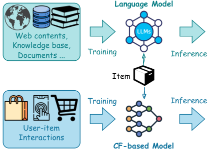
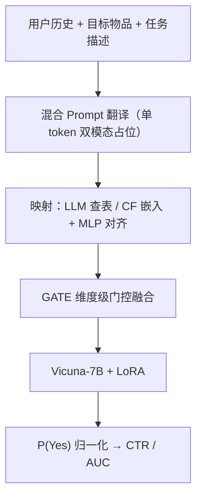
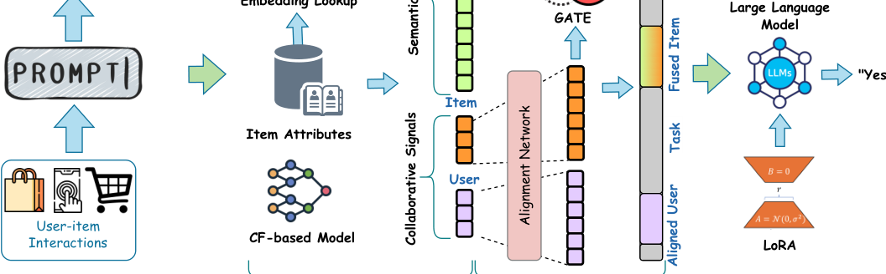

# Collaborative Cross-modal Fusion with Large Language Model for Recommendation (面向推荐的大语言模型协同跨模态融合)

- **会议/期刊**: CIKM 2024（33rd ACM International Conference on Information and Knowledge Management）
- **作者与机构**: Zhongzhou Liu, Yuan Fang（Singapore Management University）；Hao Zhang, Kuicai Dong（Nanyang Technological University）
- **推荐链路定位**: 精排（CTR 预估，LLM 侧生成 "Yes/No" 概率打分）
- **研究方向**: 大语言模型推荐 / CTR 预估与特征交叉
- **论文原文**: [https://arxiv.org/abs/2408.08564v1](https://arxiv.org/abs/2408.08564v1)
- **开源代码**: 暂未开源（文中所引 `https://github.com/lm-sys/FastChat` 为 Vicuna 训练脚本，非本文实现）

## TL;DR (1分钟核心速览)

现有 LLM4Rec 要么把协同信号塞进自然语言描述（信息量不足），要么把 CF 嵌入直接拼进 LLM 输入序列（跨模态空间错位，LLM 读不懂）。CCF-LLM 提出「混合 Prompt 翻译 + 注意力式跨模态融合」：每个物品只用一个占位 token 同时承载语义与协同两模态，再用 GATE 网络做维度级自适应加权融合，后接 LoRA 两阶段训练。在 MovieLens-1M / Amazon-Book 的 CTR 任务（AUC 指标、按月份时间切分）上，CCF-LLM (SASRec) 达 0.7526 AUC，相对 SASRec 提升 21.56%，全面超越 CoLLM、TallRec、Softprompt。

## Background & Motivation (背景与核心矛盾)

- **主流范式**: CF 模型（MF / LightGCN / SASRec）在结构化隐向量中显式建模共现信号；LLM4Rec 则试图用 LLM 的开world 语义知识补足 CF 的语义盲区。
- **前人局限其一**: 指令微调路线（TallRec、P5）把 `(u,i,y)` 转成 "Will user u like item i?" 的自然语言句子，但**非结构化文本无法承载高维稀疏共现中的非线性高阶关联**，实验显示仅带来 ~0.002 的 AUC 增益。
- **前人局限其二**: 嵌入注入路线（LLaRA、CoLLM）把对齐后的 CF 向量按 `[text_i][emb_i]` 双 token 塞入 Prompt，但**两模态分属不同表征空间，单纯维度对齐（MLP）后仍彼此割裂**，LLM 无法"理解"该向量。
- **核心洞察 (Key Insight)**: 图 1 揭示语义知识与协同信号本质异构——"啤酒与尿布"语义无关却强共现。t-SNE（图 4）进一步证实：即便经过 ALG 对齐，绿色 CF 嵌入与黄色 LLM 嵌入依旧边界分明、不可混居。
- **本文切入点**: 不解耦、不硬拼，而是让同一 token 同时持有两模态，并在**维度粒度上学习门控权重**把 CF 嵌入"翻译"进 LLM 语义空间后再相加融合。

<figure class="paper-figure" markdown="span">
  <figcaption>图1：LLMs 的语义知识与传统推荐系统中的协同信号之间的异构特性示意图。</figcaption>
</figure>

## Method (核心方法设计)

### 1. 整体框架 (Overall Architecture)

输入是用户历史高分物品列表 `{[Item_u]}`、目标物品 `[Item_i]` 与用户占位 `[User_u]` 组成的混合 Prompt。映射阶段按 token 类型分流：自然语言 token 走 LLM 词嵌入查表；`[User_u]` / `[Item_i]` 走预训练 CF 模型的隐向量并经 MLP 对齐到 LLM 维度 $d$；`[Item_i]` 还需抽取物品属性文本得到语义嵌入序列$\mathbf{x}^{SM}_i$。融合阶段用 GATE 网络逐维度生成权重$\alpha$，将 CF 嵌入注入语义嵌入，得到统一序列表征后送入 Vicuna-7B，读取 `Yes`/`No` 词表概率做 CTR 打分。

<figure class="paper-figure" markdown="span">
  <figcaption>图2：所提出的基于大语言模型的协同跨模态融合（CCF-LLM）整体框架。</figcaption>
</figure>

### 2. 关键设计拆解 (Key Designs)

1. **混合 Prompt 翻译（Hybrid Prompt Translation）**：针对"双 token 解耦导致无法融合"的痛点，本文对每个物品只用**一个**占位 token 同时绑定 $\mathbf{x}^{CF}_i$与$\mathbf{x}^{SM}_i$，把"先解耦再让 LLM 自己注意力对齐"改为"在输入端就强制同址、为后续显式融合铺路"。用户侧只保留 CF 嵌入$\mathbf{x}^{CF}_u$，因用户文本属性跨数据集极不一致、难以公平评估。
2. **GATE 维度级跨模态门控融合（Attentive Cross-modal Fusion）**：对齐网络 $\mathrm{ALG}$ 仅做维度映射，不足以弥合语义鸿沟；本文借鉴 cross-gate 机制，让融合权重同时感知两模态：

$$\alpha = \mathrm{GATE}(\tilde{\mathbf{x}}^{CF}_i, \mathbf{x}^{SM}_i[t]) = \mathrm{MLP}(\tilde{\mathbf{x}}^{CF}_i;\Theta_{G1}) + \mathrm{MLP}(\mathbf{x}^{SM}_i[t];\Theta_{G2}),\quad \tilde{\mathbf{x}}_i[t] = \mathbf{x}^{SM}_i[t] + \alpha \odot \tilde{\mathbf{x}}^{CF}_i$$

   其中 $\tilde{\mathbf{x}}^{CF}_i = \mathrm{ALG}(\mathbf{x}^{CF}_i;\Theta_A)$为对齐后 CF 嵌入，$\alpha\in\mathbb{R}^{d}$。物理直觉：$\alpha$ 是逐维"可信度闸门"，协同信号在某些语义维度上冗余时被压低、在语义缺失处被放大，从而既注入共现知识又不污染语义空间（图 4 中紫色融合嵌入与黄色 LLM 嵌入几乎重叠）。
3. **训练目标、负采样与推理效率**：以 `Yes`/`No` 两词概率构造双目标损失，$k=2.0$：

$$\min_{\Theta}\ \mathcal{L} = \mathcal{L}_1(p_{yes}, y) + \mathcal{L}_1(p_{no}, 1-y) + k\cdot\mathcal{L}_2(p_{yes}, p_{no}, y)$$

   $\mathcal{L}_1$为 BCE（对齐标签），$\mathcal{L}_2$为 BPR（约束$y=1$时$p_{yes}>p_{no}$）。训练采样沿用 CF 预训练的正负样本构造（无额外难负采样设计），可训练参数集$\Theta=\{\Theta_E,\Theta_A,\Theta_G,\Theta_L\}$（$\Theta_L$为 LoRA 权重），采用**两阶段**训练：先只更新$\Theta_L$使 LLM 适配推荐任务，再冻结 LLM、只更新$\{\Theta_E,\Theta_A,\Theta_G\}$ 精修融合网络。推理时一次前向即可，开销主要在 LLM 前向（Vicuna-7B，输入截断至 700 token），额外成本仅为两个轻量 MLP。

## Experimental Setup & Evaluation Protocol (实验设置与评估协议)

- **数据集与预处理**: 评分二值化（ML-1M 阈值 3，Amazon-Book 阈值 4），未使用 k-core 过滤。

| 数据集 | #Users | #Items | #Interactions | 稀疏度/密度 | 特征/场景说明 |
| :--- | :---: | :---: | :---: | :---: | :--- |
| MovieLens-1M | 839 | 3,256 | 51,623 (33,891/10,401/7,331) | 1.89% | 电影评分，近 20 个月交互 |
| Amazon-Book | 22,967 | 34,154 | 778,962 (727,468/25,747/25,747) | 0.10% | 图书评论，2017 年起 16 个月 |

- **数据划分与防穿越 (Splitting Strategy)**: **全局时间戳切分**——ML-1M 按 10/5/5 个月切 train/val/test，Amazon-Book 按 11/2.5/2.5 个月切分，严格防未来交互泄漏。
- **排名评测协议 (Ranking Protocol)**: 任务为 CTR 二分类，指标为 **AUC**，打分采用归一化 $p_{yes}$；由于是逐样本二分类而非候选排序，等价于**对测试集全部样本（正负俱全）做全量打分**，未做负采样排序。相对提升用$\text{RelaImpr}=(\frac{\text{AUC}_{m}-0.5}{\text{AUC}_{b}-0.5}-1)\times100\%$。
- **对比基线与超参设置**: 基线含 CF 类（MF、LightGCN、SASRec）、LLM4Rec 类（Softprompt、TallRec、CoLLM）；所有 LLM4Rec 方法后端统一为 Vicuna-7B，$d=128$，LLM 隐维$l=4096$，AdamW lr=$1\times10^{-4}$，batch=3，4×V100；结果为 5 次运行均值。

## Key Experimental Results (实验关键数据)

### 1. 主实验对比 (Main Results)

| Method | ML-1M AUC | RelaImpr | Amazon-Book AUC | RelaImpr |
| :--- | :---: | :---: | :---: | :---: |
| MF | 0.6482 | - | 0.7134 | - |
| LightGCN | 0.5959 | - | 0.7103 | - |
| SASRec | 0.7078 | - | 0.6887 | - |
| Softprompt | 0.7071 | - | 0.7224 | - |
| TallRec | 0.7097 | 1.25% | 0.7375 | 6.79% |
| CoLLM (LightGCN) | 0.7100 | 118.98% | 0.7978 | 41.61% |
| CoLLM (SASRec) | 0.7235 | 7.56% | 0.7746 | 45.52% |
| CoLLM (Best) | 0.7295 | 10.82% | 0.8109 | 39.79% |
| CCF-LLM (MF) | 0.7315 | 56.21% | **0.8150** | **47.61%** |
| CCF-LLM (LightGCN) | 0.7427 | **153.08%** | 0.8049 | 44.98% |
| CCF-LLM (SASRec) | **0.7526** | 21.56% | 0.7792 | 47.96% |
| CCF-LLM (Best) | **0.7526** | **21.97%** | **0.8150** | **41.64%** |

### 2. 消融实验 (Ablation Study)

| 变体（MovieLens-1M, LightGCN 后端） | AUC | 相对变化 |
| :--- | :---: | :---: |
| 完整 CCF-LLM（$\alpha$ 维度级 GATE + 两阶段） | **0.7427** | - |
| $\alpha=1$（直接相加，无门控） | 最低（图 3a） | 显著下降 |
| $\alpha\in\mathbb{R}$（token 级门控，退化为标量） | 优于$\alpha=1$、劣于本文 | 中间水平 |
| 仅 Stage 1（不训融合网络） | 0.7025 | -16.56% |
| 端到端单阶段联合训练 | 0.6390 | -42.73% |
| 多 CF 后端融合 L+M / L+S / M+S | 均未超过单后端 | 冗余/冲突 |

### 3. 关键实验发现 (Key Findings)

- **自然语言承载协同信号几乎无效**：Pilot Study 中把 MF 召回的 top-10 相似物品写进 Prompt，闭源 LLM 零样本 AUC 仅从 0.5783→0.5902，Vicuna-7B 指令微调后仅 0.7084→0.7108（+0.0021），而 CoLLM 直接注入嵌入即高出 0.0187——证明协同信号的正确载体是 **latent embedding 而非文本**。
- **融合策略的粒度决定成败**：$\alpha=1$的无门控直接相加为最差变体，token 级$\alpha\in\mathbb{R}$次之，维度级$\alpha\in\mathbb{R}^d$ 最优；说明跨模态冲突是**维度级**现象，粗粒度门控不足以压制噪声维度。
- **两阶段训练不可省**：端到端联合训练 AUC 掉至 0.6390（-42.73%），远差于仅 Stage 1 的 0.7025；因未收敛的 LLM 会反向误导 ALG/GATE 的学习。此外堆叠多 CF 后端（L+M/L+S/M+S）无增益，协同信号高度冗余。

## Highlights & Limitations (亮点、对比与审稿批判)

- **与代表作对比 (vs. Prior Work)**: 相比 TallRec（仅语言描述，ML-1M 0.7097）本文高出 4.3 个点；相比 CoLLM（同样注入 CF 嵌入，但仅做 MLP 对齐后硬拼入序列，0.7295）本文以"单 token 双模态 + GATE 维度门控"多获 2.3 个点；相比 Softprompt（可训练软 token 但无 CF 约束，0.7071）说明**无约束的嵌入微调甚至会损害 LLM 语义先验**。
- **可迁移亮点**: ①「单占位 token 承载多模态」的 Prompt 设计可直接迁移到多模态/多源特征注入的 LLM4Rec 或 LLM 排序；②两阶段（先 LoRA 适配任务、再冻 LLM 训融合层）的分离式训练是低成本稳定 LLM-外挂模块的通用范式。
- **审稿级局限批判**: ①评测仅 AUC 二分类，缺少 Top-K 排序指标（NDCG/HR）与真实候选全库 Full-Ranking 检验，工业召排场景的说服力受限；②用户侧语义被完全舍弃，且 lr、batch=3、700-token 截断等强算力依赖使复现成本高，推理侧缺乏延迟/吞吐与在线 A/B 证据；③多 CF 融合失败仅归因于"冗余冲突"，未做进一步机理分析。

## Rating (四维评分)

- **方法创新性 (Novelty)**: ⭐⭐⭐⭐ （单 token 统一双模态 + cross-gate 维度级融合，首次在 LLM4Rec 中显式做跨模态对齐融合，思路清晰但组件均为已有模块的组合）
- **评估协议与实验扎实度 (Protocol & Experiments)**: ⭐⭐⭐ （时间切分防穿越、5 次运行取均值、三个 CF 后端交叉验证较扎实，但仅用 AUC、无 Top-K 与显著性检验）
- **写作与数学规范度 (Clarity & Rigor)**: ⭐⭐⭐⭐ （公式与符号定义干净、GATE 融合式易复现，t-SNE 与案例研究形成较好的动机-验证闭环）
- **工业落地与复现价值 (Industrial & Practical Value)**: ⭐⭐⭐ （无需修改 LLM 主干、可插拔任意 CF 后端，但 Vicuna-7B 级前向开销与未开源限制了线上精排部署价值）

